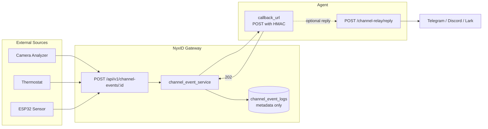
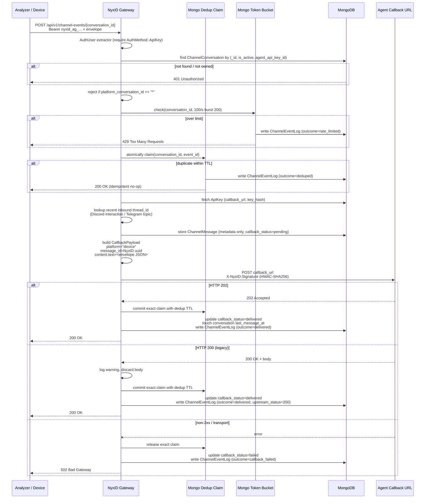
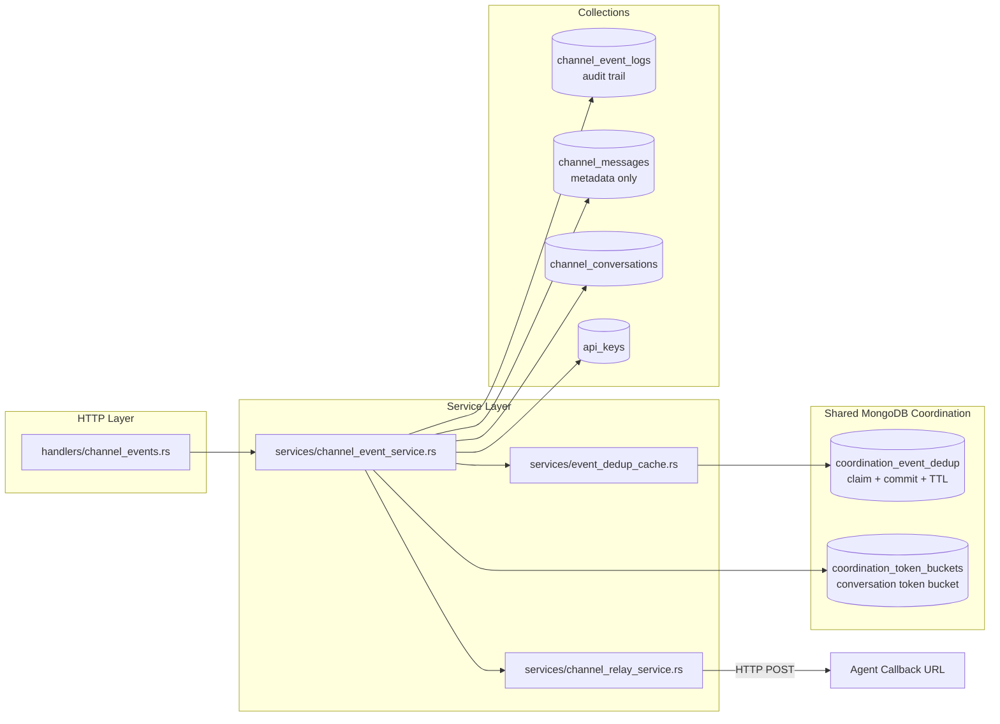

# HTTP Event Gateway

## Overview

The HTTP Event Gateway lets external devices, analyzers, and services push events into an AI agent conversation over a simple HTTP POST. It bridges the "pull mode" NyxID has always had (agents calling external APIs via `/proxy`) with a "push mode" where real-world sensors can notify an agent when something happens.

A camera analyzer detects a person entering the living room, a thermostat reports a spike, an ESP32 sensor fires an alert — all land as a `CallbackPayload` on the agent's webhook and are delivered end-to-end through the same channel relay pipeline already used for Telegram, Discord, Lark, and Feishu bots.

NyxID is a **pure passthrough gateway** for events (see [ADR-013](#adr-013-pure-passthrough)): it authenticates, applies cluster-wide rate limits and deduplication, and forwards once. It never retries, never queues, and never stores event payload content. The agent receives the event, acts on it, and optionally replies through the existing async reply endpoint.



## ADR-013 Pure Passthrough

Every design choice on this path follows a single rule: **NyxID is a gateway, not a message bus**.

| Principle | Implication |
|---|---|
| No retry | Forward once; on failure, return the error to the client and let them decide |
| No cache / queue | No in-memory buffer, no fan-out, no ordering guarantees |
| Metadata only | `channel_event_logs` stores `event_id`, `source`, `type`, `timestamp`, `status_code`, `latency_ms`, `outcome` — never payload content |
| Client-side retry | Producers reuse the same `event_id` on retry; a failed forward releases its fenced Mongo claim so a retry can proceed |
| Shared coordination | MongoDB stores only expiring limiter and dedup metadata; any replica can handle the retry |

The same principle applies retroactively to `channel_messages`: the bot relay collection was refactored in this shipment to store metadata only, matching the event path.

## Architecture

### End-to-end flow



### Component layout



## MongoDB Models

### ChannelEventLog (collection: `channel_event_logs`)

Append-only audit trail for every event the gateway touches. **Metadata only** per ADR-013 — no payload, no headers, no body.

| Field | Type | Notes |
|---|---|---|
| `_id` | `String` (UUID v4) | NyxID-assigned log row id |
| `conversation_id` | `String` | Target `ChannelConversation._id` |
| `api_key_id` | `String` | Agent identity that forwarded the event |
| `event_id` | `String` | Client-supplied envelope `event_id` (UUID) |
| `source` | `String` | Logical event source (e.g. `"camera-analyzer"`) |
| `event_type` | `String` | Event type (e.g. `"person_detected"`) |
| `event_timestamp` | `DateTime<Utc>` | Envelope `timestamp` |
| `forwarded_at` | `DateTime<Utc>` | When the gateway actually forwarded |
| `upstream_status_code` | `i32` | Agent HTTP status (202 / 200 / 5xx); `0` sentinel for transport errors or events that never reached the upstream (rate-limited, deduped) |
| `latency_ms` | `i64` | Round-trip duration around `forward_to_agent()`, per ADR-013 §4 |
| `outcome` | `String` | `"delivered"` / `"deduped"` / `"rate_limited"` / `"callback_failed"` |

**Indexes** (see `db::ensure_indexes`):

- `(conversation_id: 1, event_id: 1)` — **non-unique**, explicit name `channel_event_logs_convid_eventid_lookup`. Append-only semantics: multiple rows per `event_id` reflect retry history.
- `(conversation_id: 1, forwarded_at: -1)` — operational queries
- TTL on `forwarded_at` — 30 days

Old unique-variant index is dropped defensively at startup under its legacy default name.

### ChannelMessage (collection: `channel_messages`)

Unchanged in shape from before the event gateway landed *except* that ADR-013 forced a metadata-only refactor at the same time: the `text`, `attachments`, and `raw_platform_data` fields were removed. A startup migration gated by a `schema_migrations` marker unsets those fields from any pre-existing documents exactly once per deployment.

The `thread_id` field survives because it is routing metadata, not content — it carries Discord interaction follow-up tokens (`interaction:{app}:{token}`), Telegram forum-topic ids, and similar platform routing pointers.

Device events synthesized by the gateway persist a row here too with `platform: "device"`, `direction: "inbound"`, and `platform_message_id` set to the client-supplied envelope `event_id` so operators can correlate logs by upstream id.

### ChannelConversation (collection: `channel_conversations`)

Conversations now also carry the default-off human `allow_agent_initiated` setting for the bot send interface. Device conversations remain one-way: discovery reports all outbound capabilities as false, and `/channel-relay/send` rejects them. The gateway fetches by `{_id, is_active, agent_api_key_id}` so unknown, inactive, and foreign conversations all collapse into a single 401 response without leaking existence.

## Backend Services

### channel_event_service (`backend/src/services/channel_event_service.rs`)

Orchestration layer. Exposes a single public function `forward_event()` that ties everything together.

Execution order matters — each step is ordered to minimize wasted work on the failure paths and to prevent side-channel leaks:

1. **Auth extraction** — require `AuthMethod::ApiKey`. Relay JWTs carry an `api_key_id` too but they represent delegated access, not a real agent key; accepting them here would let a callback recipient synthesize device events. Short-circuits before any DB work.
2. **Scoped conversation lookup** — `find_one({_id, is_active, agent_api_key_id})`. Unknown / inactive / foreign → single 401. The rate-limit bucket is only consumable by legitimate owners.
3. **Wildcard reject** — `platform_conversation_id == "*"` rows are default-agent catch-all routes; async replies cannot round-trip through them. Rejected with 400 `wildcard_conversation_not_supported`. Only surfaces to owners (not a leak).
4. **Per-channel rate limit** — token bucket keyed by `conversation_id`, default 100/s burst 200.
5. **Dedup claim** - `claim(namespace, conversation, event)` uses an atomic MongoDB upsert. Exactly one replica receives the fenced claim; concurrent callers return `outcome=deduped`. Failed preparation or forwarding releases the exact claim so a retry can proceed.
6. **API key load** — fetch the agent key for `callback_url` + `key_hash`. Reject if `callback_url` is unset.
7. **Inherit thread_id** — `lookup_recent_inbound_thread_id()` finds the most recent webhook-driven inbound in the conversation with a non-null `thread_id`. Interaction tokens have a 2-minute age cap; Telegram topic ids have no TTL.
8. **Persist metadata** — `store_device_event_message()` writes a `ChannelMessage` row with the inherited thread_id. The stored message's UUID becomes the callback's `message_id` so async replies can look it up.
9. **Build payload** — `CallbackPayload` with `platform = "device"`, `content.text` = full envelope JSON, `conversation.type = "device"`, `sender.platform_id = envelope.source`, timestamp in RFC 3339.
10. **Forward and measure** — `channel_relay_service::forward_to_agent()` returns a `CallbackDelivery { http_status: Option<u16>, result }`. Latency captured around the call.
11. **Record outcome** - on success: commit the fenced dedup claim with the configured TTL, touch conversation `last_message_at`, update `callback_status = "delivered"`, and write `ChannelEventLog` with the real upstream status. On failure: release the claim, update `callback_status = "failed"`, and write the failure log.

### event_dedup_cache (`backend/src/services/event_dedup_cache.rs`)

Thin namespace wrapper around `coordination_service::EventDedupStore`. Records are keyed by a hash of `(namespace, scope, event_id)` in `coordination_event_dedup`. `claim()` is an atomic first-writer-wins upsert, `commit()` requires the exact unexpired claim fence, and `release()` deletes only the caller's claim. A TTL index removes expired claims and committed dedup records. Channel events and trigger events use separate namespaces.

### channel_relay_service (`backend/src/services/channel_relay_service.rs`)

Existing file, three changes:

**`forward_to_agent()` — 202 only.** The function now returns `CallbackDelivery` instead of `AppResult<()>`. Only HTTP 202 is a success; HTTP 200 with a body is tolerated for legacy clients (the body is discarded with a warning log) because ADR-013 and the CEO decision on #221 removed synchronous reply support. The `AgentReplyPayload` struct and its webhook-side parsing branch were deleted — there is no more dead sync-reply code.

The `http_status` field on `CallbackDelivery` records the actual agent status (`Some(202)` / `Some(200)` / `Some(5xx)`) or `None` for transport failures (connection refused, timeout, serialization error). This status flows all the way into `ChannelEventLog.upstream_status_code`.

**`store_device_event_message()` — new helper.** Persists a metadata-only `ChannelMessage` row from the gateway path. Accepts an `inherited_thread_id: Option<String>` parameter that carries forward Discord interaction tokens or Telegram topic ids from the conversation's most recent webhook-driven inbound.

**`store_inbound_message()` and `store_outbound_message()` — content stripped.** No longer write `text`, `attachments`, or `raw_platform_data`. `store_outbound_message()` lost its `text` parameter entirely — reply text goes to the platform adapter directly and is not persisted.

## Backend Handlers

### channel_events (`backend/src/handlers/channel_events.rs`)

New file. Single endpoint: `POST /api/v1/channel-events/{conversation_id}`.

Responsibilities:

- Auth gate: reject `auth_user.auth_method != AuthMethod::ApiKey` with 401. Relay tokens, session cookies, and service-account tokens are all turned away at the handler boundary.
- Envelope validation: `event_id` must be a UUID, `source` is `1..=128` ASCII in `[a-zA-Z0-9_\-./]`, `event_type` is `1..=128` ASCII in `[a-zA-Z0-9_\-.:]`, `timestamp` is RFC 3339. **No payload size limit** per ADR-013 — the router disables `DefaultBodyLimit` for this path.
- Delegation: hands the validated envelope to `channel_event_service::forward_event()`.
- Response shape: `{ "status": "accepted" | "duplicate", "event_id": "..." }`.

### channel_relay (`backend/src/handlers/channel_relay.rs`)

Modified: `async_reply` gained a platform-aware dispatch block that translates the original inbound message's `thread_id` into the outbound adapter's metadata key:

- **Discord interaction** (`thread_id` starts with `"interaction:"`): injected as `metadata.interaction_thread_id` so `discord::send_reply()` targets the follow-up webhook endpoint. Gated by a platform-specific TTL window — 14 minutes for webhook-driven originals, 12 minutes for device-event originals (source age is already capped at 2 minutes at inheritance time, so combined worst case is 14 min < Discord's 15-min TTL).
- **Telegram topic** (`conversation.platform == "telegram"`): injected as `metadata.message_thread_id` with no TTL guard (topic ids don't expire). Dispatch uses `conversation.platform`, not `original.platform`, because device events stored into Telegram conversations still carry `original.platform == "device"`.
- Other platforms: unchanged.

### channel_webhooks (`backend/src/handlers/channel_webhooks.rs`)

Modified: the sync-reply branch (previously `~70` lines handling agent 200 + body responses) was deleted. `forward_to_agent()` returning `Ok(())` now only flips the stored message to `callback_status = "delivered"`; there is no more "agent returned text inline, send it" path. Replies must flow back through `/channel-relay/reply`.

The `decrypt_bot_token()` call that fed the deleted sync path was also removed.

## Backend Middleware

### PerChannelEventLimiter (`backend/src/mw/rate_limit.rs`)

Mongo-backed token bucket keyed by `conversation_id`, distinct from the `PerAgentRateLimiter` keyed by API key. Rate and burst are loaded from config, but admission state is shared by every replica through atomic updates in `coordination_token_buckets`. Default: 100 events/s, burst 200. A TTL index removes buckets after enough idle time to refill to capacity.

## Frontend Changes

### Types (`frontend/src/types/channels.ts`)

`ChannelMessageItem` lost `text` and `attachments` fields. `MessageAttachment` interface was deleted entirely (no other consumers). Docstring explains the ADR-013 metadata-only rule.

### Pages

**`channel-conversation-detail.tsx`** — the `MessageCard` component no longer renders message bodies. Each card shows direction, sender, content type badge, delivery status, and timestamp, plus a short italicized note: *"Content is not stored in NyxID. Ask the agent for the message body."*. The `formatBytes()` helper and attachment list rendering were deleted.

**`channel-bots.tsx`** and **`channel-bot-detail.tsx`** — the yellow `(Deprecated)` warning cards referencing NyxID#191 were removed (the deprecation was recalled when #221 took precedence). Page titles and breadcrumbs no longer say `(Deprecated)`.

**Sidebar** — the `Channel Bots (deprecated)` nav label is now just `Channel Bots`.

## CLI

### `nyxid channel-event push`

New subcommand group and command in `cli/src/commands/channel_event.rs`. Pushes a device event to the gateway from a shell script or CI.

```bash
nyxid channel-event push \
  --conversation-id <CONVERSATION_ID> \
  --source camera-analyzer \
  --type person_detected \
  --event-id <UUID>                    # optional; auto-generated
  --timestamp "2026-04-08T12:00:00Z"   # optional; defaults to now
  --payload-json '{"room":"living_room","confidence":0.95}'
  --payload-file path/to/event.json    # or `-` for stdin
  --metadata-json '{"analyzer_version":"1.0"}'
  --api-key nyxid_ag_...                # or --api-key-env NYXID_AGENT_KEY
```

The command explicitly rejects `--payload-file -` (stdin) without `--api-key` or `--api-key-env` set, because the interactive prompt would consume the first line of the piped JSON.

### ApiClient changes (`cli/src/api.rs`)

New fluent builder `ApiClient::without_token_refresh()` sets a flag that short-circuits the internal 401 → session-token refresh path. `channel-event push` uses this so a bad or revoked agent key surfaces the real error instead of silently retrying with the saved session access token for the profile.

### `nyxid channel-bot` deprecation removed

The `channel-bot` subcommand no longer prints a deprecation warning on every invocation. The `[DEPRECATED]` tag in its clap description was removed. The command is a first-class surface again.

## Route Registration

In `backend/src/routes.rs`:

```rust
let channel_event_routes = Router::new()
    .route(
        "/{conversation_id}",
        post(handlers::channel_events::post_event),
    )
    .layer(DefaultBodyLimit::disable());
```

Nested under `api_v1_delegated` so the existing API-key auth middleware is applied. `DefaultBodyLimit::disable()` opts this router out of the app-wide 1 MiB body cap — per ADR-013 the gateway does not enforce an application-level payload size limit on device events.

## AppState Integration

The event gateway uses the shared database and one configured limiter in `AppState`:

```rust
pub struct AppState {
    // ... existing fields ...
    pub per_channel_event_limiter: mw::rate_limit::SharedPerChannelEventLimiter,
}
```

`PerChannelEventLimiter` is constructed in `main.rs` with the MongoDB database and rate settings. The dedup service receives the same database per request. MongoDB TTL indexes handle cleanup; there are no process-local event limiter or dedup maps in production.

## Environment Variables

```bash
# HTTP Event Gateway (NyxID#221, ADR-013)
CHANNEL_EVENT_RATE_LIMIT_PER_SECOND=100  # per-conversation events/sec
CHANNEL_EVENT_RATE_LIMIT_BURST=200       # per-conversation burst capacity
CHANNEL_EVENT_DEDUP_TTL_SECS=300         # dedup entry TTL (5 minutes)
```

## API Contract

### Request

```
POST /api/v1/channel-events/{conversation_id}
Authorization: Bearer nyxid_ag_...
Content-Type: application/json

{
  "event_id": "550e8400-e29b-41d4-a716-446655440000",
  "source": "camera-analyzer",
  "type": "person_detected",
  "timestamp": "2026-04-08T12:00:00Z",
  "payload": { "room": "living_room", "confidence": 0.95 },
  "metadata": { "analyzer_version": "1.0" }
}
```

### Envelope → CallbackPayload mapping

| Envelope field | CallbackPayload target |
|---|---|
| `event_id` | `content.text` (embedded in full envelope JSON) |
| `source` | `sender.platform_id` |
| `type` | `content.type` |
| `timestamp` | `timestamp` (RFC 3339) |
| `payload` / `metadata` | embedded in `content.text`, never stored separately |
| — | `message_id` = NyxID-assigned `ChannelMessage._id` (enables async reply lookup) |
| — | `platform` = `"device"` |
| — | `conversation.id` = path param |
| — | `conversation.platform_id` = `ChannelConversation.platform_conversation_id` |
| — | `conversation.type` = `"device"` |
| — | `agent.api_key_id` = caller's `api_key_id` |
| — | `thread_id` = inherited from most recent webhook-driven inbound (Discord interaction or Telegram topic) |

### Response codes

| Status | Meaning |
|---|---|
| 200 | Accepted (`status: "accepted"`) or deduplicated (`status: "duplicate"`) |
| 400 | Invalid envelope shape, or wildcard `platform_conversation_id` |
| 401 | Missing/invalid bearer, `AuthMethod != ApiKey`, or conversation not owned by this key |
| 429 | Per-channel rate limit exceeded |
| 502 | Downstream agent unreachable or returned non-2xx |

## Security Considerations

### Authentication

- The endpoint strictly requires `AuthMethod::ApiKey`. Session cookies, service-account tokens, and relay JWTs (which delegated callback recipients receive) are all rejected — the same `api_key_id` carried by a relay JWT must not be usable to synthesize device events, because relay tokens represent delegated access, not agent identity.
- Defense in depth: `channel_event_service::forward_event()` re-checks `AuthMethod::ApiKey` even though the handler already gates on it, so any future direct service-level caller cannot bypass the check.

### Conversation existence is not leakable

The `find_one({_id, is_active, agent_api_key_id})` query collapses "not found", "inactive", and "foreign" into a single 401. A caller holding a valid agent key cannot distinguish a foreign conversation from a nonexistent one via timing or status code. The wildcard 400 check runs *after* the ownership filter, so a 400 is only ever surfaced to legitimate owners.

### Pure passthrough, no payload persistence

Per ADR-013, `channel_event_logs` stores only metadata. Event payloads (`payload` and `metadata` fields on the envelope) are never written to MongoDB. They exist in memory only long enough to be serialized into the outbound callback body. The same rule now applies to `channel_messages` via the legacy-content purge migration.

### HMAC signing

The callback is signed with `HMAC-SHA256(api_key.key_hash, body_bytes)` and carries `X-NyxID-Signature`, `X-NyxID-Message-Id`, `X-NyxID-Timestamp`, and `X-NyxID-Platform` headers. Agents verify the signature to confirm the callback came from NyxID and not an arbitrary third party.

### Rate limiter ordering prevents bucket exhaustion attacks

The per-conversation rate limiter only fires after the ownership scope filter has succeeded. Without this order, a caller with some other valid agent key could burn a legitimate conversation's quota just by guessing its id and eating 401s.

### CLI `--payload-file -` rejects interactive prompts

When the CLI reads the payload from stdin, an API key prompt on stdin would silently consume the first line of JSON. The CLI detects this configuration and errors out with a clear message up front instead of producing mangled data.

## Discord Interaction Handling

Discord slash commands and button interactions produce a follow-up webhook token valid for **~15 minutes** with up to 5 follow-ups. NyxID stores the token on the original `ChannelMessage` as `thread_id = "interaction:{app}:{token}"` and translates it into `metadata.interaction_thread_id` at reply time, which `discord::send_reply()` uses to call the follow-up webhook endpoint instead of the normal `/channels/{id}/messages` API.

When a device event is pushed into a conversation whose most recent inbound was an interaction, the token is inherited onto the synthesized device-event row subject to two compounding guards:

### Copy-time window (2 minutes)

`lookup_recent_inbound_thread_id()` only returns an interaction token if the source webhook inbound is fresher than 2 minutes. Stale tokens are not inherited.

### Reply-time window (12 minutes for device events)

`async_reply` uses a platform-aware TTL: 14 minutes for webhook-driven originals (where `original.created_at` IS the real interaction timestamp, 1-minute safety margin under Discord's 15-min limit) and **12 minutes for device-event originals** (where `created_at` is as much as 2 minutes after the real interaction, so combined worst-case is 2 + 12 = 14 min).

### Stale-token poisoning protection

The lookup query filters out `platform: "device"` rows so a previously-injected device event — which inherited its interaction token 2 minutes ago — cannot be re-copied from forever. The filter also uses `thread_id: { $exists: true, $ne: null }` inside the query itself so a newer bland inbound row does not shadow a still-valid interaction on an earlier row.

## Telegram Forum Topic Handling

Telegram forum topics use a numeric `message_thread_id` to scope messages. NyxID stores this on `ChannelMessage.thread_id` and `async_reply` injects it as `metadata.message_thread_id` when `conversation.platform == "telegram"`. `telegram::send_reply()` reads it from metadata and passes it as `message_thread_id` in the `sendMessage` request body so replies stay inside the originating topic instead of landing in the root chat.

**Inbound continuity and outbound topics.** Inbound `ChannelMessage.thread_id` and NyxBot partitions retain the native `message_thread_id` or gateway `conversation.thread_id` exactly as before. Existing reply-chain conversations and follows keep their identities. Image audiences and outbound metadata use separate `telegram_topic` evidence: native messages require `is_topic_message: true` for a topic; version 1 gateway thread facts declare `kind: topic` with a positive decimal `native_thread_id`. Explicit reply-chain evidence makes the outbound target chat-level while retaining the inbound key. Telegram facts remain the gateway's declaration; NyxID validates Lark and Feishu facts only. Legacy saved anchors without this additive evidence retain their historical outbound target. Old replicas ignore the evidence and share the unchanged inbound keys; the image claim guarantee applies after the fleet upgrade. No thread migration is needed.

Topic ids have no TTL, so there is no reply-time age check for this case. The dispatch uses `conversation.platform` (not `original.platform`) so device events injected into Telegram conversations — where `original.platform == "device"` — still route correctly.

## Migration Notes

### Legacy `channel_messages` content purge

A one-shot migration `purge_legacy_channel_message_content()` runs during `ensure_indexes()` and `$unset`s `text`, `attachments`, and `raw_platform_data` from any existing `channel_messages` documents. Gated behind a marker in a new `schema_migrations` collection (`_id = "purge_channel_message_content_v1"`) so the expensive full-collection scan runs exactly once per deployment.

If the marker insert fails mid-way, the next boot re-runs the purge (which is idempotent — zero matches after the first successful run).

### `channel_event_logs` index cleanup

The initial broken deploy of this feature created a `unique` variant of the `(conversation_id, event_id)` index under its default name. The new non-unique version uses an explicit name `channel_event_logs_convid_eventid_lookup` so the legacy index can be dropped by name without colliding with the healthy new one. The `drop_index("conversation_id_1_event_id_1")` call is a cheap no-op returning `IndexNotFound` on any database that never saw the broken deploy.

### Breaking API change

`GET /channel-relay/messages/{conversation_id}` and `GET /channel-conversations/{id}/messages` **do not return message text or media bytes**. The bot relay history now additionally returns inbound attachment routing metadata and `download_url`; device events retain no attachment content and cannot use the media-download endpoint. Agents that need historical bodies must retain their own conversation state. Documented in the NyxID skill (`skills/nyxid/SKILL.md`) and the changelog.

## Related Documents

- [ADR-013: NyxID Pure Passthrough](https://github.com/ChronoAIProject/chrono-ai-ceo/blob/main/decisions/013-nyxid-pure-passthrough.md) — the architectural principle that drives every "no retry / no store / no queue" decision here
- [Channel Bot Relay](./CHANNEL_BOT_RELAY.md) — the bot-side inbound path that the event gateway reuses for HMAC signing, conversation storage, and async reply delivery
- [Agent Isolation](./AGENT_ISOLATION.md) — how API keys carry scope and rate-limit policies that also apply to event senders
- [NyxID#221](https://github.com/ChronoAIProject/NyxID/issues/221) — original feature request and CEO review thread

## Aurinko notification retries

The [Aurinko email adapter](./AURINKO_INTEGRATION.md) uses the channel callback and reply protocol while owning its bounded inline ingress. Aurinko supplies redelivery; NyxID persists only subscription bindings, batch digest/cursor, stable message receipts, and irreversible send barriers. No message bodies, queue, or periodic worker are added. Active claims produce retryable failures, completed items stay deduplicated across partial batches and log expiration, and callback retries retain their UUID-v4 so runtimes can suppress duplicate work after a lost acknowledgement. Device and legacy chat adapters keep their existing protocols.


## Moving the gateway host

Update the administrator-managed `cmaeg` catalog row to the new gateway API
base (for example `https://cma.nyxid.ai/event-gateway/v1`) and the `cma` row to
the corresponding application base. **Never rely on redirects for signed
callbacks:** a 301 can turn the relay's POST into a body-less GET.
Preserve CMA's channel records and token keys so the existing channel IDs
remain valid on the new host.

NyxID reconciles stored gateway destinations in the background immediately
after startup and on the existing 30-second release sweep. A completed pass is
remembered per process; another full pass runs when the catalog base changes or
after one hour. Reads use batches of 64, paginated on the built-in `_id` index.
No gateway HTTP request is needed for this repair. The catalog is the only source
of the new destination; the stored HTTPS URL contributes only its validated
`/callbacks/<channel-id>` suffix. Userinfo, queries, fragments, dot segments,
encoded path spellings and non-CMA callbacks are refused.
The channel suffix follows CMA's actual `cmaeg-core/src/seal.rs` format:
`cmaeg1.ch.<canonical u8 key ID>.<unpadded base64url>`, at most 4,096 characters.
Existing sealed IDs exceed 200 characters. Validation checks the envelope's
syntax and minimum nonce/tag size; the reference remains opaque to NyxID.

Only keys referenced by non-deleted NyxBot gateway links or active/prepared
platform-entry gateways are eligible. Personal and org-owned route keys retain
their owners. NyxBot updates compare the exact old callback and live route
reference; platform-entry row and key changes commit together under their
existing identity, revision and key fences. Every change also fences the exact
catalog base. Mixed replicas can use the new callback without understanding the
reconciler. Audit records contain local row kind/ID and old/new hosts only;
logs contain aggregate counts, never opaque gateway IDs or full URLs.

Pending releases move only when their captured catalog service ID is unchanged
and their creator issuer is still accepted. Remote identity/version and active
lease fences remain enforced. A review caused solely by
`gateway_destination_changed` becomes due again; other review reasons remain
in place. There is no persisted callback URL on release records to rewrite.

Native WhatsApp webhooks registered at Meta need separate attention. The pass
reports an aggregate `whatsapp_manual` count for retained native callbacks that
differ from the new base; it does not rewrite Meta or claim verification. The
activation helper requires relay state and can roll back on failure, so it
cannot safely repair a live native channel. For affected dedicated BYO bots,
turn off `nyxbot:gateway-whatsapp` for the linking person, wait for **verified
relay restoration**, then enable it again after the catalog move. This uses
the supported rollback/enrollment flow to register and verify the new CMA
endpoint at Meta. If doing a manual Meta subscription repair instead, retain
the exact channel ID and native Verify Token and verify the phone's effective
webhook precedence (phone override, WABA override, then application); do not
merely edit local verification metadata or leave an old override in place.

## NyxBot gateway creator authorization and recovery

Gateway management uses a **creator credential** distinct from the channel's
provider/event-tool credential. NyxID mints the linking person's delegated
`account:read` access JWT with reserved actor `nyxid:nyxbot-gateway-creator`
and a 120-second lifetime. It stays server-only, is never logged or stored, and
is sent through a redirect-disabled HTTP client. The separate channel agent key
authenticates provider callbacks and event tools; it is never a creator bearer.
The dedicated JWT mint owns the reserved actor, which neither catalog nor
user-service slugs can represent; generic delegation mints reject it. The TTL
remains a separate defense in depth.

Gateway requests have a five-second connect timeout, a 20-second request timeout,
and a streamed 2 MiB response limit. Platform-entry setup retains its dispatch
deadline and streamed 64 KiB limit. Successful calls that require JSON or binding
identities reject malformed responses rather than treating them as completed setup.

Both gateway validators are supported: legacy gateways resolve the person with
`GET /api/v1/users/me`; RFC 7662 gateways call `/oauth/introspect` with their own
confidential OAuth client and require per-method permissions. For the exact
server-side creator mint, NyxID adds only `cma-eg:channels:read`,
`cma-eg:channels:create`, `cma-eg:channels:update`, and `cma-eg:channels:delete`
when the authenticated, active confidential client is registered in the active
`cmaeg` catalog row's `introspection_client_ids`. These are effective permissions
for that caller, not stored user roles or assignments; the response's `roles`
and `groups` and its field set stay as for any other token. Ordinary personal access tokens,
other delegation mints and unrelated introspecting clients receive no extra grant.
Missing, inactive, misconfigured or unreadable gateway configuration returns
`oauth_authority_unavailable` (503), so a provisioning/read outage is not reported
as an inactive token. A resolved configuration that does not associate the caller
returns ordinary introspection without the creator grant; an RFC 7662 gateway
then refuses NyxBot management with HTTP 403, surfaced as
`gateway_permission_required`. The gateway's confidential OAuth client must be
listed by its **full client ID**, verified against the actual configured
introspection caller and matching NyxID client record. A display name, shortened
ID, catalog slug or resource URI is not a client ID.

The grant covers **owner-scoped CMA channel operations**; it is not bound to one
channel ID. CMA still checks the creator subject against the profile owner and
scopes channel reads/updates/deletes to that owner. It includes neither channel
testing nor gateway administration. This covers connect, transport moves, group
policy, thread/mention discovery, platform-entry setup/recovery/inspection, and
platform cleanup without granting the person direct gateway access.

A failed connection displays **Reconnect**, using its selected live agent and
showing the returned owner-link instructions after success. Changing the agent
on a failed row also reconnects; live rows retain their existing agent-link flow
and account-link controls. Reconnect is disabled without a live target or while
a mutation is pending. Disconnect remains available. Known errors have readable
explanations and a secondary stable code; a gateway 401 means authentication
failed and a 403 means gateway permission is missing. Remote response bodies are
never displayed. There is **no automatic reconnect** of failed rows.

Confirmed missing/inactive/invalid local `cmaeg` configuration reports
`gateway_configuration_required`; ask an administrator to verify the active
service and its URL. Failed configuration reads, network errors and transport
outages remain `gateway_unavailable` and can be retried. These bounded codes
also survive hosted setup watches and NyxBot tool reporting. Authentication
(401), permission (403), provider setup (502), and availability (503) remain
separate. For 403, verify the actual gateway's full confidential introspection
client ID association described above; do not grant broad CMA roles to the owner.
A bot being saved or linked does not verify an agent reply: open the same bot,
complete its existing owner-link step if needed, and send a unique message to
observe the reply.

REST and NyxBot tools list one current row per owner/bot. A pending/active row
wins over failed attempts, even newer ones. Without a live row the latest record
wins; a newer disconnection suppresses older failures. Creation time and then ID
break ties, and the newest 50 winning, non-disconnected rows are returned. History
is retained.

## NyxBot org bots and transport flags

NyxID's CMAEG `nyxbot` provider supports personal and organization-owned bots.
For an org bot, `nyxbot:gateway-{platform}` resolves for its **linking admin**,
including the existing live org membership overrides. The route and route key
remain org-owned. Gateway channel management uses the linking admin's short-lived
`account:read` creator bearer; the separate provider/event-tool agent key is also
person-owned, with no service grants, because provider authentication matches its
owner to `NyxbotChannel.user_id` and the profile's owner subject.

All authenticated provider endpoints recheck live org-admin membership before
processing the event or accessing its context. Loss fails the link with
`org_access_lost`, uses the existing audit and link-status/watch behaviour,
releases the gateway channel, and removes its route and active/pending keys.
The linking person's agent receives no event after this check fails. Relay
ingress and asynchronous replies retain the same authority check.

The 15-second assistant sweep attempts at most one transport move per replica.
Flag-on moves owner-verified relay bots to the gateway; refusal leaves their
working route unchanged and retries daily. **Flag-off now also moves existing
personal and org gateway bots back to the relay**. Both directions build beside
the working route, recheck authority/flag/active answers, then atomically swap the
channel and route key. A busy bot answers first and retries in ten minutes.
Returning releases the gateway channel and deletes its agent key and old route
key. Telegram always uses the gateway and is excluded from flag-off returns.

### Independent custom-event channels

When `nyxbot:gateway-custom-event` is enabled for a person, the first-party
human API can create an independent CMAEG custom source without creating a chat
bot. The binding is always attached to one existing NyxBot or specialist and to
one owner-selected chat destination:

| Method | Path | Purpose |
| --- | --- | --- |
| GET | `/api/v1/assistant/nyxagent/custom-event-bindings` | List the owner's bindings (metadata only). |
| POST | `/api/v1/assistant/nyxagent/custom-event-bindings` | Create a binding with `agent_id`, `destination_channel_id` and `destination_partition`. The response reveals the CMA producer `key_id` and HMAC `secret` once. |
| GET | `/api/v1/assistant/nyxagent/custom-event-bindings/{id}` | Read one binding's status and CMA endpoint. |
| POST | `/api/v1/assistant/nyxagent/custom-event-bindings/{id}/revoke` | Revoke the exact CMA channel, provider key and producer authority; repeated revocation is safe. |

Creation is owner-only and requires live maintain authority for the selected
agent, write access to the selected chat partition, and a live relay reply
anchor in that partition. NyxID asks CMA for
`sources:[{type:"custom",auth:{type:"hmac",key_id}}]`,
`partition:{version:1,key:"per_event"}`, a synchronous sink, and the provider
target `{type:"existing_agent",agent_id}`. The returned `custom_event_url`
is the producer endpoint. A producer's CMA HMAC secret is separate from the
NyxID provider agent key; NyxID never returns, logs, or accepts the producer
secret at a provider endpoint, and the CMA URL cannot select another binding.

Each event is admitted once using the binding and CMA event identity. NyxID
creates a private destination thread partition derived from that event, so
independent events never share a chat transcript. The destination is read from
the binding row only; event data cannot redirect delivery. Ingress acceptance,
agent completion and chat delivery remain separate statuses in the existing
NyxBot event/turn records. Provider retries with the same event context replay
the original result and never start another turn.

Every provider operation rechecks the binding's current key, selected target,
owner/org-admin authority, destination and feature flag. Revoked, transferred,
destroyed or otherwise unauthorized agents fail closed. A binding is persisted
as `preparing` before CMA creation and becomes `ready` only after CMA echoes
the channel, binding, target and version; failed preparation is retained for
operator-visible recovery. It is deliberately separate from `NyxbotChannel`,
so a custom source cannot inherit a chat bot's route key or relay identity.

The provider accepts only CMA's verified custom activity shape (`source.type`
`custom`, system actor, custom conversation and event kind) and requires the
same channel and conversation identity in the request and encrypted event
context. It treats event data as untrusted input and runs the ordinary guest /
webhook confirmation, grants, model and billing gates. CMA native media,
cards/forms, reactions and platform replies are not silently emulated by this
binding; unsupported capabilities receive the provider's normal explicit
refusal until a corresponding NyxID destination bridge exists.

### Native source foundation and provider recovery

Native enrollment is opt-in through the existing personal
`nyxbot:gateway-{platform}` flags. An absent `gateway_source` remains a relay
source. `gateway_source` stores only the selected source and verified platform
identity, never credentials. Every create and subsequent policy reconciliation
uses that selection; a native definition has exactly one native source and no
relay callback credential. Telegram/Lark/Feishu relay definitions and streams
retain their existing wire format. Explicit Discord/WhatsApp relay definitions
use CMA's `trust_normalized:true`; this does not grant native address evidence.

`services/nyxbot_gateway_source.rs` is the source extension point for Track 2.
Extend the serde-defaulted `GatewaySource` enum, `select` (eligibility,
authenticated capability discovery and identity verification), `apply_policy`,
`credentials`, `ready`, `provider_context`, `message_identity`, `matches_identity`
and the source-specific activation validation/status projection. Keep the
`Unsupported` reader arm fail-closed for newer source types. `verified_bot_id`
provides Discord's receiving user identity; WhatsApp retains its own verified
account/phone identity in its enum variant.
Native credentials are assembled only for the management request. The common
preparation, snapshot/replay, deduplication, status and retirement machinery
stays shared. Dedicated-app BYO WhatsApp is implemented as Track 2 on this
extension point; managed Embedded Signup and shared-app bots remain relay-only.
Existing gateway rows without a source selection remain relay definitions. To
move an existing Discord relay definition to native Discord, turn its per-person
flag off, let retirement finish, then turn it on again. Do not replace a live
source in place or bypass the retained cleanup/drain obligations.

The native `nyxbot` provider exposes these authenticated recovery endpoints:

| Method | Path | Contract |
| --- | --- | --- |
| GET | `/api/v1/nyxbot/responses/{response_id}` | Current persisted Responses snapshot; `404` when expired, purged or not bound to the caller. |
| GET | `/api/v1/nyxbot/responses/{response_id}/events?starting_after=N` | Ordered durable SSE replay after canonical decimal cursor N; omit the cursor to start at zero. |

After deploying and verifying these endpoints, the **CMA owner** can register
both paths as `paths.recovery.response` and `paths.recovery.events` for `nyxbot`.
NyxID does not change the CMA registry. Native POST and replay return exactly one
`x-cma-response-id`; every durable frame has an SSE ID equal to its JSON
`sequence_number`, contiguous from zero. Lifecycle frames contain the complete
snapshot, exact command metadata, output and a stable `nyxbot_<digest>` provider
conversation identity (bound to channel, binding and partition, distinct from
CMA's conversation alias and the underlying assistant history row). POST exposes
the durable acceptance prefix before Discord evidence reads or turn admission,
keeping platform latency out of CMA's 20-second submission budget. Dropping that observer does not cancel
dispatch; recovery reads never submit it again.

Snapshots and frames are envelope encrypted in `nyxbot_gateway_responses`, with
24-hour TTL. Native output remains capped at 32,000 characters; negotiated
relay responses preserve complete answer text. The shared encrypted payload
bound is 15 MiB, below MongoDB’s document limit.
This is provider conversation state; relay messages and event logs remain
metadata-only under ADR-013.
Only the four non-secret CMA command identity fields (`cmaeg.channel`,
`cmaeg.event`, `cmaeg.partition`, `cmaeg.actor`) may be echoed. Event references,
keys and credentials never enter frames; an unexpected `cmaeg.event_ref` metadata
field is refused rather than silently changed. Native sealed references exceed
CMA's short-metadata limit and remain in encrypted event context.
Conversation deletion, provider partition deletion and personal erasure purge
replay content. Terminal writes never upsert or resurrect purged rows. Reads
check the current dedicated channel key, binding and owner authority; they never
POST a turn or create a conversation. Observation failures have no durable ID.
A replay connection closes after 55 seconds if still pending and can resume.

Silent and refused responses are durable too. Queued/accepted turns recover
from the ordinary assistant transcript after restart. A crash before turn
admission becomes a fenced failed response after two minutes; it cannot rerun
work. Native delivery uses `delivery.state:replay`, which the legacy delayed
sender does not claim. CMA owns the sole source send. Native message dedup
commits atomically with response/event admission in the relay's existing native
message namespace, so a transport change or different provider request key
cannot execute the same Discord message twice.

Native `ChannelOrigin.native_event_id` binds asynchronous updates to the original
encrypted event context and the current channel/binding. Updates never substitute
a newer chat reference or a relay-era anchor. Expired original references refuse
delivery. The optional field is omitted from every legacy origin's serialized
shape. Final answers, including coalesced queued answers, use replay exclusively;
unrelated asynchronous updates use the source-bound gateway reply endpoint.

### Discord transport and provider boundary

**Health evidence (#2328 / #2323):** `selected` and `pending_discovery` confirm
source selection only. They do not prove a connected Discord session. NyxID
records optional `gateway_intake` at adoption (exact binding and hand-over time),
then samples its last authenticated native event at most once per minute in the
admission transaction (first/binding/hand-over changes bypass the interval). That
transaction clears only the exact stored intake-unconfirmed state; real delivery
failures remain. Bot inbound diagnostics share the existing admission fence write. Health
and the channel aggregate use this evidence separately from activation and
historical relay delivery; no event means `discord_native_intake_unconfirmed`.
Existing native bots are not automatically returned to relay. Positive connection
confirmation and automatic rollback require a negotiated CMA health contract,
a default-off rollout and all-replica readiness; CMA#1586 tracks that contract.

Failed setup is cleaned through the exact attempt fence, including errors before
a reservation is returned. The bounded release sweep also repairs stale direct
references after terminal cleanup. It never treats an uncertain create/DELETE
as absence, and every existing native drain guard remains authoritative for
old and new ingress readers. See [Discord intake health](CHANNEL_BOT_RELAY.md#discord-intake-health-and-failed-hand-overs-2328-2323).

`channel:discord-gateway` controls NyxID's relay WebSocket ingress.
`nyxbot:gateway-discord` selects **native Discord** only after authenticated
`/channel-capabilities` discovery and a bot-token `/users/@me` identity check.
The source uses intents `37377`, and passes `discord_bot_token` plus the dedicated
provider `agent_key`. `gateway_bot_mentions` stays off. Upstream group intake is
broad enough for followed threads; NyxID's local policy decides whether to act.
Routing selects only the default provider, with textual `@name` and `/to`
directives and unknown-target notices disabled. They never establish addressing.

Native management separates the desired routing policy from channel bodies.
CMAEG rejects top-level `routing` in both `POST /v1/channels` and full
`PUT /v1/channels/{id}`. Setup sends the stable UUID-v4 create without routing,
records its acknowledgement, then sends `PUT /v1/channels/{id}/routing` with
only `{expected_version,routing}` using the returned create version and the same
creator bearer. Only create carries the credential bundle. The route-attachment
full PUT omits routing and uses the routing response version; full PUT preserves
saved routing. Native WhatsApp uses the same split. Relay definitions keep their
existing requests and do not call the routing endpoint.

Setup and direct-to-native handoff require the final intended source **and**
saved routing acknowledgement before committing `ready`. Each acknowledged
setup version is retained in the provisional release; the final response version
is persisted on the channel. Settings/reconciliation sends full PUT without
routing, then authors routing using that returned version and persists the final
routing version behind the existing local binding/version CAS.

A routing transport or malformed-response failure gets one exact confirmation
attempt with the original version and identical policy. CMAEG accepts only the
immediately following identical revision; different policy or any later version
is 409. There is no retry with an invented/new version. Settings reconcile a
conflict through an authenticated channel read before a later policy write;
failed preparation retains the working direct route and retires its provisional
channel through the existing read/delete and native-drain fences. Initial
default-only routing, a successful direct reply, or `pending_discovery` alone
never acknowledges the requested native policy.

Deploy all replicas with readiness capability `nyxbot:native-gateway-v1` before
its first clean, drained activation. Native selection uses serving readiness:
recorded activation tolerates supported roster overlaps, while an unsupported
or undrained live generation still refuses selection. A persisted `preparing`
phase permits binding setup but refuses
provider execution with CMA's exact pre-admission `429` JSON refusal
`{"error":{"type":"invalid_request_error","code":"conversation_not_ready"}}`
until the transaction commits
`transport:gateway` and `gateway_native_phase:ready`. The provisional cleanup
obligation survives crashes; abandoned preparation retires only its own attempt.
The relay lease is drained before remote create. No active native connection
retains an active relay callback source.

Flag-off builds the direct route, swaps, and retires the remote native identity.
A second retained release guard blocks **old and new** NyxID ingress readers.
Status reports `relay_draining` until all retained obligations permit relay ingress,
then `relay_ready`. Remote DELETE/confirmed absence must settle first; then 90 seconds must pass
before a fresh IDENTIFY or another native enrollment. The not-before boundary is
persisted once using MongoDB server time. An unresolved delete has no automatic time escape.
Old replica retirement can recover the captured native source identity from
that guard. Drain completion atomically clears native source fields left behind
by older flag-off writers. The relay resume checkpoint is cleared on successful adoption;
refused setup retains its checkpoint. Transfers still have an ingress gap:
NyxID does not transfer Discord session/resume state to CMA.

Native validation requires the exact `source:{type:"discord",bot_id}`, channel,
binding, human actor, original message and canonical snowflake identities.
DMs have kind `private`; guild channels and threads have kind `group`. A thread's
`thread_id` equals its channel ID. The separate relay validation is retained.
DMs preserve the relay conversation mapping; group members share one partition
and each thread remains separate. Human owner verification, guests, `members`
and `reply_mode` all pass through shared admission.

For guild messages NyxID makes bounded authenticated reads of the original
Discord message and channel, and, when needed, the exact reply reference.
REST message reads obtain the Gateway-only guild identity from that authenticated
channel response.
Structured mentions and verified reply authors supply addressing. Failure to
verify a reply or thread supplies no reply/follow authority. Native thread facts
reuse the existing follow selector and its expiry, stop, capacity, membership
and other-user mention suppression rules. Gateway admission, names and words
never prove addressing. Native edits, reactions and controls are not accepted
as replacement original messages. Incoming media receives explicit unavailable
feedback; tool images cannot use old relay anchors and report unavailable.

Status exposes `gateway_native_phase`, `gateway_native_activation` and
`gateway_native_delivery`. A rejected native setup also exposes the optional
`gateway_native_activation_detail`: CMA's problem `code`, restricted to
`[a-z0-9_.-]{1,64}`, beside the existing NyxID activation code. It is retained
through relay fallback and included in connect/transport audit metadata and an
info log with the channel agent ID. Upstream prose, URLs and credentials are
never retained; a new preparation or successful activation clears the detail.
`gateway_native_activation_operation` records the fixed failed management step
(`create`, `channel_update`, or `routing_update`) in the channel API/audit and
bounded logs. It follows the same attempt fences and clearing rules. Routing
acknowledgement failures use the fixed `policy_not_acknowledged` detail.

Native Discord fallback visibility (#2183): `nyxbot_channel_connected` records
the persisted transport after setup/fallback, plus `gateway_native_activation`
and the bounded detail when present. A successful relay message is not native
acceptance. The channel-agent API and bot settings retain these fields and add
`gateway_next_retry_at` (last attempt plus 23 hours; a legacy fallback without
an attempt timestamp is already eligible from its fallback time)
and `gateway_retry_available_at` (last attempt plus ten minutes), plus a plain
`gateway_fallback_reason`. The automatic
time is an eligibility time, not a guarantee: the flag must remain enabled,
the owner must be verified, the bot must be idle, and the bounded sweep rotates
among eligible channels.

An owner can use **Retry native gateway now** in the channel bot list or agent
details, or ask NyxBot to call `nyxid__retry_channel_gateway`. The first-party
human REST action is `POST /api/v1/assistant/nyxagent/channels/{id}/retry-native-gateway`.
The tool is NyxBot-only (no guests/specialists) and follows the existing
channel-management access-mode confirmation. Both paths require the linking
owner's live org-admin authority, the existing gateway flag, an active verified
Discord channel on direct transport, and no answer in progress. A timestamp CAS
coordinates with the sweep and enforces ten minutes between attempts, including
connect-time attempts; a pending preparation cannot be replaced. Retry reuses
source verification, preparation, release/drain and build-beside-then-swap. A
rejection keeps the relay and persists code/detail, with metadata-only
`nyxbot_channel_native_gateway_retried` audit. Selecting native transport does
not prove a Discord send: inspect native activation and delivery separately.
Re-linking to another agent still does not trigger transport migration.

Intake refusals/unavailability and response failures
use stable codes. Activation reflects CMA's bounded activation codes;
`response_ready` means the provider answer is available, **not** a confirmed
Discord send. The CMA owner owns native connection/runtime and final delivery
health. Polling activation does not infer socket health from source selection.
For asynchronous replies NyxID checks CMA's delivery receipt, rather than the
HTTP status alone. Only `confirmed` is success; rejected, unsupported,
rate-limited and unknown outcomes are exposed as stable `reply_*` status codes
without automatic resend. Native-thread mode comes from the original event's
platform thread ID, not from the presence of a local followed reply chain.
NyxID's additive verified relay facts remain available for relay consumers.

### Lark and Feishu media

Lark and Feishu owner images, files and rich posts can reach NyxBot through the
gateway when the per-person `assistant:channel-media` flag is enabled (default
off), including org-owned bots whose linking person remains an org admin. This
requires CMA at least `a570be21` with `CMAEG_MEDIA_ENABLED=true`. Upgrade all
NyxID replicas and drain old workers before enabling it. Admission does no
downloads, preserving CMA's default 30-second provider header budget
(`CMAEG_PROVIDER_REQUEST_TIMEOUT_MS`). NyxID ingests the media at run start using
its own stored source selectors and live authority, never gateway-supplied
provider handles. Audio/video activities keep CMA's existing rendered input;
text-only and native Telegram input are unchanged. See
[inbound channel media](chat/10-uploads.md#inbound-channel-media) for limits,
guest handling, receipts and rollback, and the
[NyxBot transport contract](chat/09-nyxbot-orchestrator.md) for private-chat continuity.

Deploy the provider authority check to all replicas before enabling org gateway
cohorts. If gateway flags are already enabled for linking admins, drain older
provider replicas during rollout: they do not have the per-event org check.

### Additional relay owner media

Discord, Slack, WhatsApp and X relay adapters late-bind owner attachments to
ordinary encrypted assistant uploads under `assistant:channel-media` and
all-replica `assistant:channel-media-v2` readiness. Direct relay works locally;
relay-through-CMA additionally depends on CMA accepting/delivering that
platform's activity. NyxID uses the stored authenticated inbound row, exact
source identity and current owner/member authority, never activity URLs. This
does not add missing CMA raw-event verification or native attachment retrieval.
Native Discord/WhatsApp ingestion is deferred pending CMA#1402; native sources
retain explicit unavailable-media feedback. Guests still produce no uploads;
org public transcripts remain attachment-free. Unsupported originals remain
authorized download chips with explicit model limitations. See
[inbound channel media](chat/10-uploads.md#inbound-channel-media).

## NyxBot provider late replies and CMA contract boundary

This section concerns NyxID acting as CMAEG's `nyxbot` provider, not the generic
`/channel-events` ingress. Generic ingress remains ADR-013 passthrough. NyxBot's
existing assistant history owns answer content; additive `nyxbot_events.delivery`
metadata arbitrates streamed versus delayed answers. The implementation contract
is in [NyxBot channel delivery](chat/09-nyxbot-orchestrator.md#channel-turn-delivery-after-the-provider-stream-closes).

With `assistant:channel-media` enabled, a supported relay media activity whose source
ID names an existing row outside its authorized owner/chat/sender/route returns
HTTP **403** with problem code `media_source_refused`. This refusal is terminal
and must not be retried. Database failures still return **503**
`provider_unavailable`; a missing source row produces the fixed unavailable-media
note in the turn. A media-free activity does not assert a source and is never
refused by this presence check, even when its source ID is missing or belongs to
an unrelated row. Source presence does not authorize a provider download.

The source fence compares platform families through NyxID's existing
`channel_platform::canonical_platform` mapping. In particular, the managed
Telegram adapter stores `telegram-new` on the inbound `ChannelMessage` while the
NyxBot channel uses canonical `telegram`; this is the same authenticated bot,
route key, conversation, sender and thread fence. Other platform identities are
still exact. The terminal `media_source_refused` contract therefore applies only
to a media-bearing activity whose source row exists but fails that complete
owner/chat/sender/route/thread and platform-family fence. This is additive and
mixed-fleet safe; no callback or API shape changes.

Verified against CMA `develop`, `docs/CMAEG_Protocol.md` §§8–10 and
`api/crates/cmaeg/src/{turns,tools/reply_targets}`:

- Committed `response.output_item.done` messages can express partial/failure
  output. Output-free `response.completed` finishes without text. NyxID uses
  that terminal form for successful silence and detaching long-running work.
- CMA `develop` pinned at `37547e73aebfc8335b38f914f3ff1db4fcbf950d` was
  checked locally on 2026-10-19 (`delivery/step.rs` and the channel protocol).
  `reply.ack_after_ms = 0` disables the Accepted working acknowledgement;
  heartbeat output requires that acknowledgement to have been sent. NyxID
  provisions and reconciles this policy through versioned channel updates,
  verifying the returned policy before marking it supported. Missing or refused
  policy evidence is a blocked capability, not confirmed quiet support. Proof is
  invalidated before a policy replacement, on unconfirmed accepted write/readback,
  and on transport/binding teardown or replacement. Only an authenticated complete
  echo for the same fenced binding restores it; rebinding cannot inherit proof.
  An empty global acknowledgement string is not a supported substitute.
- `createReplyTarget` and `replyToTarget` already support the original relay
  destination, current channel/binding/key checks, a 24-hour sealed target, and
  durable payload-bound idempotency. They deliberately return `unknown` for an
  uncertain external send rather than retrying it.
- Stream output has no delivery acknowledgement. CMA's ordinary automatic
  delivery state is replica-local; writing SSE bytes does not prove platform
  delivery. NyxID therefore irrevocably marks a streamed answer before emission
  and never guesses that a disconnect means those bytes were not delivered.

Supplemental NyxBot text on gateway channels with a `nyxid_relay` source uses
NyxID's local route-key reply adapter. Checking/capacity notices, machine-control
notices, team updates, followed-thread results and permission-result occurrences
must not mark the gateway event replied. Verified against CMA
`112b09c6b3dc25838cf1519b6ed26d0effe67ed0`, `tools/state.rs` (`replyToEvent`),
`delivery/step.rs` and `turns/routed/replay_projection.rs`: a confirmed tool
reply suppresses automatic final/failure delivery. The routed tool journal also
blocks later tool sends after an unknown outcome, including reply targets.
Local supplemental sends never enter that journal. Their outcome cannot change
NyxID's provider stream, recovery payload or primary late-delivery claim. A
failed supplemental text send retains its normal per-part receipts and audit,
but does not append a primary-answer delivery-failure notice to the transcript.
The local call scopes this distinction without storing new delivery state.

Source-bound sends validate the admitted event's retained relay inbound.
Unbound genuine chat results validate `last_relay_message_id`; only an absent
pointer or deleted retained row permits the paired `event_ref_relay_message_id`
fallback. A mismatching row refuses without fallback. The thread reference,
expiry and optional relay anchor are written atomically; a digest binding to
both reference ciphertext and expiry detects stale pairs from old writers.
Old rows simply have no fallback until another inbound. No extra
event-discovery lookup or index is needed; the retained anchor uses its
existing `_id` lookup. Progress never uses that fallback. All sends retain live
owner/guest, organization, route-key, bot, chat/topic/root authority checks.

Eligibility windows are unchanged: generic gateway supplemental text needs a
live thread reference (29 minutes after its last refresh); followed replies
need their original event younger than 29 minutes. Permission occurrences keep
their existing original-event or sealed-target window. Missing or expired
sources do not redirect replies. A missing permission source finishes refused;
other supplemental text is skipped while the transcript remains available.
Direct and relay-era replies, images and multipart receipts retain their prior
paths. Primary final and durable late replies retain their original barriers.

Native-source progress is suppressed. Genuine independent native team results,
followed results and permission occurrences retain their existing event replies
and <29-minute original-event window. If the original primary final/failure is
still pending, a confirmed independent result can suppress it; an unknown routed
result may lose both and block later tool sends. This remaining native case
needs a gateway non-answer send contract that changes neither tool marker nor
unknown-tool barrier. NyxID does not defer these results for a day or retry
uncertain sends. `nyxbot_channel_supplemental_delivery` records purpose, egress,
outcome, closed skip reason, anchor class and turn/event/conversation IDs,
including retained native `gateway_event` sends. No content or references enter
the audit. Old replicas still use the old egress until drained; paired fields
are optional and ignored by old readers. No setting or reconnection is required.

**Precise CMA follow-up request (no CMA code changed here):** pass the remaining
absolute ingress turn deadline in the provider request, and expose a durable,
provider-authenticated delivery receipt keyed by the provider response/turn ID
and committed item ID. Stream delivery and `replyToTarget` must share one
payload-bound dispatch identity/barrier, with `confirmed`, `not_started`, and
`unknown` outcomes and current route/binding checks. A lost receipt must be
reconcilable without a second send. This would close the crash/timeout window
between claiming the stream and the platform delivering it. Without it, NyxID
can guarantee one chosen delivery attempt across replicas, **not exactly-once
external delivery**. Platform sends with ambiguous outcomes may still be lost.
NyxID emits neither a queue acknowledgement nor a 570-second continuing-work
notice. At the local deadline it detaches silently and retains the durable
original-source answer path. CMA starts its own clock at ingress, so an earlier
provider timeout can still close the stream first. Source and fixture checks
establish protocol behavior; they do not claim a deployed gateway or live
provider delivery test.

NyxBot accepted work is stored in its existing assistant event queue, bounded at
twenty; it is not a generic gateway body queue. Accepted destinations bind to
original source records transactionally, one message question per Event turn.
Generic sources capture their original managed route and API key. Admission
revalidates and write-fences the exact active route, owner, bot, platform and key;
a deleted, inactive, transferred or rebound route cannot start queued tool work.
Each coalesced destination is checked independently. Legacy generic queue records
without captured route/key authority are refused rather than adopting a new route.
The sweep mints original reply targets within the event window even before a
turn starts, and independently expires/refuses ineligible destinations. Silent
completion is atomically fenced without reclaiming `sending`, `streamed` or
`unknown`. Drain and upgrade every old queue writer before promising retention:
old `$slice: -20` writers can still evict accepted sources. Unanchored generic
legacy questions are unavailable; native legacy questions retain their exact
thread origin. Neither path guesses the latest message.

## Agent gateway group-thread parity

Implementation review: NyxID `feat/gateway-thread-follow` and
[CMA PR #980](https://github.com/ChronoAIProject/cma/pull/980) against `develop`
(`api/crates/cmaeg{,-core}`, normative `docs/CMAEG_Protocol.md`). The Agent
Event Gateway remains distinct from NyxID's device HTTP Event Gateway.

| Surface | NyxID relay | Gateway gap and owner | Proposed change / scope |
| --- | --- | --- | --- |
| Lark / Feishu identity | Canonical root, native thread alias and immediate parent; exact chat/bot scope | **CMA:** only the alias reaches Activity; root and parent are lost | Add opt-in, verified, versioned thread facts from the authenticated raw event. |
| Follow admission | NyxID follows child threads and applies live sender/settings policy | **Both:** gateway admits mentions/replies by default; NyxID disables gateway follow | Negotiate the contract, admit unmentioned events for selected follow-enabled group chats, and reuse NyxID's follow selection. |
| Lark / Feishu reply target | Native reply endpoint with `reply_in_thread=true` | **Both:** CMA uses the legacy relay reply API without a bound thread request | Seal the thread-reply decision with the source event; explicitly request server-resolved targeting in NyxID for immediate and delayed sends. Never fall back to the parent. |
| Mentions | Real bot mentions address; other-user-only mentions stay quiet in a followed child; broadcasts retain ordinary followed behavior | **CMA:** Lark requires pinned bot identity for exact evidence; no other-user boolean | Carry only address evidence and `mentions_others`, never mentioned names/IDs. Broadcasts do not become bot mentions. |
| Lark / Feishu inbound media | Native adapter stores image/file selectors and ordered embedded post selectors | CMA ≥ `a570be21`, `CMAEG_MEDIA_ENABLED=true`, NyxID `assistant:channel-media` on | Owner media is late-bound to encrypted assistant uploads after admission; guests default to a fixed note with no download; personal-channel opt-ins use exact-turn guest media authority. See [limits and rollout](chat/10-uploads.md#inbound-channel-media). |
| Lark / Feishu outbound media | Native adapter uploads supported attachments | **CMA:** renderer reduces attachments to safe link text | NyxID delivers NyxBot tool images itself through existing adapters before text, retaining exact thread targets. A CMA attachment-block renderer is **not required**. |
| Edits | Adapter-specific edit hooks and authenticated outbound receipts | **CMA:** Lark/Feishu edits unsupported; only confirmed Telegram interactive cards edit | Follow-up: platform capabilities plus opaque receipt-bound edits through NyxID. Inbound edits need explicit replacement/dedup policy before they can affect an agent. |
| Slack | `thread_ts`, structured mentions, native bound replies and bounded history | **CMA:** no raw verifier; `trust_normalized` gives unknown actors and no address/thread evidence; NyxID does not opt in | Follow-up: verify Slack raw events and correlate channel/sender/message, then enable the same contract. |
| Discord | Leased relay-only Gateway ingress with verified facts | **NyxID:** explicit native source, durable provider recovery, authenticated reply/thread evidence and shared follow policy | Gateway-side native runtime and delivery are owned by the CMA owner; rollout requires the readiness and recovery registration above. |
| Telegram / telegram-new | Forum topics and correlated reply chains; exact topic/reply anchor | **CMA:** forum topic ID retained, but no canonical reply-chain facts or other-user mention flag; native sends retain topic but not the full NyxID follow contract | Follow-up: topic/chain facts, exact bot reply evidence and bound source-message replies for both native and relay ingress. |
| WhatsApp | Quoted replies, no subscribable thread-follow surface | **NyxID:** native dedicated-app BYO enrollment/validation is Track 2, using the shared source extension | CMA owns its native WhatsApp runtime. Managed Embedded Signup and shared-app bots are not automatically migrated. |
| X | DM behavior and original-post-bound public replies; public follow out of scope | **CMA:** platform unsupported | Follow-up: verified ingress and original-post/DM-bound delivery before migration; no public follow here. |
| Aurinko email | Mailbox thread facts, private sender gates, participant-safe history and single-recipient send barrier | **CMA:** platform unsupported | Follow-up: preserve verified mailbox/thread/address/participant authority and irreversible single-recipient send; never reply-all. |
| Provider history | Bounded native history or supported metadata fallback | **CMA:** no generic history contract | NyxID retains bounded provider history through its existing adapter; never add scopes silently. |

The implementation contract and validation results are recorded below as the two
sides are completed. Until negotiation succeeds, existing gateway channels keep
legacy admission and follow remains unavailable. Inbound Lark/Feishu owner media
has its own flag and CMA prerequisites above; NyxID sends tool images directly.

The concrete wire contract is [thread contract 1](CHANNEL_THREAD_FOLLOW_GATEWAY_CONTRACT.md).
It replaces the earlier generic handoff proposal: `activity.thread` carries
verified metadata, `reply.thread_contract` opts in to bounded per-chat admission,
and explicit `thread_reply` selects bound replies. No feature is enabled merely
because an Activity happens to contain a thread alias. Upgrade all gateway
replicas before authoring opted-in definitions, and upgrade NyxID before opting
in to the relay reply extension. The existing follow feature flag remains in
control. Neither repository change deploys the gateway.

The remaining platform surfaces need explicit parity before moving all traffic:

| Platform | Mention / broadcast gap | Media into / out of gateway | Edits and proposed owner work |
| --- | --- | --- | --- |
| Lark / Feishu | Contract 1 carries exact pinned-bot evidence and the other-user boolean; `@_all` is not a bot mention | Owner image/file/post ingress supported under the media flag and CMA prerequisites; NyxID sends NyxBot tool images directly; generic outgoing attachments remain link text | **CMA:** enable receipt-bound edits through NyxID's existing edit API. |
| Slack | **CMA:** verify `app_mention`, structured bot/other-user mentions and broadcast tokens with native `thread_ts` | Incoming attachments rejected by generic verifier; outgoing link text only | **CMA:** use existing NyxID edit/upload APIs after implementing the raw verifier and target binding. |
| Discord | **NyxID:** relay callbacks add versioned verified facts; provider group admission requires explicit addressing evidence or a known stored reply, never names or admission alone | Relay owner attachments use stored-source late binding under media-v2 readiness; native attachments still produce unavailable-media feedback pending CMA#1402; outbound native images cannot use relay anchors | NyxID accepts original message activities, not edit activities. Immediate/delayed replies retain their original event reference, including threads; no fallback to a parent channel or newer event. Gateway-side support is owned by the CMA owner. |
| Telegram / telegram-new | Bot mention/reply evidence exists, but **CMA** lacks the full other-user boolean and topic/chain contract | Text-only message ingress; outgoing attachments are link text | Native Telegram supports ordinary message edits; relay edits are limited to confirmed interactive cards. **CMA:** extend verified attachment transport and receipt-bound relay edits while retaining the forum topic. |
| WhatsApp | **NyxID:** dedicated-app BYO native support uses the shared source, admission and recovery contract; native groups remain disabled | Native media/control mapping remains text-only with explicit unavailable feedback; delivery status is consumed from CMA Activity and the 24-hour free-form window remains | Gateway-side WhatsApp runtime and scoped `non_human` policy belong to the CMA owner; managed/shared-app bots stay on the relay. |
| X / Aurinko | **CMA:** no platform source; do not claim addressing or follow parity | Unsupported in gateway | **Both:** design verified sources and credential/receipt boundaries before migration; preserve email single-recipient barriers and keep X public follow excluded. |

The thread PR did not implement media or edits. Owner Lark/Feishu inbound media
is supplied separately by the flagged channel-media path above; the other gaps
remain follow-up work.

### Review validation

The NyxID `nyxbot`/`channel` suites passed 764 tests on each of the default
and `RUST_MIN_STACK=1572864` stacks, using MongoDB on 27022 and Rust 1.98.1.
`cargo +1.98.1 clippy -p nyxid --all-targets -- -D warnings`, formatting,
and diff whitespace checks passed.
Coverage includes shared child selection across gateway partitions, quiet
other-user mentions retained as context, real bot mentions and broadcasts,
legacy gateways, lost negotiation acknowledgement, zero-read follow gates,
and source-bound native replies with reply-to-bot evidence.
These are local tests with provider/gateway HTTP fixtures; live Lark/Feishu
rollout remains dependent on the CMA owner's merge and deployment.

CMA gateway/core: 341 default tests plus both opt-in tests passed (343 total),
including the latency budget and compiled gateway with real Rust/TypeScript SDK
clients against isolated HTTP fixtures. Rust SDK: 133 tests and 27 doctests
passed; its gateway fixture also ran through the integration test. The unrelated
CMA responses fixture was not run locally. TypeScript SDK: 2,833 tests passed.
Gateway/core and Rust SDK all-target/all-feature Clippy on Rust 1.96.1, formatting,
SDK lint/typecheck/build/docs, OpenAPI/schema coverage and source-size checks
passed. No media/edit or additional-platform thread capability was added.

## NyxBot gateway retirement and recovery

NyxBot records cleanup responsibility before dispatching a gateway create and
before removing local references. This is lifecycle cleanup; it adds no message
or event delivery retries. Creation reserves a UUID record ID and its deterministic
provider binding in `nyxbot_gateway_releases`, with a fixed 30-minute provisional
deadline. Each acknowledged channel identity and positive version is persisted
before the next external operation. Activation consumes the provisional record in
the same transaction as adoption. Native Discord additionally retains a dormant
drain guard until remote retirement and its not-before boundary complete.

Disconnect, org access loss, fallback, transport changes and abandoned setup
commit local retirement, key revocation, route retirement and cleanup responsibility
together. Local retirement completes even when the gateway is unavailable. The
existing `gateway_released` response reports confirmed remote release; a queued
obligation alone does not make it true. Explicit preservation leaves it false.
CMA deletes in this order: authenticate the creator, check owner/version,
unbind the provider, delete the remote record. A
retained primary provider key can acknowledge only DELETE of its exact retired
binding, without restoring key or provider authority. Other provider operations
continue to require live authority. Platform-conversion cleanup and native entry
retirement retain their own exact proofs and remain responsible for their resources.

| Release state | Meaning |
| --- | --- |
| `provisional` | Setup owns a reserved identity until adoption or its deadline. |
| `due` | Local authority is retired; exact remote cleanup is queued or leased. |
| `review_required` | Automatic effects stopped because authority, identity or outcome needs review. |
| `settled` | Confirmed release/absence, cancelled undispatched setup, or explicit preservation. Retained for deduplication and unbind acknowledgement. |

An independent worker runs every 30 seconds, handles at most ten obligations per
pass with two concurrent operations per replica, and uses 120-second database-time
leases. Retries back off from 30 seconds to one hour. Every completion is fenced
by claim, revision, state and lease. Recovery reads `/channel-records/{record_id}`
and validates owner, provider, binding and the captured relay or native source. It never creates a record
or replaces the captured deletion version with an observed version. Destination
drift, version changes, malformed identity and live-reference conflicts require
review. An uncertain POST that remains unobserved for 24 hours requires review:
that deadline is not proof that creation never happened.

Administrators use the [release review API](API.md#nyxbot-gateway-release-review)
to inspect a sanitized observation and resolve its exact revision. `retry_original`
requeues the original authority for a matching identity, or resumes record-ID
recovery for an unknown identity observed as missing. `preserve_changed` accepts
any observation other than `matching` or `missing`, including a changed record,
live reference, changed destination, unavailable owner or malformed identity.
It settles as `preserved` without deleting anything, records the observation status
in audit metadata, and leaves `gateway_released` false. `confirm_missing` settles
confirmed absence; an uncertain create also requires 24 hours since dispatch and
explicit attestation that the original dispatch has drained. There is no operation
to delete an observed replacement version.

Filter audit events by `nyxbot_gateway_release_queued`,
`nyxbot_gateway_release_settled`, `nyxbot_gateway_release_review_required`,
`nyxbot_gateway_release_reviewed`, `nyxbot_channel_continuity_restored` and
`nyxbot_gateway_release_reconcile_pass_completed`. These metadata events commit
with their transitions. Retries do not add audit events. Review transition logs
contain only obligation ID, local channel ID and a stable reason.

An hourly, resumable keyset scan processes at most 100 retained-identity retired
rows per step. It excludes live adoptions and platform-conversion resources;
settled obligations prevent repeated release. It does not enumerate remote
inventory or guess identities missing from local history. The creator bearer
retains its PR1 owner-wide channel management scope; CMA still enforces owner
identity, and cleanup additionally pins destination, record and acknowledged
version. It is not a token restricted to one channel.

### Automatic repair of stale local bindings

An ordinary personal gateway link can retain a valid remote record but have a
null, missing or mismatching local `binding_id` (legacy setup or partial provider
unbind). A valid authenticated conversation PUT with a binding mismatch triggers
a detached repair attempt; the original 404 returns without awaiting remote
proof. A transactional claim permits at most one attempt per channel per
15 minutes. Refused proofs additionally set optional
`gateway_binding_repair_retry_at` at least six hours ahead; transient Deferred
outcomes retain the 15-minute window. Both triggers check these same timestamps.
The existing startup/30-second maintenance worker selects at most eight due stale
links per pass, excluding healthy and cooling-down links before the limit.
Malformed rows are decoded individually and deferred for six hours so later
candidates are not starved. Scan failures log only a fixed warning code and never
abort existing release reconciliation, direct-attempt repair or native drains.
The failed customer message is never replayed; the next request can create its
partition after repair.

Repair derives `bnd_` plus the stored record UUID's 32 hex digits, then performs an
owner-authenticated GET of that exact record through the catalog gateway. It must
match record, channel, positive version, owner, provider, derived binding and exact
relay source (issuer, route key and platform). A transaction rechecks/fences live
owner, personal bot, provider/route keys and route, then CAS-restores only the
binding. The channel policy revision and owner verification/settings/history stay
unchanged. Native/org links, setup/move attempts, revoked authority, missing
identity and failed remote proof stay refused; no key is replaced or reactivated.

Audits `nyxbot_gateway_binding_repair_scheduled`,
`nyxbot_gateway_binding_repaired`, `nyxbot_gateway_binding_repair_refused` and
`nyxbot_gateway_binding_repair_deferred` contain only channel ID, trigger, repair
mode and stable reason. Claim and success audits commit with their transitions.
No owner disconnect/reconnect is required for the proven stale-metadata case.
Provider binding DELETE preserves the active row, binding and provider/route
keys and records only optional `gateway_binding_unbound_at` metadata. CMA also
uses unbind for rollback and consumer cleanup; even channel deletion unbinds
before its remote-record deletion commits. The notification alone is not terminal
authority. Only the existing explicit local retirement protocol captures cleanup
authority and revokes keys; its release worker still requires exact remote proof.
No new effect follows the observational timestamp, and it is ignored by old
replicas. Old unbind writers can still unset bindings until drained.

### Deployment and rollback

Binding repair adds only optional Mongo metadata. Old replicas understand the
restored binding and continue enforcing their current key/authority checks. Old
unbind writers can still create stale rows until drained; the bounded sweep can
repair those only while remote proof remains valid. Rolling back stops repair;
retain cooldown/fence metadata and already-restored bindings. There is no new
flag, environment variable or persisted enum value.

Startup creates release and reconciliation indexes before workers start. Deploy
normally across replicas; no global mutation freeze is needed.
**Retained-identity orphans converge automatically, including retirements
during rollout. Complete obligation coverage begins once all old lifecycle writers
and their in-flight operations have drained**. Old transport-return, fallback,
uncertain-create and stale pending-move paths can erase or never store remote
identity. Before rollback to PR1, drain release workers; retain release records
and continuity lineage fields.

## Native WhatsApp: dedicated BYO apps (Track 2 checkpoint)

Native WhatsApp is distinct from the existing `nyxid_relay` WhatsApp source.
It remains behind default-off `nyxbot:gateway-whatsapp`. Independent settings
and contract modules use the shared source-aware preparation, recovery,
idempotency and activation machinery. Saving settings alone neither creates a
gateway channel nor changes intake; the per-person flag and a successful,
verified migration are both required.

Only `credential_source = user` bots with their own dedicated Meta app are
eligible. Embedded Signup bots (`platform`) share credentials and app-scoped
callback fan-out, so return `dedicated_byo_app_required`. Connection-backed and
unknown credential sources are also refused. The owner confirms dedication;
this is not credential verification or a claim of global Meta app uniqueness.
CMA verifies token ownership/scopes and WABA phone membership before creation.

| Identity | NyxID storage | CMA native source |
|---|---|---|
| Real Meta App ID | `channel_whatsapp_native.meta_app_id` | `app_id` |
| WhatsApp Business Account ID | native `waba_id`; legacy bot `app_id` remains WABA | `waba_id` |
| Phone Number ID | bot `platform_bot_id`, bound native snapshot | `phone_number_id` |

The settings record is keyed by bot UUID and binds owner and ownership
version. Revision-fenced writes refuse changes during migration. An optional
legacy WABA must match. Legacy credentials remain untouched. Callback state
defaults to `relay`; unknown future phases fail closed. Debug omits IDs,
callback URLs and gateway references. Audit includes bot UUID and revision.
Settings lookups use the built-in `_id` index; an `owner_id, _id` index
supports personal erasure, which also removes these records.

Both `relay_authoring.native_whatsapp_writes_enabled` and
`relay_authoring.native_whatsapp_auto_activation_enabled` must explicitly be
true. Enrollment sends one atomic `credentials.whatsapp` bundle: `app_secret`,
`access_token`, `verify_token`. Legacy BYO Verify Tokens are hash-only; generate
and retain an encrypted fresh native token; never forward the relay hash or
silently change the relay Verify Token. Omit source `group_ids` for private-only intake.

During `awaiting_relay`, the owner can generate a replacement relay Verify Token
from the rollback guidance, even with the gateway flag off. The first-party
human-only `POST /channel-bots/{id}/native-whatsapp/relay-verify-token` requires
live bot write access and the current settings revision. It issues 256 random
bits, reveals the token once with `Cache-Control: private, no-store`, and stores
only its SHA-256 hash, using the existing registration/handshake contract.
The prior token stops verifying immediately. Token replacement, the settings
revision fence and `channel_whatsapp_relay_verify_token_replaced` audit commit
together. Audit contains bot ID, revision, rollback purpose, hash-only storage
and `previous_token_invalidated_immediately: true`; no token or hash is logged.
No read endpoint recovers a token, and the UI retains it only in the open reveal
dialog. Lost tokens require another explicit replacement. The owner points
Meta's callback back to the server-supplied relay URL with the new token.
This action neither configures Meta nor changes transport or callback phase.

Callback state progresses relay → awaiting_gateway → gateway → awaiting_relay
→ relay. After CMA returns its per-channel endpoints.whatsapp_webhook_url,
NyxID uses the dedicated app access token (app_id|app_secret) to POST Meta's
/{app_id}/subscriptions with object=whatsapp_business_account,
callback_url, verify_token and fields=messages. Meta performs CMA's GET
handshake. The proof reads the app subscription using the app access token
and the phone's `webhook_configuration` using the WhatsApp system token.
Meta's effective callback is resolved in documented order:
`webhook_configuration.phone_number`, then
`webhook_configuration.whatsapp_business_account`, then
`webhook_configuration.application`; empty strings and omitted fields are absent. NyxID requires
that effective URL to match the expected URL. It always requires an active
messages app subscription, and requires that subscription's callback URL to
match when the application value wins. A matching phone override can therefore
win over different WABA and application URLs. When the phone response reports
a WABA override, NyxID cross-checks `subscribed_apps` with the system token:
any non-empty `override_callback_uri` there must equal the reported
`whatsapp_business_account` value, even when the phone override wins.
Without a reported WABA override, this additional read is skipped.
Missing or malformed webhook configuration is unverified; invalid field types
never fall through to a lower-priority callback. No synthetic intake timestamp
is accepted. Proof expires after 60 seconds and never fetches a callback URL
or logs a secret. Activation and rollback use the same proof.
A failed native activation is durably backed off for 15 minutes. If
Meta accepted the native subscription but the subsequent proof or local fence
fails, NyxID first moves the settings row to `awaiting_relay`, generates a
fresh relay token, and attempts the same verified relay restoration before
retiring the provisional CMA channel. A failed restoration remains
owner-visible in `awaiting_relay` for the one-time replacement-token recovery
flow.

Flag-off requests restoration, **not** immediate gateway deletion. NyxID
generates a fresh relay Verify Token and stores only its hash in the fenced
settings/bot write, then POSTs Meta's subscription back to the server-supplied
relay URL and repeats the effective-routing proof. If the Graph write fails,
the owner can use the one-time replacement-token UI and point Meta back
manually. While awaiting_relay, an authenticated private relay message is
admitted through the normal atomic WAMID path and records restoration evidence,
which fences native admission; status/receipt events alone do not. A signed
relay message during gateway is dropped explicitly, records
native_gateway_relay_conflict, and sends the owner a diagnostic notice.
Uncertain remote cleanup remains the shared foundation's responsibility.

Native actor `unknown` proves a WhatsApp account, not a human owner. The scoped
validator requires the authenticated channel, exact app/WABA/phone snapshot,
private conversation equal to the exact numeric `wa_id`, ordinary message kind
and sealed event reference. Preserve leading digits in `wa_id`. Reactions
(`event`) and controls (`interaction`) are excluded before owner linking or
approval handling. Account admission still needs the existing one-time link
proof for owner authority. Never globally map unknown actors to humans.

**CMA operator policy:** after deploying NyxBot's durable provider recovery,
set `routing.default_consumer.non_human: true` only for the `nyxbot`
consumer of these dedicated native WhatsApp channels. Use only the WhatsApp source, no custom source or hand-off
publishing, and replies bound to origin. Keep global
`CMAEG_NON_HUMAN_PROVIDERS` unchanged. This exception admits verified WhatsApp
accounts to NyxID's strict validator; it grants no owner authority. The checked
manifest has only `cma_codex` in that global list and no NyxBot recovery paths.
The CMA owner applies the scoped policy and provider recovery configuration.
NyxID adds no environment variables.

Receipt UI must consume the authenticated exact-channel CMA Activity snapshot:
50 retained events, 16 observations per consumer, seven-day retention. Project
only `default` / `nyxbot`, exact native source and private recipient,
`platform_status` (`sent`, `delivered`, `read`, `played`) or `platform_failure`
(`failed`). Keep each component's message ID and `confirmed_at`. A read does
not invent delivered timestamps; one component never proves whole-reply
delivery. Label these **CMA receipts**, not local NyxID receipts. Completed
agent work or Graph acceptance is not recipient delivery. Status observations
never start turns or resends. The 24-hour free-form window still applies.

The native media contract requires explicit unavailable-media feedback in both
directions until a bridge exists; dispatch wiring follows in the integration.
Never fetch attachment locators or fall back to local
adapter sends for attachments, templates or controls. Native groups and
templates remain out of scope. The relay parser rejects group-addressed
messages rather than interpreting the participant as a DM.

References: CMA `CMAEG_Native_WhatsApp.md`, `CMAEG_Native_WhatsApp_Groups.md`,
`CMAEG_Native_WhatsApp_Status.md`, Protocol/Operations, SDK activity/source
types at CMA `5b23e23a7aadead851ca2651a220eda4825b2335`, and merged
#1152, #1156, #1157, #1159. CMA's broader features do not
imply NyxID support for media, templates, reactions, controls or groups.

### Channel turn reliability (#2089, #2091, #2095)

Relay-sourced provider responses can opt into the same encrypted, 24-hour durable
snapshots and numbered event replay as native responses. The registered flag
`nyxbot:relay-response-recovery` defaults off and resolves for the channel’s
linking person (`row.user_id`), including live organization overrides. Flag-off
returns to the existing live-stream path before recovery metadata validation or
any capability request. In addition to this owner opt-in, NyxID requires the
four exact `cmaeg.*` command identity fields and gateway discovery advertising
`relay_authoring.response_recovery_providers` containing `nyxbot`. Gateways that
omit these additive capabilities retain the existing live stream and late-reply
barrier. Accepted commands never restart model/tool work on POST duplication or
GET recovery. Dispatch survives the submission observer disconnecting. Streams
retain 15-second SSE keepalives, including during relay image delivery; images
use the existing per-image ledger before the final recovery text is persisted,
so replay does not resend confirmed or uncertain media. Relay recovery preserves
complete multipart answer text instead of applying the native 32,000-character
cap; the encrypted replay document remains bounded below MongoDB’s document limit.

Supplemental relay-source text takes the local adapter path described above,
so recovery GETs and replay see the same answer bytes as turns without a notice.
A notice never claims, detaches or fences recovery. No supplemental attempt adds
reads to an otherwise unchanged primary stream or recovery read.

A recovery GET atomically claims final delivery for CMA. Until then, the live
POST stream and the existing asynchronous late sender retain their shared
barrier. An observer disconnect detaches the event even before turn admission;
a recovery claim can beat the late sender, but can never reclaim `sending`,
`sent` or `unknown`. Recovery returns no sendable output if that sender already
won. Cursor replay and stream output share the accepted response ID for CMA's
deduplication. NyxID records
`nyxbot_channel_answer_delivery` with `outcome: recovery_ready` and
`reason: gateway_delivery_receipt_not_available` when the committed answer is
available. This is **not** evidence of Telegram delivery. Legacy streams now
record `outcome: streamed`, `reason: platform_delivery_unconfirmed`; a potentially
sent answer is never retried as a late reply. Existing asynchronous sends retain
confirmed `sent` versus `unknown` outcomes.

Checked against CMA `7e0bbfe91dcc6f5523fa6c5deaf611e34332d147`: the legacy
`turns/consume.rs` and `turns/runner.rs` consume the live response;
`turns/routed/adapter.rs` uses the durable recovery contract.

CMA operational requirement: the `nyxbot` provider must have both recovery routes
configured **and the Telegram `nyxid_relay` execution path must use the routed,
durable response journal**, not only the legacy `TurnRunner` live-stream
consumer. `response_recovery_providers` advertises configured paths, not that a
particular channel is executing through the journal. On submission disconnect,
use the accepted response ID, GET the snapshot, then replay `/events` with the
last durably delivered cursor. Do not start another provider turn or send the
generic failure solely because the synchronous observer ended. Recovered text
and stream text must share CMA's existing durable delivery barrier. A terminal
platform outcome should be exposed to NyxID through a provider-authenticated,
metadata-only receipt containing the accepted response ID and closed
`confirmed|rejected|unknown` outcome; until that contract exists, NyxID cannot
assert a recovered response reached Telegram. No CMA code is changed here.

NyxID retries a structured pre-execution `dependency_unavailable` response
(502/503/504) or a transport-proven failed connection only while the same live
turn has no accepted response, output, model request or tool activity. There are
at most three attempts, with 2s then 4s backoff inside a 15s retry window. The
same command key, turn and live authority checks apply. A bare gateway 502/504,
read timeout or reset after possible dispatch is ambiguous and is not retried.
Exhausted proven refusals settle as `assistant_start_unavailable` and say that
nothing was done; gateway presentation uses a human text reply instead of a
generic failed-response fallback.

Typing uses the retained event's advertised `capabilities.typing` and
`POST /events/{event_ref}/typing`. Current CMA documents relay typing as
unsupported. For Telegram `nyxid_relay`, NyxID therefore uses its own adapter's
`sendChatAction` with the exact retained inbound chat/topic. Full owner/sender/
route authority is checked once when the task resolves its destination. The bot
credential (or gateway agent key and event-reference path) is held in `Zeroizing`
only for that task’s lifetime. Each four-second tick checks the live turn/Stop,
the retained event’s turn binding, and channel eligibility with three reads; it
does not decrypt credentials or discover the gateway again. The first failed
check or platform error ends the task; settle/cancellation aborts it. Typing
creates no messages. Native
or unsupported sources without the typing capability receive no typing calls.
Telegram has no explicit stop-typing API; its last indicator expires naturally.

Reader rollout is fenced by the existing security-readiness mechanism's
`nyxbot:relay-response-recovery-v1` capability; a mixed fleet keeps admitting
relay events through the legacy path until the capability has clean activation
and serving readiness. Recorded active capabilities tolerate roster warnings
while every live generation supports them, including native transport selection. This uses the existing roster and drain configuration, with
no new environment variables. The separately negotiated Lark/Feishu followed
thread path retains its existing stream/late-send routing contract so its
resolved `thread_reply` choice cannot change after the first durable frame.

Only after the owner flag check, capability discovery uses a bounded in-process
cache (64 gateway bases) with one refresh in flight per base. Positive results
last five minutes, explicit negatives thirty seconds, and transport/HTTP errors
only one second. A cache miss is best effort and bounded to two seconds: an
unavailable capability endpoint leaves the legacy path available within CMA’s
submission budget. Capability omission never upgrades the delivery owner.
Even with discovery present, a lost observer only transfers ownership to CMA
when a recovery read wins the event's atomic claim. This also keeps configured
but non-routed legacy CMA consumers on the existing late-delivery fallback.

Rollout: deploy all compatible readers first, then enable
`nyxbot:relay-response-recovery` for one owner. Verify normal replies, observer
disconnect recovery, exactly-once late delivery, and the metadata-only delivery
audits for that owner before widening the flag to more people or organizations.
Readiness and CMA advertisement alone never enable recovery. Turning the flag
off restores legacy admission for new events; already accepted durable
responses retain their recovery and delivery barriers.

Diagnostic correlation: `nyxbot_channel_delivery_failing` describes callback or
provider admission health, not final-answer delivery. Its notification queues a
separate `origin=event` turn; ordinary inbound Telegram turns use `origin=channel`.
A nearby event-origin model failure therefore cannot be attributed to the
customer's confirmation from timestamps alone. Failure audits now include the
nullable `channel_event_id` alongside the turn ID and timing metadata. The
2026-10-29 evidence identifies a real missing-recovery/receipt path; it does not
prove the exact CMA deadline or transport failure without CMA's execution log.

CMA follow-up acceptance test: accept one `nyxbot` command, close its POST
observer while its model is blocked, then let it commit tool writes and finish
at 82 seconds. Fetch the same response snapshot and replay from the last
committed cursor; exactly one final platform reply may be sent and no second
provider POST may run. Repeat with NyxID's late-send claim winning first: the
recovery snapshot must contain no sendable output. A receipt extension should
bind `{response_id, delivery_id, outcome, reason}` to the current provider
channel/key, use `delivery_id` for idempotency, and report closed outcomes
`confirmed`, `rejected`, or `unknown` (no message text, tool data, tokens or opaque
event/reply refs). `unknown` must remain terminal for sending. This is a proposed
cross-service extension, not an endpoint implemented by this change.

### Org-specialist execution behind the provider

Default-off `nyxbot:org-specialist-channels` adds a same-org specialist binding.
Provider/creator keys stay on the linking admin and route keys stay org-owned;
CMA source contracts are unchanged. NyxID resolves each verified sender to a
live org member or an explicitly enabled org-paid guest under specialist Grants (or frozen legacy service limits). Optional
versioned origins carry that actor through replay/queues/async replies. Native
and relay events use the same authority checks and dedup namespace. There is no
CMA-provided membership/payer and no fallback to a personal agent. See
[org-specialist channel rules](chat/09-nyxbot-orchestrator.md#organization-specialists-on-channel-bots)
for verification, public transcript isolation, payer rules and mandatory rollout
readiness.

Personal-channel guest attachments are an opt-in NyxID relay feature under
`assistant:channel-guest-media`, with an independent guest-capable fleet readiness
check. Relay-through-CMA still uses only the exact stored authenticated NyxID
source selectors; a gateway attachment URL grants no fetch authority. Guest
uploads belong to the guest's channel conversation and only the current guest
turn can supply them to the model. Org-specialist guest media is deferred. Native
Discord/WhatsApp still waits for CMA#1402; this flag does not enable native reads.
See [guest uploads](chat/10-uploads.md#personal-channel-guest-media).
