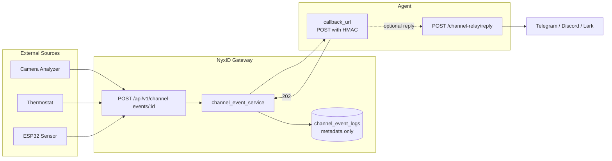
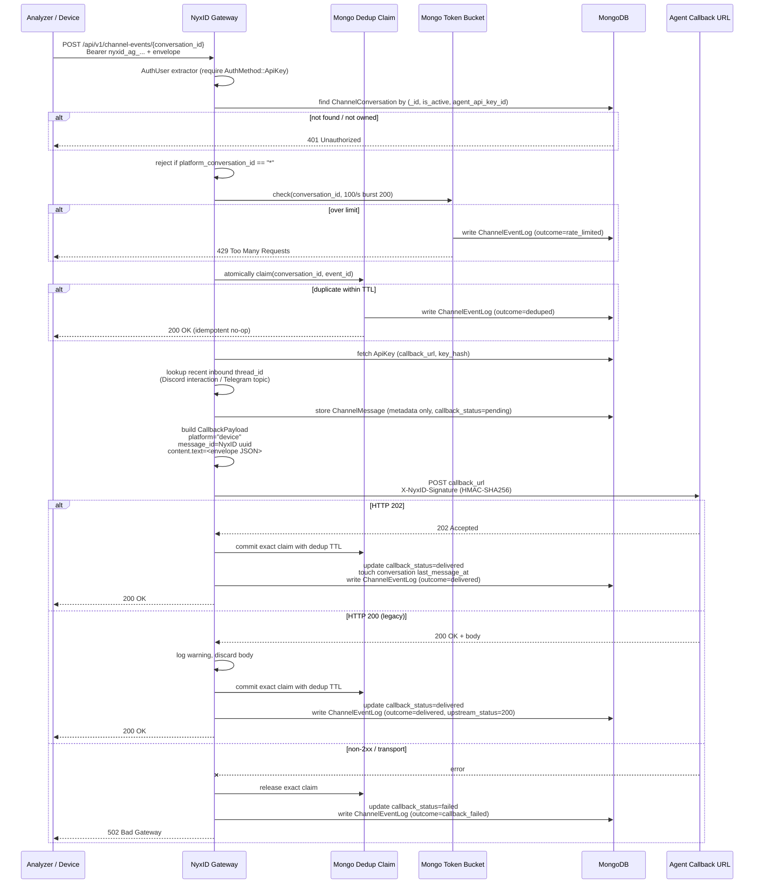
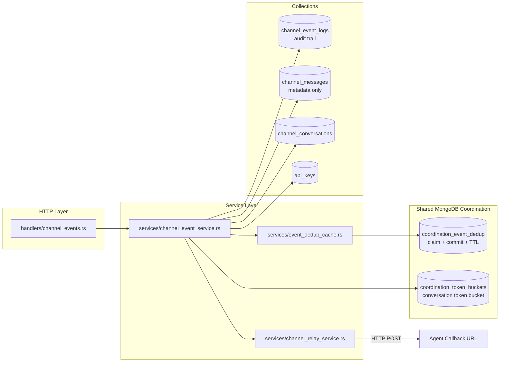

# HTTP Event Gateway

## Overview

The HTTP Event Gateway lets external devices, analyzers, and services push events into an AI agent conversation over a simple HTTP POST. It bridges the "pull mode" NyxID has always had (agents calling external APIs via `/proxy`) with a "push mode" where real-world sensors can notify an agent when something happens.

A camera analyzer detects a person entering the living room, a thermostat reports a spike, an ESP32 sensor fires an alert — all land as a `CallbackPayload` on the agent's webhook and are delivered end-to-end through the same channel relay pipeline already used for Telegram, Discord, Lark, and Feishu bots.

NyxID is a **pure passthrough gateway** for events (see [ADR-013](#adr-013-pure-passthrough)): it authenticates, applies cluster-wide rate limits and deduplication, and forwards once. It never retries, never queues, and never stores event payload content. The agent receives the event, acts on it, and optionally replies through the existing async reply endpoint.



## ADR-013 Pure Passthrough

Every design choice on this path follows a single rule: **NyxID is a gateway, not a message bus**.

| Principle | Implication |
|---|---|
| No retry | Forward once; on failure, return the error to the client and let them decide |
| No cache / queue | No in-memory buffer, no fan-out, no ordering guarantees |
| Metadata only | `channel_event_logs` stores `event_id`, `source`, `type`, `timestamp`, `status_code`, `latency_ms`, `outcome` — never payload content |
| Client-side retry | Producers reuse the same `event_id` on retry; a failed forward releases its fenced Mongo claim so a retry can proceed |
| Shared coordination | MongoDB stores only expiring limiter and dedup metadata; any replica can handle the retry |

The same principle applies retroactively to `channel_messages`: the bot relay collection was refactored in this shipment to store metadata only, matching the event path.

## Architecture

### End-to-end flow



### Component layout



## MongoDB Models

### ChannelEventLog (collection: `channel_event_logs`)

Append-only audit trail for every event the gateway touches. **Metadata only** per ADR-013 — no payload, no headers, no body.

| Field | Type | Notes |
|---|---|---|
| `_id` | `String` (UUID v4) | NyxID-assigned log row id |
| `conversation_id` | `String` | Target `ChannelConversation._id` |
| `api_key_id` | `String` | Agent identity that forwarded the event |
| `event_id` | `String` | Client-supplied envelope `event_id` (UUID) |
| `source` | `String` | Logical event source (e.g. `"camera-analyzer"`) |
| `event_type` | `String` | Event type (e.g. `"person_detected"`) |
| `event_timestamp` | `DateTime<Utc>` | Envelope `timestamp` |
| `forwarded_at` | `DateTime<Utc>` | When the gateway actually forwarded |
| `upstream_status_code` | `i32` | Agent HTTP status (202 / 200 / 5xx); `0` sentinel for transport errors or events that never reached the upstream (rate-limited, deduped) |
| `latency_ms` | `i64` | Round-trip duration around `forward_to_agent()`, per ADR-013 §4 |
| `outcome` | `String` | `"delivered"` / `"deduped"` / `"rate_limited"` / `"callback_failed"` |

**Indexes** (see `db::ensure_indexes`):

- `(conversation_id: 1, event_id: 1)` — **non-unique**, explicit name `channel_event_logs_convid_eventid_lookup`. Append-only semantics: multiple rows per `event_id` reflect retry history.
- `(conversation_id: 1, forwarded_at: -1)` — operational queries
- TTL on `forwarded_at` — 30 days

Old unique-variant index is dropped defensively at startup under its legacy default name.

### ChannelMessage (collection: `channel_messages`)

Unchanged in shape from before the event gateway landed *except* that ADR-013 forced a metadata-only refactor at the same time: the `text`, `attachments`, and `raw_platform_data` fields were removed. A startup migration gated by a `schema_migrations` marker unsets those fields from any pre-existing documents exactly once per deployment.

The `thread_id` field survives because it is routing metadata, not content — it carries Discord interaction follow-up tokens (`interaction:{app}:{token}`), Telegram forum-topic ids, and similar platform routing pointers.

Device events synthesized by the gateway persist a row here too with `platform: "device"`, `direction: "inbound"`, and `platform_message_id` set to the client-supplied envelope `event_id` so operators can correlate logs by upstream id.

### ChannelConversation (collection: `channel_conversations`)

Conversations now also carry the default-off human `allow_agent_initiated` setting for the bot send interface. Device conversations remain one-way: discovery reports all outbound capabilities as false, and `/channel-relay/send` rejects them. The gateway fetches by `{_id, is_active, agent_api_key_id}` so unknown, inactive, and foreign conversations all collapse into a single 401 response without leaking existence.

## Backend Services

### channel_event_service (`backend/src/services/channel_event_service.rs`)

Orchestration layer. Exposes a single public function `forward_event()` that ties everything together.

Execution order matters — each step is ordered to minimize wasted work on the failure paths and to prevent side-channel leaks:

1. **Auth extraction** — require `AuthMethod::ApiKey`. Relay JWTs carry an `api_key_id` too but they represent delegated access, not a real agent key; accepting them here would let a callback recipient synthesize device events. Short-circuits before any DB work.
2. **Scoped conversation lookup** — `find_one({_id, is_active, agent_api_key_id})`. Unknown / inactive / foreign → single 401. The rate-limit bucket is only consumable by legitimate owners.
3. **Wildcard reject** — `platform_conversation_id == "*"` rows are default-agent catch-all routes; async replies cannot round-trip through them. Rejected with 400 `wildcard_conversation_not_supported`. Only surfaces to owners (not a leak).
4. **Per-channel rate limit** — token bucket keyed by `conversation_id`, default 100/s burst 200.
5. **Dedup claim** - `claim(namespace, conversation, event)` uses an atomic MongoDB upsert. Exactly one replica receives the fenced claim; concurrent callers return `outcome=deduped`. Failed preparation or forwarding releases the exact claim so a retry can proceed.
6. **API key load** — fetch the agent key for `callback_url` + `key_hash`. Reject if `callback_url` is unset.
7. **Inherit thread_id** — `lookup_recent_inbound_thread_id()` finds the most recent webhook-driven inbound in the conversation with a non-null `thread_id`. Interaction tokens have a 2-minute age cap; Telegram topic ids have no TTL.
8. **Persist metadata** — `store_device_event_message()` writes a `ChannelMessage` row with the inherited thread_id. The stored message's UUID becomes the callback's `message_id` so async replies can look it up.
9. **Build payload** — `CallbackPayload` with `platform = "device"`, `content.text` = full envelope JSON, `conversation.type = "device"`, `sender.platform_id = envelope.source`, timestamp in RFC 3339.
10. **Forward and measure** — `channel_relay_service::forward_to_agent()` returns a `CallbackDelivery { http_status: Option<u16>, result }`. Latency captured around the call.
11. **Record outcome** - on success: commit the fenced dedup claim with the configured TTL, touch conversation `last_message_at`, update `callback_status = "delivered"`, and write `ChannelEventLog` with the real upstream status. On failure: release the claim, update `callback_status = "failed"`, and write the failure log.

### event_dedup_cache (`backend/src/services/event_dedup_cache.rs`)

Thin namespace wrapper around `coordination_service::EventDedupStore`. Records are keyed by a hash of `(namespace, scope, event_id)` in `coordination_event_dedup`. `claim()` is an atomic first-writer-wins upsert, `commit()` requires the exact unexpired claim fence, and `release()` deletes only the caller's claim. A TTL index removes expired claims and committed dedup records. Channel events and trigger events use separate namespaces.

### channel_relay_service (`backend/src/services/channel_relay_service.rs`)

Existing file, three changes:

**`forward_to_agent()` — 202 only.** The function now returns `CallbackDelivery` instead of `AppResult<()>`. Only HTTP 202 is a success; HTTP 200 with a body is tolerated for legacy clients (the body is discarded with a warning log) because ADR-013 and the CEO decision on #221 removed synchronous reply support. The `AgentReplyPayload` struct and its webhook-side parsing branch were deleted — there is no more dead sync-reply code.

The `http_status` field on `CallbackDelivery` records the actual agent status (`Some(202)` / `Some(200)` / `Some(5xx)`) or `None` for transport failures (connection refused, timeout, serialization error). This status flows all the way into `ChannelEventLog.upstream_status_code`.

**`store_device_event_message()` — new helper.** Persists a metadata-only `ChannelMessage` row from the gateway path. Accepts an `inherited_thread_id: Option<String>` parameter that carries forward Discord interaction tokens or Telegram topic ids from the conversation's most recent webhook-driven inbound.

**`store_inbound_message()` and `store_outbound_message()` — content stripped.** No longer write `text`, `attachments`, or `raw_platform_data`. `store_outbound_message()` lost its `text` parameter entirely — reply text goes to the platform adapter directly and is not persisted.

## Backend Handlers

### channel_events (`backend/src/handlers/channel_events.rs`)

New file. Single endpoint: `POST /api/v1/channel-events/{conversation_id}`.

Responsibilities:

- Auth gate: reject `auth_user.auth_method != AuthMethod::ApiKey` with 401. Relay tokens, session cookies, and service-account tokens are all turned away at the handler boundary.
- Envelope validation: `event_id` must be a UUID, `source` is `1..=128` ASCII in `[a-zA-Z0-9_\-./]`, `event_type` is `1..=128` ASCII in `[a-zA-Z0-9_\-.:]`, `timestamp` is RFC 3339. **No payload size limit** per ADR-013 — the router disables `DefaultBodyLimit` for this path.
- Delegation: hands the validated envelope to `channel_event_service::forward_event()`.
- Response shape: `{ "status": "accepted" | "duplicate", "event_id": "..." }`.

### channel_relay (`backend/src/handlers/channel_relay.rs`)

Modified: `async_reply` gained a platform-aware dispatch block that translates the original inbound message's `thread_id` into the outbound adapter's metadata key:

- **Discord interaction** (`thread_id` starts with `"interaction:"`): injected as `metadata.interaction_thread_id` so `discord::send_reply()` targets the follow-up webhook endpoint. Gated by a platform-specific TTL window — 14 minutes for webhook-driven originals, 12 minutes for device-event originals (source age is already capped at 2 minutes at inheritance time, so combined worst case is 14 min < Discord's 15-min TTL).
- **Telegram topic** (`conversation.platform == "telegram"`): injected as `metadata.message_thread_id` with no TTL guard (topic ids don't expire). Dispatch uses `conversation.platform`, not `original.platform`, because device events stored into Telegram conversations still carry `original.platform == "device"`.
- Other platforms: unchanged.

### channel_webhooks (`backend/src/handlers/channel_webhooks.rs`)

Modified: the sync-reply branch (previously `~70` lines handling agent 200 + body responses) was deleted. `forward_to_agent()` returning `Ok(())` now only flips the stored message to `callback_status = "delivered"`; there is no more "agent returned text inline, send it" path. Replies must flow back through `/channel-relay/reply`.

The `decrypt_bot_token()` call that fed the deleted sync path was also removed.

## Backend Middleware

### PerChannelEventLimiter (`backend/src/mw/rate_limit.rs`)

Mongo-backed token bucket keyed by `conversation_id`, distinct from the `PerAgentRateLimiter` keyed by API key. Rate and burst are loaded from config, but admission state is shared by every replica through atomic updates in `coordination_token_buckets`. Default: 100 events/s, burst 200. A TTL index removes buckets after enough idle time to refill to capacity.

## Frontend Changes

### Types (`frontend/src/types/channels.ts`)

`ChannelMessageItem` lost `text` and `attachments` fields. `MessageAttachment` interface was deleted entirely (no other consumers). Docstring explains the ADR-013 metadata-only rule.

### Pages

**`channel-conversation-detail.tsx`** — the `MessageCard` component no longer renders message bodies. Each card shows direction, sender, content type badge, delivery status, and timestamp, plus a short italicized note: *"Content is not stored in NyxID. Ask the agent for the message body."*. The `formatBytes()` helper and attachment list rendering were deleted.

**`channel-bots.tsx`** and **`channel-bot-detail.tsx`** — the yellow `(Deprecated)` warning cards referencing NyxID#191 were removed (the deprecation was recalled when #221 took precedence). Page titles and breadcrumbs no longer say `(Deprecated)`.

**Sidebar** — the `Channel Bots (deprecated)` nav label is now just `Channel Bots`.

## CLI

### `nyxid channel-event push`

New subcommand group and command in `cli/src/commands/channel_event.rs`. Pushes a device event to the gateway from a shell script or CI.

```bash
nyxid channel-event push \
  --conversation-id <CONVERSATION_ID> \
  --source camera-analyzer \
  --type person_detected \
  --event-id <UUID>                    # optional; auto-generated
  --timestamp "2026-04-08T12:00:00Z"   # optional; defaults to now
  --payload-json '{"room":"living_room","confidence":0.95}'
  --payload-file path/to/event.json    # or `-` for stdin
  --metadata-json '{"analyzer_version":"1.0"}'
  --api-key nyxid_ag_...                # or --api-key-env NYXID_AGENT_KEY
```

The command explicitly rejects `--payload-file -` (stdin) without `--api-key` or `--api-key-env` set, because the interactive prompt would consume the first line of the piped JSON.

### ApiClient changes (`cli/src/api.rs`)

New fluent builder `ApiClient::without_token_refresh()` sets a flag that short-circuits the internal 401 → session-token refresh path. `channel-event push` uses this so a bad or revoked agent key surfaces the real error instead of silently retrying with the saved session access token for the profile.

### `nyxid channel-bot` deprecation removed

The `channel-bot` subcommand no longer prints a deprecation warning on every invocation. The `[DEPRECATED]` tag in its clap description was removed. The command is a first-class surface again.

## Route Registration

In `backend/src/routes.rs`:

```rust
let channel_event_routes = Router::new()
    .route(
        "/{conversation_id}",
        post(handlers::channel_events::post_event),
    )
    .layer(DefaultBodyLimit::disable());
```

Nested under `api_v1_delegated` so the existing API-key auth middleware is applied. `DefaultBodyLimit::disable()` opts this router out of the app-wide 1 MiB body cap — per ADR-013 the gateway does not enforce an application-level payload size limit on device events.

## AppState Integration

The event gateway uses the shared database and one configured limiter in `AppState`:

```rust
pub struct AppState {
    // ... existing fields ...
    pub per_channel_event_limiter: mw::rate_limit::SharedPerChannelEventLimiter,
}
```

`PerChannelEventLimiter` is constructed in `main.rs` with the MongoDB database and rate settings. The dedup service receives the same database per request. MongoDB TTL indexes handle cleanup; there are no process-local event limiter or dedup maps in production.

## Environment Variables

```bash
# HTTP Event Gateway (NyxID#221, ADR-013)
CHANNEL_EVENT_RATE_LIMIT_PER_SECOND=100  # per-conversation events/sec
CHANNEL_EVENT_RATE_LIMIT_BURST=200       # per-conversation burst capacity
CHANNEL_EVENT_DEDUP_TTL_SECS=300         # dedup entry TTL (5 minutes)
```

## API Contract

### Request

```
POST /api/v1/channel-events/{conversation_id}
Authorization: Bearer nyxid_ag_...
Content-Type: application/json

{
  "event_id": "550e8400-e29b-41d4-a716-446655440000",
  "source": "camera-analyzer",
  "type": "person_detected",
  "timestamp": "2026-04-08T12:00:00Z",
  "payload": { "room": "living_room", "confidence": 0.95 },
  "metadata": { "analyzer_version": "1.0" }
}
```

### Envelope → CallbackPayload mapping

| Envelope field | CallbackPayload target |
|---|---|
| `event_id` | `content.text` (embedded in full envelope JSON) |
| `source` | `sender.platform_id` |
| `type` | `content.type` |
| `timestamp` | `timestamp` (RFC 3339) |
| `payload` / `metadata` | embedded in `content.text`, never stored separately |
| — | `message_id` = NyxID-assigned `ChannelMessage._id` (enables async reply lookup) |
| — | `platform` = `"device"` |
| — | `conversation.id` = path param |
| — | `conversation.platform_id` = `ChannelConversation.platform_conversation_id` |
| — | `conversation.type` = `"device"` |
| — | `agent.api_key_id` = caller's `api_key_id` |
| — | `thread_id` = inherited from most recent webhook-driven inbound (Discord interaction or Telegram topic) |

### Response codes

| Status | Meaning |
|---|---|
| 200 | Accepted (`status: "accepted"`) or deduplicated (`status: "duplicate"`) |
| 400 | Invalid envelope shape, or wildcard `platform_conversation_id` |
| 401 | Missing/invalid bearer, `AuthMethod != ApiKey`, or conversation not owned by this key |
| 429 | Per-channel rate limit exceeded |
| 502 | Downstream agent unreachable or returned non-2xx |

## Security Considerations

### Authentication

- The endpoint strictly requires `AuthMethod::ApiKey`. Session cookies, service-account tokens, and relay JWTs (which delegated callback recipients receive) are all rejected — the same `api_key_id` carried by a relay JWT must not be usable to synthesize device events, because relay tokens represent delegated access, not agent identity.
- Defense in depth: `channel_event_service::forward_event()` re-checks `AuthMethod::ApiKey` even though the handler already gates on it, so any future direct service-level caller cannot bypass the check.

### Conversation existence is not leakable

The `find_one({_id, is_active, agent_api_key_id})` query collapses "not found", "inactive", and "foreign" into a single 401. A caller holding a valid agent key cannot distinguish a foreign conversation from a nonexistent one via timing or status code. The wildcard 400 check runs *after* the ownership filter, so a 400 is only ever surfaced to legitimate owners.

### Pure passthrough, no payload persistence

Per ADR-013, `channel_event_logs` stores only metadata. Event payloads (`payload` and `metadata` fields on the envelope) are never written to MongoDB. They exist in memory only long enough to be serialized into the outbound callback body. The same rule now applies to `channel_messages` via the legacy-content purge migration.

### HMAC signing

The callback is signed with `HMAC-SHA256(api_key.key_hash, body_bytes)` and carries `X-NyxID-Signature`, `X-NyxID-Message-Id`, `X-NyxID-Timestamp`, and `X-NyxID-Platform` headers. Agents verify the signature to confirm the callback came from NyxID and not an arbitrary third party.

### Rate limiter ordering prevents bucket exhaustion attacks

The per-conversation rate limiter only fires after the ownership scope filter has succeeded. Without this order, a caller with some other valid agent key could burn a legitimate conversation's quota just by guessing its id and eating 401s.

### CLI `--payload-file -` rejects interactive prompts

When the CLI reads the payload from stdin, an API key prompt on stdin would silently consume the first line of JSON. The CLI detects this configuration and errors out with a clear message up front instead of producing mangled data.

## Discord Interaction Handling

Discord slash commands and button interactions produce a follow-up webhook token valid for **~15 minutes** with up to 5 follow-ups. NyxID stores the token on the original `ChannelMessage` as `thread_id = "interaction:{app}:{token}"` and translates it into `metadata.interaction_thread_id` at reply time, which `discord::send_reply()` uses to call the follow-up webhook endpoint instead of the normal `/channels/{id}/messages` API.

When a device event is pushed into a conversation whose most recent inbound was an interaction, the token is inherited onto the synthesized device-event row subject to two compounding guards:

### Copy-time window (2 minutes)

`lookup_recent_inbound_thread_id()` only returns an interaction token if the source webhook inbound is fresher than 2 minutes. Stale tokens are not inherited.

### Reply-time window (12 minutes for device events)

`async_reply` uses a platform-aware TTL: 14 minutes for webhook-driven originals (where `original.created_at` IS the real interaction timestamp, 1-minute safety margin under Discord's 15-min limit) and **12 minutes for device-event originals** (where `created_at` is as much as 2 minutes after the real interaction, so combined worst-case is 2 + 12 = 14 min).

### Stale-token poisoning protection

The lookup query filters out `platform: "device"` rows so a previously-injected device event — which inherited its interaction token 2 minutes ago — cannot be re-copied from forever. The filter also uses `thread_id: { $exists: true, $ne: null }` inside the query itself so a newer bland inbound row does not shadow a still-valid interaction on an earlier row.

## Telegram Forum Topic Handling

Telegram forum topics use a numeric `message_thread_id` to scope messages. NyxID stores this on `ChannelMessage.thread_id` and `async_reply` injects it as `metadata.message_thread_id` when `conversation.platform == "telegram"`. `telegram::send_reply()` reads it from metadata and passes it as `message_thread_id` in the `sendMessage` request body so replies stay inside the originating topic instead of landing in the root chat.

**Inbound continuity and outbound topics.** Inbound `ChannelMessage.thread_id` and NyxBot partitions retain the native `message_thread_id` or gateway `conversation.thread_id` exactly as before. Existing reply-chain conversations and follows keep their identities. Image audiences and outbound metadata use separate `telegram_topic` evidence: native messages require `is_topic_message: true` for a topic; version 1 gateway thread facts declare `kind: topic` with a positive decimal `native_thread_id`. Explicit reply-chain evidence makes the outbound target chat-level while retaining the inbound key. Telegram facts remain the gateway's declaration; NyxID validates Lark and Feishu facts only. Legacy saved anchors without this additive evidence retain their historical outbound target. Old replicas ignore the evidence and share the unchanged inbound keys; the image claim guarantee applies after the fleet upgrade. No thread migration is needed.

Topic ids have no TTL, so there is no reply-time age check for this case. The dispatch uses `conversation.platform` (not `original.platform`) so device events injected into Telegram conversations — where `original.platform == "device"` — still route correctly.

## Migration Notes

### Legacy `channel_messages` content purge

A one-shot migration `purge_legacy_channel_message_content()` runs during `ensure_indexes()` and `$unset`s `text`, `attachments`, and `raw_platform_data` from any existing `channel_messages` documents. Gated behind a marker in a new `schema_migrations` collection (`_id = "purge_channel_message_content_v1"`) so the expensive full-collection scan runs exactly once per deployment.

If the marker insert fails mid-way, the next boot re-runs the purge (which is idempotent — zero matches after the first successful run).

### `channel_event_logs` index cleanup

The initial broken deploy of this feature created a `unique` variant of the `(conversation_id, event_id)` index under its default name. The new non-unique version uses an explicit name `channel_event_logs_convid_eventid_lookup` so the legacy index can be dropped by name without colliding with the healthy new one. The `drop_index("conversation_id_1_event_id_1")` call is a cheap no-op returning `IndexNotFound` on any database that never saw the broken deploy.

### Breaking API change

`GET /channel-relay/messages/{conversation_id}` and `GET /channel-conversations/{id}/messages` **do not return message text or media bytes**. The bot relay history now additionally returns inbound attachment routing metadata and `download_url`; device events retain no attachment content and cannot use the media-download endpoint. Agents that need historical bodies must retain their own conversation state. Documented in the NyxID skill (`skills/nyxid/SKILL.md`) and the changelog.

## Related Documents

- [ADR-013: NyxID Pure Passthrough](https://github.com/ChronoAIProject/chrono-ai-ceo/blob/main/decisions/013-nyxid-pure-passthrough.md) — the architectural principle that drives every "no retry / no store / no queue" decision here
- [Channel Bot Relay](./CHANNEL_BOT_RELAY.md) — the bot-side inbound path that the event gateway reuses for HMAC signing, conversation storage, and async reply delivery
- [Agent Isolation](./AGENT_ISOLATION.md) — how API keys carry scope and rate-limit policies that also apply to event senders
- [NyxID#221](https://github.com/ChronoAIProject/NyxID/issues/221) — original feature request and CEO review thread

## Aurinko notification retries

The [Aurinko email adapter](./AURINKO_INTEGRATION.md) uses the channel callback and reply protocol while owning its bounded inline ingress. Aurinko supplies redelivery; NyxID persists only subscription bindings, batch digest/cursor, stable message receipts, and irreversible send barriers. No message bodies, queue, or periodic worker are added. Active claims produce retryable failures, completed items stay deduplicated across partial batches and log expiration, and callback retries retain their UUID-v4 so runtimes can suppress duplicate work after a lost acknowledgement. Device and legacy chat adapters keep their existing protocols.


## NyxBot gateway creator authorization and recovery

Gateway management uses a **creator credential** distinct from the channel's
provider/event-tool credential. NyxID mints the linking person's delegated
`account:read` access JWT with reserved actor `nyxid:nyxbot-gateway-creator`
and a 120-second lifetime. It stays server-only, is never logged or stored, and
is sent through a redirect-disabled HTTP client. The separate channel agent key
authenticates provider callbacks and event tools; it is never a creator bearer.
The dedicated JWT mint owns the reserved actor, which neither catalog nor
user-service slugs can represent; generic delegation mints reject it. The TTL
remains a separate defense in depth.

Gateway requests have a five-second connect timeout, a 20-second request timeout,
and a streamed 2 MiB response limit. Platform-entry setup retains its dispatch
deadline and streamed 64 KiB limit. Successful calls that require JSON or binding
identities reject malformed responses rather than treating them as completed setup.

Both gateway validators are supported: legacy gateways resolve the person with
`GET /api/v1/users/me`; RFC 7662 gateways call `/oauth/introspect` with their own
confidential OAuth client and require per-method permissions. For the exact
server-side creator mint, NyxID adds only `cma-eg:channels:read`,
`cma-eg:channels:create`, `cma-eg:channels:update`, and `cma-eg:channels:delete`
when the authenticated, active confidential client is registered in the active
`cmaeg` catalog row's `introspection_client_ids`. These are effective permissions
for that caller, not stored user roles or assignments; the response's `roles`
and `groups` and its field set stay as for any other token. Ordinary personal access tokens,
other delegation mints and unrelated introspecting clients receive no extra grant.
Missing, inactive, misconfigured or unreadable gateway configuration returns
`oauth_authority_unavailable` (503), so a provisioning/read outage is not reported
as an inactive token. A resolved configuration that does not associate the caller
returns ordinary introspection without the creator grant; an RFC 7662 gateway
then refuses NyxBot management with HTTP 403, surfaced as
`gateway_permission_required`. The gateway's confidential OAuth client must be
listed by its **full client ID**, verified against the actual configured
introspection caller and matching NyxID client record. A display name, shortened
ID, catalog slug or resource URI is not a client ID.

The grant covers **owner-scoped CMA channel operations**; it is not bound to one
channel ID. CMA still checks the creator subject against the profile owner and
scopes channel reads/updates/deletes to that owner. It includes neither channel
testing nor gateway administration. This covers connect, transport moves, group
policy, thread/mention discovery, platform-entry setup/recovery/inspection, and
platform cleanup without granting the person direct gateway access.

A failed connection displays **Reconnect**, using its selected live agent and
showing the returned owner-link instructions after success. Changing the agent
on a failed row also reconnects; live rows retain their existing agent-link flow
and account-link controls. Reconnect is disabled without a live target or while
a mutation is pending. Disconnect remains available. Known errors have readable
explanations and a secondary stable code; a gateway 401 means authentication
failed and a 403 means gateway permission is missing. Remote response bodies are
never displayed. There is **no automatic reconnect** of failed rows.

REST and NyxBot tools list one current row per owner/bot. A pending/active row
wins over failed attempts, even newer ones. Without a live row the latest record
wins; a newer disconnection suppresses older failures. Creation time and then ID
break ties, and the newest 50 winning, non-disconnected rows are returned. History
is retained.

## NyxBot org bots and transport flags

NyxID's CMAEG `nyxbot` provider supports personal and organization-owned bots.
For an org bot, `nyxbot:gateway-{platform}` resolves for its **linking admin**,
including the existing live org membership overrides. The route and route key
remain org-owned. Gateway channel management uses the linking admin's short-lived
`account:read` creator bearer; the separate provider/event-tool agent key is also
person-owned, with no service grants, because provider authentication matches its
owner to `NyxbotChannel.user_id` and the profile's owner subject.

All authenticated provider endpoints recheck live org-admin membership before
processing the event or accessing its context. Loss fails the link with
`org_access_lost`, uses the existing audit and link-status/watch behaviour,
releases the gateway channel, and removes its route and active/pending keys.
The linking person's agent receives no event after this check fails. Relay
ingress and asynchronous replies retain the same authority check.

The 15-second assistant sweep attempts at most one transport move per replica.
Flag-on moves owner-verified relay bots to the gateway; refusal leaves their
working route unchanged and retries daily. **Flag-off now also moves existing
personal and org gateway bots back to the relay**. Both directions build beside
the working route, recheck authority/flag/active answers, then atomically swap the
channel and route key. A busy bot answers first and retries in ten minutes.
Returning releases the gateway channel and deletes its agent key and old route
key. Telegram always uses the gateway and is excluded from flag-off returns.

### Discord transport and provider boundary

`channel:discord-gateway` enables NyxID's default-off relay socket worker;
`nyxbot:gateway-discord` selects an accepted Agent Event Gateway connection.
They are distinct flags. A pending or active gateway transport suppresses the
NyxID socket. Pending setup fences relay admission and renewal, then waits for
its lease to end before issuing remote creation. Setup still builds beside the
existing route and swaps its key atomically only after acceptance. Definitive
HTTP 400/401/403/422 create refusals settle as not-created. Ambiguous failures
retain durable cleanup obligations and hold relay ingress until remote absence
or deletion is proven. Flag-off returns retain chat settings and owner identity,
retire the remote connection, then allow a relay lease again. This avoids a
second IDENTIFY producer during migration; uncertain cleanup can pause chat.
Successful activation atomically clears the old relay resume checkpoint. Return
uses a fresh IDENTIFY, avoiding replay of gateway-owned traffic. Refused setup
retains the checkpoint so relay ingress can recover its pause.
Transfers have an ingress gap: NyxID does not transfer its relay resume cursor
to the gateway, and ADR-013 provides no durable body queue.

The ingress flag uses the existing security readiness roster/drain mechanism.
Deploy all transport writers before enabling it; mixed binaries remain safe
with the flag off. Runtime readiness loss also stops ingress. No new environment
variable or remote source option is introduced.

NyxID authenticates provider requests against the active channel credential and
rechecks the linking owner's live authority (including org-admin membership).
Discord Activities use the existing common envelope: exact gateway channel,
Discord source platform, matching route for a relay source, a sealed event
reference, canonical snowflake actor/chat/thread IDs and an explicit private,
group or channel kind. A private conversation cannot contain a thread. A Discord
thread is an addressable channel: NyxID partitions by the thread channel ID,
including when the envelope also supplies its parent as the conversation ID.
DM partitions retain the relay mapping for migration back. Group members share
one chat partition; separate threads do not share one.

Only authenticated human actors can use the owner link code. Unknown actors
stay silent; self messages stay silent; other bots retain the default-off bot
policy. The shared `reply_mode`/`members`/guest rules apply after gateway intake.
Explicit `kind.mentions_bot` and independently retained reply evidence establish
addressing; admission alone, broadcast text and display names do not. The sealed
source event owns replies throughout their lifetime. Unsupported edits never
start replacement turns, and media locators cannot trigger arbitrary downloads.

The CMA owner owns gateway-side Discord ingress, verified Activity production,
admission and capability negotiation. This change neither selects their design
nor adds a CMA proposal. NyxID's additive relay facts remain available if their
implementation uses callbacks. The existing Lark/Feishu thread-follow contract
is not silently extended to Discord; ordinary Discord thread partitions and
per-chat settings work through the common provider envelope, while automatic
follow negotiation requires the gateway's agreed capability contract.

### Lark and Feishu media

Lark and Feishu owner images, files and rich posts can reach NyxBot through the
gateway when the per-person `assistant:channel-media` flag is enabled (default
off), including org-owned bots whose linking person remains an org admin. This
requires CMA at least `a570be21` with `CMAEG_MEDIA_ENABLED=true`. Upgrade all
NyxID replicas and drain old workers before enabling it. Admission does no
downloads, preserving CMA's default 30-second provider header budget
(`CMAEG_PROVIDER_REQUEST_TIMEOUT_MS`). NyxID ingests the media at run start using
its own stored source selectors and live authority, never gateway-supplied
provider handles. Audio/video activities keep CMA's existing rendered input;
text-only and native Telegram input are unchanged. See
[inbound channel media](chat/10-uploads.md#inbound-channel-media) for limits,
guest handling, receipts and rollback, and the
[NyxBot transport contract](chat/09-nyxbot-orchestrator.md) for private-chat continuity.

Deploy the provider authority check to all replicas before enabling org gateway
cohorts. If gateway flags are already enabled for linking admins, drain older
provider replicas during rollout: they do not have the per-event org check.

## NyxBot provider late replies and CMA contract boundary

This section concerns NyxID acting as CMAEG's `nyxbot` provider, not the generic
`/channel-events` ingress. Generic ingress remains ADR-013 passthrough. NyxBot's
existing assistant history owns answer content; additive `nyxbot_events.delivery`
metadata arbitrates streamed versus delayed answers. The implementation contract
is in [NyxBot channel delivery](chat/09-nyxbot-orchestrator.md#channel-turn-delivery-after-the-provider-stream-closes).

With `assistant:channel-media` enabled, a Lark/Feishu media activity whose source
ID names an existing row outside its authorized owner/chat/sender/route returns
HTTP **403** with problem code `media_source_refused`. This refusal is terminal
and must not be retried. Database failures still return **503**
`provider_unavailable`; a missing source row produces the fixed unavailable-media
note in the turn. Source presence does not authorize a provider download.

Verified against CMA `develop`, `docs/CMAEG_Protocol.md` §§8–10 and
`api/crates/cmaeg/src/{turns,tools/reply_targets}`:

- Committed `response.output_item.done` messages can express partial/failure
  output. Output-free `response.completed` finishes without text. NyxID uses
  that terminal form for successful silence and detaching long-running work.
- CMA `develop` pinned at `37547e73aebfc8335b38f914f3ff1db4fcbf950d` was
  checked locally on 2026-10-19 (`delivery/step.rs` and the channel protocol).
  `reply.ack_after_ms = 0` disables the Accepted working acknowledgement;
  heartbeat output requires that acknowledgement to have been sent. NyxID
  provisions and reconciles this policy through versioned channel updates,
  verifying the returned policy before marking it supported. Missing or refused
  policy evidence is a blocked capability, not confirmed quiet support. Proof is
  invalidated before a policy replacement, on unconfirmed accepted write/readback,
  and on transport/binding teardown or replacement. Only an authenticated complete
  echo for the same fenced binding restores it; rebinding cannot inherit proof.
  An empty global acknowledgement string is not a supported substitute.
- `createReplyTarget` and `replyToTarget` already support the original relay
  destination, current channel/binding/key checks, a 24-hour sealed target, and
  durable payload-bound idempotency. They deliberately return `unknown` for an
  uncertain external send rather than retrying it.
- Stream output has no delivery acknowledgement. CMA's ordinary automatic
  delivery state is replica-local; writing SSE bytes does not prove platform
  delivery. NyxID therefore irrevocably marks a streamed answer before emission
  and never guesses that a disconnect means those bytes were not delivered.

**Precise CMA follow-up request (no CMA code changed here):** pass the remaining
absolute ingress turn deadline in the provider request, and expose a durable,
provider-authenticated delivery receipt keyed by the provider response/turn ID
and committed item ID. Stream delivery and `replyToTarget` must share one
payload-bound dispatch identity/barrier, with `confirmed`, `not_started`, and
`unknown` outcomes and current route/binding checks. A lost receipt must be
reconcilable without a second send. This would close the crash/timeout window
between claiming the stream and the platform delivering it. Without it, NyxID
can guarantee one chosen delivery attempt across replicas, **not exactly-once
external delivery**. Platform sends with ambiguous outcomes may still be lost.
NyxID emits neither a queue acknowledgement nor a 570-second continuing-work
notice. At the local deadline it detaches silently and retains the durable
original-source answer path. CMA starts its own clock at ingress, so an earlier
provider timeout can still close the stream first. Source and fixture checks
establish protocol behavior; they do not claim a deployed gateway or live
provider delivery test.

NyxBot accepted work is stored in its existing assistant event queue, bounded at
twenty; it is not a generic gateway body queue. Accepted destinations bind to
original source records transactionally, one message question per Event turn.
Generic sources capture their original managed route and API key. Admission
revalidates and write-fences the exact active route, owner, bot, platform and key;
a deleted, inactive, transferred or rebound route cannot start queued tool work.
Each coalesced destination is checked independently. Legacy generic queue records
without captured route/key authority are refused rather than adopting a new route.
The sweep mints original reply targets within the event window even before a
turn starts, and independently expires/refuses ineligible destinations. Silent
completion is atomically fenced without reclaiming `sending`, `streamed` or
`unknown`. Drain and upgrade every old queue writer before promising retention:
old `$slice: -20` writers can still evict accepted sources. Unanchored generic
legacy questions are unavailable; native legacy questions retain their exact
thread origin. Neither path guesses the latest message.

## Agent gateway group-thread parity

Implementation review: NyxID `feat/gateway-thread-follow` and
[CMA PR #980](https://github.com/ChronoAIProject/cma/pull/980) against `develop`
(`api/crates/cmaeg{,-core}`, normative `docs/CMAEG_Protocol.md`). The Agent
Event Gateway remains distinct from NyxID's device HTTP Event Gateway.

| Surface | NyxID relay | Gateway gap and owner | Proposed change / scope |
| --- | --- | --- | --- |
| Lark / Feishu identity | Canonical root, native thread alias and immediate parent; exact chat/bot scope | **CMA:** only the alias reaches Activity; root and parent are lost | Add opt-in, verified, versioned thread facts from the authenticated raw event. |
| Follow admission | NyxID follows child threads and applies live sender/settings policy | **Both:** gateway admits mentions/replies by default; NyxID disables gateway follow | Negotiate the contract, admit unmentioned events for selected follow-enabled group chats, and reuse NyxID's follow selection. |
| Lark / Feishu reply target | Native reply endpoint with `reply_in_thread=true` | **Both:** CMA uses the legacy relay reply API without a bound thread request | Seal the thread-reply decision with the source event; explicitly request server-resolved targeting in NyxID for immediate and delayed sends. Never fall back to the parent. |
| Mentions | Real bot mentions address; other-user-only mentions stay quiet in a followed child; broadcasts retain ordinary followed behavior | **CMA:** Lark requires pinned bot identity for exact evidence; no other-user boolean | Carry only address evidence and `mentions_others`, never mentioned names/IDs. Broadcasts do not become bot mentions. |
| Lark / Feishu inbound media | Native adapter stores image/file selectors and ordered embedded post selectors | CMA ≥ `a570be21`, `CMAEG_MEDIA_ENABLED=true`, NyxID `assistant:channel-media` on | Owner media is late-bound to encrypted assistant uploads after admission; guests receive a fixed note with no download. See [limits and rollout](chat/10-uploads.md#inbound-channel-media). |
| Lark / Feishu outbound media | Native adapter uploads supported attachments | **CMA:** renderer reduces attachments to safe link text | NyxID delivers NyxBot tool images itself through existing adapters before text, retaining exact thread targets. A CMA attachment-block renderer is **not required**. |
| Edits | Adapter-specific edit hooks and authenticated outbound receipts | **CMA:** Lark/Feishu edits unsupported; only confirmed Telegram interactive cards edit | Follow-up: platform capabilities plus opaque receipt-bound edits through NyxID. Inbound edits need explicit replacement/dedup policy before they can affect an agent. |
| Slack | `thread_ts`, structured mentions, native bound replies and bounded history | **CMA:** no raw verifier; `trust_normalized` gives unknown actors and no address/thread evidence; NyxID does not opt in | Follow-up: verify Slack raw events and correlate channel/sender/message, then enable the same contract. |
| Discord | Leased relay-only Gateway ingress; authenticated addressing and thread facts, bound native replies | **NyxID:** validates the existing provider envelope, distinguishes DMs/guild channels/thread channels, preserves local sender/settings policy and original event references | Gateway-side Discord implementation is owned by the CMA owner. NyxID does not choose native gateway ingress versus relay callbacks; no Discord follow contract is negotiated implicitly. |
| Telegram / telegram-new | Forum topics and correlated reply chains; exact topic/reply anchor | **CMA:** forum topic ID retained, but no canonical reply-chain facts or other-user mention flag; native sends retain topic but not the full NyxID follow contract | Follow-up: topic/chain facts, exact bot reply evidence and bound source-message replies for both native and relay ingress. |
| WhatsApp | Quoted replies, no subscribable thread-follow surface | **CMA:** normalized-only text; unknown actor, no address evidence | Follow-up: raw verifier and media/receipt parity; do not advertise thread follow. |
| X | DM behavior and original-post-bound public replies; public follow out of scope | **CMA:** platform unsupported | Follow-up: verified ingress and original-post/DM-bound delivery before migration; no public follow here. |
| Aurinko email | Mailbox thread facts, private sender gates, participant-safe history and single-recipient send barrier | **CMA:** platform unsupported | Follow-up: preserve verified mailbox/thread/address/participant authority and irreversible single-recipient send; never reply-all. |
| Provider history | Bounded native history or supported metadata fallback | **CMA:** no generic history contract | NyxID retains bounded provider history through its existing adapter; never add scopes silently. |

The implementation contract and validation results are recorded below as the two
sides are completed. Until negotiation succeeds, existing gateway channels keep
legacy admission and follow remains unavailable. Inbound Lark/Feishu owner media
has its own flag and CMA prerequisites above; NyxID sends tool images directly.

The concrete wire contract is [thread contract 1](CHANNEL_THREAD_FOLLOW_GATEWAY_CONTRACT.md).
It replaces the earlier generic handoff proposal: `activity.thread` carries
verified metadata, `reply.thread_contract` opts in to bounded per-chat admission,
and explicit `thread_reply` selects bound replies. No feature is enabled merely
because an Activity happens to contain a thread alias. Upgrade all gateway
replicas before authoring opted-in definitions, and upgrade NyxID before opting
in to the relay reply extension. The existing follow feature flag remains in
control. Neither repository change deploys the gateway.

The remaining platform surfaces need explicit parity before moving all traffic:

| Platform | Mention / broadcast gap | Media into / out of gateway | Edits and proposed owner work |
| --- | --- | --- | --- |
| Lark / Feishu | Contract 1 carries exact pinned-bot evidence and the other-user boolean; `@_all` is not a bot mention | Owner image/file/post ingress supported under the media flag and CMA prerequisites; NyxID sends NyxBot tool images directly; generic outgoing attachments remain link text | **CMA:** enable receipt-bound edits through NyxID's existing edit API. |
| Slack | **CMA:** verify `app_mention`, structured bot/other-user mentions and broadcast tokens with native `thread_ts` | Incoming attachments rejected by generic verifier; outgoing link text only | **CMA:** use existing NyxID edit/upload APIs after implementing the raw verifier and target binding. |
| Discord | **NyxID:** relay callbacks add versioned verified facts; provider group admission requires explicit addressing evidence or a known stored reply, never names or admission alone | Unnegotiated incoming attachments produce the existing unavailable-media note without URL fetches; outbound native images require a bound source, otherwise the existing safe failure note applies | NyxID accepts original message activities, not edit activities. Immediate/delayed replies retain their original event reference, including threads; no fallback to a parent channel or newer event. Gateway-side support is owned by the CMA owner. |
| Telegram / telegram-new | Bot mention/reply evidence exists, but **CMA** lacks the full other-user boolean and topic/chain contract | Text-only message ingress; outgoing attachments are link text | Native Telegram supports ordinary message edits; relay edits are limited to confirmed interactive cards. **CMA:** extend verified attachment transport and receipt-bound relay edits while retaining the forum topic. |
| WhatsApp | **CMA:** normalized-only unknown actor/address; no follow capability | Incoming attachments rejected; outgoing link text only | Neither side advertises edits. **CMA:** verify raw sender/quote evidence and bridge NyxID's media/receipt support. |
| X / Aurinko | **CMA:** no platform source; do not claim addressing or follow parity | Unsupported in gateway | **Both:** design verified sources and credential/receipt boundaries before migration; preserve email single-recipient barriers and keep X public follow excluded. |

The thread PR did not implement media or edits. Owner Lark/Feishu inbound media
is supplied separately by the flagged channel-media path above; the other gaps
remain follow-up work.

### Review validation

The NyxID `nyxbot`/`channel` suites passed 764 tests on each of the default
and `RUST_MIN_STACK=1572864` stacks, using MongoDB on 27022 and Rust 1.98.1.
`cargo +1.98.1 clippy -p nyxid --all-targets -- -D warnings`, formatting,
and diff whitespace checks passed.
Coverage includes shared child selection across gateway partitions, quiet
other-user mentions retained as context, real bot mentions and broadcasts,
legacy gateways, lost negotiation acknowledgement, zero-read follow gates,
and source-bound native replies with reply-to-bot evidence.
These are local tests with provider/gateway HTTP fixtures; live Lark/Feishu
rollout remains dependent on the CMA owner's merge and deployment.

CMA gateway/core: 341 default tests plus both opt-in tests passed (343 total),
including the latency budget and compiled gateway with real Rust/TypeScript SDK
clients against isolated HTTP fixtures. Rust SDK: 133 tests and 27 doctests
passed; its gateway fixture also ran through the integration test. The unrelated
CMA responses fixture was not run locally. TypeScript SDK: 2,833 tests passed.
Gateway/core and Rust SDK all-target/all-feature Clippy on Rust 1.96.1, formatting,
SDK lint/typecheck/build/docs, OpenAPI/schema coverage and source-size checks
passed. No media/edit or additional-platform thread capability was added.

## NyxBot gateway retirement and recovery

NyxBot records cleanup responsibility before dispatching a gateway create and
before removing local references. This is lifecycle cleanup; it adds no message
or event delivery retries. Creation reserves a UUID record ID and its deterministic
provider binding in `nyxbot_gateway_releases`, with a fixed 30-minute provisional
deadline. Each acknowledged channel identity and positive version is persisted
before the next external operation. Activation consumes the provisional record in
the same transaction as adoption; it leaves no cleanup obligation for a healthy
connection.

Disconnect, org access loss, fallback, transport changes and abandoned setup
commit local retirement, key revocation, route retirement and cleanup responsibility
together. Local retirement completes even when the gateway is unavailable. The
existing `gateway_released` response reports confirmed remote release; a queued
obligation alone does not make it true. Explicit preservation leaves it false.
CMA deletes in this order: authenticate the creator, check owner/version,
unbind the provider, delete the remote record. A
retained primary provider key can acknowledge only DELETE of its exact retired
binding, without restoring key or provider authority. Other provider operations
continue to require live authority. Platform-conversion cleanup and native entry
retirement retain their own exact proofs and remain responsible for their resources.

| Release state | Meaning |
| --- | --- |
| `provisional` | Setup owns a reserved identity until adoption or its deadline. |
| `due` | Local authority is retired; exact remote cleanup is queued or leased. |
| `review_required` | Automatic effects stopped because authority, identity or outcome needs review. |
| `settled` | Confirmed release/absence, cancelled undispatched setup, or explicit preservation. Retained for deduplication and unbind acknowledgement. |

An independent worker runs every 30 seconds, handles at most ten obligations per
pass with two concurrent operations per replica, and uses 120-second database-time
leases. Retries back off from 30 seconds to one hour. Every completion is fenced
by claim, revision, state and lease. Recovery reads `/channel-records/{record_id}`
and validates owner, provider, binding and relay source. It never creates a record
or replaces the captured deletion version with an observed version. Destination
drift, version changes, malformed identity and live-reference conflicts require
review. An uncertain POST that remains unobserved for 24 hours requires review:
that deadline is not proof that creation never happened.

Administrators use the [release review API](API.md#nyxbot-gateway-release-review)
to inspect a sanitized observation and resolve its exact revision. `retry_original`
requeues the original authority for a matching identity, or resumes record-ID
recovery for an unknown identity observed as missing. `preserve_changed` accepts
any observation other than `matching` or `missing`, including a changed record,
live reference, changed destination, unavailable owner or malformed identity.
It settles as `preserved` without deleting anything, records the observation status
in audit metadata, and leaves `gateway_released` false. `confirm_missing` settles
confirmed absence; an uncertain create also requires 24 hours since dispatch and
explicit attestation that the original dispatch has drained. There is no operation
to delete an observed replacement version.

Filter audit events by `nyxbot_gateway_release_queued`,
`nyxbot_gateway_release_settled`, `nyxbot_gateway_release_review_required`,
`nyxbot_gateway_release_reviewed`, `nyxbot_channel_continuity_restored` and
`nyxbot_gateway_release_reconcile_pass_completed`. These metadata events commit
with their transitions. Retries do not add audit events. Review transition logs
contain only obligation ID, local channel ID and a stable reason.

An hourly, resumable keyset scan processes at most 100 retained-identity retired
rows per step. It excludes live adoptions and platform-conversion resources;
settled obligations prevent repeated release. It does not enumerate remote
inventory or guess identities missing from local history. The creator bearer
retains its PR1 owner-wide channel management scope; CMA still enforces owner
identity, and cleanup additionally pins destination, record and acknowledged
version. It is not a token restricted to one channel.

### Deployment and rollback

Startup creates release and reconciliation indexes before workers start. Deploy
normally across replicas; no global mutation freeze is needed.
**Retained-identity orphans converge automatically, including retirements
during rollout. Complete obligation coverage begins once all old lifecycle writers
and their in-flight operations have drained**. Old transport-return, fallback,
uncertain-create and stale pending-move paths can erase or never store remote
identity. Before rollback to PR1, drain release workers; retain release records
and continuity lineage fields.
