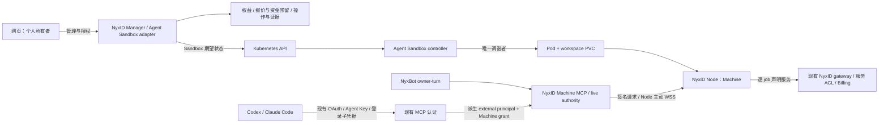

# Remote Nyx Machine MVP：Agent Sandbox 托管方案

## Backend Kubernetes credentials (2026-10-15 scoped goal and acceptance)

Add explicitly selected Google metadata access-token authentication for trusted
NyxID backend calls to the target Kubernetes/GKE API. This is credential ingress
only: native Agent Sandbox lifecycle, owner authorization, Billing, rollout and
profile/rate contracts below remain authoritative.

`NYXID_REMOTE_MACHINE_KUBE_AUTH_MODE` accepts exactly `token_file` (default only
when unset) or `google_metadata`; blank/unknown values fail configuration.
`token_file` requires an absolute `NYXID_REMOTE_MACHINE_KUBE_TOKEN_FILE` and
protected rotating reads. `google_metadata` does not require or consult that
file. There is no cross-mode fallback. Both consumers use one shared concrete
credential implementation; backend factories reuse a process-lived metadata
cache. `NYXID_REMOTE_MACHINE_KUBE_API` remains the actual HTTPS Kubernetes API,
with verified TLS and optional `NYXID_REMOTE_MACHINE_KUBE_CA_FILE` trust root.

The metadata source makes a fixed direct GET to
`http://metadata.google.internal/computeMetadata/v1/instance/service-accounts/default/token`
with `Metadata-Flavor: Google`, no proxy or redirect. Acquisition is bounded in
bytes and time (including refresh wait), validates token/positive `expires_in`,
uses conservative monotonic expiry and early refresh, serializes concurrent
refresh and briefly coalesces failures. Failure rejects the operation, permits
later retry, and never returns expired credentials or sends unauthenticated
requests. Tokens stay zeroizing/redacted in trusted backend memory only; no
logs, API responses, database, image, Machine, ordinary command user or caller
receives them. Existing untrusted metadata/private-network restrictions remain.

| Acceptance | Required local evidence |
|---|---|
| M1 configuration | Both modes/default; blank/unknown/API/CA errors; metadata without file; file rotation/protected reads |
| M2 metadata protocol | Exact GET/path/header; valid response; bounded body; invalid token/TTL; cache, early/expired refresh, concurrent success/failure, timeout and retry |
| M3 actual consumers | Sandbox API and workload verifier use Bearer, including separately reconstructed production factories sharing one cache; TLS/CA and selected-mode readiness |
| M4 bootstrap boundary | Original Pod-bound Kubernetes token stays in TokenReview with audience `nyxid-remote-machine-v1`; Google token is only Kubernetes request authorization; UID/owner/generation/epoch/fence checks remain |
| M5 disclosure and regression | Redacted diagnostics; existing metadata restrictions and relevant native lifecycle/bootstrap regression tests; identify real Rust paths versus HTTP/TLS doubles |
| M6 environment pending | Verify actual Google `chrono-nyxid` principal, target Kubernetes permissions, API reachability and CA in target environment; existing `nyxid-machine-manager` Kubernetes ServiceAccount RBAC is not evidence of Google-principal authorization |

Update these goal/MVP/acceptance contracts before implementation source. Local
fixtures do not establish real metadata identity or GKE permissions. This task
authorizes no live metadata/GKE call, IAM/RBAC/environment mutation, deployment,
commit or push. Physical stop bounds, storage writer isolation and selected
cluster acceptance remain deferred; this is not whole-MVP release acceptance.


## Personal Remote Machine rollout admission (2026-10-15)

The sole rollout key is `experimental:remote-machines`, default **false** in production and tests. Resolve it through the existing Feature Flag framework for the authenticated personal actor (`auth.user_id`), preserving existing override precedence. It grants no role, ownership, billing entitlement, or execution authority.

| Operation | Flag requirement | Existing authority and safety |
|---|---|---|
| Hosted setup fourth choice/list create entry; direct hosted form | Current authenticated person's flag ON; absent/loading/OFF fail closed | Keep This computer, Remote VM and Docker available; account switches cannot reuse another person's flag or intent |
| `POST /api/v1/remote-machine-quotes`, `POST /api/v1/remote-machines` | Personal actor ON before quote/funding/resource effects, including retries | First-party human, personal-owner and existing profile/consent/idempotency checks remain |
| User Resume or Rekey, dedicated and generic action routes | Personal actor ON before platform, replay, funding or outbox effects | Rekey can restore a paused runtime, so it shares this admission gate; re-enabling preserves exact replay |
| Runtime-rate stage/resync/retire writes | Personal actor ON after first-party human and platform-admin checks | Ordinary users, operators, external/delegated callers and API keys gain no write permission |
| `GET /api/v1/admin/billing/runtime` | None | Existing first-party human admin/operator read authorization remains |
| Existing owner list/get/entitlement/operations/history/billing, pause/delete | None | Existing ownership, policy, revision and consent checks remain |
| Accepted manager/outbox work, renewal, metering, settlement, insufficient-funds protection, background rate resync and cleanup | None | Continue all existing accounting and lifecycle safeguards; OFF never automatically pauses or deletes a Machine |

Flag denial uses the existing `forbidden` error (HTTP 403, numeric code 1002), with wire message `Forbidden: Remote Machines are not enabled for this account`. Existing role/credential denials retain their own errors. Free Machine `/billing` reads still return the existing 404 when no paid runtime contract exists; the flag does not change that read contract.

Admission is checked narrowly at HTTP boundaries using one service helper. Do not gate the whole Remote Machine router, shared owner eligibility, or background services. Open create/resume dialogs must close or become ineligible when the flag, authenticated actor or auth readiness changes; quote/create/resume/rekey dispatch checks current eligibility and the actor against the captured intent owner. There is no hosted rekey button today; the existing rekey mutation hook enforces this gate.

Local acceptance requires real mounted API tests with signed authentication, persisted flags and a new disposable transaction-capable MongoDB 8 replica set. Positive fixtures explicitly opt in; no registry test-default-on and no generic 4xx substitute for exact denial/profile validation. Cover absent/OFF/ON ordinary/admin users, personal isolation, rate-write role/auth boundaries, zero effects/provider calls on denial, successful free/paid admission, and OFF-after-establishment ongoing safety. Frontend component/hook and browser tests use disclosed HTTP doubles and do not establish backend enforcement. Local validation coverage and pending environment acceptance are summarized in [本地验证与环境验收](#本地验证与环境验收).

状态：2026-10-15 规格与费率绑定实现及定向本地验证完成（0e 为当前优先合同；独立评审与真实集群验收待完成）。此前可选 StorageClass 与 hosted 镜像整理已完成本轮本地验证（0d 为本轮优先合同，保留 0c 单一当前实现）；本文及当前 read/deployment 合同先于源码修订。当前源码 arm64 镜像及验收结果见 [HOSTED_STORAGE_VERIFICATION_20261015](REMOTE_NYX_MACHINE_HOSTED_STORAGE_VERIFICATION_20261015.md)；此前证据保留各自阶段范围，真实集群验收待完成。

**MVP 目标：用户在现有 `/assistant/machines/new` 的第四项 NyxID hosted 配置个人 Machine 名称、Commands/Files/Browser/Computer 能力及可选 specialist，确认固定规格和费用后创建完整 Machine 镜像的 Kubernetes 托管机器。NyxBot/specialist 复用已有浏览器、桌面和授权路径；OAuth / Agent Key 外部工具仍限定原八项 shell/files 工具。完成免费权益、账户余额付费、余额不足暂停和资源清理旅程。** 首版限定个人账号、一种固定规格和八个基础工具，以 NyxBot、Codex、Claude Code 验证三条实际使用路径；产品名称不构成权限类型。

本文件是 Remote Nyx Machine 的独立 MVP 实施合同。MVP 使用 **NyxID 内薄管理层直接对接 Kubernetes Agent Sandbox API**，不保留 CMA 适配层；独立终端/桌面产品、快照等属于后续范围。现有 Machine 执行链路没有依赖 CMA Sandbox。较早的完整设计与阶段性交接笔记仅在本地保留，不作为当前实施前置文档。

本轮授权设计已确定：复用现有 MCP 认证、OAuth Client/Consent、Agent Key 与登录子凭据，不增加 Machine 专属客户端注册或认证凭据体系。OAuth grant 按 `user_id + oauth_client_id` 绑定，Agent Key grant 按 `user_id + parent_api_key_id` 绑定；同一父 Key 的子凭据共享 grant，但可以单独撤销子凭据及其任务。新增的 `MachineExternalGrant` 只保存 Machine 资源授权；external principal 从已验证认证结果派生，NyxBot 继续使用现有 owner-turn 授权。


## 0e. 受控规格与运行费率绑定（2026-10-15，当前优先合同）

本轮目标是将现有 `profile_version` / `MachineProfileSpec` 与不可变的运行费率、报价、预检查、免费/付费创建、配额、Kubernetes 资源和暂停恢复明确关联。继续只售卖 `remote-machine`：`cpu_millis=2000`、`memory_mib=2048`、`workspace_gib=20`、`ephemeral_gib=null`，新费率价格固定为 **0.000040 Credits/second**。这些资源由受控规格解析，不能随部署默认值改变。同规格以后改价须创建新 `rate_version`；本次不开放其他生产规格、4C8G、50 GiB、升降配、扩盘或迁移。

| 验收 | 本轮必须实现 | 新鲜本地验证覆盖 |
|---|---|---|
| P1 规格和费率 | `MachineRuntimeRate.profile_version` 不可变；管理查询包含规格标识和安全资源视图，保留价格、同步/停售和时间字段；stage 在服务层校验可售规格和批准价格。 | 管理 API、非法规格/价格、稳定 rate ID/metric code。 |
| P2 报价和预检查 | 一个服务层 selector 按目标规格、当前 plan、同步/验证/未停售条件选最新费率；无匹配明确说明；已报价预检查钉住原规格/费率/精确价格。 | 其他规格、未同步、停售、plan 不符和无匹配；新费率不替换已接受价格。 |
| P3 创建一致性 | 报价绑定规格、费率、价格、条款；付费资源取自已接受 owner 报价，免费同一解析器；客户端额外标识和资源值必须一致。完整规范化 intent 保持幂等；仅新增 profile 字段前的完整请求可按原 digest 精确重放，所有既有参数仍须一致。 | 真 Mongo 事务下篡改在 funds/rows/outbox 前拒绝；相同重试和规格冲突；免费/付费一致。 |
| P4 运行与恢复 | 持久规格、run 快照、terms、renderer、配额/准入一致；恢复按原规格报价，保留 image、RuntimeClass、原 PVC UID；恢复配额不再申请盘。 | 准入与续费/结算、原 PVC/规格及部署默认变化回归、Rust Sandbox 和真实 CEL。 |
| P5 最小存量兼容 | 仅缺少 rate 字段按历史构造规则映射字面量 `remote-machine`，适用于顶层与 run.rate；显式 null、未知及不一致拒绝准入。无旧报价规格别名。 | 缺字段 BSON/嵌入快照、null/unknown 拒绝、冻结价格/停售已接受报价。 |
| P6 页面与证据 | 自动选择唯一规格、发送 profile_version、展示响应 CPU/RAM/GiB 与对应估算；保留原三项 setup 与能力/specialist 流程。 | Vitest/typecheck/lint；一次性 Mongo；记录真实组件/替身和待集群验收边界。 |

本节优先于 0c 中过宽的“不保留历史…兼容”描述：仅保留必需的财务记录可读性。源码 `bde170f0` 的 stage 构造只能生成原固定规格的费率，故缺失字段可映射历史字面量，绝不映射可变默认规格；不假定线上无记录，不进行 live inventory、数据重置、迁移、重新扣费或账本重写。多副本全部后端及后台任务完成按规格读取/选价升级之前，不可启用其他规格的有效费率。

P1–P6 的本地验证已完成；验证范围和环境验收边界统一记录如下。原生生命周期、授权/撤销、原子精确资金、免费权益、同意/有效期、数据保留、可选 RuntimeClass/StorageClass 和平台延期规则保持不变。

### 本地验证与环境验收

- **整合提交前验证（2026-10-15）**：361 项后端、47 项 Kubernetes 凭据/Sandbox、269 项前端测试通过，所选测试无失败或忽略；TypeScript、定向 Rust 格式及 Git 差异检查通过。后端编译有 35 条既有警告，前端 lint 有 33 条既有警告、无错误。这是定向测试结果，不代表完整仓库或真实集群验收。
- **此前专项验证**：14 条前端浏览器旅程和 262 项 CEL admission 用例曾通过；这两组未在上述提交前复跑，不与上述数量合并。需求覆盖包括按规格选价、历史费率快照、资金预留/结算、幂等创建、原规格/原 PVC 恢复、个人功能开关、授权撤销及 Kubernetes 认证。
- **真实组件**：Rust/Axum 路由和服务、一次性 MongoDB 8 副本集及事务、精确 Credits/Billing、共享凭据缓存、TLS 客户端、Sandbox 资源模板，以及 React 表单、状态和请求逻辑。此前浏览器及准入专项使用 Vite/Chrome 和实际 CEL 表达式。
- **测试替身**：Lago、Kubernetes/Agent Sandbox 和 metadata HTTP/TLS 响应、部分 Node/bootstrap/WSS 对端及前端 HTTP API。替身结果不证明真实 Google 身份、GKE 授权、物理停机或存储写入隔离。
- **真实环境待验收**：实际 Google principal 与 metadata 获取/刷新、Kubernetes 权限及 API/CA/主机名连通性、Agent Sandbox 生命周期、原 PVC 保留与回收、实际 runtime/CSI 和资源限制。独立停机上界、强旧写入方隔离及平台相关底层清理证明仍按既定边界延期。

后端测试必须使用专用、可丢弃的 MongoDB 8 副本集，并显式设置 `NYXID_TEST_DATABASE_URL`，配置方法见 [贡献指南](../CONTRIBUTING.md#running-tests)。以下命令从仓库根目录运行；无需依赖某次构建的二进制名称、固定临时端口或本机日志目录：

```sh
CARGO_INCREMENTAL=0 cargo test --locked -p nyxid --bin nyxid-server \
  --config 'profile.test.package.nyxid.debug=0' -- \
  remote_machine services::billing::machine_runtime:: runtime_profile_admin_routes \
  services::billing::reconcile::tests::machine_ services::feature_flag_service::tests \
  services::machine_external services::url_validation::tests \
  transaction_test_database_supports_atomic_writes --test-threads=2
CARGO_INCREMENTAL=0 cargo test --locked -p nyxid-machine-updater --lib -- \
  kubernetes_credentials::tests sandbox::tests --test-threads=2
npm --prefix frontend test -- --run remote-machine use-machines machines.test.ts \
  machine-setup.test.tsx machine-grants use-feature-flag
```

## 0d. 可选 StorageClass 与独立 hosted Dockerfile（2026-10-15，本轮优先合同）

本节对应 owner 的两项追加修订，先于本轮源码变更写入，优先于本文旧的显式 StorageClass／镜像路径要求。

- `NYXID_REMOTE_MACHINE_STORAGE_CLASS` 非必需。配置非空名称时必须读取并确认集群中已存在的 StorageClass，拒绝不存在、删除中或无有效 provisioner 的对象；不创建 StorageClass。未配置时 PVC 模板省略 `storageClassName`（不能写成空字符串或 null），由 Kubernetes 使用**集群默认 StorageClass**。StorageClass 是集群级资源，不是节点级默认运行时。默认类不存在、API/权限不足或无法确认时展示明确错误／待处理状态，不伪造可用存储。
- 存储类存在不等于底层 CSI 已通过验收；动态分配及 20 GiB 容量仍须在选定环境实际验证。工作盘身份、原 PVC 恢复、资源 UID 观测和清理责任保留；默认类或部署配置变化不得替换既有工作盘。class-specific 配额在类未确认时保持未知，不能当作无限或零需求。
- `cli/Dockerfile.machine` 恢复本分支 HEAD 的原始文件内容。此前该文件中的 hosted 构建、gh、托管 profile／启动／健康检查等修改移入最终 **`cli/Dockerfile.machine-hosted`**，并合并原 `Dockerfile.machine-heca-cma` 的 Heca Daemon／CMA Codex 安装。旧 `Dockerfile.machine-heca-cma` 路径删除。新 hosted 目标可直接从当前源码与 CMA named build context 构建，不依赖修改过的普通 Machine 镜像。
- 普通 Machine 及 hosted 镜像各自的入口依赖必须完整；共享的 Chromium／桌面／cua 资源和权限分离继续复用，不引入新的执行服务、生命周期控制器或镜像升级功能。Heca／Codex 仍按需由命令用户启动和认证，不自动授予权限。

本轮验收：显式／默认／无默认／无效类与权限错误；实际 renderer 省略字段；CEL 的 CREATE 选择和 UPDATE 原卷绑定；配置改变后的同 PVC 恢复；普通 Dockerfile 与 HEAD 字节相同；新文件构建、四项必需组件和 Heca／CMA 检查；托管 Commands/Files、Browser/Computer、撤销／期限和工作盘保留回归。真实集群及此前平台延期项保持待验收／待实现，历史结果保持原样，本轮结果另记。

实施顺序：先更新当前合同；后端／renderer 与镜像部分并行修改；同步 admission/RBAC/部署检查及文档；执行针对性后端和真实 CEL、本地镜像验证；独立按需求和质量复核。该实现与验收阶段未执行部署、commit 或 push；后续本地提交与分支改名按 owner 追加授权执行。

## 0c. 单一当前实现（2026-10-15，实施前优先合同）

owner 已确认开发阶段 v1 从未部署。本次仅收敛新增 Remote Machine 规格和政策，不保留历史规格、模板、报价、展示或迁移兼容。当前内部标识唯一为：profile `remote-machine`、产品政策 `remote-machine-mvp`、单机数据政策 `remote-machine-data`、账号删除政策 `machine-data`。字段名称不变；既有 API、签名、AAD、deadline、Billing 费率/账本协议版本不变。

固定 **2 vCPU、2 GiB RAM、20 GiB `/workspace`**；临时容量未声明。Commands/Files 默认启用，Browser/Computer 可选，Computer 依赖 Browser。个人/免费/付费、费用、保留、暂停保盘不收费和手动恢复政策不变。原生生命周期与平台延期边界不变；镜像入口按 0d 整理为原始普通 Machine 与包含 Heca/CMA 的完整 hosted 目标。

| 当前验收 | 必须保持的合同 | 新鲜本地证据 |
|---|---|---|
| S1–S2 | 单一标识贯穿 backend/shared/Node/部署/网页/移动/CLI/Assistant；旧字面量仅可留于历史记录或显式拒绝测试。 | 文档先于实现、before hashes、全消费者与语义分支审计。 |
| S3 | 新建与内部创建校验当前完整规格和政策；报价、确认、image、选择、owner、operation、generation、rate、expiry 严格绑定。完整规范化请求摘要用于当前幂等重放；旧标识即使有旧记录仍拒绝。 | 免费/付费、失联和过期报价后的当前确切重试、变更冲突、无重复资源/资金；Mongo 真事务。 |
| S3/S5 | 已保存当前 Machine 继续绑定 image A、RuntimeClass 和同一 PVC；部署改为 B 不使 A 失效或升级 A。CREATE 需当前批准镜像；UPDATE 保持先前准入镜像与不可变身份。 | 实际 Rust Sandbox 输出、真实 CEL、UID/resourceVersion 与同 PVC 回归。 |
| S5 | 唯一模板：CPU/RAM/PVC 不变，四个临时资源字段真正缺席；home/tmp 为磁盘 emptyDir；身份 Memory/token、安全与网络约束保留。RuntimeClass 可选；create 与 retained resume 配额不同，临时需求未知。 | Kustomize/CEL、安全变异、Node bootstrap、重建当前 full image 后固定 2 CPU/2Gi smoke。 |
| S4 | 单机和账号删除各自明确披露、人类 owner 确认及持久依据；重试保持 accepted_at。管理员删除或 owner 缺失只暂停保盘，无同意不清盘。 | 后端/网页/移动/CLI/Assistant missing/wrong/current ack、耐久依据、重试、cleanup/quota/accounting 回归。 |
| S6–S7 | 仅本地一次性 DB/volume；当前结果不沿用旧通过数；caller 独立 review/termination。 | `REMOTE_NYX_MACHINE_SINGLE_CURRENT_VERIFICATION_20261015.md`；真实集群/CSI/runtime 继续待验。 |

历史设计、阶段性交接和旧验收笔记原样留在本地，不纳入当前提交文档，也不作为本次通过依据。提交的两份分阶段验收记录明确各自源码与测试边界。Docker 测试必须记录实际挂载与容量；named volume 不证明 20 GiB PVC，tmpfs 不证明 Kubernetes 磁盘 emptyDir。该单一实现阶段未部署、提交、推送或变更在用资源及待处理记录。

## 0b. 可选 Heca / CMA Codex 扩展镜像（2026-10-14 追加授权）

owner 最初追加要求是在现有完整 Machine 镜像之上增加可选 Dockerfile，安装 Heca Daemon 和本地 CMA 项目的 Codex 实现。0d 已将该扩展和此前完整托管修改合并为 `Dockerfile.machine-hosted`；本节保留组件与安全范围，不再要求独立派生镜像或预构建基础镜像。不恢复 CMA Sandbox 适配层、控制面或运行 supervisor，也不改变创建入口、能力授权、Billing、固定规格与生命周期。以下扩展范围优先于本文早期“不包含 CMA Codex”限定。

- 按 0d 最新修订，`cli/Dockerfile.machine-hosted` 直接构建完整 hosted 产物及 Heca/CMA；普通 Dockerfile 和入口恢复原样，共享 Chromium/桌面/cua 资源与用户隔离。
- 从官方 `getheca/heca-artifacts` 固定版本与 SHA256 安装 `heca`、`heca-daemon`、`heca-mcp-server`。源码库当前不是公开构建输入。
- 从指定 CMA 源码构建上下文复用其 Codex CLI / ACP 版本和三项源补丁，不另造 CMA Codex 实现；不把完整 CMA 仓库或宿主凭据放入镜像。
- 工具在普通命令用户下按需启动，继承整机进程与停止边界；镜像不自动登录、不预置 token，也不在受控引导/执行准入前自动运行 Heca 或 Codex。
- 本地验收：当前 hosted 镜像真实构建；固定构件/补丁校验；三项 Heca 程序可执行与 Daemon 启停；Codex / ACP 启动及适用的 CMA 上游回归；完整 Machine 浏览器/桌面/期限回归。认证后的 Heca 云端连接、真实模型推理、生产网络策略和真实集群验收分别记录，不能用离线夹具替代。

构建与使用见 `docs/MACHINE_HECA_CMA_IMAGE.md`；本轮结果见 `docs/REMOTE_NYX_MACHINE_HOSTED_STORAGE_VERIFICATION_20261015.md`。原 MVP 和扩展镜像历史验收结论保持其原始源码/镜像范围。

## 0a. 完整 Machine 产品与镜像修订（revision5，优先于冲突旧文）

此节先于本次代码修改写入。owner 已确定产品及环境边界，不再请求设计批准或选择 provider。继续保留下一节九项原生简化和第 14 节全部价格/权益/保留政策。

| 验收 | 要求与实现合同 | 当前源码验证计划 |
|---|---|---|
| H1 统一入口 | `/assistant/machines/new` 保留 This computer、Remote VM、Docker 的原行为，第四项 NyxID hosted。列表快捷入口导航至该页并选中 hosted；只维护一个 hosted 创建表单，不展示安装命令。 | 实际页面 DOM 测试覆盖四项、列表导航与 hosted 创建按钮；旧三项安装命令回归。 |
| H2 创建配置 | Personal 当前登录人；name 默认 `my-remote-machine`，沿用现有 1–64 小写字母/数字/连字符校验。`capabilities` 为 shell/files/browser/computer 数组，默认 shell/files，至少一项；computer 必须同时启用 browser，取消 browser 同时取消 computer。`specialist_id` 可空，默认无分配。 | handler/service 校验、名称投影、免费/付费报价切换与失败/重试配置保留；非法能力组合、组织 owner、无权 specialist 拒绝。 |
| H3 持久化及授权 | 规范化 name/capabilities/specialist_id 纳入 durable request digest。显示名独立于 UUID 和确定性 Sandbox/PVC 技术名。ManagedMachine 保存选择，Node.name 保存显示名，sealed bootstrap 携带同一能力；WSS 上报与 live admission 核对能力上限。specialist 通过现有 assignment 服务写入，失败/权限待配置明确返回，重试不得创建另一台机器。 | Mongo 创建/重放/配置冲突、Node/ManagedMachine 一致性、bootstrap 配置、实际 assignment 与 feature-flag 默认权限、拒绝与撤销测试。启用能力不自动给任何客户端授权。 |
| H4 完整镜像 | 最终目标为 `cli/Dockerfile.machine-hosted`，复用其 Chromium/桌面/cua 安装和共享启动逻辑；保留 nyxid CLI/Node、gh、Chromium，supervisor/command/browser 身份分离。managed 模式受 bootstrap/WSS/代次/期限管理，无 CMA 控制面、额外 Agent Server 或自动升级。machine-node-only 仅有限 shell/files 构建辅助目标。 | 当前源码真实 Docker build、image identity/输入 manifest、四组件 executable/version、managed 启动；真实 Chromium/桌面/cua 功能及进程结束检查。不得以旧镜像或 mock/version-only 代替功能。 |
| H5 固定资源与保留 | 2 vCPU、2 GiB RAM、20 GiB `/workspace`；临时容量未声明。仅 workspace 持久，HOME/tmp、浏览器配置/下载默认临时；浏览器写 workspace 必须遵循现有安全路径，不共享受保护 Node 身份。浏览器/桌面/cua 跟随整机停止/删除/期限退出。 | Docker 实际 CPU/内存限制，适用的临时挂载限制及准确说明；若本地不能强制 20 GiB PVC，明确未验证，不以普通目录冒充限额盘。记录 OOM/start failure/资源竞争，不改规格/价格/组件。 |
| H6 交付 | 更新需求→代码→证据映射、read contract、部署 build/start、目录保留说明。分别说明已安装、已启动、已授权、功能验证。 | 四类交付：当前本地验证；真实组件与替身；真实 Kubernetes/CSI 待验收；明确延期平台能力。独立评审/termination 归 caller。 |

本次实现分工：coordinator 独占 backend schema/handler/service/authorization/native lifecycle/Billing、共享 bootstrap 类型及唯一 Cargo 验证；UI helper 独占 hosted 页面/form/schema/hooks/DOM tests；image helper 独占完整 Dockerfile、共享 container startup、CLI managed config/runtime 和 deployment/tests。先约定接口，再并行修改；所有 helper 在交付前终止写入。

请求合同：`POST /api/v1/remote-machines`（沿用已挂载实际路径）增加 `name: string`、`capabilities: string[]`、`specialist_id: string|null`，保留 free_slot/policy/data_policy/quote/acceptance。兼容省略字段时采用默认配置。能力规范化后参与幂等摘要；相同 key 不允许更换配置。只从登录人推导 owner。安全响应增加 name/capabilities/specialist_id 和 specialist_assignment_state（none/pending/assigned/permissions_required/failed）；失败说明使用安全固定分类。bootstrap sealed payload 增加 `capabilities`，不修改 Binding v1 AAD 字段顺序。能力配置为不可变创建配置，不增加通用设置框架。

实现/验证顺序：文档里程碑 → 两个 disjoint helper 与 coordinator 后端并行 → 单一顺序 Cargo 编译/测试（image 编译与 host Cargo 协调）→ 当前全镜像固定资源实际运行 → 合并证据/冻结源码 → 四类结论/原子 result+sentinel。任何未完成检查明确列缺口。

### revision5 需求到源码映射

| 验收 | 实现入口 | 当前验收入口与边界 |
|---|---|---|
| H1–H2 | `frontend/src/pages/machine-setup.tsx`、`machines.tsx`、`components/machines/remote-machine-create.tsx`、`schemas/machines.ts`、`remote-machine-intent.ts` | 实际 DOM 与 Playwright 页面覆盖；浏览器 API 为拦截 fixtures，不能代表真实创建/付款。 |
| H2–H3 | `handlers/remote_machine.rs`、`models/remote_machine.rs`、`remote_machine_configuration.rs`、`remote_machine_service.rs` | mounted HTTP + 真 Mongo 事务验证名称/能力、规范化摘要、当前默认字段规范化后的确切重放、失败不产生额外 Machine；付费创建保持精确资金预留。 |
| H3 specialist | `remote_machine_configuration::assign_specialist/safe_view` 复用 `assistant_team_service::apply_grants_in_session` 与 `machine_access_service` | Ready 后一次性 durable 分配；feature-flag 默认权限、失效 specialist、撤销后不自动重授予、实时权限不足状态。assignment pending 不使已通过 Node 准入的连接失败。 |
| H3/H4 | `remote_machine_bootstrap.rs`、`remote_machine_manager.rs`、`handlers/node_ws.rs`、`cli/src/node/managed_config.rs`、`managed_runtime.rs` | sealed capabilities、NodeConfig 重载与 WSS 能力上限；Browser-only 的 cua tools/readiness 是组件状态，不隐式开启 Computer；外部 grant 仍拒绝 Browser/Computer。 |
| H4–H5 | `cli/Dockerfile.machine-hosted`、`container/desktop-start.sh`、`hosted-entrypoint.sh`、`resources/machine-container/seccomp.json`、`node/machine/process.rs`、`node/ws_client.rs` | 共享完整安装/启动、保护身份、有限期限结束；`deploy/remote-machine/tests/full-machine-image-smoke.sh` 进行当前镜像实测。Docker seccomp 仅允许 Chromium 子用户命名空间所需 chroot，容器 capability 不扩大；真实 Kubernetes RuntimeDefault 兼容性仍待验收。固定资源及真实/替身范围见最终验证文档。 |
| H5/H6 | `machine-updater/src/sandbox.rs`、`deploy/remote-machine` | `/home` 全身份临时挂载、固定资源及原 PVC；RuntimeClass 可选；StorageClass 可显式选择或使用集群默认；Kustomize/CEL/healthcheck 的本地验证不代替真实集群。 |

## 0. Owner 范围修订与本地交付验收（2026-10-14，revision4）

本节落实 owner 最新完整九项调整，替代本文件旧版冲突要求；不是新增产品政策。第 14 节固定规格、价格、个人免费槽、暂停保盘且不收费、充值后手动恢复、删除同意、数据/记录保留与外部授权合同保持不变。先完成本地实现和验证，真实环境验收单独待完成；未实测结果不得称为发布就绪。

| Owner 项 | 修订后的实现合同 | 本地验收与选定集群待验收 |
|---|---|---|
| 1 原生生命周期 | 小型直接 Sandbox API adapter；controller 唯一调谐 Pod/PVC。普通 create/run/pause/resume/delete、bootstrap、准入、Billing、cleanup 均不强制 `NYXID_REMOTE_MACHINE_PROVIDER_*`。暂停以实际 `Suspended` condition、关联 Pod 观测、UID、condition 的 `observedGeneration`、本次已接受 operation 确认；desired spec/PATCH 成功不算完成。 | 实际 Manager/startup/Node 准入消费者在无 provider 配置下本地验证；显式 Kubernetes API/controller fixture，不得用假 provider 放行。真实 controller 行为待选定集群验证。 |
| 2 故障边界 | 仅 Kubernetes/Agent Sandbox 原生语义；节点失联、已知强删、陈旧观测、UID/归属冲突或旧实例状态不明进入 reconciling/pending，禁止自动新工作盘 writer。force-delete + NotFound 不能放行。新 Pod 仍需受控 bootstrap、新运行代/凭据与 live execution gate，不能接管旧任务。 | 故障注入覆盖拒绝路径及重试/人工处理入口；不承诺分区期间独立物理停机上界或 API 可证明全部旧写权限已消失。 |
| 3 runtime/storage | RuntimeClass 可选，未设时模板省略 `runtimeClassName` 使用节点默认，显式设置则保留并验证；StorageClass 可选；显式时选已有确认类，未设时省略字段使用集群默认。保留资源、安全、网络和 supervisor/命令身份隔离。恢复只用原 PVC，失败不建空盘。 | 模板/后端/admission/healthcheck 覆盖省略与显式类。选定集群默认 runtime、限制及 CSI 语义待记录实测；不宣称 VM 隔离。 |
| 4 暂停与恢复 | 暂停停止计算 Pod、保留 Machine 和 `/workspace`；恢复新运行代、同工作盘，不恢复进程/内存/旧 job。资金不足暂停，充值后人类手动恢复，无自动删盘。 | 免费/付费完整 pause/resume 与持久绑定测试；真实卷 checksum 旅程待验收。 |
| 5 诊断与指标 | 保留 Kube API 连通性、必要权限、创建错误及基本状态。详细 Deployment/版本矩阵为可选运维诊断。工作盘可靠容量/用量和满盘处理必需；Pod 临时盘优先现有监控，不可得显示未知，不强制 kubelet token/CA/audience 链路，不拿局部目录冒充全 Pod。 | 缺详细诊断/临时盘 monitor 不阻断普通使用；unknown 不等于零；workspace 测量及满盘回归。 |
| 6 核心页面 | 创建/列表/详情、状态/最近错误/进度/重试、pause/resume/delete 确认、grants、job 查询/输出/取消、必要费用/余额/停止原因为核心。 | 实际组件测试；完整时间线、复杂筛选/聚合、责任人/升级 UI 非本地硬门槛；已正常组件可留，记录保留照常执行。 |
| 7 授权与账务 | 复用 NyxBot/OAuth/Agent Key/子凭据、owner ACL、显式 grant、任务归属、选择性撤销、人类确认、签名、运行代/到期。精确 Billing 原子预留、报价同意、幂等结算和不足不续保持。计量保存真实原生观测身份/依据/时间，未知停止保留必要 pending 责任；未知期间不一律算客户运行，不追扣无资金覆盖的残余成本。 | 真 Mongo/Billing/Node 路径回归；native ready/stop 及 replay/stale-worker/未知停止测试；不伪造 physical time。 |
| 8 删除可靠性 | 立即撤权、幂等 Sandbox/PVC 清理、必要 PV 观测、后台重试/告警。按选定 CSI 语义判定原生资源清理；存在/finalizer/Retain 遗留/归属未知时保留 quota 和清理行，资源与账务各自进度。 | 普通原生关闭与 pending 分支；界面明确提交删除不等于物理擦除。通用签名 cleanup proof 不再必需，真实 CSI 回收验收待完成。 |
| 9 交付 | 更新代码、部署、测试及需求映射，保留三项 pass2 并发授权/env 脱敏/删除披露修复。 | 结果分四类：已实现且本地验证；真实组件与替身；选定集群待验收；明确延期平台能力。无部署/真实支付/账号/在用环境变更。 |

明确延期：独立签名停机 provider、跨 runtime 截止执行器、分区物理停机上界、通用 CSI 写隔离/云资源回收或物理擦除证明、未选定运行时强隔离。它们不作为普通生命周期或本轮本地交付的隐藏前置；也不以另一套控制器、executor、wallet、identity 或通用插件框架补建。

实施顺序：本节与 J/F/A 验收先修订 → adapter/模板/admission 与 UI/诊断并行 → coordinator 集成生命周期、Billing、bootstrap → 单一 Cargo 管线和本地 fixtures → 更新当前分阶段验收记录、FINAL_READ_CONTRACTS 与部署说明 → caller 独立评审。所有未完成检查如实列为缺口。

### revision4 需求到实现与验证映射

以下是修订后的代码对应关系；实际通过/失败、命令、源码身份和测试替身边界以 `REMOTE_NYX_MACHINE_HOSTED_STORAGE_VERIFICATION_20261015.md` 的本轮结果为准，不能将本表当作测试已通过。

| Owner 项 / 验收 | 当前实现入口 | 本轮验证入口 |
|---|---|---|
| 1、2 / N1、N2、F2–F4 | `machine-updater/src/sandbox.rs`；`remote_machine_manager.rs`、`remote_machine_native.rs`、`remote_machine_service.rs` | 原生 Manager 测试、实际环境构造器、desired/applied 分离、UID/generation/op/Pod/Node 冲突及失联测试；不使用成功 provider 替身 |
| 3 / N1、F7、F12 | `remote_machine_adapter.rs`、固定 profile、Sandbox 模板与 admission CEL | updater 模板测试；Kustomize/CEL 实际渲染与 healthcheck 脚本夹具；缺 RuntimeClass 时省略字段，StorageClass 可选／集群默认 |
| 4 / J1、J4、J6、F21 | native 停止记录、运行代推进、Kubernetes workload bootstrap、managed Node WSS | 免费/付费 HTTP 生命周期旅程和 bootstrap/运行代回归；新代同 PVC，无旧 job 接管 |
| 5、6 / A2、A5、A6、A11、A13 | `remote_machine_storage_telemetry.rs`、只读平台诊断、现有 Machine/Billing/grant/job 页面 | workspace/临时盘 provenance 与 unknown 测试，真实组件 DOM 测试；详细 Deployment 与直连 kubelet 非普通前置 |
| 7 / J2、J3、J5、J6、F10、F13–F18、F22–F23 | `remote_machine_runtime.rs`、既有 Billing 原子预留/精确结算、external source/grant/consent、Node authority | 原生观测结算/replay/unknown tail/续期 outbox；真实 Mongo 事务及 Node Runtime 的授权、撤销和公开客户端夹具旅程 |
| 8 / J7、F5、F24 | native cleanup、owner deletion basis、Sandbox/PVC/PV 观测、既有 outbox/事件与保留策略 | DELETE 提交与实际 GC 分离，finalizer/Retain/未知资源保留配额，资源清理与账务 pending 分开，单机及账号删除披露 |
| 9 / S1–S4 | 本计划、两份分阶段验收记录、FINAL_READ_CONTRACTS、部署 README | 四类交付、真实组件/替身、当前镜像/启动 smoke、caller 独立评审及真实集群待验收项分别记录 |

## 1. 用户范围与交付边界

| 能力 | MVP 合同 |
|---|---|
| 网页管理 | 创建固定规格实例；选择免费名额或接受按账户可用余额付费的报价，不要求每实例 cap；机器列表、详情、异步进度、失败原因、重试指引 |
| 客户端接入 | NyxBot 保留 owner-turn Machine MCP；Codex、Claude Code 接扩展后的 NyxID 远程 HTTP MCP，共用 OAuth / Agent Key 身份规则 |
| 基础工作 | 机器列表、命令、后台 job 查询与取消、文件列表/读取/写入/精确修改；网页直接执行命令不作前置 |
| 授权 | 所有者按现有 Agent 或 OAuth/父 Key 主体批准 Machine、能力、目录、服务与有效期；子凭据继承并可单独撤销；执行授权不附带资源管理权 |
| 生命周期 | 网页暂停、恢复、删除；跟踪接受、应用、停止证据和清理完成；恢复沿用同一 Machine 身份 |
| 持久化 | 一个固定大小 `/workspace` 工作盘；暂停、恢复、Pod 替换保留；明确临时区域和系统层不保留 |
| 权益与账务 | 每个合资格个人一个免费固定规格实例，免费权益无到期日；额外实例付费，使用现有钱包与 Billing |
| 余额与故障 | 付费新工作和续运行受资金预留窗口约束；不足触发停机，充值后手动恢复；处理重复、丢响应、断联、撤权、孤儿与清理失败 |

后续范围：完整交互终端/PTY、新建独立网页实时桌面/浏览器产品（现有 owner-only 查看接管与 browser/computer 路径本次复用）；快照、备份恢复、持久环境变量管理、自定义镜像和多规格；组织付款、所有权转移、更强客户端隔离和复杂并发调度；客户端直接创建付费资源、接受变价或删除数据的完整管理工具；自动闲置暂停、扩容和升级。现有自带 Machine 的这些能力不因此删除。

产品参数与批准状态统一见第 14 节。已确认正常个人账号均可领取、免费和付费使用同一固定规格（2 vCPU、2 GiB 内存、20 GiB 工作盘；无固定临时容量承诺），免费权益无到期日且不设月度运行时长，暂停后的工作盘暂定一直保留，免费和付费实例暂停存储均不另收费。额外实例按 0.000040 Credits/秒（0.144 Credits/小时）计费，使用账户可用资金、不要求每实例 cap，余额不足暂停、充值后手动恢复；报价、删除/记录保留、授权/执行期限及通知规则均已明确。产品决策不代表功能已经实现或部署；实际成本与第 12 节工程门槛仍须验证。

## 2. 架构：资源调谐与执行保持分工



**Pod 内运行并注册的 NyxID Node 就是一台 Machine，`machine_id = node_id = Node._id`。** Manager 负责业务准入、稳定身份、操作状态和证据；adapter 只提交 Sandbox 期望状态并观察资源。Agent Sandbox controller 唯一调谐 Pod/PVC；NyxID 不实现第二套 Pod 创建、重启或卷控制器。工作执行继续走 NyxID 签名与 Node WSS，不引入 Sandbox Router、SDK execute、Kubernetes exec 或 AgentServer。

| 分类 | 已有或上游事实 | 本 MVP 所需工作 / 验证 |
|---|---|---|
| NyxID 可复用 | Node 注册/WSS、Machine 工具、确认、能力与撤权、job、gateway、审计 [N1–N5] | 托管身份引导、运行代约束、外部 principal 与共同授权检查 |
| NyxID 可复用 | 钱包、充值支付、付款记录与凭证、精确预留/结算/账本、Billing [N6] | 运行区间 SKU、严格付费准入、短窗资金预留和费用展示 |
| Agent Sandbox 原生 | 核心 `Sandbox` CR、Pod/PVC 调谐、暂停/恢复、到期处理 [U1–U4] | 直接 API adapter、确定性映射、版本锁定；不要求 Claim、WarmPool 或 extensions |
| 新增产品功能 | 当前 setup/pair 是用户自带资源，不是托管创建 [N1] | 网页管理、免费槽、报价、grants、operation、对账与运维闭环 |
 | 未验证 | 完整 Machine 镜像的选定集群运行、外部认证、默认/显式 runtime 与 CSI、断联行为 | 属于选定集群真实验收项；完整镜像另有 H4–H5 本地实测要求，独立物理停机能力已延期，已有源码或配置入口不能证明最终环境可用 |

Node-only 指只运行 Node 执行运行时，不要求在 Pod 内运行 NyxBot、Agent Sandbox SDK executor 或其他 Agent Server；它不等于“当前镜像已可去掉 browser/cua”。当前容器入口按受控能力配置启动桌面组件，本次通过 `cli/Dockerfile.machine-hosted` 构建完整托管镜像，验证可选 browser/computer 的实际启动依赖、健康检查和安全边界 [N7]。

## 3. Agent Sandbox 原生映射与不可推定的能力

上游证据固定于 `kubernetes-sigs/agent-sandbox` commit **`86ad94178a85aa26788077a55894cdc234c5ea6a`**。这是源码快照，不是已验证的发布版或当前生产部署。实施必须锁定相容的 controller 镜像与 CRD；若采用其他版本，重新核查本表和验收结果。

| 原生字段或行为 | MVP 映射与限制 |
|---|---|
| `agents.x-k8s.io/v1beta1`、`kind: Sandbox` | 核心 CR 足够；受控 namespace、确定性资源名和 operation 标签绑定业务意图 [U1] |
| `spec.podTemplate` | 固定 image digest、CPU/内存/临时盘与安全配置来自批准的 profile；用户不能提交任意 PodSpec |
| `spec.volumeClaimTemplates` | 创建 `/workspace` PVC；此字段创建后不可变，首版不扩盘；Docker `VOLUME` 本身不创建 PVC |
| `spec.service` | MVP 显式设 `false`，Node 主动 WSS 无需 Sandbox 入站 Service；不是默认值推断 |
| `spec.operatingMode: Suspended` | controller 删除 Pod，保留 Sandbox/PVC；若启用 Service，暂停本身不删除它 [U2] |
| `spec.operatingMode: Running` | controller 建立新 Pod；恢复不是内存或进程恢复。需先准入权益或预留付费资金，并更新未过期的 `spec.shutdownTime` |
| `spec.shutdownTime` / `spec.shutdownPolicy: Retain` | 到期删除 Pod/Service、保留 Sandbox/PVC；字段直接位于 spec，不是 `spec.lifecycle.*` [U1, U3] |
| 删除 Sandbox | PVC 带 Sandbox ownerReference，进入 Kubernetes GC；底层 PV/云盘是否释放取决于 StorageClass、reclaim policy、finalizer 和 CSI [U4] |
| `Ready`、`Suspended` 条件、`Ready=False / reason=SandboxExpired` 与 `NotFound` | 用作观测输入；不能单独充当 Pod 物理停止、卷无写者或商业计费终态证据 |
| `RuntimeClass` | 隔离由实际 runtime 提供；Agent Sandbox 是编排器，不自动提供 VM 级或客户端间隔离 [U5] |

适配层分别记录 Sandbox UID、Pod UID、NyxID `runtime_generation` 与凭据 epoch。Kubernetes `metadata.generation` 表示 spec 变化，不能替代 Pod 运行代；未改 spec 的 Pod 自动重建也必须产生新的 NyxID 运行代。

暂停/删除原生观测必须绑定 Sandbox UID、Pod UID、运行代、当前 operation 和观测时间；暂停需 applied Suspended condition、匹配 observedGeneration 与关联 Pod 观测。API 删除成功、force delete、心跳中断、Node job 结束和 controller 条件不构成分区场景下的通用物理停机证明；证据不足进入 `reconciling`。

旧 Pod 停止未知时，不得批准另一代成为 `/workspace` writer。仅有 RWO、Pod NotFound 或旧 WSS 被断开不能证明旧进程已失去写盘能力；已知不确定状态需保留 pending 并人工处理；普通健康路径依第 0 节原生合同确认，强物理 fence 是后续能力。新 Pod 即使被 controller 提前重建，也只能处于受控引导等待，不能释放命令执行/工作盘写入；最终部署须证明该阻断有效。

## 4. 现有认证复用、客户端接入与基础工具

### 4.1 现有 NyxID 权限覆盖什么

现有设置页已生成 Claude Code 的 HTTP MCP 和 Codex 的远程 URL 配置 [N2]。MCP 已解析 `user_id`、`oauth_client_id`、`api_key_id`、`api_key_credential_id`、scope 和资源限制；当前 Machine 入口仍只接受非 guest 的 owner-turn chat key [N3]。本次复用认证、传输、发现、配置和凭据生命周期，并新增外部 Machine 授权分支。

| 现有能力 | 当前管理的权限 / 状态 | Machine 如何复用 |
|---|---|---|
| OAuth/OIDC scopes | `openid/profile/email/roles/groups` 控制身份信息及相关 claims，`offline_access` 控制 refresh token，`proxy` 用于 proxy/MCP 访问；`urn:nyxid:scope:broker_binding` 用于 broker binding [N11] | 保留原含义；已有 scope 均不直接授予 shell/files 能力 |
| OAuth Client + Consent | Client 的 allowed scopes/active 状态；按用户和 client 保存用户批准的 scopes、服务 allowlist、有效期与 `revision` [N11] | 身份和用户同意来源；Machine grant 绑定这个用户与 client，并校验 consent 版本 |
| OAuth token / resource | subject、client、RBAC、delegation、sender constraint，以及 service/node allowlist 和资源 URI [N11] | 继续执行已有认证与资源限制；`resource={BASE_URL}/mcp` 表示 MCP audience/resource，不代表 Machine 授权 |
| Agent Key / `ApiKey` | scopes、service/node 范围、active/expiry、`state_version`、名称和 `platform` [N12] | 复用父 Key 身份；Machine grant 是它的附加资源授权 |
| Agent Key 登录子凭据 / `ApiKeyCredential` | 自有秘密 hash、active/expiry/revoke、label、`last_used_at`；认证时实时加载父 Key 权限 [N12] | 继承父 Key 的 Machine grant；将 child ID 写入任务、lease、确认和撤权记录 |

`allowed_node_ids` 现有含义主要是代理路由限制，不能替代 Machine 能力授权；其适用的限制继续生效。`account:read` 的 GET 管理访问、`mcp:catalog:read` 的目录读取、下游 `sandbox:execute` 都不能绕过 Machine gate。既有广泛 service/node 权限不会自动转换为 Machine grant。

### 4.2 已确定的绑定粒度与接入流程

| 使用路径 | Machine 授权来源 | 共享与撤销边界 |
|---|---|---|
| NyxBot / specialist | 现有 `ChatAuthority`、`AssistantAgent.machine_access`、Machine membership 和 owner-turn | 保留现有 conversation/turn、Stop 和 guest 拒绝规则，无须额外注册为 OAuth 外部客户端 |
| 外部 OAuth | `user_id + oauth_client_id` 对应的 `MachineExternalGrant` | 同用户同 client 的连接共享 grant；同一 client 的不同用户独立；token 刷新不创建新主体 |
| 外部 Agent Key | `user_id + parent_api_key_id` 对应的 `MachineExternalGrant` | 父 Key 主密钥与其有效登录子凭据继承同一 grant；父 Key 撤销影响它们全部 |
| Agent Key 登录子凭据 | 没有独立 Machine grant；每次执行保留 `api_key_credential_id` | 单独撤销 child 只取消该 child 创建的工作，不撤销父 grant，也不影响其他有效 child |

Codex 和 Claude Code 只是配置模板和兼容性验收对象。若它们使用同一 OAuth Client 或同一父 Key，就共享对应 grant；仅改变名称、`platform`、MCP `clientInfo` 或 session ID 不能形成独立授权。需要不同 Machine 权限时使用现有体系中的不同 OAuth Client / 父 Key；需要同权限下独立退出某次 Agent Key 登录时使用不同子凭据。同一个 OAuth Client 的不同安装在本 MVP 中不提供安装级 grant 隔离。

接入流程是：配置现有 NyxID MCP 地址 → 完成现有 OAuth 或 Agent Key 登录 → 所有者批准该主体的 Machine grant → 工具发现和调用均执行 live grant 检查。OAuth 首选；客户端支持现有 `x-api-key` 认证时可使用 Agent Key/登录子凭据。只有远程 HTTP MCP 的实际认证兼容性验证失败时才增加本地 MCP adapter，adapter 仍调用相同认证与授权链路。本次不发行 Machine 专属 bearer，不建立新的客户端注册、G/E token 层级或人类 execution session。

### 4.3 八个基础工具及任务列表的范围

| 工具（现有名称） | MVP 合同 |
|---|---|
| `nyx__machine_list` | 只列当前调用者获准机器，返回状态、能力、目录和确认配置；结果有界并分页 |
| `nyx__machine_exec` | 无 TTY 命令；`cwd`、有界输入/超时、`services`、后台模式；长任务返回 `job_id` |
| `nyx__machine_job` | 保留 `{machine, job_id, wait_secs?, output_offset?}` 单任务查询；新增省略 `job_id` 的任务列表模式 |
| `nyx__machine_job_cancel` | 取消对应 job 的整个进程组；归属与受限停止权限必须验证 |
| `nyx__machine_list_files` | 有界目录/深度/glob，范围受 canonical roots 约束 |
| `nyx__machine_read_file` | offset/limit 分页；二进制显式 base64；输出限制、路径和读权限检查 |
| `nyx__machine_write_file` | create/overwrite/append；原子写、`expected_sha256` 冲突检查，返回新哈希 |
| `nyx__machine_edit_file` | `old_string/new_string` 精确匹配；零匹配或歧义失败；可用哈希避免共享写覆盖 |

**必须区分工具扩展和数据模型扩展。** 外部调用必须扩展 `MachineJob` 的归属与验证模型（第 5.5 节），因为旧模型依赖 chat。`nyx__machine_job` 增加列表模式则是任务管理的产品选择，不是 OAuth 认证的必要条件。之前按已知 `job_id` 查询能够工作；不增加列表仍可执行、查询和取消已知任务，但客户端丢失 ID 后无法通过这个工具找回任务，也缺少完整任务历史。本 MVP 为完成任务管理闭环保留列表扩展，不新增第九个工具。

列表按 Machine、状态、创建时间和稳定游标分页，默认从当前认证推导主体；外部请求不得靠传入另一个 client/key ID 扩大查询范围。列表返回有界的安全元数据，输出仍通过单任务模式按 offset 获取。网页复用同一查询服务并在 owner ACL 下查看任务。NyxBot 的可见性继续按现有 assistant 归属规则执行；登录子凭据的共享边界见第 5.5 节。

后台 job 可跨 WSS 重连继续，但当前不跨 Node daemon 重启存活 [N1]。Pod 替换或恢复后，旧 job 标为中断/终止，保留有权查看的历史元数据；不得把旧 job 的输出请求发给新 runtime。Node 的输出环消失或保留期到期时明确返回不可用，不能把“有任务索引”宣传成“持久保存全部输出”。需要持久结果的任务写入 `/workspace`。共享文件冲突向客户端明确返回。

### 4.4 页面复用与可选诊断信息

页面按实际 Agent/OAuth Client/父 Key 展示 Machine 授权，以现有 OAuth consent、API Key 详情和 Login credentials 管理页提供登录、重授权及撤销入口。NyxBot 展示 Agent assignment 和 owner-turn 状态；外部工具展示来源主体和 Machine grant。无需为三个产品各造一套绑定、认证、刷新和撤销系统 [N12, N14]。

必须展示“原认证对象是否有效”和“Machine grant 是否有效”，并区分“撤销 Machine 权限”“撤销 OAuth consent”“撤销父 Key”“退出某个子凭据登录”。MCP 断线只表示传输结束，不自动等同于撤权或整机暂停。网页不能凭服务端无请求推断客户端本地 access token 状态或真实在线状态。

Key/child 的最近认证使用时间可复用现有 `last_used_at`；OAuth 无可靠使用记录时显示未知，最近一次 Machine 调用可从安全审计投影。使用时间只是辅助信息，不参与授权，也不要求首版建立实时连接状态表。配置示例继续按 Codex/Claude Code 区分；独立“连接测试”按钮是可选诊断项，可用认证、工具发现和 `machine_list` 完成无执行副作用的检查，不作为新身份或额外基础工具。不提供这些辅助项不影响授权正确性；实际登录、刷新、重连和撤权的兼容性验收仍必须通过。

## 5. Machine grant、运行授权、任务归属与撤销

### 5.1 External principal 是现有身份的引用

拟增加内存中的 `ExternalPrincipalRef` 和 `MachineCaller`，不增加 `MachineClientPrincipal` 注册表。以下为概念类型，最终 Rust DTO/model 按项目约定定义：

```rust
enum ExternalPrincipalRef {
    OAuth { user_id: String, oauth_client_id: String },
    ApiKey {
        user_id: String,
        api_key_id: String, // parent ApiKey
        api_key_credential_id: Option<String>,
    },
}

enum MachineCaller {
    Assistant(ChatAuthority),
    External(ExternalMachineCaller),
}
```

`ExternalMachineCaller` 包含服务端已验证的 principal、scope/resource/service/node 限制、认证到期时间，以及后续校验需要的 consent/version 引用；OAuth token 的 JTI 只作必要的认证关联，不是 grant 主键。来源是 `McpAuthContext` 和 live 认证对象，不能来自请求 body、客户端显示名称或自报的 consent revision。OAuth 与 ApiKey 用显式变体避免同时填两种身份；child 必须属于该 user 和父 Key。

用于查找 grant 和主体级任务视图的规范化 principal key 是 `(user_id, kind, oauth_client_id 或 parent_api_key_id)`，不含 child ID；`api_key_credential_id` 是执行来源和局部撤销字段。不能直接把包含 child 的整个引用对象相等比较当作共享 grant 的主键。

MVP 只接入个人用户的 OAuth 与现有合资格 Agent Key；delegated token、service account、relay token、guest 和用途受限 Key 不因同名 user/client 或持有 scope 自动进入 external 分支。保留现有 purpose/route 约束，owner-turn chat key 始终走 Assistant 分支，不能在该分支拒绝后回退为 External。

### 5.2 MachineExternalGrant 的数据合同

新增集合 `machine_external_grants`，承担“已有身份可使用哪些 Machine”的授权。NyxBot 继续使用 `AssistantAgent.machine_access`，本次不迁移成统一主体表。

| 字段 / 约束 | 功能说明 |
|---|---|
| `_id`、`user_id`、typed `binding` | UUID v4 grant ID；binding 只允许 OAuth `oauth_client_id` 或父 Key `api_key_id`，不绑定 child 或产品名称 |
| OAuth binding fence | 保存 `consent_id`、非空 `consent_revision`，关联用户明确批准的现有 Consent |
| API Key binding evidence | 保存审批时 `api_key_state_version_at_approval` 作 CAS/审计证据；实时父 Key 授权检查与 grant revision 负责执行失效，见下文 |
| `policy: machine_access::Policy` | 复用现有 `assignments[node_id]`、`Assignment.capabilities/mode/revision/saved_login_ids` [N13] |
| `restrictions[node_id]` | 新增授权限制：明确的 `file_roots` 与可用 service ID 上限；服务默认空。现有 Assignment 没有这两个字段，不宣称可原样获得 |
| `revision`、`status` | grant 自身单调版本；状态为 active/revoked。所有 mutation 用 CAS；重授权不能让旧版本 authority 复活 |
| `expires_at`、创建/更新时间、撤销时间与原因 | grant 默认期限见第 14.8 节，独立于免费 Machine 权益与工作盘保留；实际有效期仍受源认证、lease、任务期限和资源资金窗口约束 |

每个 OAuth `(user_id, oauth_client_id)`、每个 ApiKey `(user_id, api_key_id)` 至多一个 active grant，通过按 binding kind 的 partial unique index 保证；一个 grant 可含多台 Machine assignment。撤销后保留历史并创建新 ID 重新授权，旧 grant/job 不被自动接管。Node、运行代、权限版本和输出读取仍各有校验，不能只查一个 grant ID。

当前 `Policy.revision` 是编辑 CAS/assignment 版本分配器，未修改 assignment 可保留自己的 revision；grant revision 是外部授权额外的运行 fence，两者用途需明确。MVP grant 内容修改使该 grant 的旧 authority/lease/jobs 失效，再按新版本准入；这可能影响同一主体在其他 Machine 的工作，页面应展示影响范围。其他主体与 NyxBot 的独立授权不受影响。更细的无关 assignment 保活可后续优化。

**不能把现有 `ApiKey.state_version` 直接用作长期相等性校验。** `validate_api_key` 更新 `last_used_at` 时也经过 mutation service 递增该版本 [N15]；每次认证后比较 `grant.api_key_state_version == current.state_version` 会误撤销正常工作。MVP 保留现有字段语义，用它做审批 CAS/审计，执行时实时读取父 Key 的 active、expiry、purpose、scopes、service/node 范围。对这些授权字段的变更、停用和轮换必须在同一事务中使关联 Machine grant 失效并写撤权 outbox；常规使用时间、显示名称/标签变化不触发 Machine 撤权。准入/续租和安全变更在同一授权记录上建立事务冲突 fence，避免检查后并发撤销仍提交 lease。仅比较前后权限值不能代替持久撤权，否则“撤销再恢复同值”会复活旧工作。

MVP 外部 grant 只开放 `shell/files`，mode 固定为可验证的 `shared_legacy`；`browser/computer/developer_browser` 关闭、`saved_login_ids` 显式空。复用类型为未来能力留出兼容性，不把浏览器、保存登录或 separated context 提前纳入首版。NyxBot 已有的这些功能保持现有授权合同。

### 5.3 授权创建和认证版本衔接

OAuth 拟新增粗粒度 `machine` scope；这是待实现的新增 scope，具体 node/capability/目录/服务放在 Machine grant 中。`proxy` 继续遵守现有 MCP/proxy 准入规则，不能单独取得 Machine 执行权。新增 scope 需同步 Client allowed-scopes 校验、OAuth 元数据、authorize/consent、授权码、token/refresh 和 MCP discovery/dispatch；Client 允许申请不等于用户已经批准。首版不拆成 Codex/Claude Code 专属 scope，也不将 Machine 管理权放入该 scope。

OAuth 流程：验证 Client/用户与请求 scope → 现有 consent 页面增加 Machine 选择及能力/目录/服务/有效期 → 事务写 Consent 与 `MachineExternalGrant` → 绑定 consent revision 签发授权码/token。Machine 授权内容使用服务端保存的授权请求和一次性批准合同，不能仅信任浏览器回传的 ID。旧 consent 缺少 revision 或未明确批准 Machine 时要求重新同意，不自动生成 grant。

当前 `Claims` 没有 consent revision [N11]。Machine OAuth 必须增加受保护的 consent/version 引用，贯穿 authorization code、access token、refresh token 与认证上下文，并验证 `token version = grant consent_revision = live Consent revision`。只检查 grant 与 live Consent 相同仍不够：OAuth consent 撤销再授权后旧 access/refresh token 不得套用新 grant。普通刷新保留原主体和同意版本；版本已变化则要求明确重授权，不能借 refresh 静默升级。consent 修改导致 Machine grant 失效时，即使只修改服务授权，MVP 也要求复核 Machine 授权。

Agent Key 流程：人类通过现有 Key 详情选择自己可管理的父 Key → 检查 Key purpose/active/expiry 与 owner ACL → 以当前状态 CAS 批准 Machine policy → 写 `MachineExternalGrant`。API Key 路径复用其现有 scopes 与 purpose 校验，Machine 权限由显式 grant 增补；本 MVP 不强制为 Key 再造 OAuth consent 或 Machine 密钥。登录子凭据通过现有 `nyxid login --agent-key` / Web 或 Mobile 审批签发，继承父授权，child 到期不超过父 Key。父 Key 轮换产生 successor 时须明确重授权 successor，不按名称或 `platform` 自动搬迁 grant。

OAuth token 刷新、Agent Key 使用记录、MCP session 重连都不创建新 principal。后台 job 不保存原始 OAuth bearer 或 API Key secret；OAuth 的已认证有效截止时间记录在执行授权中，可由同一主体、同一 grant/consent 版本的新认证请求（例如 job 查询）经 live 校验后续期，不能复活已终止 job。没有续期时，执行 lease 不得越过该认证截止时间；父/子 Key、grant、任务和已批准运行资金窗口的期限同样限制 lease。平台撤销、停止和账务清理不依赖该 token 是否仍有效。

### 5.4 复用 NyxBot 的 Machine 授权内核

抽取公共 policy evaluator，复用 `machine_access_service`、`machine_service`、authority、lease 与 Node 本地检查；identity/policy 来源分支由 `MachineCaller` 表达。Assistant 分支保留 owner-turn、AssistantAgent policy/membership、conversation Stop、saved login 与 guest 排除。External 分支加载现有身份和 `MachineExternalGrant`，不伪造 conversation、turn、agent 或 assistant key。

实际执行权限是当前 owner ACL、源 OAuth/Key 限制、有效 Machine grant、Node 本地能力、当前 assignment/grant revision、运行代/lease、Machine 生命周期、免费权益或运行资金窗口和操作所需能力的交集。Node owner 字段继续使用 `Node.user_id` 和现有 `org_service::resolve_owner_access`；个人 MVP 不引入组织分配能力，也不绕过已有 ACL。额外 Machine 数据读取仅发生在 Machine discovery/执行/管理及相关撤权路径，不放进无关 proxy、MCP 工具或普通 turn 热路径。

复用的能力映射为 exec/job/service call → `shell`，文件 list/read/write/edit → `files`；取消保留已绑定任务的窄停止权限，不要求已被撤回的 shell 能力。目录限制取 grant roots 与 Node roots 的交集，并在签名请求和 Node 执行端落实 canonicalize、symlink/TOCTOU 防护，拒绝 Node 身份目录。仅保存 roots 到数据库不算完成实施。

### 5.5 MachineJobBinding、任务可见性与迁移

继续使用现有 `machine_jobs` 集合，增加有版本的 tagged `MachineJobBinding`；external job 是现有任务的归属分支，无须第二套调度器或任务集合。

| binding | 必须保存的执行归属与版本 |
|---|---|
| `Assistant` | `conversation_id`、原 `turn_id`、`api_key_id`、`agent_id` 与现有 assistant authority |
| `External` | 已验证 `principal`、`grant_id/grant_revision`、assignment revision、OAuth `consent_id/consent_revision` 或父 Key 审批/授权证据、可选 `api_key_credential_id`、认证截止时间；按需记录 token JTI 关联 |
| 两分支共用 | `user_id`、`node_id`、Node `runtime_id`、托管 `runtime_generation`、lease、显式 `DeclaredService` ID+slug、生命周期时间和状态；不保存秘密或完整命令/输出 |

`runtime_id` 是 Node 实际进程运行标识，托管 `runtime_generation` 是 Manager 的持久代次；二者都要绑定和检查。外部查询先限定 live user、typed principal、原 grant、目标 node 和 job，再校验当前权限/输出保留；执行、gateway 和活跃输出另校验当前运行代。终态历史元数据可以跨 Pod 代次留存，不能用旧运行代继续执行或向新 Node 读取旧输出。

同一父 Key 的有效子凭据共享主体级 grant 和有权任务视图；child ID 用于归因及精确撤销，不构成独立的目录/任务读取隔离。共享视图不能改写 job 原始 child 绑定，B 查询 A 的 job 不会使它改由 B 授权运行，撤销 A 仍须停止该工作。撤销 child 后该 child 无法读取任何结果；其他有效 child 的权限按父 grant 决定。不同主体的任务互不可见，owner 通过单独的人类管理 ACL 查看；同一主体的新 grant 也不自动继承旧 grant 的输出权限。需要更强隔离应使用不同父 Key/Client 和独立 Machine。

迁移先让所有服务端读者支持新 binding，并让旧 assistant 专用顶层字段可缺省；新 Assistant job 可同时写新 binding 与旧字段。旧行没有 binding 时只进入原 Assistant 兼容路径，从已有持久 authority 恢复有证据的 turn 信息；缺失信息不能补造。External job 只写 External binding，不向 `api_key_id` 填 OAuth client ID，也不填空 conversation 冒充合法 chat。所有服务端/Node/后台任务读者支持新协议后才能启用 external；旧版本回滚前关闭准入并处理已有 external jobs。

### 5.6 签名 authority、gateway 与逐 job 服务

**签名 authority、MachineJob、gateway `job_auth`、lease、确认和撤权必须同批升级。** 当前 authority 和 gateway 仍依赖 chat [N4–N5]。新增签名版本绑定 caller kind、actor/owner、原 grant 与 revision、child（如有）、node/runtime、lease、能力/roots、认证截止时间及请求摘要。Node 广告协议能力；未知版本明确拒绝，external 不能降级成旧 assistant authority。

Node 只信任服务端签名的执行授权以及绑定的 request/job/node/runtime；不接收 OAuth token、API Key/child secret 或 OAuth client secret。扩展现有 lease、context 和 `machine_revocations` outbox 的 typed subject，使 OAuth 分支无需虚构 `api_key_id/agent_id`。已有进程组取消、短租约和租约过期失效机制继续使用。

gateway 每次从持久 job 恢复调用者后再 live 校验：Assistant 沿原 chat/turn 检查；OAuth 检查用户、Client active、Consent/version、grant/version 和认证截止时间；ApiKey 检查父 Key active/expiry/purpose/当前权限、child active/expiry/父子关系、grant/version。共同检查 job 未终止、node/runtime、owner ACL、capability、lease、服务资金准入与 Machine 运行资金窗口。OAuth gateway 必须构造受验证的 OAuth 执行身份；不能为它补造 assistant key，或把 API-key identity constructor 当作通用跳过 OAuth 限制的入口。需要真实 caller token 的下游服务必须有相容的凭据路径，否则明确拒绝该服务，不伪造或转发过期 token。

服务权限取交集：`源认证签发/准入时的服务上限 ∩ 当前 OAuth/父 Key 服务权限 ∩ 当前 live 服务 ACL ∩ Machine grant 的服务上限 ∩ job 显式声明`。声明默认为空，解析后把 ID+slug 固化在现有 `MachineJob.services`；gateway 重用服务可见性、proxy approval、平台凭据 ACL 和 Billing。只修改 client 或 grant 的服务上限不能给已发 job 偷加服务。真实服务凭据仍留在 NyxID；`services` 不限制普通 shell 网络访问或用户自行保存的凭据。

### 5.7 撤销合同和耐久失效

“撤销 A 不影响 B”中的 A/B 指可独立授权的真实主体或明确的 child，而非产品标签。撤权先让服务端 admission/gateway/续租立即拒绝，再以事务 outbox 推送 Node 取消；Node 不可达时依赖有界 lease 到期，不能宣称数据库提交即等于物理进程已经停止。

| 触发 | 新请求与运行中工作的处理 | 保持可用的范围 |
|---|---|---|
| child logout/revoke/expiry | 拒绝该 child，按 `api_key_credential_id` 取消它创建的 jobs/lease/确认，gateway 拒绝；不提升父 grant revision | 同父 Key 的其他有效 child/主密钥及其他主体 |
| 父 Key 停用/删除/expiry/轮换，或授权字段变化 | 当前父 Key 不再满足授权；使其 Machine grant 失效，取消该 Key 及所有 child 的工作；successor 需明确新授权 | 其他父 Key、其他 OAuth 主体和 NyxBot |
| OAuth consent revoke/expiry/版本改变 | 撤销该 `user_id + client_id` 的 Machine grant，拒绝旧 token/version 并取消其工作；revoke 保留现有 refresh/broker 撤销联动 | 该 client 的其他用户及同用户的其他主体 |
| OAuth Client 停用/删除、用户停用 | 分别使该 client 所有用户、该用户所有相关授权失效；索引扫描可分批，但实时检查先拒绝 | 未受该身份对象影响的主体 |
| 仅撤销/到期/修改 Machine grant | 提升 grant revision/标记失效、取消其 jobs/lease/确认、禁用 gateway；撤销 Machine 权限本身不注销其他服务登录 | 其他有效 Machine grants 和 NyxBot；Machine 保持 ready |
| NyxBot Stop/assignment 撤销 | 沿原 conversation/turn 或 Agent assignment 范围终止 | 无关 external jobs |
| Machine pause/delete、运行资金不足、Node disabled/运行代变化 | 资源级 fence 全部相关主体；新代不得接管旧 job | 其他 Machine 按各自授权及已锁定资金窗口继续；共享余额不足可能分别触发它们停机 |

用户发起的安全 mutation 与 grant fence/outbox 在同一事务提交；后台分批取消、通知和 Node I/O 在事务外幂等执行。到期条件在每次执行/续租/gateway 直接检查，并由 sweep/outbox 补齐停止与记录。当前 consent 删除与 refresh 撤销已有事务，broker 撤销在 handler 后续调用；当前 child revoke 尚未接 Machine outbox [N14]。实现须把 Machine fence 纳入源撤权事务，并为跨边界联动提供耐久重试，不能把这些增强描述为已有原子保证。

revoke 选择器按 `principal / child / grant / node-runtime` 区分，覆盖已入队任务、正在执行任务、待批准操作和重连。准入与撤销共享事务冲突 fence，outbox 重放幂等；换 request ID、清空 session、晚到的完成消息均不能覆盖 revoked/stopped 终态。资源 pause/delete 使用独立全机 fence，不能把一个 child 的 logout 升级成整机停机。

窄取消权只允许原本有权主体或 owner/后台清理终止已绑定工作；源凭据已无效的客户端连取消接口也不能继续冒用，后续由 owner 或受限服务身份处理。取消不返回输出、不续租、不恢复 shell，不扩大 grant。token 到期不能阻断停止、清理和账务对账。

### 5.8 确认与共享环境边界

外部确认纳入本 MVP，复用现有 `machine_confirm` 策略与审批基础设施，新增无需 conversation 的 confirmation binding：`principal + child（如有）+ grant/assignment revision + node/runtime + operation + parameters_digest + expires_at`。NyxBot 继续使用原 action card。需要确认的外部请求返回 owner-only 批准链接和可查询的 `confirmation_pending`，等待时不执行；owner 在 Web 批准后，客户端凭同一有效身份重试同一操作/参数，服务端再次 live 校验并只消费一次批准。

客户端不能自批、调整确认策略或借批准扩大 grant。拒绝、过期、重复消费、参数/代次/认证版本/授权变化都拒绝旧批准；共享父 grant 也不能替另一个 child 消费其待批准操作。待确认与批准后执行窗口分别计时，具体期限见第 14.8 节；批准不延长 grant、凭据、任务或运行资金窗口期限。若外部确认尚未完成，不能开放需确认的执行路径；不得因无 conversation 跳过 `machine_confirm=changes/all`。MVP 发布仍须完成 shell/files 和确认的完整旅程。

各主体共享 OS 工作环境和 `/workspace`。文件目录限制不等于 shell 沙箱，不保证跨客户端秘密隔离；shell 拥有命令 OS 用户的实际权限。非隔离环境提示须明确可能访问 Node token、签名秘密及已存凭据，推荐容器或分用户部署。托管镜像必须以 supervisor/命令用户分离、DAC 与独立受保护挂载保护 Node 身份；验证完成前不能用 roots 宣称保护成立，也不能宣传多租户隔离。

## 6. 稳定身份、工作盘与引导恢复

当前注册预留 Node ID，但“消费注册 token → 插入 Node → 返回新密钥”尚不满足托管丢响应恢复合同 [N8]。MVP 新增如下步骤：

1. 创建事务原子写免费槽或付费准入、预分配 `node_id`、托管映射、规范化请求 digest、operation 与 outbox。此时仅是 provisioning，不能伪造在线 Node。
2. adapter 用确定性 Sandbox 名称和不可变 allocation intent 标签提交 CR，回读 UID/PVC 绑定。丢响应按原意图查询，名称相同但 UID/归属不符立即隔离调查，不能盲目接管。
3. 引导绑定 node、Sandbox UID、Pod UID、运行代、credential epoch、operation、delivery ID 与接收方临时公钥；可信平台验证目标身份，临时私钥证明只证明接收方持有，不能单独代替 Pod 归属验证。
4. 原子激活唯一 Node/凭据。响应丢失且临时私钥仍在时，只能取回同一受封装交付；私钥丢失时撤销旧交付和旧 epoch 后 rekey。通用幂等记录、API、日志及审计不得保存可重放的明文秘密。
5. 恢复、重建及 controller 非计划 Pod 重建都提升运行代并重新交付凭据；旧代 WSS、bootstrap、签名和 gateway 失效。先取得原生前代停止确认且无已知不确定性，再开放新代；新代同步权限/撤销状态并通过就绪检查。

| 数据 | 暂停、恢复和 Pod 替换后的合同 |
|---|---|
| `/workspace` 固定 PVC | 固定 20 GiB；暂停后暂定一直保留，不因暂停时长或闲置自动清理；免费和付费实例暂停存储都不另收费。恢复校验同一卷绑定、挂载、权限与文件 checksum；不承诺应用数据库一致性 |
| HOME、`/tmp`、输出环、容器可写系统层 | 临时，Pod 销毁后丢失；进程、内存、TCP、job 不恢复 |
| workspace 内依赖/缓存 | 按普通文件保留；镜像/ABI 不兼容时可能需重装，不承诺自动迁移 |
| 系统软件与 Node 二进制 | 来自批准的 immutable image digest；首版无自定义镜像或自动升级 |
| Node 配置/token/签名材料 | 与用户 PVC 分离的受保护平台材料；每代重建/轮换，不从工作盘复制恢复；不提供用户下载 |

用户自行写入 workspace 的 `.env`、私钥仍是共享用户数据；平台不保证识别或清除这些副本。首版不实现快照或持久秘密环境管理。暂停保留不等于备份或故障恢复承诺；只有明确进入删除流程才允许清理用户工作盘，账号异常、资格失效或钱包不足本身不触发删盘。删除与通知规则见第 14.5、14.7 节。

## 7. 生命周期、幂等与清理

分开返回 `resource_state`、`billing_state`、`caller_authorization_state`；ready 不表示调用者已授权，未授权也不表示 Machine 不健康。操作状态为 `accepted/applying/reconciling/succeeded/failed`；**accepted 不等于已应用，更不等于物理停止。** `failed` 还须携带独立 `cleanup_state`。

| 转换 | 执行/资源动作 | 成功证据与费用/槽位 |
|---|---|---|
| create → provisioning | 事务准入，提交单个 Sandbox；引导等待 | 固定关联、唯一 Node/槽位；ready 前无客户计算费，结果未知不重建 |
| provisioning/resuming → ready | 正确 Pod/Node 代在线；能力、撤权、权益/资金窗口同步；无旧 writer | 综合就绪证据后开放工作与运行计量，不能只读 Sandbox Ready |
| ready → stopping → paused | 拒绝新工作、取消/drain 所有 writer、撤旧代凭据；设 Suspended | 当前原生停止观测后关闭可证实计费区间；Sandbox/PVC 暂定一直保留且不收暂停存储费，免费槽继续占用 |
| paused → resuming | owner 明确恢复，重新检查资格/钱包/有效报价并预留资金；新期限与 Running；重新 bootstrap | 同 node_id、同工作盘、新 Pod/运行代；旧进程不恢复，充值不自动触发此转换 |
| any → deleting → deleted | fence 执行，引导撤销，先停机，再按已接受数据政策 Foreground 删除原 Sandbox | 按[删除证据 v2](REMOTE_MACHINE_DELETE_RECOVERY.md)验证停止、原 Sandbox/已知命名空间 Pod/PVC 缺席及创建责任与账务终态；不查询 PV/attachment 或证明底层存储释放；已知对象仍存在/身份不明不释放槽 |
| 创建/恢复失败 → failed | 记录安全错误并补偿已分配资源；未分配也需明确证据 | failed 不证明清理；ready 前失败无计算费，资源未知仍占槽 |
| 丢响应/分区/停止未知 → reconciling | 原 operation 有界重试、读回、扫描孤儿；禁止新增 writer | 不确定费用 pending，保留相应锁；显示最近错误、操作进度和重试指引；复杂责任方/升级展示可选 |

所有 mutation 使用 `Idempotency-Key`，作用域为 owner、验证后的 principal、动作与目标，并绑定不可变规范化 body digest。同键同输入返回同 operation；同键不同输入冲突。生命周期 mutation 还需 `expected_revision` CAS、运行代与授权 revision，写意图/资金/槽位后由 durable outbox 发 effect；每步推进须有持久证据，不能跨 I/O 持数据库锁。

平台 reconciliation 凭受限服务身份继续原操作的查询、停止、撤销、补偿和既定数据清理，不依赖用户 token；清理流程不能自行恢复、接受新价格或改数据政策。正常运行的资金窗口续期另按已接受报价、当前授权与原子资金预留进行，不得借清理权限延长已经停止/撤销的运行。未生效的扩张在执行前重新验证授权/资金，已失效则停止扩张并清理原分配。公开 operation 查询仍检查当前用户 ACL。

分页比对 NyxID intent/映射与带受控标签的 Sandbox/Pod/PVC inventory，处理已创建未绑定、已停未结算、删除未 GC 的孤儿。只通过 Sandbox 期望状态驱动正常生命周期；不并行造 Pod。过 deadline 停止自动扩张、持续有界退避并升级值班运维，资源保留 reconciling；人工处置也须记录可核验证据。

托管分类由服务端耐久映射、受控 namespace/profile/标签共同确定。现有 Node delete、rotate-token、transfer、update/自动更新、管理员删除/断连及内部服务调用都须走托管守卫 [N9]：删除进入清理 operation，轮换走受控 bootstrap，转移在 MVP 拒绝，升级不能调用 native/Docker updater 绕过固定镜像。映射缺失/冲突的疑似托管节点 fail closed 并对账；自带 Node 保留原语义。

Kubernetes RBAC/admission 只允许受控 Manager 身份修改批准 namespace 内的 Sandbox；controller 独占对应 Pod/PVC 调谐权。禁止用户/工作负载接触管理 ServiceAccount、kubeconfig、宿主 socket、云 metadata；核心 Sandbox 模板须显式关闭 token automount，不能借用其他模板入口的默认值。准入限制 image digest、可选 RuntimeClass、可选已存在 StorageClass（省略时使用集群默认类）/受控卷、owner 标签、资源配额、网络和安全上下文。运维直接变更必须受控、审计并纳入对账，不能成为未计费资源旁路。

## 8. 免费槽、一个 SKU 与余额不足停机

每个正常个人账号一个免费固定规格槽，**免费权益无到期日、不设月度免费运行时长**；按个人 `user_id` 计，不声称识别自然人的多账号。资格条件与异常处理见第 14.2 节。独立 entitlement/slot 记录以 owner 唯一，事务并发获取；provisioning、paused、stopping、failed-but-unclean、reconciling 均占槽。只有 runtime、credential、数据清理及最终化完成才释放。免费不可用时应明确提示，绝不静默转付费；额外实例须接受付费报价。

首版仅增加 **一个实例运行时长 SKU**，固定 20 GiB 工作盘作为套餐包含项，不新增独立磁盘或快照 SKU。免费实例覆盖固定计算资源及工作盘；额外实例只在运行期间收费；免费和付费实例暂停后的固定工作盘均不另收费，并暂定一直保留。暂停、恢复仍受资格、授权、资源与付费资金准入约束；用户明确删除时清理数据。不得通过存储费、闲置 TTL 或资格中的隐含期限把永久免费权益改成试用。覆盖范围和独立服务费用见第 14.4、14.6 节。

复用现有钱包、充值、付款记录/凭证、资金优先级、`Credits` 精确预留、结算、账本和 Billing 页面 [N6]。新加运行度量、区间与 SKU 适配，不再造一套钱包。金额使用 checked 精确运算、BSON Decimal128 和 API 十进制字符串；不得用浮点、逐窗口取整或截断资金移动。新指标须待所有副本兼容后启用。

**付费 Machine 必须严格 fail closed。** 创建/恢复要求计费开启、exact 迁移就绪、钱包/订阅/provider 可用、价格已同步、owner 已接受余额付费报价且下一运行窗口资金预留成功；通用 `gate_and_reserve` 在缺钱包、订阅或 Lago 时可能返回 `None` [N6]，托管付费准入必须显式拒绝这些路径，不能当作免费或 metering-only。账户余额模式不要求用户设置每实例 cap，也不新建一份 Machine 钱包。

报价绑定 owner、profile/image 与 rate version、15 分钟接受窗口、`funding_mode = account_balance`、计量精度和数据政策，明确没有每实例累计消费上限。用户同意形成耐久记录；未同意的价格变更不能续用旧 quote。本次连续运行保持已接受费率，暂停后恢复接受新报价，具体规则见第 14.4 节。按累计运行秒数计量，跨结算窗口保留亚秒余数；未配置或未同步有效价格时状态不可用于付费准入。

客户计算计量为 **有当前原生观测支持的 ready → 原生停止确认**，且仅在已获资金覆盖的窗口内结算。创建等待成本、资金窗口结束后无法及时停机的残余成本归平台。区间以 `node_id + runtime_generation + rate_version + interval_id` 唯一去重，记录证据与时间；同 Machine 两代不得重叠向客户收费，纠正采用追加调整，不能覆盖历史。

资金不变量改为**每个运行窗口先通过现有 Billing 原子锁定其资金/额度，才开放对应时间；窗口结算责任不超过这次预留所覆盖的费用**。同账号多台实例、服务调用、赠金/allowance 与钱包消费共享现有资金锁和可用性计算，不能各自读取余额后分别放行。pending 区间保留尚未结清的预留责任，不能既释放又继续运行；结算原子转换，最终未使用部分按已有规则释放。无法预留下一个有限窗口时拒绝新工作、停止续期并发起整机暂停；已锁定的其他窗口不被重复消费。窗口长度和提前停机余量属于待实测的工程参数，不是用户 cap。

使用现有 Agent Sandbox `shutdownTime`/`Retain` 和 NyxID lease/Node 期限限制续运行。shutdownTime 依赖 controller 可用，本版不承诺控制面/节点分区中的独立物理停止上界；独立截止执行器与强隔离延期。job/lease 结束不等于整台 Pod 已暂停，原生停止未知保留 pending。

停止未知期间费用显示 pending，不武断标 paused/免费；最终证据到达后只结算已预留且有运行证据支持的责任。不得以欠费形式追扣未获资金覆盖的运行，更不能从后续充值或下一次恢复转扣平台残余成本。这里不再承诺单台实例累计不超过某个 cap：持续有可用资金时可以持续运行和扣费。付费承诺在原子资金锁、现有时间约束与原生状态合同全部验证前不得上线。

Billing/详情需显示：累计运行秒数、费率版本、已结算、已预留（其中待确认）、账户可用资金、估算运行时间和最近区间；实例费用与服务费用分项展示，不重复结算，不能将实例免费显示成全部服务免费。平台残余成本单列于内部成本/运维视图，不计入用户应付。计算停止后不继续按运行 SKU 收费，暂停存储不另收费；充值后 owner 手动恢复。资金覆盖与展示规则见第 14.6 节。

## 9. 最小数据、接口与工程边界（均为提案）

| 记录 | 最小职责与关键约束 |
|---|---|
| `ManagedMachine` | 以 `node_id` 唯一；个人 owner、profile/image 与资源/保留政策版本、Sandbox namespace/name/UID、PVC 绑定、当前 Pod UID/runtime generation/credential epoch、三类状态、revision；暂停保留不设 TTL |
| `MachineOperation` + outbox | operation/action/idempotency digest、期望 revision、准入/报价、资源关联、状态、cleanup、证据引用、重试/deadline/责任人；不得含明文密钥 |
| `ExternalPrincipalRef` / `MachineCaller`（内存类型） | 从现有 MCP 认证派生；区分 Assistant/OAuth/ApiKey，携带 child 归因；无独立 principal 集合或注册 API |
| `MachineExternalGrant` / `machine_external_grants` | 第 5.2 节的 user+client 或 user+父 Key 绑定；复用 Policy/Assignment，新增 roots/services/expiry；partial unique index、revision/CAS、撤销历史 |
| 现有 OAuth 授权码/token/refresh 元数据扩展 | 新增 `machine` scope 和受保护 consent/version 传递；旧无版本授权不可取得 Machine 能力 |
| `MachineJob` / `MachineJobBinding` 扩展 | 仍用 `machine_jobs`；Assistant/External 归属、grant/assignment revision、child、认证截止、runtime ID/generation、声明服务、lease/终态；输出独立校验。执行到期、历史删除时间和输出可用时间分开，不复用现有执行 `expires_at` 作历史 TTL |
| 现有 authority/lease/context/revocation outbox 扩展 | typed subject 与新签名域覆盖 external；事务 fence、child 精确选择器、分批取消/重放；OAuth 分支不虚构 chat/key 字段 |
| 外部 confirmation binding | 复用审批基础设施，绑定 principal/child/grant/node/runtime/操作摘要和期限；只允许人类批准 |
| `MachineFreeSlot` | owner 唯一、占用 Machine/operation、清理与释放证据；不以 TTL 自动删除占槽记录 |
| `MachineQuote` | 不可变费率/profile/同意/数据政策、报价接受截止时间与连续运行锁价范围、`funding_mode=account_balance`；不要求 `accepted_cap` 或独立 MachineBudget；未定价不能生成可接受的付费报价 |
| `MachineRuntimeInterval` | 运行代/区间唯一、ready/stop 证据、已准入资金窗口/截止、计量数量、固定费率与现有 reservation/funding/settlement 关联；CAS 与结算去重，平台成本独立；不复制一套账户余额 |

| 拟议接口 | 主体与响应合同 |
|---|---|
| `GET /api/v1/remote-machine-entitlement`；`GET /remote-machines[/{id}]` | 表中管理路径省略 `/api/v1` 前缀，OAuth 协议端点仍为现有 `/oauth/*`；网页所有者读权益/安全 DTO，外部 MCP 仅列自己获准机器 |
| `POST /remote-machine-quotes`；`POST /remote-machines` | 仅已验证人类 owner；free 明示或 quote+账户余额付费同意；付费首窗原子预留，无必填 cap；返回稳定 machine_id 和 202 operation |
| `POST /remote-machines/{id}/actions` | owner 管理 pause/resume/delete；revision、幂等键、数据政策；不接受执行 grant 代替管理权 |
| `GET /remote-machine-operations/{id}` | live owner ACL；安全进度/错误/cleanup/evidence 引用，绝不返回 bootstrap 或工作输出 |
| `GET/PUT/DELETE /api-keys/{key_id}/machine-grant` | 人类 owner 管理现有父 Key 的整份 Machine policy；PUT 使用 `expected_revision` 与父 Key 审批 CAS。以 owner 和 key_id 读取真实绑定，child 无独立 grant API |
| `GET/PUT/DELETE /users/me/consents/{client_id}/machine-grant` | 人类 owner 查看、调整或仅撤销 Machine grant；PUT 要求现有 active/versioned consent 已明确包含 `machine`，不能用它替代首次 OAuth 同意或恢复已撤销 consent |
| 现有 `/oauth/authorize`、consent 与 `/oauth/token` | 首次 OAuth Machine 授权及 consent 版本变化后的重授权走原流程；增加 Machine 选择和版本传递，保留 PKCE 与现有 token 校验 |
| 现有 `/users/me/consents/{client_id}`、`/api-keys/{key_id}`、`/api-keys/{key_id}/credentials/{credential_id}` 的撤销操作 | 复用原入口并接入第 5.7 节的撤权事务/outbox，不新增“按产品断开”协议 |
| `GET /remote-machines/{id}/grants`、`GET /remote-machines/{id}/jobs` | 人类 owner 的按机器聚合视图；grant 回指实际 Client/父 Key/Agent，jobs 调用公共查询服务；不会创建另一份授权或输出副本 |
| 现有 MCP 八工具与扩展后的确认状态/decision | NyxBot owner-turn 或有效外部 principal；外部 confirmation 查询验证原归属，decision 仅人类 owner；客户端不能发资源付费/删盘管理动作 |

人类管理和客户端执行是不同权限面；本 MVP 不增加网页执行 API 为必需项。挂载新增路由前扩展 `delegated_read_denied_path`：上述管理/确认路由族默认禁止 delegated `account:read`，以后如放行纯元数据须逐项审查；任何工作内容、凭据、引导、下载、流或升级入口不得从普通 GET/account scope 获得 [N10]。

事件建议：`machine_create_accepted`、`runtime_ready`、`machine_external_grant_changed/revoked`、`machine_credential_jobs_revoked`、`runtime_stop_requested/proven`、`workspace_cleanup_proven`、`machine_funding_unavailable`、`runtime_interval_settled`、`free_slot_released`。记录实际 actor、验证后的 client/父 Key/child 引用、grant revision、撤销范围和原因、Machine、job/operation 和运行代；产品标签仅作辅助展示。审计走现有 hash-chain append，禁止输出 token、签名材料、命令秘密和文件内容。

实现遵守 `handlers → services → models`：HTTP/MCP 仅做身份提取与 DTO；业务准入/授权/账务/adapter 在 service；model 是带 `COLLECTION_NAME` 的 serde 结构。UUID v4 字符串 `_id`，日期用现有 BSON helper，秘密 Zeroizing/Debug 脱敏，不用 `skip_serializing` 漏存字段。错误通过 `AppError` 正式评审，本文件不占用任何数值码。API 以安全错误类别区分未授权、冲突、资金不足、暂不可用和清理待定，并提供是否可重试、原 operation 和下次重试时间。

## 10. 实施顺序与责任

| 工作包 / 责任 | 产出与进入下一步的条件 |
|---|---|
| P0 平台+Node+安全 | 锁定 Agent Sandbox CRD/controller 与 image，RuntimeClass 可选、StorageClass 可选／集群默认；验证原生暂停/受控重建/故障保守处理与 Node-only，真实 runtime/CSI 验收待完成；独立停止与强写隔离延期 |
| P1 后端管理+平台 | 托管模型、唯一槽、operation/outbox、Sandbox adapter、bootstrap/代次、守卫、孤儿对账；先打通创建/暂停/恢复/删除与失败清理 |
| P2 身份/MCP+Node | 现有身份派生、MachineExternalGrant、公共 policy evaluator/MachineCaller、OAuth 版本、JobBinding、签名/gateway/lease、外部确认和撤权同批交付；保留 NyxBot/guest 回归 |
| P3 Billing | 单 SKU/报价、严格准入、精确资金预留/区间/结算、停止衔接、残余成本与崩溃重放；复用既有账务 |
| P4 前端 | 复用 OAuth/Key/子凭据页面管理真实主体的 Machine grant；管理/异步进度/安全错误、共享风险、远程 MCP 配置、Billing；最近使用与测试按钮按需复用 |
| P5 QA+运维+产品 | 下表真实集成与故障注入、告警/runbook/值班；填定发布参数和用户可见政策；完整旅程通过后发布 |

P2 与 P3 可在 P1 的稳定合同后并行；集成必须等双方完成，不得先放开外部工具再补 gateway、撤权或资金准入。没有功能标志可以替代三客户端完整旅程验收。

P2 内部按依赖推进：先定义 `ExternalPrincipalRef`、grant/索引和授权来源 → 抽取公共 evaluator 与 `MachineCaller` → 增加 OAuth scope/版本和父 Key grant 管理 → 升级 JobBinding、签名、lease/context、查询/取消和 gateway → 将 consent/父 Key/child/grant 的所有安全变更接入事务 fence/outbox → 完成外部确认 → 验证滚动升级后开放 external MCP discovery/执行。任务列表是查询层增强，不能代替 JobBinding 与撤权工作。优先复用现有模块，新增字段和具体改动见第 13 节。

## 11. 验收矩阵：revision5 本地验证与真实环境分开记录

第 0a 节 H1–H6 与下列原生 J/F 验收共同构成本次验收。旧 node-only 构建/启动不能替代 H4–H5；中断 attempt1 表格不作有效通过结论。

| ID | 场景 | 可核验结果 |
|---|---|---|
| J1 | 网页免费创建→看进度→ready | 一个 Node=Machine、一个 Sandbox/工作盘、一个免费槽；安全错误/进度准确，未授权不误报故障 |
| J2 | NyxBot 与 Codex、Claude Code 实际接入 | NyxBot 保留 owner-turn；两外部工具通过已验证 OAuth 或现有 Agent Key 登录完成命令、job 查询/取消、文件读写；使用相同主体时如实共享 grant，独立权限演示使用不同主体 |
| J3 | 两个独立主体 A/B 同机运行，撤销/过期/轮换 A | A 的新请求、旧签名、job、lease、gateway 被拒绝或取消；B 与 NyxBot 有效工作继续，整机不误停；Node 不可达时记录 lease 到期与取消证据 |
| J4 | 暂停→确认停止→恢复→Pod 替换 | node_id 不变、新运行代；workspace checksum 相同；HOME/临时数据与旧 job 不伪恢复；暂停仍占槽 |
| J5 | 额外付费实例→现有账户资金结算 | 接受报价和余额付费规则，不要求 cap；按 0.000040 Credits/秒结算，运行区间进入 Billing/既有账本；资金优先级、付款记录与凭证保持原链路，无第二套钱包 |
| J6 | 可用资金不足→停机→充值→手动恢复 | 无法预留下个窗口时拒绝新工作/续租并请求原生暂停、等待原生确认；不透支或重复消费已锁定资金，残余平台成本不追扣；充值不会自动恢复，owner 接受新报价后恢复 |
| J7 | 删除并等待清理 | runtime/credential、原 Sandbox/已知命名空间 Pod/PVC 级联观测及创建责任和账务终态完整；Node tombstone、资源与账务独立进度；已知对象存在/身份未知不释放相关配额；PV/attachment/Retain 底层存储不在 Manager v2 观测范围 |
| F1 | 并发免费创建、重复 request/CAS 冲突 | 至多一个免费占用；同键同意图单一资源，不同输入冲突，无静默付费 |
| F2 | CR create 响应丢失、bootstrap 丢响应/私钥丢失 | 原 operation 回读同资源；独立 managed bootstrap v1 接收方密封交付或受控 rekey，无第二有效身份、明文重放或泄漏；不得引入后端 RCI 依赖。覆盖完整 Binding 篡改、错误接收方、旧 pending key 保留并拒绝、重放事务和 Python/Rust 互通。协议变更须后端与镜像协调升级，不自动替换已激活交付。 |
| F3 | 旧 Pod 延迟回连、非计划 Pod 重建、节点分区 | 旧 epoch/runtime 拒绝；旧运行原生状态不确定则不放行新 writer；force-delete+NotFound、节点失联和归属冲突保持 pending；新 Pod 必须受控 bootstrap |
| F4 | controller/API/Manager/Node 断联、stop 响应丢失 | 现有 lease/原生 shutdownTime 生效范围如实记录，不承诺分区独立停止；未知进 reconciling/pending，有界重试与运维升级；客户仅承担已锁定且有运行证据的费用，不收两代重叠费，不从后续充值补扣平台残余成本 |
| F5 | PVC finalizer/CSI/PV reclaim 异常 | Manager 观察原 Sandbox/命名空间 Pod/PVC 及所有权；已知对象存在/finalizer/身份未知不提前释放槽；CSI/PV/Retain 由独立运维监控，不作为 Manager v2 完成证据，不声称云盘物理擦除 |
| F6 | token 过期、执行撤销与 cleanup 并发 | 原清理/取消仍能完成，不能延长资源或恢复执行；A 撤权不影响 B；用户读取仍需 live ACL |
| F7 | Node/admin/update/rotate/transfer 与 K8s 旁路 | 托管守卫、RBAC/admission 生效；拒绝转移/任意模板/管理 SA；自带 Node 不回归 |
| F8 | guest、无 Machine grant 的 OAuth/key、假 clientInfo、跨 owner/主体、受限 purpose | 均不能获得 Machine 执行或输出；同父 Key 的有效 child 按共享 grant 访问；grant ID/confirmation URL 不是 bearer；旧签名版本拒绝 external |
| F9 | 文件越界/symlink/哈希冲突，shell 共享与秘密路径 | files 范围有效；shell UI 如实说明 OS 边界；Node 材料保护实测，services 默认空并 live 校验 |
| F10 | 重复计量、资金预留/结算中崩溃、价格变化、None 路径 | 恢复后单次结算、精确守恒/账本一致、pending 锁正确；缺钱包/订阅/provider/迁移就绪一律拒绝付费 |
| F11 | 确认拒绝/过期/重复 approve/参数或 grant 变更 | 无提前副作用，原审批只消费一次；不能变相扩大授权，客户端不能自批 |
| F12 | 最终固定 profile OOM/盘满/PID/并发/网络限制 | 原因有证据、输出有界、已有文件保护；不自动扩容/升级/付费；未知错误不伪报物理停止 |
| F13 | 同父 Key 的 child A/B 各运行 job，单独 logout/revoke/到期 A | 仅 A 的 job/lease/gateway/确认失效，父 grant revision 不变，B 继续；父 Key 再撤销时两者全部失效；撤销 child 不能误停整机 |
| F14 | OAuth 刷新、consent 修改、撤销后重新授权、Client 停用 | 正常刷新沿同主体/version；版本变化要求重新同意；旧 access/refresh token 不借新 consent 恢复 Machine；Client 停用即 live 拒绝，取消可分批完成 |
| F15 | Key 连续认证更新 last_used、修改标签、缩权与轮换 | 常规 state_version 增长不使 Machine grant 失效；授权字段变化触发 grant fence；successor 不自动继承；旧 Key/child 工作不能续租 |
| F16 | admission/续租与 grant/child/consent 撤销并发，outbox 重复/崩溃重放 | 无检查后仍能提交的新有效工作；durable fence 先拒绝，取消幂等；晚到完成不能覆盖 revoked 终态；非 Machine 请求无额外 Machine 查询 |
| F17 | 丢失 job_id、换有效 child、Node 重启、旧 grant 重新授权 | 有效主体按游标找回获准任务；子凭据遵守共享边界；旧 runtime 只读授权历史元数据，输出丢失明确说明；新 grant 不自动读旧 grant 输出 |
| F18 | 外部确认、认证截止与服务交集 | child 不能消费另一 child 的确认；参数/version 变化失效；同版本刷新可续授权，未续期则停止；未声明或超出 token/grant/live ACL 的服务不能从 gateway 调用 |
| F19 | 全量升级、旧 assistant 行、新 external 行与回滚 | 旧行仅走 Assistant 兼容路径；所有读者/Node 识别新 binding/signature 后才开放 external；无空 chat/伪造 Key；回滚不让 external 降级绕过检查 |
| F20 | 正常个人账号领取、并发领取、资格失效/恢复 | 无人工审核或隐藏充值/邮箱门槛；每个个人 user_id 至多一免费占用；异常暂停保留工作盘、不转付费、不按暂停时长释放槽；资格恢复不自动开机 |
| F21 | 免费/付费实例长期暂停，模拟跨月/跨年 | 同一 workspace 绑定与文件仍在；不因闲置或暂停 TTL 清理，不收暂停存储费；HOME/临时层/输出不被误报持久。未来政策通知不自动变成删除许可 |
| F22 | 同账户多 Machine 与服务并发预留、赠金/allowance 到期、低余额 | 复用同一资金优先级与锁；不重复占用或透支，未匹配额度不能抵扣；实例与服务费用分别展示且只结算一次；无隐含每实例 cap 承诺 |
| F23 | 报价 15 分钟边界、运行时变价、暂停再恢复、亚秒多窗口 | 到期未接受需新报价，已接受运行不因报价窗口结束而加价；恢复明确接受新价；累计秒数与余数正确，最终不足 1 秒免费，不因分窗多扣 |
| F24 | 删除超 24 小时、记录到 30/90 天、活动清理超过展示期 | 超时保持 cleanup_pending 并通知/升级，不伪完成；任务元数据与操作投影按各自终态期限清理；未完成 outbox/结算证据不被提前删，哈希链账本/审计保持可验证 |
| F25 | 并发第 3 个命令、命令到期、输出总量与一小时到期 | 单机最多 2 个命令，超限返回可重试且未排队；120 秒默认/3600 秒上限；每 job 1 MiB、整机 32 MiB 强制生效；读取已过期输出直接拒绝，无须等待启动下个 job |
| N1 | 无 provider/RuntimeClass/详细 controller 诊断/临时盘 monitor | actual startup/Manager/bootstrap/执行准入及免费/付费 native 生命周期可用；安全与资金 gate 保持；RuntimeClass omission 与 unknown telemetry 明确。 |
| N2 | desired/applied suspension、generation/UID/operation/replay | 请求成功不终结；当前 Suspended condition + 关联 Pod 才确认；stale/force-delete/节点失联/归属冲突 fail closed；同 PVC 新代不能接管旧任务。 |
| F26 | grant 30 天、人类确认 15/10 分钟、lease 45 秒边界 | 各自到期仅终止相应权限/工作，不删 workspace 或取消免费权益；10 秒续签不越过最早截止；不得以记录保留 30 天替代执行期限 |

## 12. 源码依据与发布前决定

以下为本次静态依据；上游链接固定 commit，本地链接指当前工作区。它们证明能力和缺口，不证明新 MVP 已运行通过。本节静态引用本身不提供运行证据；本轮可选 StorageClass 与 hosted 镜像调整的实际本地检查见 [HOSTED_STORAGE_VERIFICATION_20261015](REMOTE_NYX_MACHINE_HOSTED_STORAGE_VERIFICATION_20261015.md)；提交的 SINGLE_CURRENT_VERIFICATION 保留前一阶段完整功能验证；更早的阶段记录仅在本地保存。真实集群创建 Pod、生产调用、付款、部署及发布均未进行。

| 引用 | 来源 |
|---|---|
| U1 API 与版本 | [Sandbox 字段](https://github.com/kubernetes-sigs/agent-sandbox/blob/86ad94178a85aa26788077a55894cdc234c5ea6a/api/v1beta1/sandbox_types.go#L257-L367)、[GroupVersion](https://github.com/kubernetes-sigs/agent-sandbox/blob/86ad94178a85aa26788077a55894cdc234c5ea6a/api/v1beta1/groupversion_info.go#L32) |
| U2 暂停调谐 | [删除 Pod 并保留 Sandbox](https://github.com/kubernetes-sigs/agent-sandbox/blob/86ad94178a85aa26788077a55894cdc234c5ea6a/controllers/sandbox_controller.go#L1328-L1362) |
| U3 到期与条件 | [expiry 清理与 Retain/Delete](https://github.com/kubernetes-sigs/agent-sandbox/blob/86ad94178a85aa26788077a55894cdc234c5ea6a/controllers/sandbox_controller.go#L1791-L1888) |
| U4 卷归属与 GC 前提 | [PVC 创建/ownerReference](https://github.com/kubernetes-sigs/agent-sandbox/blob/86ad94178a85aa26788077a55894cdc234c5ea6a/controllers/sandbox_controller.go#L1714-L1789) |
| U5 隔离责任 | [README RuntimeClass 说明](https://github.com/kubernetes-sigs/agent-sandbox/blob/86ad94178a85aa26788077a55894cdc234c5ea6a/README.md#L20) |
| N1 Machine 现有合同 | [工具](MACHINE_NODES.md#L158)、[进程/重连/roots](MACHINE_NODES.md#L235)、[逐 job gateway](MACHINE_NODES.md#L415) |
| N2 远程客户端配置 | [Claude Code](../frontend/src/pages/settings.helpers.tsx#L92)、[Codex](../frontend/src/pages/settings.helpers.tsx#L115) |
| N3 认证与当前 gate | [MCP 认证上下文](../backend/src/handlers/mcp_transport.rs#L431)、[owner-turn gate](../backend/src/handlers/mcp_transport.rs#L2993) |
| N4 签名 authority | [版本/短租约/当前 chat 结构](../machine/src/authority.rs#L6) |
| N5 job 与 live gateway | [MachineJob](../backend/src/models/machine_job.rs#L8)、[job_auth](../backend/src/services/machine_gateway_service.rs#L481) |
| N6 账务与准入缺口 | [精确账务](BILLING_EXACT_ACCOUNTING.md#L1)、[reservation 可返回 None](../backend/src/services/billing/reservation.rs#L65) |
| N7 镜像与引导入口 | [Dockerfile](../cli/Dockerfile.machine-hosted)、[entrypoint](../cli/container/hosted-entrypoint.sh) |
| N8 Node 注册身份 | [register_node](../backend/src/services/node_service.rs#L234) |
| N9 托管旁路现有入口 | [Node 删除/轮换/转移](../backend/src/handlers/node_admin.rs#L1177)、[管理员删除](../backend/src/handlers/admin_nodes.rs#L293)、[更新](../backend/src/handlers/machine_update.rs#L159) |
| N10 delegated GET 防护 | [deny 路由分类](../backend/src/mw/auth.rs#L608) |
| N11 OAuth 当前权限与版本 | [已支持 scopes](../backend/src/services/oauth_client_service.rs#L19)、[Consent](../backend/src/models/consent.rs#L8)、[JWT Claims](../backend/src/crypto/jwt.rs#L25)、[MCP resource 与服务范围](../backend/src/services/oauth_resource_service.rs#L345) |
| N12 现有 Key 与登录子凭据 | [ApiKey](../backend/src/models/api_key.rs#L17)、[ApiKeyCredential](../backend/src/models/api_key_credential.rs#L27)、[认证加载父 Key](../backend/src/services/key_service.rs#L1666)、[登录、退出和页面](AGENT_ISOLATION.md#L9) |
| N13 NyxBot Machine 权限内核 | [Policy/Assignment](../backend/src/models/machine_access.rs#L12)、[AssistantAgent policy](../backend/src/models/assistant_agent.rs#L129)、[公共化起点 authorize](../backend/src/services/machine_access_service.rs#L369) |
| N14 现有撤权入口及事务边界 | [consent/refresh 事务](../backend/src/services/consent_service.rs#L216)、[后续 broker 撤销](../backend/src/handlers/consent.rs#L128)、[child revoke](../backend/src/services/api_key_credential_service.rs#L84)、[现有 consent/credential 路由](../backend/src/routes.rs#L585) |
| N15 ApiKey state_version 的使用限制 | [认证时记录使用时间](../backend/src/services/key_service.rs#L1666)、[每次 mutation 增版本](../backend/src/services/api_key_mutation_service.rs#L126)；因此它不能直接作为长期 Machine 授权 epoch |
| N16 现有执行与输出限额 | [Node 默认配置](../machine/src/config.rs#L28)、[120 秒默认超时、输入限制和惰性清理](../cli/src/node/machine/jobs.rs#L96)、[文件分页与 edit 上限](../cli/src/node/machine/files.rs#L17)、[job 执行到期字段](../backend/src/services/machine_service.rs#L205) |
| N17 确认与 lease 的现有期限 | [等待批准 15 分钟、批准后 10 分钟](../backend/src/services/assistant_acknowledgement_service.rs#L109)、[45 秒执行 lease](../machine/src/authority.rs#L8)、[10 秒续签周期](../backend/src/services/machine_access_service.rs#L29) |
| N18 资格字段与计价单位 | [现有个人/组织用户类型](../backend/src/models/user.rs#L16)、[Credits 与精度](BILLING_UI_GLOSSARY.md#L23)；资格策略和 Machine 单价仍是本 MVP 的产品配置 |

本次要求补齐的产品政策已汇总于第 14 节：资格、规格、免费/暂停覆盖、实际定价与报价规则、账户余额付费、删除/记录保留、授权/执行期限与通知规则均已明确；账户余额模式正式替代旧的必填 cap 提案。工程与运维仍须定版并验证：最终镜像/可选 RuntimeClass 或节点默认 runtime/CSI、认证兼容、原生暂停与故障保守处理、资金预留窗口/提前停止余量、PID/I/O 等保护阈值、bootstrap 保留、reconcile 周期/退避/升级 deadline、删除 24 小时目标、平台成本和处置责任。窗口及运维参数不得改变已确认的商业政策；如实际成本或验证结果要求改规格、价格、覆盖或保留规则，须再次确认。所有者管理、三客户端执行、选择性撤销、工作盘恢复、精确付费、余额不足停机、任务管理和最终清理全部通过第 11 节及第 13.1 节后，才能宣称 MVP 可发布。

## 13. 仍需增加或修改的功能

下面的清单汇总实施时需要增加或修改的页面、接口、授权执行和运维能力，与前面的资源、权限、计费和清理合同共同作为实现和发布评审依据。范围仍为个人账号、固定规格、以三类客户端验证使用路径和单 SKU；表中的设计不表示这些功能已经实现。

### 13.1 MVP 必须增加的功能

| 编号 | 功能 | 需要增加的功能说明 | 最小验收结果 |
|---|---|---|---|
| A1 | 统一 hosted 创建与准入预检 | 按 H1–H3 在既有第四入口展示并保留名称/能力/specialist，免费付费复用单一表单；网页创建流程应先展示账号资格、免费名额状态、固定规格、工作盘额度、报价有效期、账户可用资金与无每实例上限说明、暂停存储政策和删除政策；付费实例在提交前检查钱包、计费 provider、价格同步和 exact 迁移状态。创建按钮只能产生一个幂等 operation，不能在预检失败时静默创建或把付费实例当成免费实例。 | 并发点击、刷新和网络重试最多产生一个 Machine；用户能看到失败原因、是否可重试以及需要补充的付款或授权动作。 |
| A2 | Machine 详情与健康状态 | 详情页增加资源状态、Node 注册/WSS 状态、Sandbox/Pod/PVC 观测、当前 `runtime_generation`、最近心跳、工作盘用量、当前 operation、计费状态和调用者授权状态。三类状态必须分开显示，不能用一个 `ready` 覆盖授权失效、账务待结算或物理停机未知。 | Pod 已 Ready 但 Node 未注册、Node 在线但授权已撤销、停止证据未知、磁盘接近上限等状态均显示为可理解的不同状态，并提供安全的下一步操作。 |
| A3 | 复用认证页面与配置指引 | 按第 4.4 节复用 OAuth consent、Agent Key、Login credentials 和 NyxBot Agent assignment 页面；Machine 页面回指真实授权来源，区分撤销 Machine 权限、consent、父 Key 与单次登录。Codex/Claude Code 只提供不同配置示例，不新增三套注册或连接状态机。最近使用/连接测试为可选诊断信息。 | 三条实际路径完成认证、重连和授权恢复；共享同一主体时显示共同 grant；独立主体撤权互不影响，child 可单独退出。无需用测试按钮或“在线”指示证明授权。 |
| A4 | Machine 授权管理矩阵 | 按 Agent 或 user+OAuth Client / user+父 Key 显示 Machine、shell/files、canonical roots、services、有效期、确认策略和 revision；支持缩权、撤销和明确重授权。复用 policy/capability 类型，补齐授权限制。资源管理、执行、job 元数据/输出与取消分别检查。 | 可查明真实主体有权使用哪些机器、目录和服务；授权变化的影响范围可预览；仅撤销 Machine grant 不注销其他服务登录。 |
| A5 | 任务列表、历史与输出保留 | 保留已有 `machine_job` 单任务查询；省略 `job_id` 时新增按 Machine/状态/时间的分页列表，主体从认证推导。安全元数据包含开始/结束时间、运行代、退出码、取消者及输出保留状态，不默认保存命令或完整输出。此项是任务管理增强，外部身份所需的 JobBinding 另见 A16。 | 丢失 ID 后仍能找回获准任务；不同主体互不可见，同父 Key child 按共享 grant 访问；旧代只保留授权历史元数据，丢失的输出不误报可恢复；取消和重连不重复执行。 |
| A6 | 工作盘用量与满盘处理 | 增加可靠工作盘容量/用量、文件写入大小限制和接近上限提示；全 Pod 临时盘指标来自可选现有监控，缺失显示未知。明确满盘时哪些操作被拒绝、是否允许删除文件、是否仍可读取和查询 job；固定盘不可扩容时必须说明恢复路径。 | 写入超过单文件限制或总容量时返回可行动的错误；满盘不会导致服务端静默覆盖、无限重试或继续产生无法解释的计费。 |
| A7 | 余额不足后的恢复 | 展示账户可用资金、实例与服务分项费用、已结算/已预留（其中 pending）、估算可运行时间和停止原因。资金不足暂停后，owner 充值或取得适用额度，再接受新报价并明确 resume；无必填 cap/扩大预算入口。 | 充值不自动开机；恢复先检查旧责任和新窗口预留，沿用同一 Machine/工作盘且建立新运行代；客户端不能自行接受变价或重启付费资源。 |
| A8 | 删除前确认与数据清理进度 | 删除页面必须显示不可逆警告、workspace 数据处理方式、工作盘/PV 保留或删除、job 输出和操作记录的保留期限、预计进入 `reconciling` 的条件，并要求 owner-only confirmation。删除后继续显示不含秘密的 tombstone 和清理进度，直到适用停止、credential、原 Sandbox/已知 Pod/PVC、创建责任和账务终态完成；底层盘按回收策略处理，Manager 不证明其释放。 | 删除请求丢响应、重复确认或页面刷新不会重复删除；免费槽只有最终清理完成才释放；MVP 不提供恢复时，界面必须明确“无快照、无恢复”。 |
| A9 | 基础并发与资源保护 | 按第 14.3、14.8 节落实固定资源、命令超时、输入/输出和缓存限额；并发按 Machine 聚合所有主体及 child，不按产品 label/session 分桶。MVP 沿用无持久队列的容量拒绝方式，超限返回可重试状态；集群容量由受控 namespace quota/准入限制。增加整机输出总量上限与到期读取检查，不增加自动扩容或升级。 | 同机工作不突破 profile，换 child/session 不能绕过限额；容量拒绝不生成已排队成功的假象；资金不足、撤权与暂停阻止新工作。无队列时不承诺排队次序或公平调度。 |
| A10 | 网络与临时环境边界 | 在网页、MCP 工具说明和报价页明确 MVP 只有 Node 主动 WSS 和现有 gateway 能力，不提供入站 Service、公网 IP、端口映射或任意 Kubernetes 网络权限。`exec` 的 `env` 只表示单 job 临时变量，不提供持久环境变量或平台秘密注入；敏感值不能回显到 job 输出。 | 用户不会因为看到 Machine 就误以为可以公开部署端口；无入站端口或持久环境配置的请求得到明确错误，而不是创建一个隐含的公开入口。 |
| A11 | 异步操作时间线与通知 | 对 create/resume/pause/delete、余额不足停机和清理对账提供当前状态、最近错误、操作进度与重试指引；完整时间线/责任人/升级展示可选。网页至少自动刷新；对长时间 `reconciling`、失败、余额不足停止和最终清理完成提供站内通知，通知正文不得包含命令、凭据或文件内容。 | 用户不需要反复猜测 operation 是否仍在运行；所有通知都能回到原 operation，重复通知不会产生重复动作。 |
| A12 | 账户、付款和资格异常处理 | 明确账户被禁用、删除、风控锁定、钱包不足、支付 provider 不可用、价格失效和免费资格撤销时的顺序：拒绝新工作、暂停续租、停止付费 Machine 或进入人工对账，并保留必要的清理权限。个人 MVP 不支持组织转移，但页面要解释原因。 | 每种异常都有用户可见状态、恢复动作和是否继续计费的说明；用户 token 失效不会让后台清理永久卡住，也不会让系统继续无资金覆盖运行。 |
| A13 | Agent Sandbox controller 运维能力 | 保留 API 连通性、必要权限、namespace quota、资源创建错误和基本状态检查；未确认应用时 reconciling。详细 Deployment 诊断与完整兼容矩阵为可选运维工具，不是普通使用前置。 | controller 掉线、版本不兼容或权限不足时不会生成孤儿 Pod、重复 Machine 或错误的商业 ready；恢复后能从原 operation 继续。 |
| A14 | MCP 协议与错误兼容 | 给远程 MCP 增加工具 schema 版本、能力发现、分页游标、错误类别、`retryable`、原 operation/job 引用和客户端最小版本说明。外部客户端只接触 NyxID MCP，不接触 Kubernetes、Agent Sandbox 或 Node 管理凭据。 | Codex、Claude Code 和 NyxBot 在工具字段增加、服务端重启、错误重试和旧版本客户端连接时，都能得到稳定且不泄露内部资源的响应。 |
| A15 | 现有身份上的 Machine grant | 从 `McpAuthContext` 派生 ExternalPrincipalRef，新增 `machine_external_grants`；OAuth 以 user+client 和 consent version 绑定，Key 以 user+父 Key 绑定。实现 coarse `machine` scope、OAuth 版本传递、grant 管理/索引与公共 policy evaluator。Key state_version 仅作审批 CAS/审计，不能因 last_used 更新撤权。 | 无新客户端注册/秘密体系；无 grant 或仅有 proxy/node 路由权限不可执行；普通 token 刷新/Key 使用不丢 grant；consent 或父 Key 授权变化正确失效。 |
| A16 | 外部任务、签名与选择性撤销 | `MachineCaller`、`MachineJobBinding`、authority/lease/context、gateway 和 `machine_revocations` 同步支持 External；保留 child 归因、runtime 和服务交集。将 consent/Key/child/grant 的安全变更接入事务 fence/outbox，升级全部读者后开放。 | 一个 child 撤销只终止它的工作；父 Key/consent 撤销覆盖正确范围；不伪造 chat；旧 bearer/签名不能越过版本；gateway 不以过期凭据继续服务。 |
| A17 | 外部 owner-only confirmation | 保留 NyxBot action card；给现有确认基础设施增加 principal/child/grant/runtime/参数摘要绑定和网页批准入口，返回 pending 后由客户端同参数重试，批准只消费一次。 | 无 conversation 也执行 machine_confirm；客户端不能自批、跨 child 消费或改参数复用；撤权/到期后待批准操作失效。 |
| A18 | 产品政策配置与版本 | 将第 14 节的资格、固定 profile、报价/计量、资金覆盖、保留和任务限额纳入受控配置与安全 DTO，记录 `policy_version/profile_version/rate_version`。创建/恢复/授权/删除页展示各自适用规则，保存 owner 接受的版本；`unpriced` 不能生成可接受的付费报价。 | 已确认政策与页面、签名、资源模板、账务一致；未批准变更不能被当成上线默认值；政策变更不暗中追溯费用或清理已保留数据。 |
| A19 | 数据与记录分层清理 | 暂停工作盘无到期清理；明确删除才清理卷/凭据/临时资源。任务历史、内存输出、用户操作时间线和内部清理/账务证据采用不同期限与清理条件；执行 `expires_at` 不兼作历史 TTL。输出读取在到期时拒绝，后台清理不依赖下一次执行命令。 | 长期暂停仍可恢复工作文件；历史到期不复活或提前删除执行权限；清理失败记录保留并告警；审计/账本哈希链不因按行 TTL 删除而损坏。 |

### 13.2 现有功能描述需要修改或补充的地方

| 现有描述 | 需要修改的内容 | 修改原因 |
|---|---|---|
| “网页管理” | 明确包括机器健康、磁盘用量、任务索引、授权矩阵、计费责任和操作进度（完整时间线可选）；网页不执行 shell，但可以显示执行和清理结果。 | 当前文字能表达创建和生命周期，但不足以指导实际管理页面。 |
| “三类客户端” | 改成三条使用/验收路径，权限按 Agent、user+client 或 user+父 Key 区分；登录子凭据可单独撤销，产品 label 只用于指引/展示。复用现有认证状态与操作，辅助诊断不强制三套实现。 | 同一个已认证主体不能因自报名为 Codex 或 Claude Code 取得不同权限，也不应重复建设现有登录/撤销功能。 |
| “ExternalMachinePrincipal / MachineClientGrant” | 收敛为内存 ExternalPrincipalRef 和资源授权 MachineExternalGrant；不设独立 principal 注册表。政策复用 NyxBot Policy/Assignment，补齐 roots/services/expiry。 | 已有 MCP 认证能提供主体；新增需求是 Machine 资源授权与运行边界。 |
| “八个基础工具” | 保留 `job_id` 查询兼容，列表模式用于找回任务；明确 `MachineJob` 归属扩展是外部执行必需，而 `nyx__machine_job` 列表是本 MVP 选定的管理增强。 | 原来已知 ID 的工作流可以运行；此次新增列表不代表旧工具错误，也不能取代外部身份/gateway 改造。 |
| “授权版本” | OAuth 增加 consent version 全链传递；ApiKey.state_version 因使用记录也变化，只作 CAS/审计，运行撤权采用 live Key 授权和 Machine grant revision/outbox。 | 既要防止旧 token 在 consent 重建后复活，也要避免每次正常 API Key 认证导致 grant 失效。 |
| “暂停、恢复、删除” | 在用户状态中固定 `provisioning/ready/degraded/stopping/paused/reconciling/failed/deleted` 与独立 billing/authorization 状态；暂停是删除 Pod、保留 Sandbox/PVC 的基础设施动作，恢复不恢复进程。 | 避免把 Agent Sandbox 的条件、Node 在线或账务状态混成一个 `ready`。 |
| “费用与预算” | 改为账户余额合同：无每实例必填 cap；明确单价、连续运行锁价、有限窗口原子预留、余额不足停机和充值后手动恢复；实例与服务共享资金、分项展示。 | 余额快照不能代替资金锁；取消 cap 后不能继续承诺每实例累计上限，亦不能把充值视为自动恢复许可。 |
| “工作文件持久化” | 增加容量/用量/满盘策略、文件保留期限和删除前提示；继续明确没有快照和恢复。 | “持久”只说明 Pod 替换后保留，尚未说明容量和删除时的用户预期。 |
| “审计与故障处理” | 保留核心状态、最近错误、进度及 retry/不重试指引；已有 operation timeline、通知和运维升级展示可以保留，但不是首版本地硬验收门槛。内部审计继续禁止命令、凭据和文件内容。 | 只有后台审计不能解决异步创建、停机和清理失败时的用户沟通问题。 |
| “未验证能力” | 将 controller 健康/版本、Node 注册、WSS 心跳、workspace 用量、网络边界和真实 MCP 认证/刷新/撤权作为发布前验收；单独的连接测试按钮为可选 UI。 | 协议兼容性和授权正确性需要实际验证，但不必新增独立诊断产品才能使用 Machine。 |

### 13.3 需要明确留在后续版本的功能

以下功能应在路线图中单独描述为后续能力，并在 MVP 页面明确“不支持”，避免用户把固定 profile 的托管 Machine 误认为通用云主机：

- workspace 导出、快照、备份和恢复；没有快照时，删除后的数据不可恢复。
- PTY、网页终端、实时桌面、浏览器/cua 交互和人工接管。
- 自定义镜像、多规格、扩容、自动升级、自动闲置暂停和跨 provider 迁移。
- 组织成员、所有权转移、共享付款、团队配额和更强的租户隔离。
- 入站端口、公网地址、域名绑定、持久环境变量、平台秘密注入和任意网络策略。
- 客户端自行创建 Machine、修改规格、接受变价、选择计费账户和删除其他资源的完整自助管理。

这些后续项不能作为本 MVP 的隐含依赖；如果其中任一项成为上线必要条件，应先修改第 1 节的范围和第 11 节的验收矩阵，再开始实现。

## 14. 产品参数、有效期与数据保留政策

本节是产品参数的唯一说明入口，更新于 2026-10-14。**“已确认”表示本次沟通已作决定；“工程验证”表示仍须以最终部署证明可实现。** 定价按用户委托参考官方公开价格选定。免费资格期限、运行资金窗口、执行授权期限、工作盘保留和历史记录保留彼此独立，不能用其中一项的到期暗中改变另一项。

### 14.1 决策状态

| 项目 | 本次规则 | 状态 |
|---|---|---|
| 免费资格 | 正常个人账号均可领取，无人工审核；每个个人 `user_id` 一个免费实例，暂停仍占名额 | 已确认 |
| 免费权益与覆盖 | 权益无到期日；固定计算与 20 GiB 工作盘免费，不设月度免费运行时长；服务调用不因 Machine 免费自动免费 | 已确认；服务费用沿现有 Billing |
| 固定规格 | 免费和付费统一为 2 vCPU、2 GiB 内存、20 GiB 工作盘；临时容量未声明 | 已确认；最终镜像与资源强制限制仍需工程验证 |
| 暂停工作盘 | 暂定一直保留；免费和付费实例的暂停工作盘均不另收费 | 已确认，当前不配置暂停保留 TTL |
| 实际付费单价 | 0.000040 Credits/秒，即 0.144 Credits/小时；工作盘包含，无基础月费、无暂停存储费 | 按用户委托参考公开项目选定，随后报价确认；成本可持续性仍需工程/运营核算 |
| 报价与计量 | 累计秒计量、无起步价、金额沿用 12 位精度；报价 15 分钟接受窗口、已接受连续运行锁价、恢复重报价、不追溯变价 | 已确认 |
| 付费资金模式 | 账户余额模式，不要求每实例 cap；复用现有 allowance/赠金/钱包资金优先级和原子预留；不足暂停，充值后手动恢复 | 已确认，替代此前强制 cap 的提案 |
| 删除与记录 | 删除后立即禁止访问，资源清理目标 24 小时；任务安全元数据终态后 30 天、操作时间线完成后 90 天；输出终态后最多 1 小时且可能提前丢失 | 已确认；不含哈希链账本/审计的单条删除 |
| 授权与执行 | 外部 grant 默认 30 天；确认 15 分钟/批准后 10 分钟；命令默认 120 秒/最长 3600 秒；单机并发 2；输出每 job 1 MiB/整机 32 MiB；lease 45 秒、10 秒续签 | 已确认；现有能力与新增差异见第 14.8 节 |
| 未来保留政策变化通知 | 至少提前 30 天站内与已验证邮箱通知；通知本身不授权删除已有工作盘 | 已确认；当前没有暂停清理倒计时 |

### 14.2 免费资格与账号异常

资格按现有用户对象判断：`user_type = Person`、`is_active = true`，未进入账号删除流程，且未被有效的账号安全限制禁止使用 Machine。正常账号不附加人工审核、邀请名单、充值、绑定银行卡、注册时长或额外邮箱验证门槛；登录仍遵守 NyxID 现有认证规则。[N18] 中的邮箱验证字段不因本方案变成领取条件。

“每个个人一个”在 MVP 中落实为**每个个人账号 `user_id` 一个**。不新建实名或唯一自然人验证体系，不把免费槽错误描述成已能识别同一人的多个账号。组织账号不具备本次个人免费资格；免费槽领取与释放使用第 8 节的原子约束，删除未清理完成前不能再次领取。

| 事件 | 执行与实例处理 | 工作盘、费用和恢复 |
|---|---|---|
| 账号停用或禁止执行的安全限制 | 即时拒绝新建、恢复、新工作与续租；对该账号受影响的全部 Machine 发起暂停，执行撤权与资源停机分别记录 | 保留工作盘；免费不转付费，付费只按原报价和已锁定资金结算有证据的运行。解除限制后由 owner 明确恢复，不自动开机 |
| 仅免费资格失效，账号其他功能仍正常 | 拒绝领取/恢复免费实例，暂停已有免费实例；已获准的付费实例不因这一事件被转为另一计费类型 | 免费槽继续占用、工作盘一直保留，不补收费用；资格恢复后可以明确恢复原免费实例；转付费必须是新的明确报价/同意动作 |
| 账户可用资金不足以预留下个运行窗口 | 付费实例停止新工作、停止续运行并暂停；免费计算不以钱包余额为准入条件 | 工作盘保留且暂停存储免费。收费服务按其原有资金准入独立拒绝；充值不等于恢复指令；多台付费实例可能陆续因共享资金不足暂停 |
| 计费 provider/价格同步不可用 | 新的付费创建/恢复拒绝；运行实例仅在已有有效预留和有界运行窗口内运行，无法安全续期则暂停 | 不转成免费、不额外透支；免费实例计算不因没有付费报价而失去资格，收费服务仍遵守现有 Billing |
| owner 明确删除 Machine 或确认删除账号 | 进入不可逆删除流程，先撤权/停止再清理；后台清理不依赖已删除用户的登录凭据 | 按第 14.7 节清理数据与资源，最终证据齐全后释放免费槽；账号异常或资格失效本身不等于此事件 |

异常原因必须可追溯到账号状态或明确的安全决定；不能以“资格失效”隐藏免费期限、活跃度考核、暂停时间上限或自动收费。现有状态不足以表达 Machine 使用限制时，仅增加有原因/时间/操作人的限制记录，不新增资格身份注册体系。

### 14.3 固定规格与资源边界

| 资源 | 已确认规格与实施合同 |
|---|---|
| CPU | 2 vCPU；受控模板的总 CPU request/limit 均设为 2，包含本实例运行时进程的预算；不允许自动突发为更大付费规格，不承诺独占物理核心 |
| 内存 | 2 GiB；实例运行时的总 memory request/limit 均设为 2 GiB，Node/supervisor、命令、缓存和内存盘共享该额度；不承诺 2 GiB 全部供用户命令使用。超限产生 OOM/失败证据，不自动扩容 |
| `/workspace` | 20 GiB PVC/配额，创建后不扩盘；格式化和文件系统元数据会占空间，页面显示实际可用/已用。写满拒绝新增写入，尽量保留读取、清理文件、取消任务与暂停能力，不自动删旧文件腾空间 |
| 临时盘 | 不声明本地临时存储 request/limit，HOME 与 `/tmp` 使用无固定 sizeLimit 的磁盘 emptyDir；部署环境管理临时存储，无固定容量承诺。满盘、写入失败/驱逐清楚报错，暂停、重启、Pod 替换后可能丢失 |
| 进程与执行 | shell/files 范围、并发、超时和输出按第 14.8 节执行；CPU/内存限制不等于任务成功或公平调度保证；换 client/child/session 不增加单机资源 |
| 网络与平台资源 | 无入站 Service、公网地址或端口映射；不开放管理网络、宿主接口或云 metadata。首版没有额外流量/磁盘计费 SKU，也不承诺无限带宽或磁盘 IOPS；平台容量不足时明确拒绝准入，不暗中降配或收费 |

profile 使用固定版本和受控 image digest。最终 runtime 的 PID/文件句柄、I/O/网络保护阈值、临时盘计量与驱逐效果属于 P0 工程验证，须记录实际配置；它们不得扩大上述资源规格，也不得增加未经确认的商业额度或收费。完整 Machine 镜像必须在 2 GiB 实测 Commands/Files 和 Browser/Computer 合法组合；如不足，记录 OOM/启动失败/竞争与影响，不能擅自升至 4 GiB、改价或删组件。

### 14.4 付费单价、免费覆盖与报价

**首版额外实例单价：0.000040 Credits/秒，即 0.144 Credits/小时。** 按用户“参考外部项目定一下”的委托选定；现有 Billing 中 `1 Credit = 1 USD`。正式 SKU 使用运行秒数和精确秒费率，每小时价格由秒费率乘 3600 得到，均可精确表示，无需循环小数换算或逐窗口舍入。[N6, N18]

以下为 2026-10-14 查询的官方公开标价，按 2 vCPU、2 GiB 内存作计算部分对照，不把不同套餐当作完整等价产品：

| 官方来源 | 公开单位价格与折算 | 对照边界 |
|---|---|---|
| [E2B Pricing](https://e2b.dev/pricing) | 2 vCPU 为 $0.000028/秒，2 GiB 为 $0.000009/秒，合计 **$0.1332/小时** | 此数只含计算。页面将 20 GiB 存储列在 Pro，Pro 基础费 $150/月另加用量；Hobby 默认配置/额度及会话时限不同，不代表可用同价获得本方案全部功能 |
| [Daytona Pricing](https://www.daytona.io/pricing) | $0.0504/vCPU/小时 + $0.0162/GiB/小时，计算合计 **$0.1332/小时**；存储前 5 GiB 免费，超出部分 $0.000108/GiB/小时，按页面口径 20 GiB 加 $0.00162/小时，总计 **$0.13482/小时** | 按页面费率直接折算，不包括另行配置的其他资源；不据此推断与本方案有相同的暂停长期保留合同 |
| [Modal Sandbox Pricing](https://modal.com/pricing) | 使用页面专门的 Sandbox/Notebooks 费率：$0.00003942/物理核/秒（页面注明 1 物理核约 2 vCPU）+ $0.00000667/GiB/秒，折算 **$0.189936/小时** | 不使用更低的普通 Functions 费率；实际按请求/使用量等规则计费，存储、网络和套餐免费额度另算；物理核换算不保证实际性能相同 |

选择 0.144 Credits/小时，略高于 E2B/Daytona 的上述计算参考价，保持单 SKU 并包含固定工作盘与暂停保留；没有基础月费。连续运行 24 小时为 **3.456 Credits**，连续运行 720 小时为 **103.68 Credits**，后者只是用量示例，不是包月价或消费上限。实例 ready 且仍在运行时，即使没有 job 也计时；MVP 没有自动闲置暂停。

这一定价是公开市场对标，不是已完成的成本/毛利证明。P0/P3 必须核算实际算力、CSI/PV、永久暂停存储、免费实例、日志、流量和失败停机成本；低使用率下的长期保留成本不能凭小时价保证回收。成本不可持续时须重新提请调整商业规则，不能静默删盘、增收存储费或改变已接受运行价格。公开标价和套餐可能变化，后续调价应记录新的来源日期及 `rate_version`。

| 项目 | 合同 | 状态 |
|---|---|---|
| 免费计算与工作盘 | 一台固定规格实例，运行时间不设月度免费额度；固定工作盘及其暂停存储免费。不能通过周期性 grant 到期代替权益到期 | 已确认 |
| 额外实例 | 只按运行时间收取同一固定规格的实例运行费；工作盘为包含项，暂停后不收存储费；没有独立磁盘/快照/流量 SKU | 已确认 |
| 其他服务与额度 | 模型、API 等经 gateway 的服务调用按现有服务价格、allowance、grant 和钱包计费；本 MVP 不附赠未声明的服务调用额度。用户直接访问第三方产生的费用也不属于实例免费范围 | 沿用现有服务合同；报价页必须说明 |
| 计量精度 | 运行时间累计到整秒，无分钟/小时起步价；同一连续运行及价格合同跨结算窗口保留亚秒余数，运行周期最终不足 1 秒不收费；免费实例可记录用量但不扣款 | 已确认 |
| 金额精度 | 复用 12 位 Credits 精度与精确预留/结算；界面通常 6 位显示、微小正数显示 `<0.000001`，展示精度不改变实际金额；禁止逐窗口向上取整和浮点计价 | 现有 Billing 约束，需验证新度量适配 |
| 报价接受期限 | 自服务端生成起 15 分钟；到期未接受则失效。此前已接受的报价不因这 15 分钟届满而停止计费合同；创建失败重试仍按原幂等意图处理 | 已确认 |
| 价格变更 | 已接受的本次连续运行锁定费率；新价格用于新报价，不追溯旧区间。不因临时 WSS 重连或受控 Pod 替换改变费率；暂停后恢复或主动更换合同需 owner 接受新报价 | 已确认 |
| 无可用价格 | 未定价、未同步、过期且未接受或计价单位不一致时拒绝付费创建/恢复；不填写示例价格、不静默免费、不自动扣其他 SKU | 必须落实的准入边界 |

引用的价格版本须在相关运行、结算及对账完成前保持可解析；标价变更或下架不能删除旧费率，也不能破坏已接受合同。后续窗口的 reservation、NyxID 结算与 Lago 账务均须使用已接受版本；仅在 quote 保存旧价、续窗却读取新现价不满足锁价合同。P3 必须验证新旧价格同时存在时的结算一致性。若平台不能继续履行原价，可暂停并请 owner 接受新报价，不能以更高价格继续运行。价格锁定不豁免授权失效、资金不足或安全停机。此方案文本不等于已在生产配置价格；实际配置缺失/未同步时仍须拒绝付费准入。

### 14.5 暂停保留、清理依据与通知

**已确认：暂停后的 `/workspace` 暂定一直保留，免费和付费实例都不另收暂停存储费。** 不配置 `paused_at + N days` 删除任务，不因闲置、没有登录、余额不足或免费资格失效自动删除工作盘。免费实例暂停后仍占用名额。保留的是工作文件，不是进程、内存、临时目录、环境变量或原始输出；没有快照和恢复保证。

允许清理用户工作盘的依据是 owner 明确确认删除 Machine，或明确确认删除账号且已展示其全部 Machine 数据将被删除；其余异常只进入暂停/隔离。创建失败时可清理从未承载用户数据、可证明属于该失败创建的空资源；恢复失败不得据此清理原工作盘。运维不得把普通清理孤儿流程用于删除仍有有效 owner/保留记录的暂停卷。

已确认通知规则：暂停/余额不足停机/资格异常发送状态及恢复指引，不发送不存在的清理倒计时；owner 删除前在确认页列出将删除的工作盘、临时数据、记录保留期限和不可恢复性，确认后通知已接受和最终结果。若未来拟改变长期保留政策，至少提前 30 天通过站内通知及已验证邮箱说明变化、适用范围和处理入口；无已验证邮箱时仍保留站内通知与管理页提示。**发送通知不等于用户同意删除，现有工作盘不因通知期限届满自动套用新 TTL**；任何新删除依据需要另行明确确认并版本化。

### 14.6 账户余额合同与费用展示

**已确认：首版不设置必填或默认的每实例 cap，直接使用账户可用资金；余额不足暂停，充值后手动恢复。** 这替代旧稿“每次付费创建/恢复必须填正数 cap”的提案。创建/恢复仍需 owner 接受明确费率、按余额持续扣费、无每实例累计上限及暂停数据政策；网页展示余额和估算时长，不把账户余额快照当作已锁定的可消费额度。

“账户余额模式”复用现有 Billing 的资金顺序：匹配运行指标的 allowance → 可用赠金/credit grant → 钱包余额；未匹配的服务额度不能拿来支付 Machine。可用资金计算沿用原有锁、pending debit、grant 占用和过期检查；所有 Machine 与服务调用复用同一套原子准入/预留，不生成另一个 Machine 余额。通过 gateway 发生的服务费仍由原服务 Billing 结算，实例单价不包含该费用；用户直接向第三方支付的费用不在 NyxID 余额合同内。

正常运行只预留下一个有限窗口，不锁住整个账户余额。预留成功后才能延长相应 runtime/执行期限；资金不足即停止新工作、停止续期并暂停。停止证据未知时保留对应预留和 pending 状态；最终只结算已覆盖且有证据的运行，用不上部分释放。窗口外的停机残余费用由平台承担，不制造透支、不从后续充值追扣。平台准入和故障验证须覆盖多个 Machine 与收费服务争用同一余额的情况。

没有 cap 时，持续有可用资金的实例可持续消费，后来充值也可供仍在正常运行的实例后续窗口使用；**已经暂停的实例不会因为充值自动恢复**。余额不足时不承诺哪个实例优先保活：各自依原子预留结果继续有限已付窗口或暂停，MVP 不增加账户内实例优先级调度。免费计算不受钱包余额门槛限制，但免费实例发起的收费服务请求仍须通过服务资金检查。

| 展示区 | 必须显示的内容 |
|---|---|
| 实例运行费 | 当前/历史报价、rate version、累计秒数、已结算、已预留（其中 pending）、当前运行资金窗口、停止原因；暂停存储费为 0；不展示不存在的实例 cap/剩余预算 |
| 账户资金 | 钱包、适用赠金/allowance、已占用/可用资金与估算运行时间；说明其他 Machine/服务可能同时消费，该估算不是保证时长或已锁定上限 |
| 服务调用费 | 按 Machine/job 归因到现有 Billing usage，分服务/模型/价格层展示费用与资金来源；服务用量无法关联时如实标明，不重复记一份费用 |
| 汇总 | 可合计已结算实例费与已结算服务费，保留分项；明确两者共享账户可用资金、当前未设单实例消费上限；不把预留金额与最终费用重复相加 |

报价变化或恢复运行只能由 owner 明确接受；外部 Machine grant 无权充值、接受变价或自动创建付费资源。恢复须先处理旧运行未结清责任，再用新报价预留下一窗口，不能覆盖旧账或重复释放锁。用户若以后需要每实例 cap，可另行加入可选限额；本 MVP 的“不会透支已预留资金”不能被描述成“每实例费用不会超过一个用户 cap”。

### 14.7 删除时限、任务输出与记录保留

以下期限已确认。删除起点 `T0` 为 owner 确认且删除 operation 持久接受的服务端时间；立即拒绝执行和工作内容访问，随后取得原生停止观测并清理资源。**资源清理目标为 `T0 + 24 小时`，不是未实测的物理擦除保证**；超时持续 `reconciling/cleanup_pending`、通知用户并升级运维，不能到点伪造成功或停止重试。选定 CSI 的原生删除/回收语义与时延保留为真实环境验收。

| 数据类别 | 已确认保留/清理规则 | 实施边界 |
|---|---|---|
| 工作盘、临时层与相关运行资源 | 明确删除后目标 24 小时内级联回收原 Sandbox/Pod/PVC 及撤销托管凭据；底层存储按回收策略处理，暂停没有此倒计时 | 以 v2 对象级清理、适用停止、创建责任及撤权/账务证据完成，不仅看 CR NotFound；Manager 不查询 PV/attachment 或证明磁盘擦除；MVP 不提供删除恢复或快照；免费槽在这些终态提交后释放 |
| 任务安全元数据 | 任务确认进入终态后 30 天；保留 ID、归属、Machine/运行代、时间、状态、退出码、停止原因和输出可用状态 | 不默认保存完整命令、输入、环境变量或输出；历史可见性仍依赖当前授权。删除 Machine 不代表这些安全历史立即消失，删除页须说明 |
| stdout/stderr 原始输出 | 仅保存在 Node 运行时内存；终态后最多 1 小时。容量淘汰、重启、暂停或 Pod 销毁可更早丢失；删除请求后立即禁止读取 | 同时执行单任务及整机缓存上限；返回可用 offset/截断/已过期原因，不宣称一小时最低保证；持久成果由用户写入 `/workspace` |
| 用户操作时间线 | 每次 operation 终态后 90 天，仅含安全的进度、结果、重试、通知和责任引用 | 非终态操作不开始此倒计时。到期可清理用户时间线投影，但不能连带删除尚需使用的幂等、撤权、清理或结算证据 |
| 最小 tombstone、幂等与清理/结算证据 | 至资源清理、凭据失效、账务和关联重试全部终结；满足条件后随相应记录政策清理 | 不能按一个到期字段盲删活动 outbox/fence，使迟到的请求重新创建资源或重复扣款；若超过展示期仍未终结，只保留必要字段并明确待处理原因 |
| 防篡改审计与账本 | 继续平台现有审计/财务保留和验证合同，本次不新增按记录 TTL 清理 | 与 30/90 天的用户历史不同；不得删除哈希链中间行破坏验证。删除说明单列仍保留的必要安全/财务记录，不声称“所有记录 24 小时清零” |

现有 job `expires_at` 是执行截止（当前由命令超时加短缓冲计算），现有 Node 对终态一小时后的 job 只在下一次启动任务时惰性清理。[N16] 因此本次需要独立的历史 `retain_until/purge_after` 语义、到期后读取拒绝、周期性清理、总缓存控制和终态记录；不能仅修改一个 TTL 就声称满足上述保留合同。原始输出不得为满足历史列表而复制到 MongoDB、审计或 operation。

### 14.8 授权、确认、命令与 lease 默认期限

| 项目 | 已确认默认值与行为 | 来源 / 实施差异 |
|---|---|---|
| 外部 `MachineExternalGrant` | 默认批准后 30 天，到期停止新工作/续租并撤销对应运行授权，不自动续期；owner 明确重新授权才产生新合同 | 新增外部 grant 的已确认默认期限；不改 NyxBot 现有 owner-turn 或免费权益 |
| 源认证期限 | OAuth access token、Consent、父 Key、登录 child 沿用原有效期；不延长已签发凭据。OAuth 新认证可按第 5.3 节续已运行 job 的认证截止，但不能续 grant 或复活终态 job | 复用现有认证对象；新增 Machine 版本与 live 检查仍需实现 |
| 等待人类确认 | 15 分钟，从创建待批准记录计时；未批准则过期，无执行副作用 | 复用现有 `PENDING_SECONDS`；外部分支待实现 [N17] |
| 批准后执行窗口 | 10 分钟，从人类批准计时；同一参数/身份重试只消费一次，且必须仍满足 grant/凭据/运行代/运行资金 | 复用现有 `ACTION_SECONDS`；外部分支待实现 [N17] |
| 命令时间 | 未指定为 120 秒；显式申请最多 3600 秒，不接受 0/无限；到期取消进程组，后台模式不绕过最大时长 | 复用现有命令默认与 Node 默认最大值 [N16] |
| 并发与等待 | 每台 Machine 合计 2 个命令，所有主体/同父 Key child 共享；无持久队列，超限立即返回可重试且不启动任务。job 查询/取消不占执行槽 | 托管 profile 需把现有默认 4 改为 2；沿用超限拒绝，无公平排队保证 |
| 命令输入 | command 最多 32 KiB，stdin 最多 64 KiB；沿用有界请求/环境校验，超限拒绝，不静默截断命令 | 现有输入上限 [N16]；不新增更大的默认输入能力 |
| 单任务输出 | stdout/stderr 合计最多 1 MiB，两者各 512 KiB；截断/offset 明确返回，达到输出上限不允许内存继续无界增长 | 复用现有 Node 默认值 [N16] |
| 整机输出缓存 | 合计最多 32 MiB；优先淘汰已结束的旧 job 输出，活跃 job 各受自身上限限制；保留索引不保证输出仍在 | 新增总量限制；不能把现有最多 1024 条 job 当作足够的内存总量限制 |
| 执行 lease | 最长 45 秒，服务端每 10 秒尝试续签；实际截止取 grant/源认证/任务/运行资金窗口等期限的最早值，撤权或续签失败则到期拒绝并取消 | 复用现有 `LEASE_MS` 与续签节奏，需接外部身份 [N17]；不是 Pod 物理停机上界 |

文件工具继续遵守现有路径、帧和输入边界：当前文件读取每页最多 4 KiB，精确 edit 处理的原文件及结果最多 16 MiB；这不是工作盘内单个文件的统一大小限制，也不表示 write 工具自动支持同样大的请求。[N16] 托管服务必须同时执行网关/协议实际的更小限制，并向客户端返回可行动的错误；提升现有边界需要单独变更和验证。

grant、确认、任务、lease 和运行资金窗口的到期都只是相应权限/运行的截止，不删除长期保留的工作盘，也不注销永久免费权益。命令即使申请 3600 秒，也可能因更早的 grant/凭据到期、撤权、资金不足或资源故障提前终止；页面和工具说明需明确这一点。
