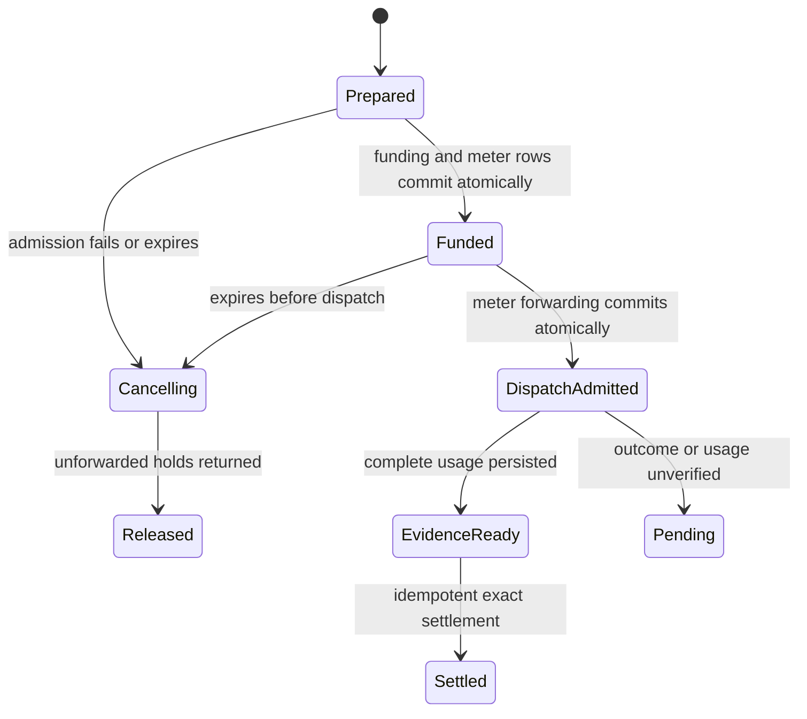

# Telnyx platform billing

Users authenticate to NyxID and spend NyxID credits on a shared, funded Telnyx
account. NyxID injects the account credential on its server. Users do not connect
Telnyx OAuth or supply a Telnyx key for this offering. HTTP and MCP are two ways
to execute the same operation and use the same admission and settlement code.

This implementation supports a restricted pilot of **one fixed model's
nonstreaming, text-only chat completions**. It does not enable production access
or configure an account tariff. Existing `api-telnyx` BYOK and
`api-telnyx-oauth` services retain their current behavior.

## Offering and configuration

Create a dedicated HTTP catalog service, for example `telnyx-platform`, rather
than changing the existing BYOK offering. The slug must not start `platform-`:
that prefix belongs to retired legacy vendor services.

Use these settings together:

| Setting | Value |
| --- | --- |
| Base URL | `https://api.telnyx.com/v2` |
| Service category | `internal` |
| Credential injection | `bearer` |
| Platform key | Explicit `restricted` audience; start disabled |
| Allowed owners | Named pilot people only |
| Identity propagation | `none`; no token forwarding or delegation injection |
| Inference metadata, destinations, anonymous endpoints | Omitted/disabled |
| Operation | `POST /ai/openai/chat/completions` only |
| Platform-key primary price | `input_tokens`, **uncached** input rate |
| Components | `output_tokens` and `cache_read_tokens` |
| Legacy, BYOK and resale prices | Omitted/disabled for the dedicated offering |

The additive `billing.managed_execution` contract requires `model`,
`max_input_tokens` (the verified full context ceiling), `max_output_tokens`,
`max_request_bytes`, `max_response_bytes`, `tariff_version`, `tariff_source`, and
`tariff_verified_at`. The timestamp follows the model's BSON date adapter: JSON
accepts Extended JSON such as `{"$date":"2026-10-16T00:00:00Z"}`. MongoDB stores a
native date. The source must be a Telnyx HTTPS URL without query parameters or
credentials. Admission refuses verification older than 30 days; reverify rather
than advancing that timestamp without evidence.

Prices are exact decimal **NyxID credits per token**, not per million tokens.
Apply the deployment's documented credit-to-currency conversion to the
account-effective Telnyx rates. Require all three prices to synchronize with
Lago and match fresh cache rates. A missing or unsynced component blocks execution.
Prices are captured when funding is reserved and retained through settlement.
The [documented wallet setup](LAGO_SETUP.md) uses 1 credit = 1 USD. At that
conversion, an illustrative USD 0.25 per million tokens becomes
`0.00000025` credits per token. This example is not a Telnyx tariff; use the
verified account rate for each token class.

Configure the credential through NyxID's write-only service editor or CLI
`--credential-env` input. A dedicated catalog service needs an explicit key
submission. Do not extract the existing service's encrypted master credential.
Never put a credential in a committed manifest. See the nonsecret
[configuration template](examples/telnyx-platform-service.template.json).
Replace every placeholder and zero bound using verified evidence before
submitting the template. It deliberately contains no executable tariff or key.

Publish only the chat operation with a schema that pins the verified model and
requires `messages` and `max_tokens`. Do not reuse the full Telnyx overlay, which
advertises unsupported stateful and asynchronous operations. A catalog operation
policy should also allow only that POST path. The runner enforces the contract
even if discovery or a generic proxy request advertises something broader.
The [OpenAPI template](examples/telnyx-platform.openapi.template.json) contains
only that operation; fill in the same model/version and set the `max_tokens`
schema maximum to the contract output cap before publishing it.

## Request and charging contract

The request accepts only:

```json
{
  "model": "THE_VERIFIED_MODEL_ID",
  "messages": [{"role": "user", "content": "Hello"}],
  "max_tokens": 128,
  "stream": false,
  "temperature": 0.5
}
```

Text roles are `system`, `user`, and `assistant`; at least one user message is
required. Streaming, tools, multimodal content, stored conversations, alternate
models, additional generation parameters, query parameters, node routing, pool
routing, scheduled durable-grant calls and permission-execution ingress are
outside this pilot. The LLM gateway cannot bypass the managed runner.

Billing must be enabled for the acting person, with Lago, a provisioned wallet
and subscription, complete prices, and available allowance/grant/wallet funding.
Platform usage charges the acting person's wallet under the existing owner
resolver. Disabling billing or excluding the person from rollout refuses the
operation; it does not make the shared Telnyx balance free to use.

Admission reserves the verified full context bound and the configured output
maximum. This deliberately reserves conservatively until a tokenizer bound has
been proven. It never estimates the maximum charge from JSON bytes. Unused
funding is released after verified usage settles through the existing exact
allowance → grant → wallet and ledger paths.

Complete responses must report the exact pinned model, request identity,
`prompt_tokens`, `completion_tokens`, `total_tokens`, and
`prompt_tokens_details.cached_tokens`, all coherent nonnegative integers within
the admitted limits. Uncached input is prompt tokens minus cached tokens. The
current upstream OpenAPI example does not guarantee the cached-token field;
**verify real responses for the chosen model before pilot activation**. A model
without that evidence does not meet this contract.

## Durable recovery and pending status

`managed_executions` stores metadata, configuration snapshots and validated token
usage. It does not store prompts, completion bodies, or credentials.



Only the successful dispatch claim can produce an outbound permit, bound to the
catalog configuration and normalized request. The same execution cannot claim
dispatch twice. A supervised, bounded exchange continues accounting after the
HTTP or MCP caller disconnects and retains its service concurrency lease.
Timeout, process crash after admission, malformed usage, non-success provider
responses, or response limits preserve possible liability. No ambiguous request
is automatically retried or settled as zero.

Authenticated callers can read their last 50 executions using
`GET /api/v1/billing/executions`, or one using
`GET /api/v1/billing/executions/{id}`. These are metadata-only routes scoped to
the acting person. Successful HTTP responses include `X-NyxID-Execution-Id`;
uncertain response errors include the execution identity. Pending records show
their state, reservation ceiling and a bounded reason code. The normal billing
reconcile cadence releases expired unforwarded work and replays persisted valid
evidence. Dispatched unknown work stays pending.

This release has **no automatic Telnyx detail-record reconciliation or general
operator evidence-resolution API**. Restrict the pilot to attended users and
stop new access if an unresolved vendor outcome occurs. Preserve its execution
and funding records for investigation. Do not release uncertain holds by editing
wallets or fabricate usage to unblock an account. Resolving a pending operation
requires a reviewed evidence-recovery path through the existing settlement
machinery before broad release.

## Activation checklist

1. Upgrade every backend replica before writing the new contract. Older binaries
   ignore unknown managed contracts and cannot enforce this boundary. Keep the
   audience disabled while old replicas exist; rollback requires disabling and
   draining managed access first. Preserve all pending execution and meter rows.
2. Verify the funded Telnyx key, one exact model, context ceiling, output cap,
   real response schema and request-to-provider-cost correlation.
3. Verify account-effective rates, currency and credit conversion. Public
   `/v2/pricing/products` data supplies list rates and is insufficient to assert
   account invoice parity. Do not silently allocate unrelated charges or taxes.
4. Create the disabled restricted service, submit its key through a write-only
   channel, publish the one operation, configure exact prices and synchronize
   all components. Confirm billing migration and rate-cache readiness.
5. Run the managed transaction tests against a real MongoDB replica set. Prove
   rejection before vendor dispatch for billing failures, duplicate-dispatch
   rejection, cancellation races, cached usage, rate retention and settlement
   recovery. Then run an attended paid pilot through both HTTP and MCP.
6. Enable only the pilot owner allowlist, compare NyxID settlements with
   attributable Telnyx billing evidence and agree a tolerance before expansion.
   Zero markup is a pricing policy; invoice parity remains unproven until that
   comparison passes.

SMS, calls, assistants, stored conversations, embeddings and speech require
additional ownership, cost adapters and reconciliation. SMS must handle actual
parts and carrier charges; calls must handle duration increments, all legs and
enabled features. Telnyx funding and auto recharge cover the upstream account;
these additions determine how NyxID safely attributes that spending to users.

## CLI walkthrough after verification

Use an admin session against the upgraded environment. Copy the two templates
to local working files, fill in the verified model, bounds, timestamp and exact
prices, and set the OpenAPI `max_tokens.maximum` to the contract output cap.
Keep the platform key disabled and the allowlist empty during configuration.
The service template is an API payload; wrap it in a catalog manifest and add
its operation before using `admin catalog apply`:

```python
import json
from pathlib import Path

service = json.loads(Path("telnyx-platform-service.json").read_text())
spec = json.loads(Path("telnyx-platform.openapi.json").read_text())
path = "/ai/openai/chat/completions"
operation = spec["paths"][path]["post"]
service["operations"] = [{
    "name": operation["operationId"],
    "method": "POST",
    "path": path,
    "description": operation["summary"],
    "request_body_schema": operation["requestBody"]["content"]["application/json"]["schema"],
    "request_content_type": "application/json",
}]
Path("telnyx-platform.catalog.json").write_text(
    json.dumps({"services": [service]}, indent=2) + "\n"
)
```

Review the plan and apply it while access is disabled:

```sh
nyxid admin catalog apply --file telnyx-platform.catalog.json --dry-run --base-url https://nyx-api.chrono-ai.fun --output json
nyxid admin catalog apply --file telnyx-platform.catalog.json --base-url https://nyx-api.chrono-ai.fun --output json
nyxid service update telnyx-platform --catalog-admin --credential-env TELNYX_PLATFORM_KEY --base-url https://nyx-api.chrono-ai.fun --output json
```

Set `TELNYX_PLATFORM_KEY` securely in the shell before the credential command;
the nonsecret manifest must never contain it. The CLI uses the saved admin
session and submits the credential through the write-only update. A dry run
checks the proposed catalog changes; runtime tariff, synchronization and funding
checks still apply. Confirm all three prices are synced before granting access.

After the activation checklist passes, set `PILOT_PERSON_UUID` to the verified
pilot person's NyxID UUID and enable the restricted platform audience:

```sh
nyxid service update telnyx-platform --catalog-admin --platform-key-audience restricted --platform-key-allow "$PILOT_PERSON_UUID" --platform-key-enabled true --base-url https://nyx-api.chrono-ai.fun --output json
```

A pilot user with a saved NyxID session can then connect and invoke the operation:

```sh
nyxid service add telnyx-platform --platform-key --base-url https://nyx-api.chrono-ai.fun
nyxid proxy request telnyx-platform ai/openai/chat/completions --method POST --data @chat-request.json --base-url https://nyx-api.chrono-ai.fun
```

`chat-request.json` uses the request shape above and the verified model. This
POST spends real Telnyx funds and NyxID credits. MCP discovers the same published
operation for authorized callers and uses the same managed billing runner.

## Local validation

Use a disposable MongoDB replica set through `NYXID_TEST_DATABASE_URL`. Match
the repository's CI toolchain and debug-information setting to keep the large
backend test binary's memory use bounded:

```sh
CARGO_PROFILE_TEST_DEBUG=line-tables-only cargo +1.98.1 test --locked -j 1 -p nyxid --bin nyxid-server managed_execution_service
CARGO_PROFILE_TEST_DEBUG=line-tables-only cargo +1.98.1 test --locked -j 1 -p nyxid --bin nyxid-server telnyx_platform_service
CARGO_PROFILE_TEST_DEBUG=line-tables-only cargo +1.98.1 test --locked -j 1 -p nyxid --bin nyxid-server services::billing:: -- --test-threads=4
```

The managed lifecycle tests require transaction support and fail if MongoDB is
unavailable. They make no Telnyx requests and do not spend vendor funds.
