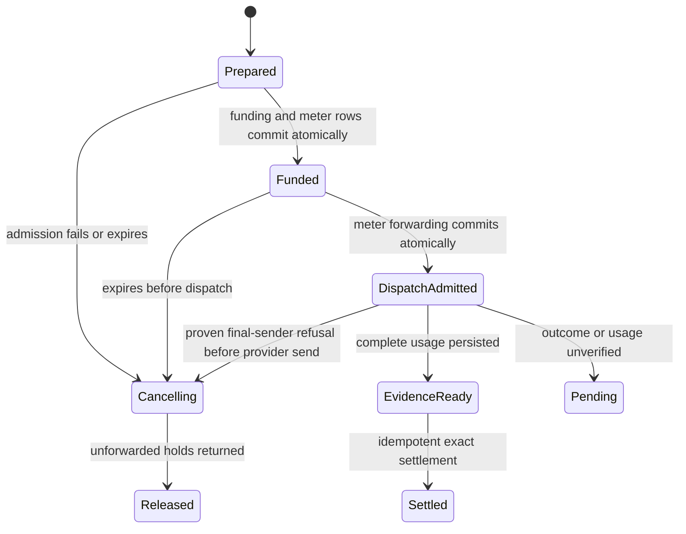

# Telnyx platform billing

Users authenticate to NyxID and spend NyxID credits on a shared, funded Telnyx
account. NyxID injects the account credential on its server. Users do not connect
Telnyx OAuth or supply a Telnyx key for this offering. HTTP and MCP are two ways
to execute the same operation and use the same admission and settlement code.

This implementation supports a restricted pilot of **one fixed model's
nonstreaming, text-only chat completions**. It does not enable production access
or configure an account tariff. Existing `api-telnyx` BYOK and
`api-telnyx-oauth` services retain their current behavior.

## Offering and configuration

Create a dedicated HTTP catalog service, for example `telnyx-platform`, rather
than changing the existing BYOK offering. The slug must not start `platform-`:
that prefix belongs to retired legacy vendor services.

Use these settings together:

| Setting | Value |
| --- | --- |
| Base URL | `https://api.telnyx.com/v2` |
| Service category | `internal` |
| Credential injection | `bearer` |
| Platform key | Explicit `restricted` audience; start disabled |
| Allowed owners | Named pilot people only |
| Identity propagation | `none`; no token forwarding or delegation injection |
| Inference metadata, destinations, anonymous endpoints | Omitted/disabled |
| Operation | `POST /ai/openai/chat/completions` only |
| Platform-key primary price | `input_tokens`, **uncached** input rate |
| Components | `output_tokens` and `cache_read_tokens` |
| Legacy, BYOK and resale prices | Omitted/disabled for the dedicated offering |

The additive `billing.managed_execution` contract requires `model`,
`max_input_tokens` (the verified full context ceiling), `max_output_tokens`,
`max_request_bytes`, `max_response_bytes`, `tariff_version`, `tariff_source`, and
`tariff_verified_at`. The timestamp follows the model's BSON date adapter: JSON
accepts Extended JSON such as `{"$date":"2026-10-16T00:00:00Z"}`. MongoDB stores a
native date. The source must be a Telnyx HTTPS URL without query parameters or
credentials. Admission refuses verification older than 30 days; reverify rather
than advancing that timestamp without evidence.

Prices are exact decimal **NyxID credits per token**, not per million tokens.
Apply the deployment's documented credit-to-currency conversion to the
account-effective Telnyx rates. Require all three prices to synchronize with
Lago and match fresh cache rates. A missing or unsynced component blocks execution.
Prices are captured when funding is reserved and retained through settlement.
The [documented wallet setup](LAGO_SETUP.md) uses 1 credit = 1 USD. At that
conversion, an illustrative USD 0.25 per million tokens becomes
`0.00000025` credits per token. This example is not a Telnyx tariff; use the
verified account rate for each token class.

Configure the credential through NyxID's write-only service editor or CLI
`--credential-env` input. A dedicated catalog service needs an explicit key
submission. Do not extract the existing service's encrypted master credential.
Never put a credential in a committed manifest. See the nonsecret
[configuration template](examples/telnyx-platform-service.template.json).
Replace every placeholder and zero bound using verified evidence before
submitting the template. It deliberately contains no executable tariff or key.

Publish only the chat operation with a schema that pins the verified model and
requires `messages` and `max_tokens`. Do not reuse the full Telnyx overlay, which
advertises unsupported stateful and asynchronous operations. A catalog operation
policy should also allow only that POST path. The runner enforces the contract
even if discovery or a generic proxy request advertises something broader.
The [OpenAPI template](examples/telnyx-platform.openapi.template.json) contains
only that operation; fill in the same model/version and set the `max_tokens`
schema maximum to the contract output cap before publishing it.

## Request and charging contract

The request accepts only:

```json
{
  "model": "THE_VERIFIED_MODEL_ID",
  "messages": [{"role": "user", "content": "Hello"}],
  "max_tokens": 128,
  "stream": false,
  "temperature": 0.5
}
```

Text roles are `system`, `user`, and `assistant`; at least one user message is
required. Streaming, tools, multimodal content, stored conversations, alternate
models, additional generation parameters, query parameters, node routing, pool
routing, scheduled durable-grant calls and permission-execution ingress are
outside this pilot. The LLM gateway cannot bypass the managed runner.

Billing must be enabled for the acting person, with Lago, a provisioned wallet
and subscription, complete prices, and available allowance/grant/wallet funding.
Platform usage charges the acting person's wallet under the existing owner
resolver. Disabling billing or excluding the person from rollout refuses the
operation; it does not make the shared Telnyx balance free to use.

Admission reserves the verified full context bound and the configured output
maximum. This deliberately reserves conservatively until a tokenizer bound has
been proven. It never estimates the maximum charge from JSON bytes. Unused
funding is released after verified usage settles through the existing exact
allowance → grant → wallet and ledger paths.

Complete responses must report the exact pinned model, request identity,
`prompt_tokens`, `completion_tokens`, `total_tokens`, and
`prompt_tokens_details.cached_tokens`, all coherent nonnegative integers within
the admitted limits. Uncached input is prompt tokens minus cached tokens. The
current upstream OpenAPI example does not guarantee the cached-token field;
**verify real responses for the chosen model before pilot activation**. A model
without that evidence does not meet this contract.

## Durable recovery and pending status

`managed_executions` stores metadata, configuration snapshots and validated token
usage. It does not store prompts, completion bodies, or credentials.



Only the successful dispatch claim can produce an outbound permit, bound to the
catalog configuration and normalized request. The same execution cannot claim
dispatch twice. A supervised, bounded exchange continues accounting after the
HTTP or MCP caller disconnects and retains its service concurrency lease.
Timeout, process crash after admission, malformed usage, non-success provider
responses, or response limits preserve possible liability. No ambiguous request
is automatically retried or settled as zero.

NyxBot's final authority check runs inside the managed worker immediately before
the provider send. A typed refusal at that boundary proves the operation was not
sent, so its dispatch bookkeeping and reserved funding can be released. A timeout,
lease loss or uncertain transport result cannot supply that proof. Once the
operation may have been dispatched, its pending liability and settlement survive
Stop and caller disconnect.

Authenticated callers can read their last 50 executions using
`GET /api/v1/billing/executions`, or one using
`GET /api/v1/billing/executions/{id}`. These are metadata-only routes scoped to
the acting person. Successful HTTP responses include `X-NyxID-Execution-Id`;
uncertain response errors include the execution identity. Pending records show
their state, reservation ceiling and a bounded reason code. The normal billing
reconcile cadence releases expired unforwarded work and replays persisted valid
evidence. Dispatched unknown work stays pending.

This release has **no automatic Telnyx detail-record reconciliation or general
operator evidence-resolution API**. Restrict the pilot to attended users and
stop new access if an unresolved vendor outcome occurs. Preserve its execution
and funding records for investigation. Do not release uncertain holds by editing
wallets or fabricate usage to unblock an account. Resolving a pending operation
requires a reviewed evidence-recovery path through the existing settlement
machinery before broad release.

## Activation checklist

1. Upgrade every backend replica before writing the new contract. Older binaries
   ignore unknown managed contracts and cannot enforce this boundary. Keep the
   audience disabled while old replicas exist; rollback requires disabling and
   draining managed access first. Preserve all pending execution and meter rows.
2. Verify the funded Telnyx key, one exact model, context ceiling, output cap,
   real response schema and request-to-provider-cost correlation.
3. Verify account-effective rates, currency and credit conversion. Public
   `/v2/pricing/products` data supplies list rates and is insufficient to assert
   account invoice parity. Do not silently allocate unrelated charges or taxes.
4. Create the disabled restricted service, submit its key through a write-only
   channel, publish the one operation, configure exact prices and synchronize
   all components. Confirm billing migration and rate-cache readiness.
5. Run the managed transaction tests against a real MongoDB replica set. Prove
   rejection before vendor dispatch for billing failures, duplicate-dispatch
   rejection, cancellation races, cached usage, rate retention and settlement
   recovery. Then run an attended paid pilot through both HTTP and MCP.
6. Enable only the pilot owner allowlist, compare NyxID settlements with
   attributable Telnyx billing evidence and agree a tolerance before expansion.
   Zero markup is a pricing policy; invoice parity remains unproven until that
   comparison passes.

SMS, calls, assistants, stored conversations, embeddings and speech require
additional ownership, cost adapters and reconciliation. SMS must handle actual
parts and carrier charges; calls must handle duration increments, all legs and
enabled features. Telnyx funding and auto recharge cover the upstream account;
these additions determine how NyxID safely attributes that spending to users.

## CLI walkthrough after verification

Use separate saved human profiles for the admin and pilot. Every command below
uses the native `nyxid` binary. Set nonsecret shell variables to the verified
model, bounds, tariff evidence and exact **credits per token**. Load
`TELNYX_PLATFORM_KEY` securely into the environment; never put its value in argv
or a manifest. The write and paid steps below require the operator's approval
for the target environment.

Read the deployment configuration first:

```sh
nyxid whoami --profile billing-admin --output json
nyxid admin billing config show --profile billing-admin --output json
nyxid admin billing overview --profile billing-admin
```

Use a separately authorized BYOK connection for the upstream probe. The models
GET is read-only; the completion POST spends vendor funds. `probe-request.json`
uses the verified model and a bounded text-only request. `probe-response.json`
must be the raw provider response, including explicit cached-token usage.

```sh
nyxid service add api-telnyx --slug telnyx-verification --credential-env TELNYX_PLATFORM_KEY --terminal --profile billing-admin
nyxid proxy request telnyx-verification ai/openai/models --profile billing-admin
nyxid proxy request telnyx-verification ai/openai/chat/completions --method POST --header 'Content-Type: application/json' --data @probe-request.json --profile billing-admin --output json > probe-response.json
```

Generate a nonsecret catalog manifest with platform access disabled and an empty
restricted allowlist. The template creates one internal service and one
`chat_completions` operation, pins the model enum and renders the output cap as
an integer. It contains no billing block. The internal service uses server
defaults for `requires_user_credential: false`, `identity_propagation_mode: none`
and `inject_delegation_token: false`; those fields are left unauthored. The
template explicitly disables access-token forwarding. Review the dry run before
applying:

```sh
nyxid admin catalog add --template telnyx-platform --var model="$MODEL" --var max_output_tokens="$MAX_OUTPUT_TOKENS" --save telnyx-platform.catalog.json --dry-run --profile billing-admin --output json
nyxid admin catalog apply --file telnyx-platform.catalog.json --dry-run --profile billing-admin --output json
nyxid admin catalog apply --file telnyx-platform.catalog.json --profile billing-admin --output json
```

Reapplying these disabled access defaults to a live pilot requires interactive
confirmation, or `nyxid admin catalog apply --allow-access-change --file
telnyx-platform.catalog.json` for non-interactive use. `catalog add --yes` does
not authorize the change; a dry run only warns. If creation succeeds but a
follow-up update fails, apply reports `created`, the service ID and the failed
fields, then exits 1. Rerun apply to reconcile that existing service.

Author the managed contract and the three exact prices. Review its request body,
field diff and conservative full reservation ceiling before running the same
command without `--dry-run`:

```sh
nyxid admin billing service set-managed telnyx-platform \
  --model "$MODEL" --max-input-tokens "$MAX_INPUT_TOKENS" \
  --max-output-tokens "$MAX_OUTPUT_TOKENS" --max-request-bytes "$MAX_REQUEST_BYTES" \
  --max-response-bytes "$MAX_RESPONSE_BYTES" --tariff-version "$TARIFF_VERSION" \
  --tariff-source "$TARIFF_SOURCE" --tariff-verified-at "$TARIFF_VERIFIED_AT" \
  --input-price "$INPUT_PRICE" --output-price "$OUTPUT_PRICE" \
  --cache-read-price "$CACHE_READ_PRICE" --probe-response probe-response.json \
  --dry-run --profile billing-admin --output json
nyxid service update telnyx-platform --catalog-admin --credential-env TELNYX_PLATFORM_KEY --profile billing-admin --output json
nyxid admin billing service show telnyx-platform --profile billing-admin
nyxid admin billing rates --service telnyx-platform --profile billing-admin
nyxid admin billing service verify telnyx-platform --managed --profile billing-admin --output json
```

Readiness must exit 0 before enabling access. It checks configuration and fresh
exact rates; it does not prove replica versions, payer funding, tariff provenance
or upstream behavior. If synchronization failed, inspect its row errors, correct
the cause, then explicitly run `nyxid admin billing service resync telnyx-platform
--profile billing-admin`. Resync is a write, runs once, and exits 2 if any row
remains unsynced. The response's `synced` flag means a change occurred.

The pilot provisions their own wallet/subscription. An admin credit grant funds
the person but does not provision their wallet or enable their billing rollout.
Confirm the pilot's rollout separately and review every recipient's returned
`activation_state`; a pending activation grant cannot be spent.

```sh
nyxid billing wallet --provision --profile pilot --output json
nyxid admin credits grant issue --user "$PILOT_PERSON_UUID" --amount 5 --service telnyx-platform --reason "Attended Telnyx pilot" --profile billing-admin --output json > grant.json
nyxid admin credits grant list --user "$PILOT_PERSON_UUID" --profile billing-admin --output json
nyxid service update telnyx-platform --catalog-admin --platform-key-audience restricted --platform-key-allow "$PILOT_PERSON_UUID" --platform-key-enabled true --profile billing-admin --output json
nyxid service add telnyx-platform --platform-key --profile pilot
```

Grant amounts are exact decimal strings: greater than zero, at most 1,000,000
credits, with up to twelve fractional digits. Integer `--amount 5` still works.
Issuance requires confirmation or `--yes` and sends a generated UUID v4 request
ID. The CLI prints it on stderr before the POST (as JSON in JSON mode) and
includes `request_id` in JSON results and issuance errors. After an uncertain
failure, rerun the identical command with `--request-id <printed UUID>` using
the same admin account. This returns the original frozen batch; a new
invocation without that flag creates a new batch. A different payload with
the same request ID returns HTTP 409 naming that ID. Confirmation still applies
on a retry.

Retry-safe issuance requires all server replicas at NyxID 0.72.0 or later
(credit allocations, #1950). The CLI sends `amount` and omits legacy
`amount_credits`: older replicas ignore unknown exact-amount/request-ID fields
but require the legacy amount, so this payload fails there instead of silently
issuing an unprotected batch. Do not fall back to legacy requests during rollout.

Grant list and revoke tables show exact balances, held and reclaimed credits,
status, activation, revoke state and service limits; JSON retains the server
response. With allocations enabled, revoke requests reclaim unused credits
after held work finishes. A requested revoke on an active grant is pending;
`complete` means the grant is revoked. Held includes reserved credits rather
than adding another balance. Immediate revoke without the allocation capability
refuses grants with in-flight holds.

Personal wallet GETs also provision a missing wallet. With `--owner-id`, the
wallet command always uses an owner-aware POST and provisions the selected
wallet if missing, even without `--provision`; the server checks org access.
Platform-key execution is billed to the acting person, so provision the pilot's
personal wallet for this walkthrough.

Billing commands, catalog apply, proxy requests and MCP tools/calls check saved
sessions before work and refresh expired tokens. Billing reads, catalog apply,
MCP discovery and proxy GET/HEAD retain 401 refresh and replay. Idempotent wallet
provisioning, top-up checkout and grant issuance POSTs also retain it; checkout
reuses the same idempotency key and issuance reuses its request ID and entire
body. Billing configuration and grant revocation writes, other proxy methods
and MCP execution calls do not replay on 401. Network and 5xx failures do not
automatically retry grant issuance. Explicit or environment credentials never
switch to a saved session for refresh.

The next HTTP POST and MCP call each spend real Telnyx funds and NyxID credits.
Run one attended call at a time. The MCP envelope records `started_at` and
`finished_at` RFC3339 bounds for correlation. `chat-request.json` uses the same
flat text-chat shape for HTTP and MCP.

```sh
nyxid proxy request telnyx-platform ai/openai/chat/completions --method POST --header 'Content-Type: application/json' --data @chat-request.json --profile pilot --output json --envelope > http.json
nyxid billing executions show "$(jq -r .execution_id http.json)" --wait --timeout-secs 120 --profile pilot --output json
nyxid mcp tools --service telnyx-platform --profile pilot --output json
nyxid mcp call telnyx-platform__chat_completions --args @chat-request.json --envelope --profile pilot --output json > mcp.json
nyxid billing executions list --since "$(jq -r .started_at mcp.json)" --profile pilot --output json
nyxid billing executions show "$MCP_EXECUTION_UUID" --wait --timeout-secs 120 --profile pilot --output json
nyxid admin usage --from "$(jq -r .started_at mcp.json)" --to "$(jq -r .finished_at mcp.json)" --service telnyx-platform --user "$PILOT_PERSON_UUID" --profile billing-admin --output json
nyxid admin billing ledger verify --all --profile billing-admin --output json
```

A successful HTTP call carries an execution ID; unchanged proxy invocations keep
the provider body on stdout and print the ID on stderr. The envelope includes
it in JSON with HTTP status, a JSON-or-text body and a `headers` object limited
to `x-nyxid-execution-id`, `x-nyxid-agent-id` and `x-request-id` when present.
A managed pending HTTP or MCP outcome exits 2 with the ID: inspect execution
state and do not automatically repeat the paid request. Other MCP `isError`
results exit 1. MCP success omits the ID, so identify `MCP_EXECUTION_UUID` from
the self-scoped latest-50 list, matching the called service and creation time
between the envelope's `started_at` and `finished_at` bounds. The list has no
pagination. Plain execution show exits 0 for nonterminal state; `--wait` exits
2 if its timeout expires before `settled` or `released`.

MCP service discovery enumerates the complete visible operation list from GET
`/mcp/config` and reads every page of `tools/list`. It resolves missing, lazily
exposed schemas through `nyx__search_tools` using exact fully qualified tool
names, and fails loudly for any missing or invalid schema. Service calls use
`nyx__call_tool`; native meta-tools are called directly. The client reinitializes
once on HTTP 404 or JSON-RPC session-expired -32002 only when a session was sent;
a 404 during initialization is an `http_error`.

Calls wait indefinitely by default, matching proxy requests, with a 10-second
connection timeout. `--timeout-secs` bounds the whole MCP exchange. A timeout
before `tools/call` dispatch exits 1 and reports that nothing was executed.
After dispatch, a timeout exits 2 with `managed_outcome_uncertain` and correlation
bounds: inspect executions before retrying because a paid call may have
completed.

Execution reads expose state and reservation ceilings. Compare admin usage in
the tight attended window with provider usage: input = prompt minus cached,
output = completion, cache-read = cached. Compare the exact gross cost with
those quantities multiplied by the three configured rates. Vendor invoice parity
still requires Telnyx's records. To stop access, run:

```sh
nyxid service update telnyx-platform --catalog-admin --platform-key-enabled false --profile billing-admin --output json
```

See [the CLI billing reference](../skills/nyxid/references/billing.md) for file
updates, overdraft defaults, grants and output/exit contracts.

## Local validation

Use a disposable MongoDB replica set through `NYXID_TEST_DATABASE_URL`. Match
the repository's CI toolchain and debug-information setting to keep the large
backend test binary's memory use bounded:

```sh
CARGO_PROFILE_TEST_DEBUG=line-tables-only cargo +1.98.1 test --locked -j 1 -p nyxid --bin nyxid-server managed_execution_service
CARGO_PROFILE_TEST_DEBUG=line-tables-only cargo +1.98.1 test --locked -j 1 -p nyxid --bin nyxid-server telnyx_platform_service
CARGO_PROFILE_TEST_DEBUG=line-tables-only cargo +1.98.1 test --locked -j 1 -p nyxid --bin nyxid-server services::billing:: -- --test-threads=4
```

The managed lifecycle tests require transaction support and fail if MongoDB is
unavailable. They make no Telnyx requests and do not spend vendor funds.

### Local backend without Lago

CLI unit and binary tests use wiremock and need neither MongoDB nor Lago. For
manual write-path checks, use the repository's local development setup from
[ENV.md](ENV.md) with the Docker Compose MongoDB replica set, development RSA
keys and a disposable database. Copy `.env.example` to an ignored local env
file, select a loopback `BASE_URL`, set `BILLING_ENABLED=true`, and leave
`LAGO_API_URL` and `LAGO_API_KEY` unset. Start the backend with that environment
and log in to a separate human admin profile against its loopback URL.

Use `--base-url http://localhost:3001 --profile local-billing` on the catalog,
set-managed, service-show, resync and readiness commands above. Use only
synthetic tariff evidence and no upstream credential. This exercises failed
price synchronization and row error rendering without a vendor request. Verified
on 2026-10-20 against a disposable local replica set: template dry-run, apply,
unchanged reapply, set-managed and service show exited 0. Resync exited 2 with
`synced: false` and three failed price rows whose error was `Lago is not
configured; the reconcile sweep will retry`. Managed verification exited 2:
Lago, the absent credential and fresh exact rate checks failed, while the
published operation, model/output schema, proxy policy and billing flags passed.
A successful Lago sync and paid execution require
the separately authorized live acceptance run. Do not point this setup at a
shared database or production API.
