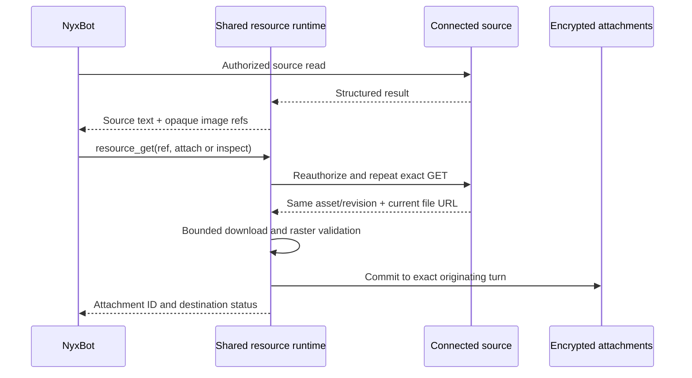

# Source resources and image display

NyxBot and specialists can retrieve an image reference from an authorized source
read and retain the image through the existing encrypted attachment pipeline.
The common MCP tool is `nyx__resource_get`. A source adapter interprets a known
provider response; the common runtime owns handle scope, authorization replay,
download bounds, image validation, attachment storage and destination reporting.
No knowledge index, per-document binding or setup skill is required.

## Current source adapter

`services/resource_adapter.rs` implements `notion.v1` for published, durable
`GET /v1/pages/{page_id}` and `GET /v1/blocks/{block_id}/children` operations.
It uses freshly resolved catalog provenance, so renamed or additional Notion
connections work. The first adapter supports server-routed `UserManaged`
bearer connections to the canonical `https://api.notion.com` base, without
identity propagation, token forwarding or delegation injection. Dynamic
instance operations without a positive producer generation, platform delegated
credentials, node routes and custom Notion gateways are outside this adapter.
Those source reads retain their ordinary text behavior.

Supported fields are image blocks, page cover/icon files, and page `files`
properties. Emoji icons and arbitrary nested URLs are excluded. File properties
require stable property identity and unique names. A selected file must actually
be PNG, JPEG, GIF or WebP when materialized; other formats return an explicit
unsupported-media result. This version does not traverse nested blocks or fetch
additional pages automatically. Their normal read operations can return their
own resource references.

## Compact Notion evidence

For assistant chat keys, a verified Notion block-children response is presented
as compact evidence instead of the provider's repeated metadata. It includes
block IDs, last-edited times, text, rich-text links, table cells, child-block
markers and the provider's pagination cursor. The default view includes a
bounded section index and preview. The original `ToolResponse.text` remains
unchanged for execution receipts and non-chat consumers.

To retrieve relevant sections from the same source read, pass `result_query`
beside the arguments of `nyx__call_tool`:

```json
{
  "tool_name": "my-notion__notion_list_block_children",
  "arguments_json": "{\"block_id\":\"<known page or block UUID>\",\"page_size\":100}",
  "result_query": "signature dishes vegetarian"
}
```

This field is presentation metadata and never reaches the provider. It accepts
1–256 characters and is available only for chat calls to a durable published
block-children GET. Normal live source authorization, operation restrictions,
guest rules, confirmations, execution and billing still run. Actual source
provenance must satisfy the Notion adapter before any content is interpreted.
An unsupported or malformed response retains its ordinary source text; a
requested query reports that compact retrieval was unavailable.

The deterministic lexical ranker favors matching section headings and their
parent headings, returning at most four sections within a 6,000-byte escaped
text budget. It marks omitted blocks, truncated text/links and omitted index
entries. Matching paragraphs precede other blocks within a selected section;
long paragraphs use a bounded excerpt around the first match, with its original
UTF-8 byte offset. A non-match applies only to the returned block page. Use `next_cursor`
for subsequent pages and `has_children` block IDs for nested tables/content;
never infer workspace-wide absence from an empty or partial result. This
per-read index has no embeddings, persistent cache or background sync.

Image resource annotations still precede the evidence and use the same opaque
references. Compaction does not attach an image: `nyx__resource_get` with
`output: "attach"` is required. Resource replay and image validation continue
to operate on the original source response.

A local fixture can be measured without printing its content:

```sh
NYXID_NOTION_EVIDENCE_FIXTURE=/path/to/block-list.json \
NYXID_NOTION_EVIDENCE_QUERY='signature dishes vegetarian' \
cargo test -p nyxid notion_evidence_local_fixture_probe -- --ignored --nocapture
```

The probe reports source/output bytes, returned/omitted counts and extraction
time. This measures parsing and retrieval; it is not a model completion or
production latency benchmark.

### Specialist configuration and reuse

This capability adds no persisted specialist setting or source-binding editor.
It applies to any assistant chat's verified Notion block read. `result_query`
is a per-call option; its response scope and output bounds are shared runtime
behaviour. Restaurant names, outlet aliases, page IDs, database IDs and answers
do not belong in the retrieval implementation.

Use the existing specialist configuration: linked-service grants select the
authorized connection, Role describes the task and starting sources, and
attached skills hold repeatable procedures and source guides. Source identifiers
in that configuration are guidance, not a page-level access restriction. Skills
do not grant service access, and guest turns omit attached skills; a channel
bot's guest-facing source routing must therefore remain available without a
private skill. The existing agent model setting controls new specialist threads
unless the owner explicitly chooses a model for the thread.

A structured Knowledge sources editor, persistent retrieval index, scheduled
refresh and per-agent retrieval policy would be additional features. None is
introduced by compact evidence presentation.

## Request flow

1. NyxBot calls the ordinary connected-source read. Its existing grants,
   operation scopes, guest policy, approvals, billing and routing apply.
2. After execution, the adapter interprets the typed response. MCP presentation
   prefixes a bounded `NyxID image resources` annotation containing opaque
   `ref`, `kind` and `label` fields. The underlying `ToolResponse.text` remains
   unchanged for receipts and other digest consumers. Failure to issue handles
   does not discard successful source text.
3. To display an image, NyxBot calls:

   ```json
   {"ref":"<opaque UUID>","output":"attach"}
   ```

   To request model viewing, it uses `output: "inspect"`. Both direct invocation
   and `nyx__call_tool` wrapping use the same handler. The tool accepts no URL,
   headers, source identifier or credential supplied by the model. An optional
   `acknowledgement_id` can present the exact pending source-operation card.
4. NyxID loads the handle in the exact owner, conversation, agent, key, turn and
   audience scope. It then repeats the saved source GET through the normal
   service dispatcher. Only bounded `page_id`, `block_id`, `start_cursor` and
   `page_size` arguments can be retained. It compares the immutable service and
   endpoint IDs, producer generation, endpoint contract and resolved execution
   fingerprint before dispatching. Source replay is bounded to 2 MiB.
5. The fresh response must contain the same stable selector and source revision.
   A changed `last_edited_time`, missing asset, changed account/credential or
   changed endpoint returns `resource_stale`; NyxBot must reread the source.
   An automatic OAuth refresh may conservatively invalidate an old handle.
   A new temporary file URL with the same selector/revision can be used without
   persisting that URL.
6. A fresh client downloads the file with no provider authorization or user
   headers. HTTPS, public DNS/address checks, address pinning, a 30-second
   timeout, no redirects, an 8,192-byte URL limit and a streamed 5 MiB body
   limit apply. MIME/magic checks precede the bounded extraction worker's full
   raster decode, dimension limit and allocation limit.
7. One MongoDB transaction accepts the image into the exact live, unstopped
   turn, inserts its encrypted attachment bytes and marks the resource
   completed. The commit rechecks the conversation credential, agent,
   owner/guest audience, lease and live API key. It cannot attach a delayed
   download to a newer turn. An image-slot refusal leaves neither attachment
   metadata nor stored bytes behind.
8. The result identifies the retained attachment and reports the captured
   destination. Retained/scheduled media is not reported as successfully
   delivered. The existing browser, group, channel and automation attachment
   paths handle rendering and delivery according to their capabilities.



## Intent and retry behavior

`attach` enables channel delivery and skips an extra model image round.
`inspect` requests model viewing, subject to the selected model's image
capability, without enabling channel delivery. They are independent, monotonic
intents: requesting both in either order preserves one attachment and enables
both flags. Source authorization and revision are rechecked for every request;
an already completed resource reuses the validated, retained bytes rather than
downloading again. Existing binary tool images with no `image_inspection`
metadata preserve their automatic inspection behavior.

Equivalent source reads in the same key and turn reuse one resource and one
UUID-v4 attachment ID. Concurrent requests consume one attachment slot. A later
independent turn receives a fresh attachment identity so the same image can be
delivered again. This does not cache authorization across turns or requests. The narrowly bound
confirmation continuation described below is the sole old-ref exception.

## Confirmation continuations

Organization source reads retain the existing confirmation rules in Auto and
Ask modes. The initial authorized read and the image replay are separate GETs;
each consumes its own exact card when confirmation is required. Resource replay
requests a fresh card instead of implicitly presenting the initial read's used
card. Trusted service-policy refusals retain their structured JSON and recovery
instructions; provider errors cannot create a continuation.

A resource records only its pending card ID and requested output. The same live
turn may retry with that exact `acknowledgement_id`. After the owner approves
and a new turn starts, the old ref is accepted only for the matching
server-validated confirmation message, live allowed card, unchanged key/agent/
audience and output. The source execution gate consumes that card exactly once
under its unchanged service-authority binding. Changing the access mode,
including switching to Full access, invalidates that saved binding. The owner
must start a fresh turn and reread the source; Full access can then retrieve and
attach the fresh image without a new confirmation. Successful source and
revision validation issues a fresh current-turn resource and attachment identity.
Unrelated turns, changed intent, expired/denied/used cards and key changes cannot
adopt the old ref. Concurrent pending intents cannot overwrite a live intent.
A binding failure returns `resource_confirmation_unavailable` with the original
trusted refusal under `source_policy`; it does not instruct approval of an
unsaved image intent. Fresh-row issuance rechecks the original scoped ref,
expiry and pending card/output inside its transaction, including when reusing
an existing current-turn row.

A source or download failure after card consumption remains a failure; this
flow does not reset consumed cards or promise automatic retry. The shared
source client preserves the application's 10-second connection timeout and
90-second idle-pool timeout while disabling redirects.

## Persistence and limits

`assistant_resources` stores immutable source identity, an execution fingerprint,
allowlisted GET arguments, selector/revision and an allocated attachment ID.
It stores no file URL, source response body or credential. Handles expire after
one hour; reads enforce expiry independently of MongoDB TTL cleanup. At most
32 handles can be issued per turn. Resource records are removed by conversation
and owner deletion; TTL provides eventual cleanup for settled turns. The
existing eight-attachment limit still applies.

The handle collection has expiry and scope/identity indexes. Issuance updates
`active_turn.resource_refs` and inserts the resource atomically; the parent write
serializes concurrent equivalent issuers and Stop/settlement. Materialization
commits the completion marker, attachment row and active-turn reference together.

## Validation

Targeted tests cover stable selectors, ambiguous names/IDs, unsupported URLs,
source revision/authority drift, scoped expiry, bounded handle issuance,
concurrent deduplication, monotonic intents, key/turn/Stop/lease fences,
malformed/oversized raster downloads, redirects and private-address rejection.
The MCP integration test runs a mocked source read through the real execution
hook and follows it with direct display and wrapped inspection. It checks a
renamed connection, retained encrypted bytes, no source credential on the file
request, one CDN download, and refusal after endpoint/credential/scope changes.
Mock origins are registered per listener and compiled only in tests.

Verification on 2026-10-17 passed 95 distinct targeted and related tests against
MongoDB 8.0.34: the 66-test `resource_` group, existing MCP image handling and
destination notes, six channel-media tests, 20 URL-validation tests, and the
existing turn-image retention/deletion test. The MCP integration test also
passed independently after the request-path normalization fix. The source and
file servers in that test are mocked; no live Notion/channel smoke test, load
test or retrieval-latency benchmark was run.
Production `cargo check -p nyxid --offline -j 1`, formatting of all 20 changed
Rust files, local documentation links and `git diff --check` also passed.

This capability does not implement background Notion synchronization, indexed
knowledge retrieval, conversational onboarding jobs or business publication
policy. Those remain in the [general knowledge and media plan](../plans/2026-10-16-nyxbot-knowledge-and-media.md).
