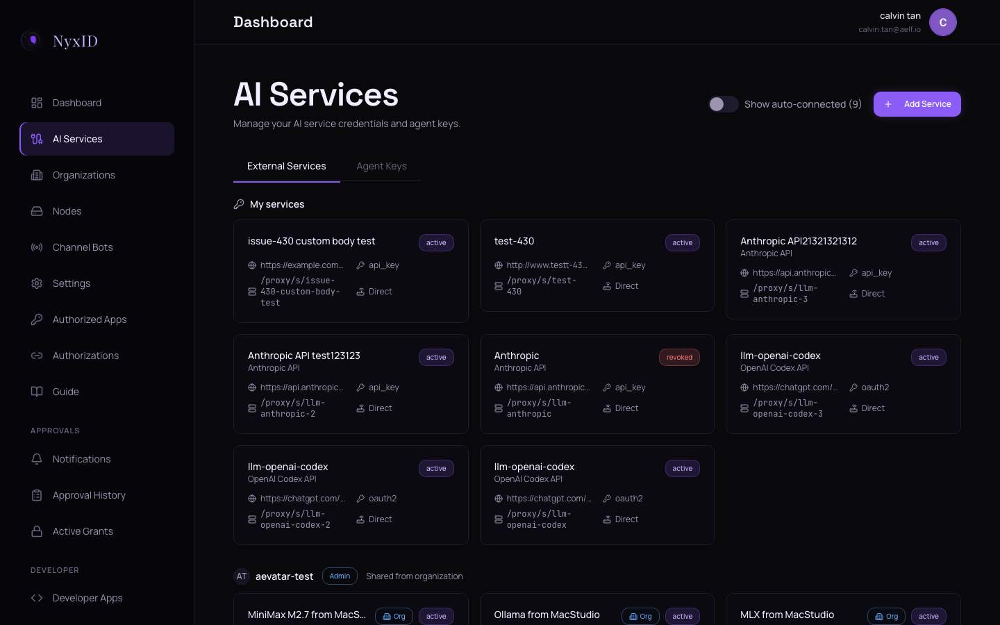
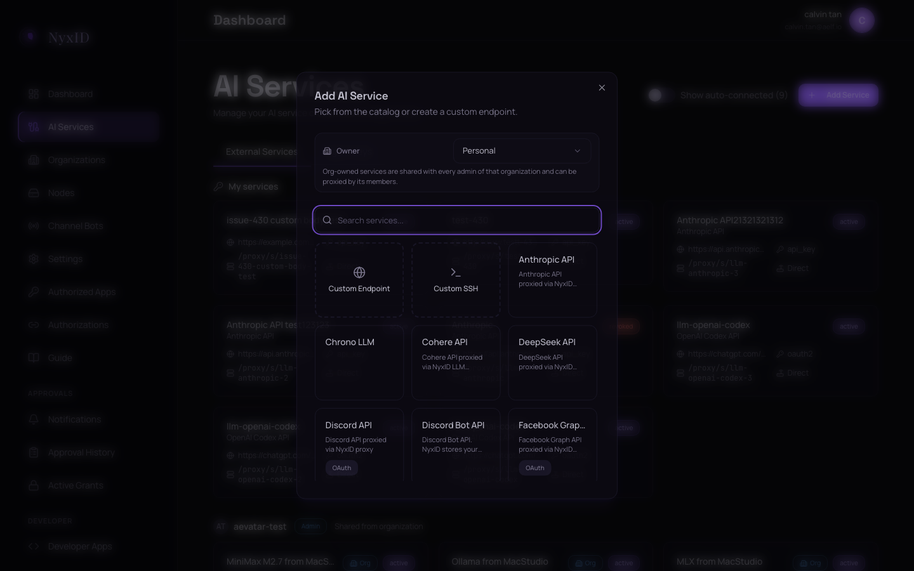
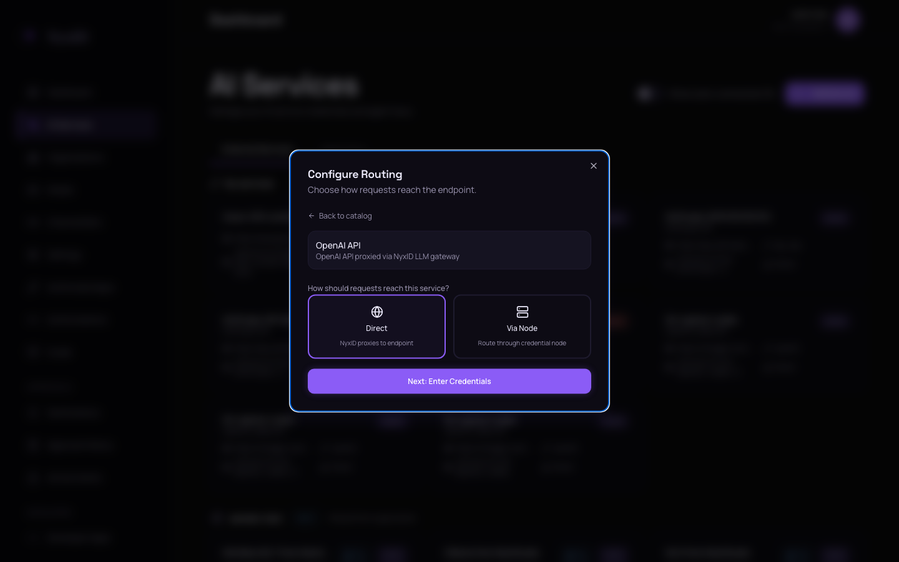
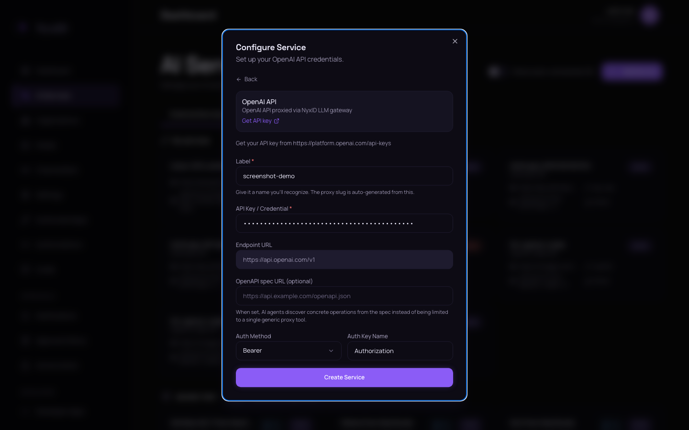
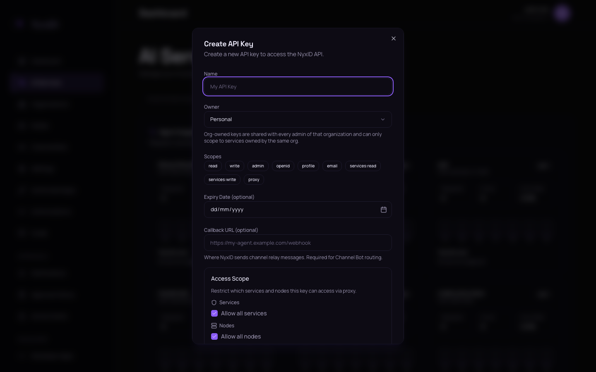
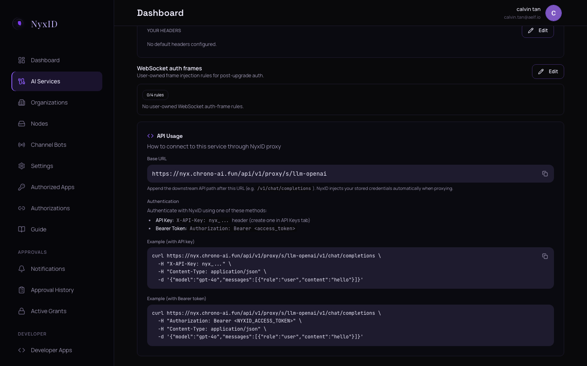

# Web UI — Connect Your First AI Service

Click-through walkthrough. End state: an `HTTP/1.1 200` response from your first proxied call.

This is the Web UI flow. If you want CLI, AI-driven, or curl instead, see the [hub](README.md).

## Hosted (recommended for first-time users)

Console URL: **https://nyx.chrono-ai.fun**

### 1. Sign in

If you don't have an account yet, register at [nyx.chrono-ai.fun/register](https://nyx.chrono-ai.fun/register) with invite code `NYX-FGNY85AF`.

### 2. Add an AI Service

1. Click `AI Services` in the left sidebar (you'll be on the `External Services` tab). The page shows your existing services and the `Connect Service` button (or `+ Connect` in the compact toolbar).

   

2. Click `Connect Service`. The `Add AI Service` dialog opens with the catalog.

   

3. Pick `OpenAI` from the catalog. (Use OpenAI for verification — its example curl works out of the box. You can add Anthropic, GitHub, etc. afterward.)

4. The `Configure Routing` step appears. Click the `Direct` card (NyxID proxies to OpenAI directly — the `Via Node` option is for self-hosted services behind a firewall). Then click `Next: Enter Credentials`.

   

5. The `Configure Service` step appears. Paste your **provider API key** in the `API Key / Credential` field — for OpenAI, an `sk-...` key. This is the **external service's** credential, **not** a NyxID `nyx_...` key. NyxID stores it encrypted.

   

6. Click `Connect Service`. The dialog offers `Create Agent Key` or `Maybe later`.
   Creating here gives you a key with `proxy` scope restricted to this connection.
   Copy the full key when it appears; it is shown once. For supported services,
   click `Test Agent Key` to make a real read-only proxied request. A successful
   proxied 2xx completes the browser's first-call checklist step. Provider errors
   retain the Agent Key diagnostic and offer `Retry test`; `Done` closes the dialog.

   OAuth and device-code connections reach the same optional setup step after
   authorization. Completing provider sign-in alone does not complete the first-call
   step. If you choose `Maybe later`, create an Agent Key from the `Agent Keys` tab.
   Open the connection's detail page from `External Services` for `API Usage`.

### 3. Create a NyxID Agent Key

If you created an Agent Key in the connection dialog, reuse it. Otherwise create one separately. The service detail example uses a placeholder or a masked preview; neither can authenticate.

1. Open a new tab on `AI Services` and switch to the `Agent Keys` tab.
2. Click `Create API Key`. The `Create API Key` dialog opens.

   

3. Give it a name (anything — `quickstart-test` is fine).
4. Under `Scopes`, click the `proxy` badge so it's highlighted. The `proxy` scope is required for `/api/v1/proxy/...` requests; without it the proxy returns 403.
5. Restrict service access to the connection you want this key to call. Keep node access restricted to the intended node if the connection uses one.
6. Click `Create Key`. The dialog shows the full key **once** — copy it now.

To verify in the browser, open that Agent Key's detail page, find `Verify key`,
paste its full secret in `Agent key`, and click `Test key`. The pasted secret must
belong to the key on that page. `Gateway checks passed` reports that the selected
key reached the allowed route and NyxID rejected an invalid slug; it does not prove
that another existing service is excluded. The provider diagnostic separately
reports whether the allowed call succeeded. Activation requires the matching key's
proxied 2xx, independently of the invalid-slug check. Network failures and other
inconclusive denied-leg results show `Denial unverified`.

The dashboard keeps successful built-in verification for the signed-in user across
navigation and refresh in this browser. Other accounts have their own checklist.
A terminal curl verifies the service independently; use a built-in test to update
the browser checklist.

### 4. Run the verification curl

1. Return to the service detail tab. Scroll to the `API Usage` section.

   If you lost that tab, go to `AI Services` → `External Services`, find the service you just created, and click its service card to reopen the service detail page.

   

2. Click the **copy icon** on the `Example (with API key)` curl block.
3. Paste it in your terminal. **Replace the `nyx_...` placeholder or the selected key's masked preview (ending in `••••••••`) with the full Agent Key you saved at creation.** Selecting a key changes only the preview; the copied template still needs the real secret.
4. Run it.

> **Windows users:** Run this curl from a Unix-compatible shell — WSL Ubuntu (recommended) or Git Bash both work. See [docs/WINDOWS_SETUP.md](../WINDOWS_SETUP.md) for the one-time setup.

The OpenAI example returns chat-completion JSON with `"choices": [...]` and a generated message. GitHub connections use a read-only `GET /user` example on the actual connection slug (`api-github`, `api-github-2`, etc.) and return your GitHub user JSON. A restricted Agent Key works only for its permitted services and nodes; adding a connection does not widen it.

## Self-host

Console URL: **http://localhost:3000** (port 3000, while the API runs on 3001).

Same steps as hosted, except you sign in with the account you registered against your local instance. If you don't have NyxID running locally yet, see [docs/SETUP.md](../SETUP.md) first.

## What if the curl errors?

- **400 from NyxID with `bad_request`, code `1000`, and `Bad request: API key is pending_auth`**: open the connection detail page, choose `Continue authentication`, finish provider sign-in, then return and retest. Refresh the service page if its status is stale. You can use Back or close the dialog and reopen the same pending connection to continue authentication.
- **Provider 4xx/5xx with valid Agent Key evidence**: read the provider diagnostic, fix the credential or wait for the provider to recover, then `Retry test`. This does not complete the first-call step.
- **401 Unauthorized from OpenAI** (downstream): the **provider** key you pasted in section 2 is wrong or revoked. Open the service's detail page and update the credential.
- **403 Forbidden from NyxID**: your Agent Key is missing the `proxy` scope. Go back to `Agent Keys`, edit the key (or create a new one), and add `proxy`.
- **401 from NyxID with `Missing API key`**: you forgot to replace the literal `nyx_...` placeholder in the copied curl with your real Agent Key.

For other failure modes, see the **Did it work?** section in the [hub](README.md#did-it-work).

## Next

- **Want your AI agent to use this service?** After the service is added, connected, and verified from `AI Services`, wire MCP — see [ai-driven.md](ai-driven.md).
- **Want to script this for more services?** See [cli.md](cli.md) or [direct-api.md](direct-api.md).
- **Want to expose a private API behind your firewall?** See [docs/NODE_PROXY.md](../NODE_PROXY.md).
