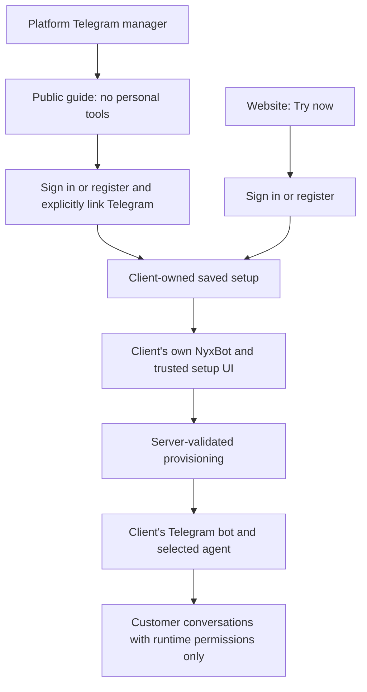
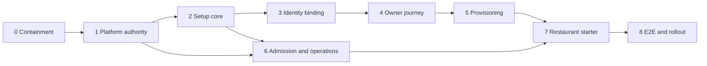

# Platform BotFather and reusable client onboarding

Status: reviewed construction plan; PR 1 contract decisions remain explicit
implementation gates. Date: 2026-10-13.
Repository baseline: `1819c7219`, branch `nyxbot-telegram-botfather-setup`.
Scope: implementation plan, not a production change or deployment authorization.

Implementation authorized 2026-10-14. Platform route creation, configuration,
activation and management are restricted to NyxID admins, enforced by the
backend (including alternative route setters). Public clients may use the
onboarding flow and manage only their own approved setups; operator role alone
does not authorize platform route control. Existing personal routes retain
their existing permissions and default behavior.

Execution: one Heca GPT-6.1-Sol worker, xhigh, full access; no worker delegation.
The primary agent personally reviews implementation and iterates with that
worker. This supersedes any additional reviewer-agent requirement below.
Production deployment and activation remain separate from implementation.

Consultation and findings: [Fable and independent review](2026-10-13-platform-botfather-review.md).

## Outcome

`@nyxid_manager_bot` helps prospective clients register or sign in to NyxID,
select a use case, and provision their own agent and Telegram channel. The
platform administrator manages the offering, but neither anonymous visitors nor
authenticated clients run with that administrator's personal assistant context,
service directory, credentials, or account-management authority. The
administrator contacting this public bot follows exactly the same client path.

Both entry points converge on one saved setup:



After binding, the public manager can show narrowly projected progress and
help draft changes. Privileged general account work belongs in the client's own
NyxBot or trusted browser. Completing onboarding entirely from Telegram is a
later convenience built on the same step-specific approvals, not a switch into
the client's unrestricted NyxBot inside the shared manager.

## Evidence and corrections

### Current live configuration

The session created specialist `nyxbot-tg` and linked it through the ordinary
NyxBot channel API. Relevant nonsecret references:

| Resource | ID |
| --- | --- |
| Telegram manager channel | `bb3f92a9-6cf9-405c-9bca-bc422c8555d5` |
| Telegram remote bot | `8631737144` (`nyxid_manager_bot`) |
| Personal specialist | `f79ed7f1-621f-434e-b76a-7ceccd9424f2` |
| Personal NyxBot channel link | `0aac6d2a-990d-4154-a34e-2b09c5a3a83c` |

The last inspected specialist had `services: []`, `account_read: false`, empty
guest access, machines and logins. Its channel link was active, gateway-backed,
`private_chats: everyone`, and `owner_linked: true`. Its latest response listed
personal service names. These observations prove metadata exposure in an owner
conversation; they do **not** prove successful personal service execution.
The deployed backend version has not been pinned. Verify it before attributing
the live behavior to the checked-out source.

Source explains why the present architecture is inappropriate:

- `backend/src/handlers/nyxbot.rs::start_chat_turn` uses the agent home thread
  for a verified owner's private chat and can fall back to `ensure_nyxbot` when
  an agent selection is absent.
- `backend/src/handlers/mcp_transport.rs::load_all_services_for_meta_tools`
  loads the owner's directory and filters to service grants only for guests.
  Owner specialists discover ungranted services to request permission.
- `chat_access` and `chat_service_gate` distinguish discovery from grants and
  can ask the owner's orchestrator for permission.
- `services/assistant_agent_credential_service.rs::KeyAuthority::Subagent`
  already constrains execution keys to the specialist's grants. Do not erase
  existing personal-specialist discovery semantics as a substitute for a new
  platform execution boundary.
- `docs/TELEGRAM_NEW.md` states manager callbacks omit
  `X-NyxID-User-Token`. That protects the relay boundary, but downstream
  ordinary NyxBot linking independently associates messages with a personal
  assistant identity. No-owner-token alone is insufficient.
- `mcp_transport.rs::mcp_service_scope` treats chat keys as unrestricted
  for ordinary tool publication unless the distinct organization-owner branch
  applies. `handle_tools_list` therefore also needs an explicit platform
  boundary; testing only connected-service search misses this path. Whether
  the deployed NyxAgent uses stateless or session-backed publication must be
  verified. Catalog discovery and connected-service metadata are different
  surfaces; do not describe catalog listings as executed personal effects.
- `telegram_new_service.rs` reserves `/start` and accepts only its own
  48-character creation challenge. Other payloads are swallowed. A normal
  NyxBot `nyxlink_...` owner-verification deep link cannot be assumed to work
  on the manager. A new identity handoff needs an explicit reserved protocol
  dispatch, not an ordinary channel deep link.
- `nyxbot.rs::known_owner_senders` can seed the operator's sender ID from their
  Telegram notification connection. This explains owner classification without
  a successful manager `/start` pairing link. Do not reuse notification linking
  or self-asserted OpenClaw mappings as general client identity proof.

Earlier statements that empty grants completely isolated this bot were too
strong. Prompt restrictions were added, but prompts are not an access-control
mechanism. This planning work has **not disconnected the live link**.

### Restaurant workspace input

Read the discussion in `[toread]restaurant-onboarding-bot-flow`, workspace
`01a13527-f5d7-7b41-9554-b0f3d0548af3`, primary agent
`01a13527-f5e8-7cc0-aaf4-fd0e4a545d74`, chat
`01a13527-f5eb-7f13-97b9-dc671cee363e`, messages 1, 7, 8 and 9. The discussion
includes an Opus 5.5 adversarial review; its conclusions are prior design input,
not evidence that the proposed features already exist.

Carry forward:

- Two entries: platform conversation and website Try now; one saved setup.
- Three responsibilities: platform acquisition guide, client's own NyxBot,
  and customer-facing specialist. An optional setup worker is not the runtime
  customer specialist and receives temporary authority only.
- Versioned use-case manifest plus owner-scoped setup record, which becomes
  the active installation. Avoid separate business/location hierarchies and a
  general workflow engine in the first release.
- Structured draft facts cross the authentication boundary only after review;
  public transcripts never become privileged NyxBot instructions or memory.
- Restaurant v1: approved FAQ, externally hosted reservation-request form
  link, Telegram, contact/staff handoff, cost controls. Customer runtime can
  have zero external connector grants.
- Private memory is unsuitable for published FAQs. Add explicit versioned
  guest-visible publication.
- Future conversational reservation intake requires a validated, tenant-bound
  operation. Confirmed bookings and queue management need their own
  authoritative state and concurrency rules.

Primary external checks on 2026-10-13:

- [Telegram managed bots](https://core.telegram.org/api/bots/managed-bots):
  managed child bots remain owned by their creator; a manager requests native
  creation rather than silently creating a bot identity as another user.
- [Google Forms responses](https://developers.google.com/workspace/forms/api/reference/rest/v1/forms.responses):
  the responses resource exposes read methods, not a response-submission API.
  Do not promise programmatic customer form submission through that resource.

## Architecture decisions

### 1. A platform execution profile is mandatory

Administration, model funding, execution identity, client identity, and
destination ownership are different fields and must remain separate in code.

| Role | Permitted authority |
| --- | --- |
| Human platform administrator | Configure templates, manager credentials, published help, quotas, rollout and operator diagnostics through admin UI |
| Public guide runtime | Published help/template discovery, create own bounded draft, initiate identity handoff, projected setup status for its verified sender |
| Authenticated client | Approve destination, resources, grants, publication and activation through trusted human surfaces |
| Provisioning worker | Execute a specific approved setup step under server-resolved destination ownership |
| Client's NyxBot | Existing personal owner operations, separate from public guide |
| Customer-facing specialist | Published business data and explicitly scoped runtime operations |

Add a typed `platform_onboarding` execution profile, server configured and
default-off. Whether represented on the channel or in a separate platform-bot
config is finalized in PR 1; it must be durable and mandatory in callback,
conversation, credential, tool-dispatch, recovery and late-effect checks.
Do not rely on bot name, persona, `guest=true`, or a generic service grant.
Do not introduce a new `AgentKind` unless mapping the existing specialist
machinery with explicit platform authority proves inadequate.

Platform mode must:

- Never call owner-thread selection or fall back to `ensure_nyxbot`.
- Partition private conversations by platform config, remote manager identity,
  numeric sender/chat, binding generation and execution-profile generation.
  Do not use one home thread for the operator or all clients.
- Reuse guest context exclusion/admission mechanics where sound, but persist an
  immutable per-turn platform authority in addition to guest status. A guest
  boolean alone can be changed by ordinary channel ownership paths and does
  not constrain every discovery surface.
- Build context only from public help, selected template, that sender's draft,
  and safe status projection. No operator memory, checkpoint, roster,
  services, pending decisions, app messages, or permission-request machinery.
- Publish only onboarding tools and reject personal tools on every dispatch
  path, including `tools/list`, search, connected-service discovery, direct
  calls, `nyx__call_tool`, REST/proxy alternatives and tool-name aliases.
- Fail closed on unknown mode, missing profile, stale binding, revoked
  authority or missing upstream support. No fallback to personal execution.
- Recheck live profile/binding/approval generation before every effect and
  recovery. Revocation must invalidate cached context and persisted upstream
  session ownership, not merely remove a UI route.

A dedicated platform identity is useful for ownership and funding, but ordinary
service accounts are not currently supported substitutes for human assistant
routes. `require_first_party_human` explicitly rejects them. Keep existing human
routes unchanged; introduce a narrow onboarding service interface if a worker
service account is needed. No admin role, `proxy:*`, catalog editor scope,
impersonation endpoint, or arbitrary user selector is granted to the guide.

### 2. Identity binding does not grant general account access

Use a dedicated binding protocol informed by `docs/DEVICE_LOGIN_PROTOCOL.md`
and Rule 12 in `CLAUDE.md`, not the actual device-login token delivery flow.
The public bot must never receive a user JWT, browser cookie, refresh token,
Agent Key, password, or MFA secret.

1. A verified manager webhook starts a handoff for an exact private sender/chat.
2. Send an expiring public code and trusted frontend review URL. Store only
   HMACs of challenge material and minimal requesting identity metadata.
3. Preview is non-mutating and suppresses telemetry. Authenticate with existing
   registration/social/password/MFA flows. Honor invite policy, email
   verification, disabled accounts and existing membership rules.
4. The signed-in human sees the account, manager, intended action, and public
   code; explicitly confirms that it matches the requesting Telegram chat.
   Decisions use the existing minimum 750 ms throttle posture. Account
   switching discards previous review and draft adoption decisions.
5. If additional chat-side confirmation is used, only a fresh authenticated
   update from the initiating numeric sender/chat can finish it. A copied
   browser link alone is never a verified Telegram identity. Define and test
   relay/phishing residuals; never market a transferable code as strong proof.
6. Atomically consume the request and save an active binding. Binding only
   allows bounded onboarding resume; it is not ownership of any child bot and
   grants no general customer credential access.

Unique active binding key is `(platform_config_id, manager_bot_id,
telegram_sender_id)`; private chat id is also verified. Support explicit unlink,
expiry, reauthentication, account replacement and generation increments.
Rebinding never silently moves saved setups or client resources. Numeric
Telegram IDs, usernames, email claims, child-bot creation claims and verified
NyxID account identity are separate proofs.

Authenticated `/my setups` in the manager returns only that binding's safe
projection. Unauthenticated responses must not disclose whether an arbitrary
email/Telegram account has a NyxID account. Group chats receive generic help
and a private-chat handoff, never identity review or client setup data.

### 3. Two product concepts, plus necessary security records

**Use-case template:** static, versioned, server-owned manifest with typed
questions, schema/defaults, connector requirements, compile-time supported
provision steps, runtime permission template and readiness predicates. Starting
templates: `telegram-assistant@1` and `restaurant-starter@1`. No remote executable
workflow, arbitrary callbacks, model-authored grants or unreviewed template
packages.

**Client setup:** one owner-scoped record carries selected template/version,
validated facts, resources and progress. It becomes the installation after
activation. For anonymous drafts `owner_user_id` is absent; only the bound
sender's capability can access it until the human adopts its reviewed facts.
Authenticated ownership uses existing person/org conventions, not a new tenant
or business ID parallel to NyxID's resource ownership.

Security records remain separate where appropriate: platform configuration,
identity binding/approval and step execution/outbox records. These are not
additional competing installation models.

Proposed setup fields (schema design, not implemented):

```text
_id: UUID v4 string
owner_user_id?: existing polymorphic resource owner
initiating_actor_id?: authenticated person
source: web | telegram
platform_config_id?, binding_id?, binding_generation?
template_id, template_version, revision
state, validated_facts, published_content_revision?
resource_refs: selected_agent_id?, channel_bot_id?, creation_request_id?, form_url?
steps: step_key -> {state, attempt_id, resource_ref?, safe_error?, retry_at?}
approved_config_digest?, approved_by?, approved_at?, approval_revision?
activation_status, readiness_evidence, test_evidence
quota_policy_ref, created_at, updated_at, expires_at?, purge_after?
```

All datetimes use the mandated BSON helpers; IDs follow repository conventions.
No tokens, raw webhooks, whole public transcripts or credentials in these rows.
Closed schemas, maximum fact sizes, bounded setup counts and metadata-only
audit fields are part of the contract. Draft state is untrusted input. Encrypt
unpublished anonymous/client draft facts containing business/contact details
with existing envelope encryption; expose only owner-approved public fields
through the published snapshot. Define access and purge for guide conversation
history separately; never treat channel metadata storage as permission to
retain message bodies indefinitely.

State progression:

```text
draft -> awaiting_identity -> collecting -> awaiting_connections
      -> awaiting_approval -> provisioning -> ready_for_test -> active
```

`failed_retryable`, `paused`, `cancelled` and `expired` are explicit states;
failed/expired authentication and stale approvals do not silently advance.
`connected` is not `active`, and `active` is not proof of delivery. Structured
progress, not transcript merging, provides cross-channel continuity.

V1 supports personal destination ownership. Preserve the polymorphic schema;
org activation stays unavailable until live admin ACLs, linking-person keys,
billing attribution and revocation are covered end to end. A user selecting an
existing specialist may use only an authorized agent compatible with the
template and reviewed runtime authority.

### 4. Scoped provisioning, not admin impersonation

The assistant drafts a proposed outcome; a deterministic backend validates it.
Approval binds template version, destination, agent, channel identity,
connector/resource references, runtime permissions, public content, budget,
revision and binding generation to a digest. Editing any authority-relevant
field invalidates that approval.

The frontend may invoke the existing human setup APIs directly after review.
For background completion, capture step-specific approved authority and reuse
internal service-layer helpers with an explicit actor and destination. Do not
forge `AuthUser`, bypass ACLs or expand human-only routes to service accounts.

Worker tokens, if needed, carry audience and exact onboarding scopes; handlers
also require an active approved setup-step capability. Service-account scope
alone cannot authorize arbitrary account creation, grants or user IDs. Proposed
operations are intentionally few:

| Operation | Server-resolved inputs and restrictions |
| --- | --- |
| `get_setup_status` | Bound setup; safe facts/progress only |
| `draft_setup` | Own bounded draft; no effect on resources |
| `request_setup_review` | Trusted fixed-origin UI link for a particular revision |
| `begin_telegram_setup` | Approved destination and step; existing managed creation service |
| `reconcile_setup_step` | Exact approved step and stored resources; no free-form provider call |
| `request_activation` | Reviewed runtime config, cost limits and readiness evidence |

No model argument names an arbitrary `user_id`, credential, callback URL,
service-account role or upstream endpoint. Backend resolves them from the
binding, human approval and setup. Specific future service accounts can be
granted as optional connectors to the worker; they are never replacements for
client consent or permission to use the administrator's connectors.

### 5. Reuse managed Telegram creation and preserve its webhook

Keep one manager webhook and its reserved management commands, callback
queries, creation events, redaction, secret verification and management-event
suspension semantics. Do not add another bot polling process or install a
second webhook. Generic guide inline callbacks are not available on this
manager today; v1 uses ordinary text, full URLs and existing native controls.

From the authenticated setup, start the existing `telegram-new` request with a
saved destination and a deliberate human authorization. Store its request ID
on the setup. This does **not** make Telegram's creation event carry that ID:
the native creation form and `ManagedBotCreated` do not echo an arbitrary setup
identifier or keyboard `request_id`. Current NyxID correlates the next eligible
creation from a sender with that sender's one active request. Preserve existing
per-actor and manager/sender serialization; a second setup waits rather than
starting another native creation prompt. Cancellation/restart cannot prove an
old Telegram form will not finish later. For onboarding, show the observed
exact child ID/username in trusted human review before assignment and public
activation, and never automatically adopt an ambiguous child. This may add a
review step compared with the existing generic auto-connect flow. Record the
approved child identity and creation observation/revision on the setup.
Telegram-first unbound creation can keep its existing
private claim-and-browser flow, then attach only the verified result to the
owner's setup.

Setup-linked Telegram requests carry `setup_id`, approved setup revision/digest
and authority/binding generations. Existing automatic creation workers must
validate these fences inside their worker/connect/registration path, including
the registration transaction; checks only in the outer onboarding worker are
insufficient. Invalidated setup requests cannot progress independently through
the generic auto-connect worker. New request variants stay opt-in and do not
change legacy creation requests. An ambiguous external operation that already
started is reconciled and recorded, never made public on a stale approval.

A creator proof can satisfy child owner verification only when the existing
workflow has bound that creation to the same authenticated actor. Manager
account linking alone never verifies ownership of a different child bot.
Manual-token setup remains a trusted-page fallback, with separate child owner
verification. No token enters the guide transcript.

The saved child channel selects the client's agent explicitly. New channels
remain non-public until approved public activation and budget readiness. An
installation-wide runtime gate, enforced on native and gateway admissions,
private/group/channel/topic/thread-follow traffic, asynchronous replies and
rebuild/relink paths, is authoritative. `private_chats=owner` alone is not
enough: current groups can admit guests after `owner_seen`, and ordinary access
setters can enable public traffic. Those setters may not bypass a managed
installation's activation state or change its reviewed authority silently.
Owner tests can use a separate bounded test mode; customers cannot activate it.
The
client's general NyxBot is not automatically exposed publicly; a public child
uses a reviewed specialist. Verify transport behavior on both native relay
and Agent Event Gateway paths; Telegram personal NyxBot links currently use
the gateway, whose provider handshake binds a person and may require an
upstream contract addition for platform mode.

### 6. Failure recovery and limits precede public activation

Each provisioning step has a stable setup/step/revision identity, recorded
attempt barrier, leased execution and fencing generation. Persist completed
resource IDs. Reconcile uncertain external outcomes before creating again.
Do not blindly repeat non-idempotent provider calls. Activation is an atomic
transition checked against live readiness and approval generation.

Cancellation stops new work and drains/reconciles in-flight effects; it does
not promise deletion of already created Telegram bots, external documents or
user-owned connectors. Cleanup affects only resources created by this setup,
with explicit user decisions for external deletion. Reusing a resource is not
ownership of its lifecycle.

Use an outbox for durable *setup status* and completion notices, with dedupe
and bounded retry. Do not turn the channel relay into a durable message-body
queue: ADR-013 remains intact. Manager ordinary delivery is transient, may
duplicate, has a 32-delivery per-process cap and may drop at capacity. Browser
status is authoritative when a Telegram progress notice is lost.

Reserve before admitting model work. Enforce atomic cross-replica per-sender,
per-platform and per-installation budgets/concurrency, bounded input/output,
draft/creation count limits and expiration. Funding is explicit: the platform
pays public guide work, the approved client funding policy pays child runtime.
Do not accidentally use the administrator's personal wallet as platform
funding. Integrate exact accounting where applicable; no ad hoc float balances.
Anonymous capacity is separately bounded from authenticated provisioning.
At a limit, return deterministic help/status, pause new model work and keep
human controls available.

## Delivery plan

Use `docs/plans/` to match this repository's existing plan location. Each step
is intended as a reviewable PR or bounded operations task. Keep the feature
default-off until the relevant dependencies pass. No PR is considered complete
from a document, mock screenshot or simulated provider success alone.

### PR 0 — Containment and evidence (small; serial first)

Context: the live manager is currently attached to a personal specialist;
empty service grants do not prevent owner service discovery or context reuse.
This plan has not performed containment.

Tasks:

- Pin the deployed NyxID, NyxAgent and gateway versions; inspect relevant
  thread/tool activity and key metadata without revealing key material.
- Disable/disconnect only the personal NyxBot channel link and its public
  agent route. Preserve the manager's bot-creation credentials and webhook.
- Verify old route/provider keys and late replies can no longer act. Disable
  any remaining exact routes that would reach the personal agent.
- Leave deterministic creation/sign-in guidance; no new LLM route until PR 1
  establishes the execution profile. Preserve contaminated history separately
  for bounded investigation; never migrate it into platform/client context.
- Write an operations runbook and a cheap regression reproducing metadata
  exposure in the old path and proving the platform path's intended refusal.

Verification: live channel/link/route readback, manager webhook verification,
old-key/late-event refusal, native creation staging regression. No service
execution using real personal credentials just to prove a boundary.

Exit: personal execution disconnected; bot creation still available; evidence
distinguishes metadata, permission requests and successful effects.
Rollback: deterministic guidance only; never restore the personal public route.
Execution model: strongest for authority diagnosis; default for runbook/tests.

### PR 1 — Platform execution authority (medium; after PR 0)

Context: ordinary owner/guest semantics in `nyxbot.rs`, `nyxbot_chats.rs`,
`assistant_instruction_context.rs`, `assistant_agent_credential_service.rs`,
`mcp_transport.rs` and `mw/auth.rs` are correct for personal bots but not for
the platform guide. Manager no-owner-token relay is already implemented.

Tasks:

- Write and review a short authority contract before implementation, including
  config representation and direct/gateway transport strategy.
- Implement durable default-off profile, dedicated funding/execution identity,
  private sender partitioning, public context builder and closed tool set.
- Enforce at credential construction, MCP publication/dispatch, REST/proxy,
  resume/retry/session refresh and late-effect boundaries.
- Ensure admin senders never select owner-thread context and missing agent
  selection never falls back to personal NyxBot.
- Coordinate any upstream gateway contract as a dependent sub-PR; if it cannot
  represent platform mode, retain a native public-guide receiver rather than
  pretending the current person-bound provider contract suffices.
- Add admin configuration and explicit unsupported-mode error. No broad
  changes to ordinary specialists, guest semantics or human-only endpoints.

Verification: authority tests for operator, two strangers and two clients;
tool-list/search/direct/wrapped-call attempts; forged mode and stale keys;
context/session isolation; ordinary specialist regressions.
Exit: empty personal directory and blocked personal execution/permission
requests for every platform sender, including admin, proven in real server
paths. Upstream support is version-pinned or a reviewed native path is used.
Rollback: disable profile and stop guide model work; native creation preserved.
Execution model: strongest design/review, default implementation.

### PR 2 — Templates and saved setup core (medium; after PR 1 contract)

Context: restaurant discourse requires two entry points and durable typed
facts, not shared privileged transcripts. Existing `nyxbot_watches`, channel
creation requests and action cards are reusable components, not the new setup
source of truth.

Tasks:

- Add static closed manifests, setup schema/state transitions/revision fences,
  indexes and owner/sender access helpers following handler/service/model layers.
- Add `telegram-assistant@1` and minimal `restaurant-starter@1` definitions.
- Implement safe projections, validated draft adoption, resume, expiry and
  cancellation. No external provisioning effects in this PR.
- Test two clients choosing the same template and one client opening concurrent
  setups. Make idempotency explicit without deduplicating deliberate new setups.
- Define retention and purge hooks for bindings, setups and content separately
  from audit retention. Register new errors centrally, avoiding reserved blocks.

Verification: transaction-capable Mongo tests for states, revision races,
ownership, duplicate requests, expiry, oversize facts and serialization.
Exit: same setup can resume from permitted surfaces; cross-client ID substitution
is refused; no credentials/public transcript copied into facts.
Rollback: read-only status for existing records, new initiation off.
Execution model: default implementation, strongest schema/ACL review.

### PR 3 — Registration and Telegram account binding (medium; after PRs 1–2)

Context: Telegram sender identity is not NyxID account identity. Device-login
review mechanics are a useful pattern, but delivering its account token to
the bot is forbidden. Existing manager start challenges run in the other
direction and do not substitute for general client linking.

Tasks:

- Add narrow HMAC-backed request/preview/approve/deny/revoke protocol with
  no account-token delivery, numeric sender/chat binding and generation fences.
- Reuse existing sign-in/registration/MFA/invite policy and safe return-to
  validation. Honor disabled email auth or invite-required deployment.
- Build review page showing requesting manager/chat, matching code, selected
  account and exactly what linking permits; login alone never approves.
- Protect review URLs from analytics, referrers and unsafe storage; no poll
  secret in public URLs. Preview/GET has no mutation; mutation routes use
  first-party human auth/CSRF posture. Deny/revoke are explicit.
- Add fixed-origin links and phishing/relay tests; reject group/forwarded
  identity proofs and account replacement without new review.
- Add explicit manager command/payload dispatch for the new binding protocol
  without intercepting existing 48-character creation challenges or recovery.
  Do not reuse `nyxlink_...` payloads that this manager currently consumes.
- Add delegated-read deny entries for new protocol/secret-bearing routes before
  mounting, as required by `mw/auth.rs` conventions.

Verification: approval race/replay/expiry, guessed or copied codes, different
sender/account, account switching, revoked binding, unavailable login providers,
invite policy and denied/disabled user. Browser/mobile-width review smoke.
Exit: new and existing clients adopt only reviewed drafts into their own setup;
bot holds no user login credential. Group privacy is preserved.
Rollback: no new binding; revoke incomplete requests; old bindings read-only
until profile generation and migration compatibility are established.
Execution model: strongest protocol design/review, default implementation.

### PR 4 — Website entry and authenticated owner journey (medium; after PRs 2–3)

Context: website Try now and Telegram handoff need one setup UI. The existing
`/nyxbot/onboarding` frontend is an Aevatar registration flow and lists missing
pairing/budget APIs; reuse suitable components, not its backend assumptions.

Tasks:

- Add bounded template selection hint across login and authoritative setup
  creation/resume after authentication; no owner ID in the URL.
- Show setup summary/progress in `/assistant` with explicit setup reference and
  client's own NyxBot, or a dedicated owner setup panel.
- Ask only missing typed questions; show draft outputs early; approval is
  separate from editing or login. Preserve server facts through refresh.
- Reuse `useAppForm`, domain Zod schema and TanStack Query hooks; handle
  service readiness errors without claiming connection or activation.
- Define operator-vs-client views; admin UI never becomes a client impersonation
  surface. Keep optional org destination disabled with clear explanation in v1.

Verification: related Vitest/schema/hook tests and changed-file lint; browser
flows for both entries, refresh, alternate account, small viewport, cancel and
resume. Full frontend/type/build gates follow repository CI policy.
Exit: both entries reach the same owner-approved setup; client retains their
own NyxBot as the management interface.
Rollback: hide new entry UI; keep existing setup status accessible.
Execution model: default; design specialist only if needed for UI review.

### PR 5 — Approved provisioning and Telegram child assignment (large; after PRs 1–4)

Context: use `telegram_new_service`, `assistant_team_service`, exact channel
linking, watches and encrypted credentials. Never correlate by the next random
bot or perform account changes with a platform admin bearer.

Tasks:

- Implement authority digest and explicit human approval; capture approved
  actor/destination/resource refs and revalidate before each effect.
- Add leased/fenced steps with attempt barrier, stable dedupe identity,
  durable result refs, uncertain-outcome reconciliation and bounded outbox.
- Implement generic assistant template: select/create client's agent, start
  exact managed creation request, observe that request, assign exact child bot,
  preserve creator/owner-verification contract and expose safe completion link.
- Keep the existing actor and manager/sender creation serialization. Bind the
  request to the setup, but explicitly review the observed child identity
  because Telegram does not echo the setup ID. Test stale form completion after
  cancellation/restart and two setups competing for one sender's creation slot.
- Propagate setup approval and binding generations into linked Telegram
  requests; enforce them within the generic creation worker, connect helper and
  registration transaction as well as onboarding dispatch.
- For approved background work use internal services under constrained step
  authority. Optional dedicated worker service account is default-deny and
  cannot call existing human routes, arbitrary proxy or arbitrary account APIs.
- Public child bots select a specialist with final runtime grants only; private
  general NyxBot use stays a deliberate separate choice.
- Cancellation/revocation and management-event suspension invalidate remaining
  steps and replies; never remove unrelated client resources or manager webhook.

Verification: real Mongo transactions, simulated Telegram/gateway; crash before
and after every provider/DB boundary; repeated worker/creation events; two
concurrent setups; stale approved revision; unauthorized resource substitution;
manual token path; rotated manager token; deletion/transfer/suspension.
Exit: client gets one correctly owned child bot and selected agent after retries;
  no broad admin credential enters execution; an installation-wide gate keeps
  every private/group/follow/reply path non-public until
PR 6 admission and explicit activation pass.
Rollback: stop new provisioning, reconcile attempted effects, retain resource
refs and status; no automatic external deletion or personal route fallback.
Execution model: strongest authority/failure design, default workers.

### PR 6 — Admission, costs, activation and operations (medium; contract starts with PR 1)

Context: public guide work is platform-funded; public customer specialist
traffic may be client-funded. Ordinary channel delivery is transient. This PR
is a prerequisite to exposing either as an open LLM endpoint.

Tasks:

- Add atomic per-sender/per-platform/per-installation rate, budget and concurrent
  admission, reserve bounded model cost before execution, deterministic fallbacks.
- Integrate explicit funding owners, exact accounting and metrics. Quota errors
  are capacity rejections, not server faults. Test settlement/release once.
- Add kill switches, generation invalidation, audit actor/client separation,
  safe diagnostic views, retry/cancel and sender unlink.
- Define separate `provisioned`, `ready`, `tested`, `active` and delivery health;
  extend readiness appropriately rather than assuming its present GitHub-only
  registry proves Telegram/template callability.
- Require owner-approved runtime permissions, content and funding, readiness
  evidence and customer-role test before public activation.
- Enforce installation activation on group membership auto-admission,
  `private_chats`/members setters, agent overrides, relink/rebuild and all
  transport/reply paths. Test a pre-activation group with `owner_seen=true`.

Verification: two replicas racing at a quota boundary, active-stream accounting,
anonymous floods, deterministic limit response, pause/revoke during work,
status notice duplicates/loss, no private data in audits/logs/diagnostics.
Exit: exhaustion blocks new spend and effects predictably; admin can halt guide
work without disabling manager creation; no accidental operator wallet funding.
Rollback: guide/child public admission off; trusted owner status remains.
Execution model: strongest budget integration review, default implementation.

### PR 7 — Restaurant starter publication (medium; after PRs 2, 4–6)

Context: restaurant workspace recommends FAQ plus request-form link; private
memory is excluded from guest turns and cannot implement public FAQ. Customers
need no NyxID account merely to ask questions.

Tasks:

- Collect bounded name, timezone, hours, location, menu links, contact and
  policies. Publish only client-reviewed versioned FAQ fields to guest context.
- Accept an existing customer-safe reservation form URL with validated scheme
  and no embedded secrets; show destination in owner review. No arbitrary
  fetched private documents in the customer turn.
- Generate specialist configuration with zero runtime connector grants and
  clear reservation-request/staff-confirmation wording.
- Owner changes through their NyxBot edit draft and republish; guests cannot
  edit business content or trigger approvals.
- Optional connector provisioning for forms/docs is a later sub-PR after
  provider readiness and exact resource constraints are proven. V1 does not
  require a broad Google or Notion grant.

Verification: unpublished/private content absence, old/new content revision,
guest prompt injection, link-only request wording, customer needs no signup,
operator/client/guest roles and cross-restaurant isolation.
Exit: tested restaurant child answers approved FAQ, supplies request link and
staff contact, obeys limits, and exposes no owner resources.
Rollback: unpublish/disable runtime while retaining owner-approved setup facts.
Execution model: default; strongest permission/publication review.

### PR 8 — End-to-end proof and controlled migration (medium; after PRs 1–7)

Context: current live `nyxbot-tg` belongs to a person. Simulated provider tests
cannot prove real Telegram creation and delivery, and older replicas may not
understand a new authority profile.

Tasks:

- Independent adversarial review of final authority, identity and recovery
  implementation, with all critical findings fixed and re-reviewed.
- Upgrade/drain all backend writers before enabling new profile records; pin
  minimum NyxAgent/gateway capability if used. Refuse old-profile handling.
- Keep a default-off rollout flag and pilot allowlist; move the manager to the
  platform config with fresh keys/sessions/partitions, never old home history.
- Run staging with two independent NyxID accounts and Telegram clients plus
  admin: registration/sign-in, linking, two setups, cancellation/retry,
  native child creation, owner and customer chat, public content and pause.
- Verify operator personal directory and services unavailable in every role,
  not just a stranger. Test rebind/revoke, guest permission escalation, fake
  owner claims and user-supplied foreign IDs.
- Document evidence and live-provider boundary; update canonical channel/chat
  docs and admin/client runbooks. Production switch requires separate explicit
  deployment authorization, after the reviewable result exists.

Verification: focused Rust suites with transaction-capable isolated Mongo;
related frontend suites/e2e; `cargo fmt --all -- --check`, changed-scope Clippy
and required CI checks. Full upstream/gateway checks if contract changed.
Exit: acceptance matrix below passes with recorded evidence and independent
review; staged real Telegram delivery is observed, not inferred from HTTP 202.
Rollback: default-off profile and revoke platform runtime keys; deterministic
manager creation preserved. Never restart incompatible old binaries against
new authority records or reattach the personal specialist publicly.
Execution model: strongest independent review, default staging execution.

## Dependencies and parallel work



PR 6 contract work starts with PR 1 and implementation can overlap PRs 3–5
after PR 2 freezes setup/funding interfaces. PR 7 content schema/UI exploration
can overlap provisioning, but no restaurant public activation before PRs 5–6.
Overlap only across agreed interfaces; `routes.rs`, `mw/auth.rs`, `db.rs`, MCP
dispatch and channel authority files need one integration owner. No concurrent
agents edit the same source without explicit ownership and merge coordination.

Git/GitHub are available. Branch each step from its reviewed dependency base,
write one problem/outcome PR description with relevant validation, run required
CI and merge in dependency order. Use this existing checkout for planning; do
not create extra worktrees or publish issues/PRs merely to finish the plan.
Size labels describe risk and scope, not calendar promises; PR 5 may split into
approval/worker and transport assignment after interface review.

### Useful release milestones

**Stage A: secure guide and human setup handoff (PRs 0–4 plus PR 6 admission).**
The manager gives public help, links the client's own account, saves the use case
and directs them to existing human creation/settings pages and their own
NyxBot. It watches only exact owner-authorized resource references and gives
safe progress. Agent assignment and public activation remain deliberate owner
actions; no automatic resource mutation is attributed to the platform guide.
Use only bounded test/pilot access until installation-wide activation fencing
is available. This is useful before automatic provisioning is complete.

**Stage B: automatic reviewed setup (PR 5 plus remaining PR 6 integration).**
The client approves a concrete setup and the constrained worker completes its
steps with Telegram-specific exact-child review where necessary. Same records,
bindings and UI; no second onboarding product.

**Stage C: restaurant starter and public launch (PRs 7–8).**
The template adds explicit FAQ publication, reservation-form link, limits and
observed owner/customer testing. Other verticals reuse the shared core rather
than duplicating signup, binding or provisioning logic.

## Acceptance matrix

| ID | Required behavior | Evidence |
| --- | --- | --- |
| A1 | Administrator messaging manager sees no personal services/context and cannot trigger personal permission requests | Real platform authority/tool/context tests, admin Telegram staging |
| A2 | New client registers using live signup policy; existing client resumes | Browser tests plus two-account staging |
| A3 | Telegram username/email claims and copied/expired codes cannot silently bind another account | Protocol races and phishing/relay cases |
| A4 | Binding never delivers account credentials or grants general account access | Response/storage/log checks and credential denial tests |
| A5 | Client A cannot list, configure, claim or receive client B's setup/resources/replies | ID substitution, two-client concurrency and late replies |
| A6 | Web and Telegram resume the same reviewed facts with separate conversations | Refresh/cross-entry tests; no transcript import |
| A7 | Exactly one owned child/agent is assigned to the exact setup after crashes and duplicate events | Transaction fault injection and observed Telegram creation |
| A8 | Public runtime authority never includes temporary setup/admin authority | Credential fields, tool lists, direct/wrapped effect refusals |
| A9 | FAQ visible only after publication; request link never claims confirmed booking | Guest context and customer role tests |
| A10 | Limits reserve spend atomically; platform guide never accidentally bills personal operator wallet | Cross-replica admission and exact accounting checks |
| A11 | Unlink, pause, revoke, account disable and bot management changes fence in-flight and resumed effects | Generation/recovery/late-effect tests |
| A12 | One manager webhook and native creation survive migration and rollback | Webhook assertions, rotation/delete regressions, staging |
| A13 | Actual successful customer reply is observed before marking delivery tested | Independent Telegram client evidence |
| A14 | Stale Telegram form completion and competing setups cannot silently assign the wrong child | Serialized creation, explicit exact-child review, cancel/restart tests |
| A15 | Group auto-admission and ordinary access setters cannot bypass managed installation activation | Native/gateway/group/follow/rebuild/reply tests |
| A16 | Generic auto-connect workers cannot outlive setup approval/binding revocation | Worker and registration-transaction fencing tests |

## Verification commands and artifacts

Planning validation: `git diff --check`, source/path existence, dependency and
acceptance coverage review. This plan adds no runtime code, so running the full
application suite would not validate its proposed behavior.

Implementation PRs use the existing server test package and focused filters,
with new suites named consistently, for example:

```sh
NYXID_TEST_DATABASE_URL='<isolated transaction-capable MongoDB>' \
  cargo test -p nyxid --bin nyxid-server platform_onboarding
NYXID_TEST_DATABASE_URL='<same isolated MongoDB>' \
  cargo test -p nyxid --bin nyxid-server telegram_new
NYXID_TEST_DATABASE_URL='<same isolated MongoDB>' \
  cargo test -p nyxid --bin nyxid-server assistant_authority
cargo fmt --all -- --check
cargo clippy -p nyxid --bin nyxid-server -- -D warnings
```

The `platform_onboarding` filter is proposed; create substantive tests before
using it and check that the run executed the intended cases, rather than
passing with zero tests. Broaden to channel/MCP/guest suites when those paths
change. Frontend uses `npm test -- <related test files>` and changed-file ESLint
from `frontend/`; browser smoke/e2e validates authentication and resume. Follow
actual repository instructions and CI requirements at implementation time.
Keep credentials out of command logs and evidence files.

Deliver review artifacts with the plan: Fable consultation synthesis,
independent adversarial findings/dispositions, authority/API contract, rollout
runbook and staging acceptance evidence. Do not turn a planned command into a
claim that a proposed feature has passed it.

## Deferred work and launch decisions

Deferred: generic workflow engine, per-location hierarchies, org-first setup,
arbitrary inline-button callbacks on manager, other messaging channels,
automatic client-account creation by service accounts, programmatic Google
Forms response submission, confirmed booking/capacity engine, queue service,
automatic purchases, and generic admin impersonation.

Recommended launch defaults, subject to operator configuration before rollout:

- Telegram private onboarding and website entry; personal-owned destinations.
- Platform pays bounded public help; child runtime funding is explicitly
  approved. Concrete numerical caps must be chosen and enforced before pilot.
- Existing invite and auth policies remain authoritative. If invite-only,
  provide the normal invitation path; no automatic guide-issued invites.
- No external connectors needed for generic Telegram or restaurant FAQ/link v1.
- Anonymous drafts expire quickly (proposed 24 hours); identity challenges
  expire within minutes (proposed 10 minutes); exact values and binding
  reauthentication policy are finalized with the protocol and privacy review.
- Linked clients get onboarding status only; broad management continues in
  their own NyxBot/trusted UI. Add Telegram step approvals later if justified.

## Plan maintenance and review record

Owner for implementation coordination: one lead responsible for authority and
integration. Each PR records source/upstream versions, checks, migrations,
unresolved assumptions and rollback. Split/insert/reorder a step only by
updating dependencies and acceptance coverage here before proceeding. Any
change to identity, funding, scope or public activation gets renewed independent
review. Mark a step complete only after its exit evidence exists.

Fable 5.1 consultation completed in this workspace, agent
`01a135a6-63b0-7b02-8919-fa4320cc827d`, with repository and restaurant-discussion
context. Its recommendation is a platform channel profile over reusable guest
isolation, closed discovery, device-code-shaped linking, staged human handoff
then scoped provisioning, and service accounts only for an external worker.
Adopted findings and deliberate differences are recorded in the companion
review. This is consultation, not implementation security sign-off.

Independent GPT-6-Astra plan review found three high-priority gaps: lack of
upstream exact creation correlation, group activation bypass, and the independent
Telegram worker missing setup authority fences. All three are incorporated
above with acceptance A14–A16. PR 1 must still resolve execution identity/funding
and native-versus-gateway transport before dependent implementation starts.
