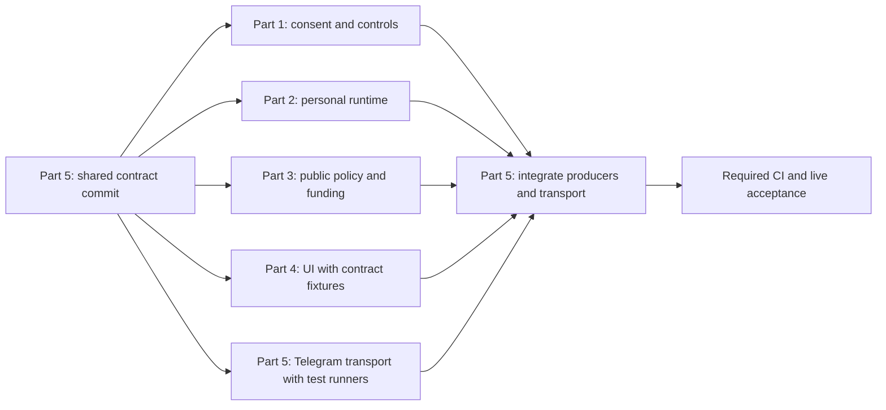

# Five parallel workstreams for public and personal NyxBot

Status: implementation breakdown, 2026-10-15. This document allocates work; it
does not start agents or claim implementation. The
[converged design](2026-10-15-public-personal-nyxbot.md) remains authoritative for
behavior, and its [Opus review](2026-10-15-public-personal-nyxbot-opus-review.md)
remains the architectural review. This allocation has not received a separate
Opus review.

Use five workstreams, with one owner per file. Parallel development begins after
a small shared contract commit; complete implementations do not need to arrive
before another worker can start. Production integration and final validation
remain ordered. These are five ownership areas, not five independently enabled
features and not a promise that every area fits in one PR.

| Part | Outcome | Starts against | Depends on for final integration |
| --- | --- | --- | --- |
| 1. Identity, consent and manager controls | A Telegram sender can securely link/unlink their own account; durable consent survives public configuration changes | Frozen authority and HTTP contracts | Part 2 exact-stop/thread helpers; Part 3 readiness and auth hooks; Part 5 registration/lifecycle wiring |
| 2. Personal NyxBot and shared engine | User-owned Telegram threads, normal NyxBot access, web history and confirmation behavior | Frozen identity, origin and execution contracts | Part 1 live consent; Part 3 execution-origin auth hook; Part 5 inbound/outbound delivery |
| 3. Public NyxAgent, execution policy and billing | Public FAQ/signup tools with enforced isolation, sponsor caps and upstream contract evidence | Frozen policy, engine and funding contracts | Part 1 manager policy and signup intent; Part 2 common execution adapter; Part 5 ingress/delivery |
| 4. Frontend and setup experience | Three-field admin setup, signup/linking, personal thread visibility and unlink UI | Frozen DTOs with HTTP fixtures | Real endpoints and thread events from Parts 1–3; combined checks with Part 5 |
| 5. Telegram transport and integration | Single audience decision, deduplication, protected reply delivery, independent capacity and working end-to-end flow | Frozen producer interfaces; fake runners for transport tests | Completed producers from Parts 1–3 and live UI from Part 4 |

## Shared contract commit, owned by Part 5

This is the opening slice of Part 5, not a sixth workstream. Agree the following
contracts before workers edit production paths. Put shared Rust execution types
in a small new `services/platform_manager_contract.rs` module; keep persisted
serde models in `models/` and dedicated API DTOs in handlers. Part 5 owns the
shared contract module and publishes its initial registration. Each producer
owns its own implementation file after the contract commit.

The commit must settle actual signatures, field names, null/default behavior,
transaction ownership and response/error fixtures. Names below describe the
required seams; they are not claims that these APIs already exist.

| Contract | Producer | Consumers | Required semantics |
| --- | --- | --- | --- |
| `resolve_sender`, `fence_personal_origin` | Part 1 | 2, 3, 5 | Distinguish unlinked, authorized personal, disabled/unavailable and infrastructure failure. Only unlinked selects public. Bind stable manager epoch, user, binding generation and active state. Transaction-aware fencing is available to callers |
| `ManagerRuntimePolicy`, configuration/consent DTOs | Part 1 | 3, 4, 5 | Separate public policy revision, personal controls and emergency stop. Decimal money strings; missing state means disabled. No old onboarding generation dependency |
| `PlatformTurnOrigin`, `ReplyDestination`, `TurnRef` | Shared definitions in Part 5; durable assistant fields in Part 2 | 1, 2, 3, 5 | Exact identity/generation and conversation/turn linkage; no raw token, mutable payer, generic owner override or synthetic channel ownership |
| `start_personal_turn`, `stop_exact_platform_turn`, `decide_platform_reply`, `clear_binding_thread` | Part 2 | 1, 5 | Ordinary owner semantics; same thread visible in app; exact stop only; helpers participate in the caller's transaction where atomicity requires it |
| Common NyxAgent execution adapter | Part 2 | 3 | Explicit ordinary-owner versus public execution context. No default-to-orchestrator path for public callers. Reuse stream/cancel/settlement transport without duplicating the engine |
| `PublicExecutionContext`, public policy validation, `run_public_turn`, `probe_public_readiness` | Part 3 | 1, 2, 5 | Server-derived public purpose, pinned profile/model operations, sponsor-only funding, full-loop caps and cleanup; no public key secret in output |
| `admit_manager_update`, `deliver_platform_reply` | Part 5 | 2, 3 | One durable audience decision per verified update, independent public/personal pacing, generation-checked sends and uncertain-send handling |
| UI API examples and stream/source metadata | Parts 1–3 supply contracts; Part 4 owns frontend schemas/fixtures | 4, 5 | Preview/approve/deny/list/unlink, source/readiness/settings, thread origin and failure states; old clients remain readable |

Publish transaction rules alongside the signatures:

- Part 5 owns the transaction that claims/classifies an inbound update; it calls
  Part 1 fencing helpers in that transaction. No model or Telegram request runs
  inside a MongoDB transaction.
- Part 1 owns consent/revoke/replace transactions. Part 2 supplies exact-stop
  helpers taking the existing session; cancellation effects occur after commit
  and have a durable recovery record. No nested transaction or best-effort
  in-memory notification may replace atomic revocation.
- Part 2 owns conversation/turn claim and deletion transactions. It calls
  Part 1's transaction-aware helpers to claim/clear a binding's thread reference.
- Part 1 owns durable configuration writes. Part 3 performs readiness work
  outside the transaction and returns a bounded readiness result bound to the
  reviewed configuration. Part 1 rechecks authority/revisions before enabling.
- Part 3 owns billable-call reservations and settlement/cleanup. Part 5's ingress
  receipt is not a wallet debit and must not create a second posting.
- Part 5 owns outbound claim/pacing admission, with live Part 1/3 authority
  checks before send. Neither runner sends Telegram messages independently.

Also settle API paths and scopes now, including which new GET paths belong in
`delegated_read_denied_path`. Part 3 installs those auth guards before Part 5
mounts a reachable route. Part 4 can then build against stable fixtures.

Compile-safe placeholders, if needed for parallel branches, must return an
explicit unavailable result and remain unmounted/disabled. They must never
return fabricated readiness, valid authority, a free price or a successful send.
Only test fixtures may simulate successful downstream components.

## Part 1 — identity, consent and manager controls

**Deliverable:** the server can identify who has consented to use personal
NyxBot through this manager, expose that consent to its owner, and revoke it
atomically without tying it to public guide settings.

Own the following work:

- Personal bindings, separate 24-hour signup intents and ten-minute confirmation
  challenges, indexes, purpose-bound HMACs, first-party approval and same-chat
  confirmation. Existing onboarding links retain their existing meaning.
- Multiple Telegram identities per user, one thread reference per binding,
  replacement between accounts, cancel/replay/expiry handling and invitation
  policy preservation.
- `platform_bot_runtime_controls`, stable manager authority epoch, independent
  public/personal controls, explicit emergency-stop clearing and revision checks.
- Human-only API handlers for linking and runtime settings. Public profile
  discovery/readiness delegates to Part 3; the admin UI is Part 4's work.
- Revoke/replace/disable lifecycle services, using Part 2's transaction-aware
  exact-stop helper and exposing hooks to Part 5's existing account/manager
  lifecycle entry points. Broad `/unlink` revokes both purposes for that exact
  manager/sender; command parsing belongs to Part 5.

**Exclusive files:** new `models/platform_personal_binding.rs`,
`models/platform_link_intent.rs`, `models/platform_bot_runtime_controls.rs`,
new corresponding `services/platform_personal_binding_service.rs`,
`services/platform_link_intent_service.rs`,
`services/platform_bot_runtime_control_service.rs`, and
`handlers/platform_personal_bindings.rs`. Existing
`services/platform_binding_service.rs`, `services/platform_bot_config_service.rs`,
`models/platform_bot_config.rs`, `handlers/platform_binding.rs` and
`handlers/platform_bots.rs` also belong to Part 1. Paths here and below are
relative to `backend/src/` unless stated otherwise; new names are proposed.

Part 1 must not edit the assistant engine, credential service, webhook, shared
auth middleware or frontend. For the existing `platform_binding` handler, it
exposes purpose-aware command services; Part 5 chooses when to call them.

**Done when:** proof/replacement/revoke tests pass on transaction-capable MongoDB;
signup can exceed ten minutes without losing the intent; public budget/model
edits and same-identity token rotation preserve personal consent; existing
onboarding tests pass. Covers A3, A16 and the consent side of A6/A14/A17.

## Part 2 — personal NyxBot and shared execution engine

**Deliverable:** a verified personal origin can start the user's NyxBot in a
dedicated thread, continue it on the web, handle confirmations and stop exactly
the Telegram-origin turn. Public execution can reuse the engine through an
explicit bounded interface.

Own the following work:

- Extract the smallest reusable NyxAgent execution service needed by both
  runners. Preserve ordinary owner behavior. Implement the explicit public
  context branch of the adapter against Part 3's policy interface; no public
  context may enter ordinary orchestrator credential convergence.
- Personal thread creation/recreation, `platform_thread` and `platform_origin`
  fields, transcript/read/list DTOs, home-adoption/recovery exclusions, web live
  events and ordinary user billing.
- Shared word-decision service extracted from `nyxbot::reply_decision`; normal
  Auto/Ask/Full semantics, same-thread owner-message anchors, app-only image
  notices, exact active-turn stop and pending-card behavior after unlink.
- Origin propagation for the active turn and inline continuations. Expose a live
  origin validation callback for Part 3's MCP/proxy/auth entry points. Committed
  independent tasks continue as the user's work, with no stale Telegram send.
- Shared encrypted assistant credential primitives and conversation-key
  rotation/settlement behavior. Part 3 owns public-purpose policy and its new
  public credential/session service, but requests changes to existing assistant
  credential machinery through this owner.

**Exclusive files:** `models/assistant_conversation.rs`,
`models/assistant_agent_credential.rs`, `services/assistant_nyxagent.rs`,
`services/assistant_agent_credential_service.rs`,
`services/assistant_team_service.rs`,
`services/assistant_acknowledgement_service.rs`, `services/assistant_continuation.rs`,
`handlers/assistant_nyxagent.rs`, `handlers/assistant_team.rs`, and
`handlers/nyxbot.rs` for the word-decision extraction only. New
`services/platform_personal_turn_service.rs`,
`services/assistant_platform_reply_decision.rs` and any extracted common engine
service also belong to Part 2. Existing related engine tests have the same owner.

Part 2 must not add a new path through the manager's ordinary
`NyxbotChannel`/`owner_sender_ids`, modify shared auth/proxy files, implement public
budgeting, or send Telegram messages. Return replies/events through Part 5's
delivery contract.

**Done when:** personal engine tests prove user isolation, history visibility,
no home adoption, permission-mode parity, exact stop, web continuation after
unlink and safe deleted-thread recreation; ordinary assistant tests remain green.
Covers A4, A5, A17 and the execution side of A6/A8.

## Part 3 — public NyxAgent, execution policy and billing

**Deliverable:** public FAQ/signup runs with a fixed tool policy and bounded
sponsor spend, and every execution entry point respects the admitted origin.

Deliver this in two slices under the same owner:

1. **Local security hooks first.** Install the new human-only GET deny rules and
   the hook that checks a personal turn's origin through Parts 1/2. Define the
   public-purpose deny-by-default branch in auth/MCP/proxy. This slice requires
   no upstream NyxAgent changes and must not wait for public runtime research;
   it lets personal routing finish independently.
2. **Public execution and proof.** Verify the upstream native-tool/model/session
   contract; implement the public runner, restricted credential/session
   lifecycle, FAQ corpus/tools, signup-intent tool, profile readiness and
   sponsor accounting. If NyxAgent needs changes, record its repository/build
   dependency and required patch in this workstream; public activation waits
   for evidence, while the other workstreams continue.

Public tools cannot select a user, payer or generic URL. All model hops, including
priced discovery/readiness, reserve against both public caps and settle through
existing exact billing. Public keys cannot use the ordinary assistant inference
exception or become ordinary org keys through edit/rotation. Public retention
and cleanup cover local context and the proven upstream protocol.

**Exclusive files:** `mw/auth.rs`, `handlers/mcp_transport.rs`,
`handlers/proxy.rs`, relevant existing LLM proxy modules (the exact paths are
assigned in the contract commit), `models/api_key.rs`, `services/key_service.rs`,
`services/platform_inference_service.rs`, `services/platform_guide_service.rs`,
and new `services/platform_public_policy.rs`,
`services/platform_public_agent_service.rs`,
`services/platform_public_credential_service.rs`,
`services/platform_public_budget_service.rs`, plus their public-session/credential
models and reviewed FAQ content. Any necessary billing-core changes belong to
Part 3 and must retain ordinary payer resolution. New public contracts do not
require a new `PlatformExecutionProfile` enum variant.

Part 3 must not edit the existing assistant engine/credential files owned by
Part 2, manager configuration handlers owned by Part 1, the webhook owned by
Part 5, or frontend files. It supplies policy/readiness services to those owners.

**Done when:** forged direct/wrapped/native/proxy calls fail; sponsor versus
user billing, multi-call/concurrent caps, crashes, UTC rollover, readiness spend
and cleanup pass; upstream evidence is recorded before marking public readiness
available. Covers A1, A9, A15 and the public side of A2/A8.

## Part 4 — frontend and setup experience

**Deliverable:** the user-visible flow requires source and two budgets to enable
the guide, and clear consent to use personal NyxBot from Telegram.

Own the following work:

- Revise #1896's direction into NyxAgent source + total daily budget + daily free
  quota; sensible defaults, Advanced, automatic profile loading and one Enable.
- Signup-intent continuation, invitation-required states, first-party review,
  same-chat confirmation status, link inventory and unlink UX.
- Personal Telegram thread presentation in the assistant, ordinary approval
  cards, app links for images, explicit billing and transport disclosures.
- Failure/loading/retry/expired-intent states and browser tests. Build against
  versioned HTTP fixtures initially; remove test interception in real integration.

**Exclusive files:** all frontend changes for this feature, including
`frontend/src/pages/admin-platform-bots.tsx` and its tests,
`frontend/src/schemas/platform-onboarding.ts`,
`frontend/src/hooks/use-platform-onboarding.ts`,
`frontend/src/lib/platform-onboarding.ts`, `frontend/src/router.tsx`, new linking
pages/hooks/schemas, and affected assistant components. Part 4 alone updates
frontend dependencies/lockfiles if needed. Follow `DESIGN.md` and `useAppForm`.

Part 4 must not invent backend authority or treat a mocked readiness response as
evidence of a usable public runtime. Backend-facing DTO changes go through the
contract owner first; production UI stays disabled when capabilities are absent.

**Done when:** fixture-backed browser tests and frontend checks pass, followed
by the same journey against integrated endpoints. Covers A11 and the UI side
of A3/A5/A16/A17. The fixture stage is progress, not completed live acceptance.

## Part 5 — Telegram transport, shared wiring and integration

**Deliverable:** verified Telegram traffic reaches exactly one runner and replies
reach only the correct live destination, with public load unable to consume
personal reserved capacity. This owner integrates the feature throughout the
work; it is not a testing role that waits until the end.

Own the following work:

- Opening contract commit and the shared interface module. Record any later
  signature/DTO changes once, obtain affected owners' acknowledgement and update
  consumers before merging the new contract.
- Native webhook audience dispatcher after existing creation/control handling,
  new ingress receipts, update deduplication across link/unlink, private/group
  classification, and no fallback from failed personal authorization to public.
- Native command transport that calls Part 1/2 services. Preserve existing
  BotFather commands and the shared manager creation webhook.
- Reply destination verification, metadata-only claims, fair public/personal
  outbound scheduling, Telegram rate-limit responses, uncertain sends, exact
  generation fences and `protect_content`. No private body replay queue.
- Startup/module/router/index registration, sweeper scheduling, feature flags,
  existing account disable/delete and manager-token lifecycle hook wiring.
  Implement business logic in the appropriate owning service, not the wiring.
- Combined transaction/race tests, staged integration, CI monitoring and the
  two-account real Telegram acceptance procedure. Actual deployment/real-account
  messaging remains a separately authorized execution step, not a planning action.

**Exclusive files:** `handlers/telegram_new.rs`,
`services/telegram_new_admin.rs`, `services/telegram_new_service.rs` only for
native dispatch/lifecycle hookups, new `services/platform_manager_dispatch.rs`,
`services/platform_manager_delivery.rs`,
`services/platform_manager_ingress_service.rs`, its ingress/delivery models,
`services/platform_manager_contract.rs`, `routes.rs`, `db.rs`, `main.rs`,
`models/mod.rs`, `services/mod.rs`, `handlers/mod.rs`, and feature registration.
Account lifecycle entry-point edits, shared backend fixtures, dependency/lockfile
edits if needed, and combined backend acceptance tests belong to Part 5.

Part 5 does not patch Parts 1–3's files to make an integration failure disappear.
It returns the failing case and required contract correction to that owner.
Frontend integration test edits go through Part 4. Avoid broad formatting changes
to shared files.

**Done when:** duplicate updates execute once, public exhaustion leaves personal
capacity, revoke/replace/rotation races behave correctly, all acceptance gates
have evidence, required CI is green and the deployment prerequisites are explicit.
Covers A7, A10, A12, A13 and the integrated portions of A2/A6/A8/A14.

## Preventing file and semantic conflicts

The ownership lists are exclusive, including their existing in-file tests. New
focused tests sit beside the owning module; shared fixtures are Part 5's. For
any file not listed, assign an owner before its first edit. The contract commit
records exact LLM proxy and account lifecycle paths after tracing callers.

The most likely collisions are resolved as follows:

| Collision | Single writer | How the other part contributes |
| --- | --- | --- |
| Personal and public runners both need assistant engine/key changes | Part 2 for existing assistant files | Part 3 supplies the public policy contract and adversarial cases; Part 2 implements the narrow adapter/credential hook |
| Linking needs auth route denials; personal execution needs live-origin checks | Part 3 for `mw/auth.rs`/MCP/proxy | Parts 1/2 supply route paths and validation services; security hooks land early |
| Config enablement needs public model discovery/readiness | Part 1 for config handlers/services | Part 3 owns the probe; Part 1 owns revision-checked persistence and calls the probe |
| Thread deletion must clear consent's conversation reference | Part 2 for conversation deletion; Part 1 for binding mutation helper | Same transaction passed through the agreed helper; neither part issues ad hoc writes to the other's collection |
| Unlink must stop an active personal turn | Part 1 for revocation; Part 2 for exact-stop helper | Same transaction and exact origin filter; no broad cancellation callback |
| Both runners need Telegram replies | Part 5 | Both return the agreed reply/event type; neither calls `sendMessage` itself |
| Every new module needs registration/startup/routes | Part 5 | Owners supply a small registration manifest; Part 5 lands those edits sequentially |
| Backend changes affect UI fields | Part 4 for frontend | Producers update the agreed DTO examples first; Part 4 updates schemas/fixtures |

Use isolated implementation branches/worktrees rooted at the same contract
commit. Retain one integration branch under Part 5. Each owner tests its own
changes; Part 5 applies compatible changes in order and runs the combined checks.
Do not let several workers run heavyweight Rust builds on this host at once.
Frontend work, source inspection, upstream verification and test preparation can
proceed while the single backend build slot is occupied.

## Development and merge order

All five implementation tracks can start after the contract commit. This
diagram describes development parallelism; mergeability still follows actual
dependencies:

1. Land shared contracts with the new mode disabled.
2. Integrate Part 1 foundations, Part 2's shared execution seam, and Part 3's
   early local security hooks. Their internal services can be reviewed before
   mounting externally usable routes.
3. Integrate Part 5 transport with personal execution and Part 4's personal
   consent/history UI. Personal functionality does not wait for the public
   NyxAgent contract proof. Until it is ready, existing public onboarding can
   remain on its current path, with no silent personal-to-public fallback.
4. Integrate Part 3's verified public runner and Part 4's source/budget UI.
   Backend work and mocks may merge disabled while upstream proof is pending;
   public activation and claims of completion may not.
5. Run the combined acceptance suite, verify rollout prerequisites and then
   enable the new mode through the authorized rollout. Remove replaced direct
   guide code only after migration, keeping child-bot dependencies intact.

Each part is responsible for its regression tests. The acceptance mapping above
covers A1–A17 from the design; Part 5 owns the final evidence matrix, and A13
cannot be satisfied by mocks. The shared bot must not go live merely because
five isolated PRs each passed their own tests.
