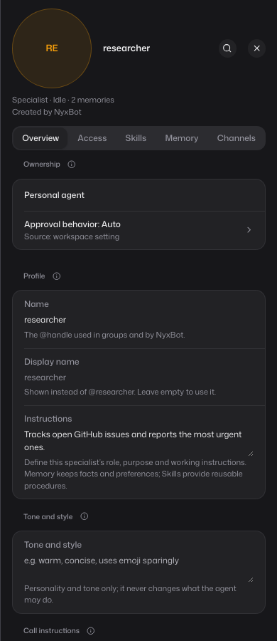
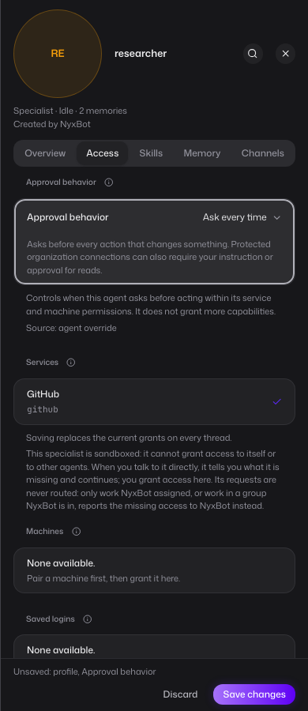
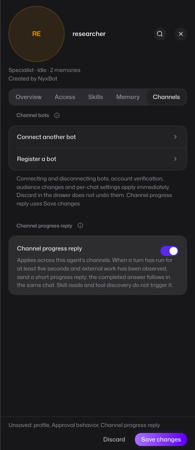
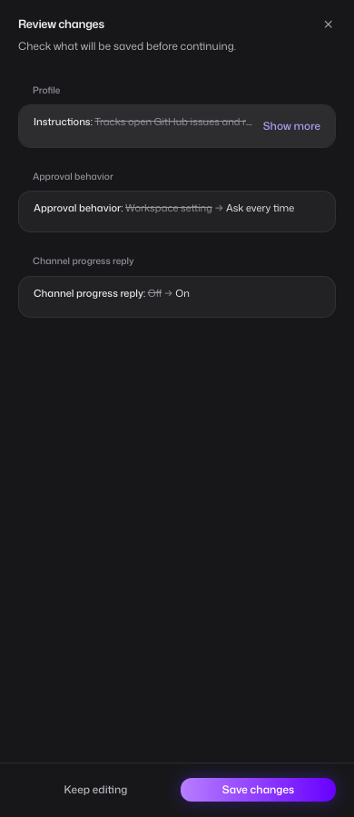
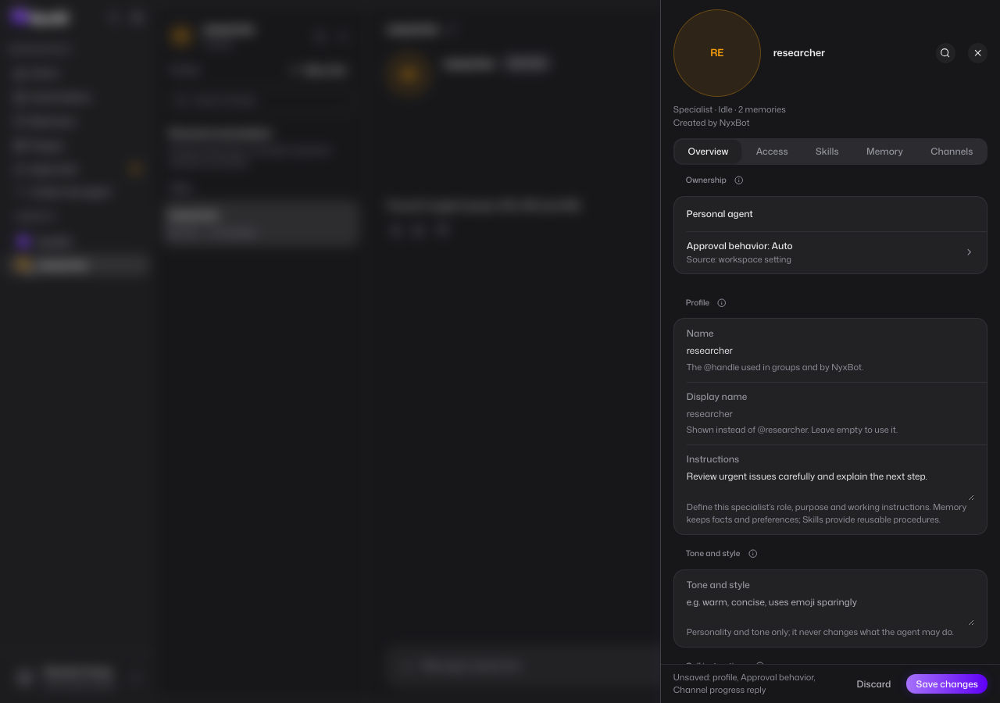
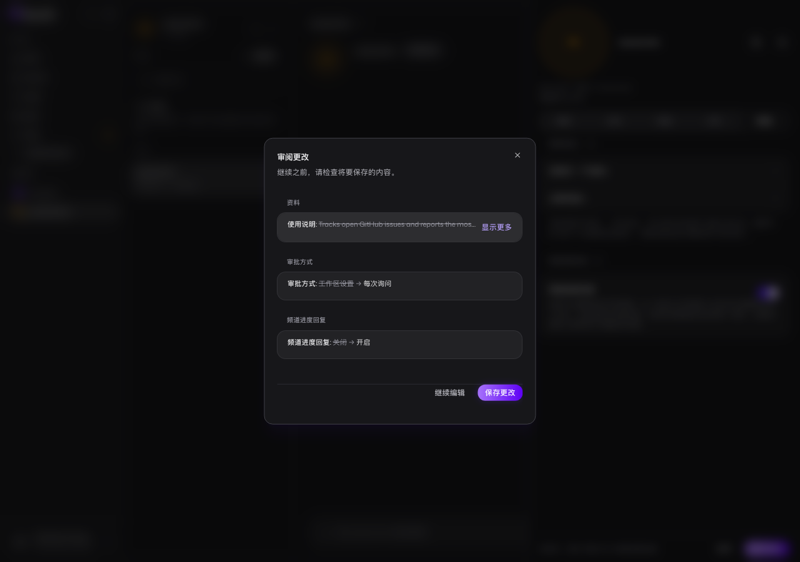

# Agent details: change guide and preview

Agent details keeps the existing five-tab drawer and grouped design while placing related controls together. The main changes make settings easier to find, show which edits need saving, and explain the consequences of actions that apply immediately.

## Current organization

| Tab | Groups and nested features | How to reach related controls |
| --- | --- | --- |
| **Overview** | Ownership and saved approval source; Profile with identity, model and working **Instructions**; **Tone and style**; **Call instructions**; authorized avatar, organization governance, sharing, automations and lifecycle controls. | Click the approval summary to open its actual editor in Access. Call instructions links to optional Device voice when available. |
| **Access** | **Approval behavior** first; service and account grants; guest operation limits; machines, workspace/capabilities and saved logins; connected accounts and connection order; optional Device voice. Shared users see their own connection consent. | Audience settings links to the readable service-access section, including for organization members without maintenance rights. Connection order explicitly identifies its account-wide scope. |
| **Skills** | Attached and built-in skills; **Find skills**; pinned version detail and skill access check; preload settings; history; learning proposals with nested draft review and publication. | Find skills focuses the catalog search input. Skill access checks explain package readability. Preload drafts remain part of Save changes. |
| **Memory** | Personal or organization notes; role-appropriate private notes and published team memory for shared agents. | Search can reveal a remembered note without changing its user-written text. Chinese search uses the same Agent memory term as the tab. |
| **Channels** | Connected bots; Available bots; contextual registration; messaging-account verification; audience; chats and posting; diagnostics; agent-wide **Channel progress reply**. | Register a bot returns to this agent’s Available bots. Nested Back returns focus to the originating control. If Channels is unavailable, the progress editor appears in Overview. |

Controls continue to follow the agent’s ownership, sharing role, maintainer rights, lifecycle and existing feature flags. Organization access governance, avatar editing and built-in skill controls from the current `dev` base are retained.

## What became easier

| Earlier friction | Result |
| --- | --- |
| Profile mixed identity, communication style, approval and channel behavior. | Instructions, tone and call guidance have clear groups. Approval is in Access; progress replies are in Channels. |
| Related settings required remembering a tab or navigating away. | Approval, voice and audience links open the actual setting through the same navigation path as search. |
| The summary of unsaved sections was visually hidden. | A pinned, visible summary names the sections with drafts. Review changes shows their individual field/value changes. |
| Moved forms could lose state when their placement changed after loading. | Profile, approval and progress have separate retained forms; progress has one form instance even when its host moves. |
| Registration left the selected agent and obscured the next step. | Registration stays contextual and explains registration → connection → account verification. |
| “Saved” or “updated” feedback could describe another item or an unaccepted value. | Skill feedback follows its affected pin, and learning displays authoritative values and skips unchanged writes. |
| Search and change review contained English fragments in Chinese. | Fixed labels, values, prompts, breadcrumbs and help are localized; arbitrary names and user text stay verbatim. |

## Save behavior and immediate actions

**Review changes / Save changes / Discard** coordinates independent form scopes. Editing Instructions, approval override and progress replies produces three review sections. Keep editing, changing tabs, opening nested pages and searching retain all three drafts. Each successful save settles its own scope. If another save fails, its draft remains; Discard then resets the remaining draft without reverting the successful save.

Immediate actions explain their own consequences and feedback: connecting or disconnecting bots, verification, audience and per-chat changes, skill attachment/version/enabled/removal, Forget/Delete of memory notes, learning settings and voice setup. Adding or editing a memory note uses the registered Review changes / Save changes form. Discarding a form draft does not reverse an already completed action. Connection order also states that it applies to all of the current user’s agents.

Learning analyzes distinct eligible conversations and may produce a private proposal or none. Analysis does not publish a learned draft. Requesting publication may **publish and attach immediately under the approving chat’s Full access mode**; otherwise the server supplies its confirmation card. Existing card, recovery and authored-draft paths remain available.

Learning settings wait for a successful read and offer Retry when unavailable. Threshold editing is disabled while learning is off, accepts whole numbers from 1 to 50, skips unchanged blur events and renders the accepted server value. Rejected edits restore the saved threshold. A readback after saving takes precedence when another maintainer changes the settings concurrently.

Approval descriptions explain behavior within existing permissions. Protected organization connections may independently require instruction or approval, including for reads. Channel progress timing is measured from turn start: after at least five seconds, observed external work can trigger a short interim reply while the turn is still running. Attached skill reads and tool discovery alone do not trigger it.

## Organization registration and access

An organization specialist’s registration scope stays fixed to its organization. Token registration uses that owner. Managed Telegram setup also checks the owner of saved requests and mutation responses. A personal request or a request for another organization is not adopted, launched, cancelled or accepted as completion from this contextual flow. The user can open that existing setup separately or choose another platform. A matching request resumes normally.

Registration alone does not attach the new bot or verify the messaging account. Continue returns to Available bots for the same agent. Organization connection preflight and its existing confirmation remain in force. Non-maintainers can read the allowed Access section from the audience link; modified clicks preserve ordinary browser behavior.

## Preview walkthrough

1. Open `/assistant?mock=1&nyxbot=1`, choose **researcher**, then **Agent details**. The preview uses fictional fixtures.
2. Edit **Instructions** in Overview. Click the saved approval summary, select an override in Access, then search for **Channel progress reply** and enable it in Channels.
3. Check the visible summary, open **Review changes**, and inspect all three sections. Choose **Keep editing**, open **Connect another bot**, and use **Back**. The drafts and keyboard focus are retained.
4. Save and reopen to verify persistence, or Discard to restore the saved form values. A partially failed save keeps only the failed scope pending.
5. Create another Instructions draft. In Channels, choose **Register a bot**, cancel and return, then register a fictional Telegram token bot using `demo-bot-token`. Continue, connect it to researcher, and observe the separate account-verification step. Discard an existing form draft and verify that the immediate connection stays.
6. In Skills, choose **Find skills** and type immediately. Open a pinned skill to inspect access-check, version and preload guidance.
7. Repeat the draft/review/search flow in Simplified or Traditional Chinese and at 390px/1280px. Organization administrators, members, viewers and shared roles receive only their authorized controls.

For a local preview after checkout:

```sh
npm --prefix frontend ci --no-audit --no-fund
npm --prefix frontend run dev -- --port 4612 --strictPort
# Open http://localhost:4612/assistant?mock=1&nyxbot=1
```

These are application captures from the current change using fictional fixture data, committed so the links remain available to PR and gist readers:

| Overview at 390px | Access at 390px |
| --- | --- |
|  |  |

| Channels and retained drafts | Review of three form scopes |
| --- | --- |
|  |  |





## Review and verification

A fresh Heca **gpt-6.2-astra, xhigh** session reviewed the flow and implementation independently, requested corrections, re-reviewed them and returned **APPROVE**, with no outstanding actionable product findings. It ran **324 tests across 13 files** and exercised 390px Chinese save/search/focus flows and 1280px registration/connection/Discard flows. It used local fixtures.

The primary verification after rebasing onto `dev` includes **487 tests across 25 files**, **88 tests across three transport/preview suites**, and **8 Chromium scenarios** for retained drafts, nested navigation, registration, keyboard focus and existing display-name/persona persistence, production build with TypeScript and the public/mock artifact gates, lint, typography and localization checks. The embedded CLI wizard is rebuilt because the shared UI/search/help closure changed. Exact final commands and results are recorded in the [implementation plan](2026-11-28-agent-details-implementation.md).

The current behavior contracts are documented in [Agent details](../chat/05-frontend-ui.md#agent-details), [progress replies](../chat/09-nyxbot-orchestrator.md#progress-replies-during-external-checks) and [Telegram setup](../TELEGRAM_NEW.md#what-the-customer-sees).
