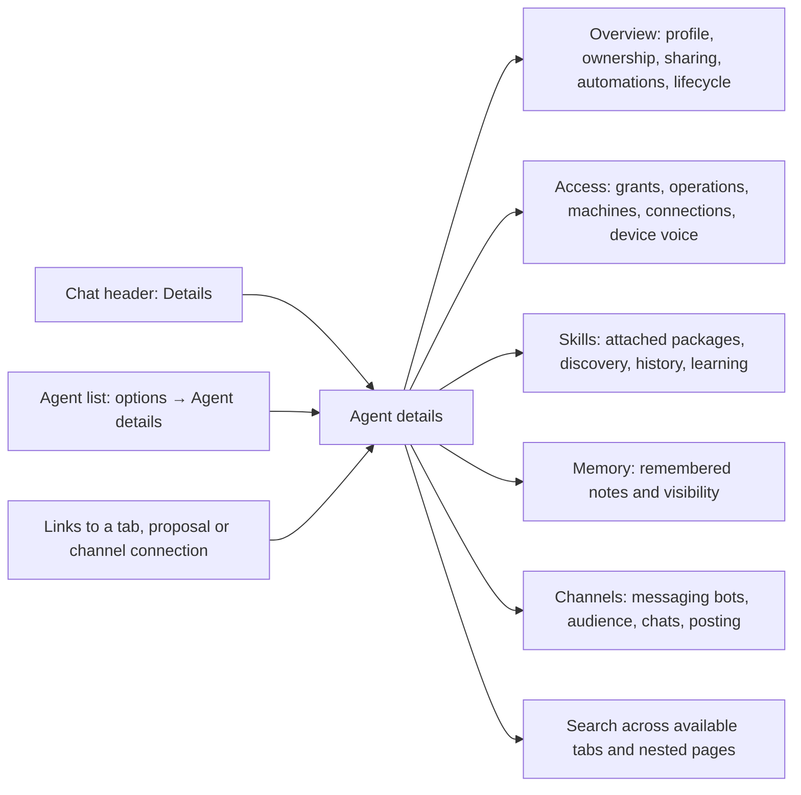

**Agent details: feature map and ease-of-access review**

Reviewed 2026-11-28 against the supplied NyxBot screenshot and the current web implementation, then independently challenged with GPT-6.2 Astra and reconciled in a second review round. This is a heuristic review of discoverability, clarity, navigation and feedback. Ease ratings are judgments from those materials, not measured user-test results. Native mobile screens and the deployed application were not exercised.

**Implementation:** completed under the [implementation plan and verification record](2026-11-28-agent-details-implementation.md). The inventory below records the reviewed starting state and rationale.

The drawer provides substantial control, but its organization makes people learn several overlapping concepts. The largest opportunities are accurate explanations of action consequences, separating permission scope from approval behavior, retaining quick editing in Overview, and connecting setup steps that currently span several screens.

**Converged review position**

- Correct claims about approval and publication before moving settings. The current Full access description promises “Never asks,” although protected organization connections can still require trusted owner instruction or an exact approval when that policy is activated.
- Keep the five tabs as the working structure. In Overview, show compact owner/role and effective approval/source context while keeping name and instructions immediately editable. Do not add a dashboard of counts above the form.
- Put the approval editor in a shallow, clearly labeled Access section. Put the agent-wide channel progress reply under Channels, making its scope explicit and retaining access for eligible maintainers whose Channels tab is hidden. Connect voice instructions to device setup with contextual links.
- Preserve the existing draft/save coordination. Expose its pending-section summary visually and make immediate changes distinguishable. Do not force every action into a new staged save model.
- Improve existing audience and guest summaries within each context. Shared-agent recipients, group participants and channel guests have different authority; a single universal guest editor would obscure those differences. Organization Channels already shows effective guest services, payer and wallet prerequisites.
- Treat field appearance, the optimal amount of summary context and the final ease ratings as hypotheses to validate in a rendered prototype and task-based user testing.

**How the controls relate**

| User question | Controls that answer it | Relationship |
| --- | --- | --- |
| Who is this agent, and how should it work? | Display name, specialist handle, Notes/Role, Persona, Voice instructions | Identity and behavioral guidance. Instructions do not grant access. |
| What information should it retain? | Memory notes; private notes and published team memory for shared agents | Persistent remembered context, with visibility determined by ownership and sharing. |
| What reusable procedures does it know? | Attached skills, pinned versions, preloaded files, learning proposals | Reusable guidance. Skills do not grant services, tools or machine permissions. |
| What can it use? | Service grants, account read, machine assignment, saved logins, operation scopes, machine capabilities | Permission scope. Assignment and the capabilities allowed on a machine are separate controls. |
| When should it ask before acting? | Access mode, including an agent override or inherited workspace setting | Approval behavior within the access available to it. The label “Full access” can be mistaken for a grant of more capabilities; independent protected-connection requirements can still apply. |
| Who can use it, and where? | Sharing audience, guest service levels, guest operations, Channels, chat audience and posting settings, Device voice | Several different audiences and entry points. Their controls need explicit connections. |

**Current navigation map**

The chat header shows a labeled Details button in its expanded state and an icon in its compact state. The agent-list menu reveals on hover or keyboard focus on pointer devices and is visible on devices without hover. Supported incoming links open particular tabs, proposals and channel connections. Search can reveal a nested page, scroll to a result, focus it and briefly highlight it.

**Feature inventory: Overview**

| Feature and current location | What it does | Ease of access and comprehension |
| --- | --- | --- |
| Profile → Display name | Changes the friendly name. Empty restores NyxBot or the specialist handle. | Easy to find. The gray value/placeholder styling in the screenshot gives a weak editing cue. |
| Profile → Name, specialists only | Changes the lowercase handle used in groups and by NyxBot. | Fair. The distinction from Display name is explained, but people must understand which one they want. |
| Profile → Model, when enabled | Sets the model for new threads; individual threads can change model from their composer. | Fair. Reasonable profile setting, but conditional visibility and the separate thread control need a clear explanation. |
| Profile → Access mode | Chooses an agent override or inherits the workspace mode. Current labels are Full access, Auto and Ask every time. | Difficult conceptually. It is outside Access, and “Full access” sounds like a permission scope. The “Never asks” explanation also conflicts with activated protected-organization-connection requirements. The inherited source has no direct navigation link here. |
| Profile → Channel progress reply | Enables a short reply after five seconds when an external check is needed; the completed answer follows in the same chat. | Difficult to predict its location. It affects channels but sits in Profile. Implementation terms make its explanation longer than necessary. |
| Profile → Notes / Role | Describes how personal NyxBot should work with you, or the specialist's job. | Fair to difficult. “Notes” overlaps with Memory, which also presents notes. |
| Profile → Persona | Sets personality and tone without changing permissions. | Fair. “Tone and style” would describe the purpose more directly. |
| Profile → Voice instructions | Supplies call-specific guidance across the bot's voice clients and connected services, using existing permissions. | Fair to difficult. Easy to edit once found; it is separated from Device voice setup in Access. |
| Ownership | Shows personal, organization or shared ownership and relevant role information. | Fair. Useful context appears after the long Profile form. |
| Sharing → Share agent, eligible personal specialists | Enables sharing, chooses people/organizations and roles, and limits services exposed to shared users. | Difficult for initial discovery. Below the profile, then inside a dialog. Sharing with an organization requires its UUID. |
| Automations → Manage automations | Lists this agent's scheduled/event-driven tasks and opens the Automations page filtered to the agent. | Fair to difficult. Good destination link, but little indication above the fold that the agent has automations. |
| Danger zone → Destroy / Delete permanently, specialists only | Destroy stops work, revokes access and disconnects bots while retaining readable threads. A destroyed specialist can then be permanently deleted, including its memory and threads. | Appropriate separation and explicit confirmation. “Destroy” requires explanation; it is irreversible, so it must not be presented as a pause or archive. |

**Feature inventory: Access**

| Feature and current location | What it does | Ease of access and comprehension |
| --- | --- | --- |
| Services, specialists | Selects connected services the specialist may use. Saving updates its grants across threads. | Fair. The picker is recognizable, but connecting an account and granting it to this agent remain separate jobs. |
| Machines / Saved logins, specialists | Assigns machines and, for personal specialists, selected saved logins. | Fair to difficult. Assignment does not explain the entire path to working machine access. |
| What others in its chats may do | Sets a guest level per granted service: look up only; use without changing/deleting existing items; or everything the agent may do. | Difficult. “Use” includes creating and sending, which some people will interpret as changing something. |
| Account → Read my account, personal specialists | Permits read-only lookup of account keys, services and nodes. | Fair. Strong narrow explanation, but another concept within an already long Access page. |
| Service operations → service details, specialists | Narrows a granted service to selected operations; supports exact methods/paths for services without published operations. Shows existing input-limit indicators. | Difficult for ordinary users. Requires a nested page and sometimes HTTP terminology. Input limits can be authored through API/CLI; this selector preserves and marks them. |
| Group guest replies / Guest service operations | Controls applicable group guest replies and further narrows operations available on guest turns. | Difficult. Related guest controls are spread across grants, operation lists, sharing and channel audience settings. |
| Machine access → machine details | Configures workspace/browser separation and supported shell, file, browser, desktop and developer-browser capabilities. Changes can cancel this agent's work on that machine. | Difficult. Machine selection, capability selection, owner authority and machine acknowledgement are separate stages. |
| Connected services and account, NyxBot | Explains NyxBot's broad connected-service/account access and that machine capabilities are separate. | Easy to read; should link to approval behavior so “Full access” in two contexts does not imply identical meaning. |
| Connections → connected accounts | Shows which account connections are available to the agent, grouped by service. Links to account management. | Fair. “Services,” “Connections” and “Channels” need concrete examples to establish the distinctions. |
| Connection order, NyxBot | Reorders eligible connections for a service; saved order applies across agents, with eligible personal accounts before organization accounts. | Moderate. The cross-agent effect is already explained in the section footer, but should also be visible beside the reorder action. |
| Device voice, when enabled | Creates a voice service connection. A device's Agent Key must permit it; keys allowing all services can already include it under their existing policy. | Difficult end to end. Setup and key eligibility are distinct, and generic Agent Key management leaves the drawer. Do not imply every device requires a key change. |
| Connection consent, shared-agent recipients | Reviews requests to use the chatting person's own connection through a shared agent. | Fair. It replaces the owner's grant-management view, so the same Access tab has a different purpose for recipients. |

**Feature inventory: Skills, Memory and Channels**

| Feature and current location | What it does | Ease of access and comprehension |
| --- | --- | --- |
| Skills → Attached skills → skill details | Shows a pinned version; chooses another version; tests package readability; removes the pin; optionally enables/disables it or starts an editable draft. | Fair for experienced users, difficult for first use. “Test skill” verifies access/readability rather than task quality. |
| Skill details → Preload settings | Includes selected skill files automatically in owner chat turns. Files consume model context; changing the version resets that skill's preloading. | Difficult. It is an advanced nested setting with raw file paths. |
| Skills → Find skills → result/version preview | Searches visible Ornn packages, previews a specific version and attaches it. | Fair. Explicit preview is helpful, but “Find skills” follows the attached list and catalog/version terminology adds work. |
| Skills → History | Opens recent pin and skill activity. | Fair. Useful nested destination, without a top-level indication of recent changes. |
| Skills → Learning proposals, when enabled | Enables analysis after a threshold of distinct eligible threads; analysis may produce a pending proposal or no proposal. The person can review/edit and request publication. If the approving chat uses Full access, that explicit publication request can publish without a second card; other modes require confirmation. The approving chat's mode is not necessarily the displayed specialist's mode. Authored skills requested through chat have a separate path. Organization learning also has member consent. | Difficult. “Threshold” has no unit in the row, and fixed two-step publication copy does not describe the Full access branch. Turning on learning alone does not publish a learned proposal. |
| Memory → Add a note / Notes | Adds remembered context and forgets notes. Organization maintainers can also edit existing shared organization notes. | Easy to locate and understand at a basic level. Personal notes do not currently expose the same inline edit action. |
| Memory, shared-agent recipients | Separates Your private notes from Published team memory; team-memory editing depends on role. | Fair. The explicit visibility distinction is useful and should stay visible during editing. |
| Channels → connected bot | Shows platform/status, answering agent, account linking, errors, reconnection/disconnection and applicable organization settings. | Fair for maintaining an existing bot. There are several independent readiness states. |
| Channels → Connect another bot | Connects a previously registered available bot. Initial bot registration is elsewhere. | Difficult for a first connection. The empty state explains the prerequisite but does not provide a direct registration action here. |
| Connected bot → Who can talk to this bot | Controls personal private-chat audience or organization guest access and surfaces readiness. Organization settings already show effective guest services, organization payer, wallet prerequisites and a link to grants. | Fair to difficult. Preserve that context and improve links to permitted actions; keep channel guests distinct from shared-agent recipients and group participants. |
| Connected bot → Chats and posting → chat/thread details | Controls replies, eligible participants, answering agent, autonomous posts and thread-following where supported. | Difficult initially; the nested structure is sensible once users know the concepts. |

**Which controls a person actually sees**

| Context | Material differences |
| --- | --- |
| Personal NyxBot | No editable specialist handle, specialist grants, sharing dialog or lifecycle actions. Broad service/account access; machine capabilities configured separately. |
| Personal specialist owner | Broadest configuration surface: grants, operations, eligible sharing/guest controls, memory, channels and lifecycle. |
| Organization specialist maintainer | Organization ownership and shared memory; some channel/guest controls require an organization admin and enabled rollout. No personal-specialist sharing dialog or Device voice setup. |
| Organization viewer | Read-only profile, grants and skills; memory is hidden. The drawer explains why maintenance controls are unavailable. |
| Shared-agent recipient | Profile depends on User/Manager role; Access shows connection consent; Memory separates private/team notes. Skills are read-only and Channels is hidden. |
| Destroyed specialist | Settings and notes are read-only; Channels is hidden. Eligible maintainers can delete permanently. |
| Feature unavailable | Model controls, learning, skill disabling, operation editing, voice and machine features have independent rollout conditions. Some disappear; others retain an unavailable explanation or existing restrictions. |

Different roles justify different controls. The usability issue is that availability can be difficult to explain from the tab labels alone. The current read-only and no-access messages are valuable; extend that clarity to incomplete setup and feature availability where a user has a reason to expect a control.

**What already works well**

- Five stable primary categories give the drawer a manageable top level.
- Search spans available tabs, nested details, values and section help. It supports `/` and Cmd/Ctrl+F outside editable controls, arrow navigation and Enter to open results.
- Nested pages have contextual Back labels; incoming links can land near the required work.
- Forms preserve drafts across tabs. A coordinated save bar remains outside scrolling content, and changed form values are reviewed before saving.
- The save coordinator already names unsaved sections for assistive technology and reports successful sections after a save. The section names are currently visually hidden; saving independent forms can partially succeed while failed forms retain their drafts.
- Organization channel audience settings already explain guest services, organization payment and wallet prerequisites. Connection-order help already explains its cross-agent effect. These need clearer presentation in context, not duplicate implementations.
- The implementation includes focus return, keyboard tab navigation, named sections, permission explanations and explicit destructive confirmations. These are positive implementation signs; this review does not establish screen-reader or WCAG conformance.

**Prioritized usability findings**

| Priority | Finding and evidence | Recommended change |
| --- | --- | --- |
| High | The Full access description says “Never asks. Every action…” but protected organization connections can still need trusted owner selection or an exact owner card after policy activation. | Explain automatic approval behavior without an absolute guarantee. Keep service/machine permission scope and independent protected-connection requirements explicit. Verify the text across the drawer and chat controls. |
| High | Learned-proposal actions say “Publish & request confirmation” and promise a two-step flow; the handler can publish on that first explicit request when the approving chat uses Full access. That is not necessarily the displayed specialist's mode. The section footer and help also blur learned and authored paths. | Make the action label and explanation follow the actual approving-chat policy and proposal source. If the client cannot determine that policy, explicitly say the action may publish immediately instead of promising another step. Explain generation, an explicit publication request and a second confirmation separately. Do not imply enabling learning alone publishes learned proposals. |
| High | Access mode is in Overview; permission scope is in Access. “Full access” is used in both approval-mode and service-access contexts. | Label the behavior “Ask before acting” or “Approval behavior.” Put its editor in a shallow Access section and show compact effective value/source context in Overview. Avoid adding it below the existing long permission lists. |
| High | “Save changes” reviews draft forms, but skill attach/remove/toggle, learning configuration and several channel controls use direct mutations. The profile's toggle is staged while other toggles apply immediately. | Preserve coordinated saves and existing feedback. Show the existing pending-section names visually; make immediate changes and their outcomes explicit. Report remaining failures clearly when independent forms partially save. Do not stage every action by default. |
| Medium | Overview starts with one long form. In the screenshot, Profile consumes the visible space; ownership, automation and applicable sharing information follow it in code. | Keep name and instructions immediately editable. Add only compact owner/role and effective approval/source context, plus one actionable exception when present. Group related editors and use concise links for sharing and automations; avoid a counts dashboard. |
| Medium | Guest access is configured through per-service levels, guest operations, sharing policy, group replies and channel audience. Organization Channels already provides useful services/payer/wallet context. | Improve and connect the existing per-context summaries of audience, permitted actions, account source and payer. Link to each authoritative editor. Keep shared recipients, group participants and channel guests distinct. |
| Medium | Notes, Persona, Memory and Skills all look like places to teach the agent. | Rename Notes to Instructions and Persona to Tone and style. Add one short distinction: instructions guide behavior; memory retains facts/preferences; skills supply reusable procedures. |
| Medium | Voice instructions are in Overview, Device voice setup is in Access, and some devices require an Agent Key access change elsewhere. | Connect instructions and setup with contextual links and show the relevant setup/eligibility state. Keys already allowing the service do not need a redundant access step. Keep this optional device integration separate from ordinary chat setup. |
| Medium | First-time channel setup depends on bot registration elsewhere. The current empty state tells the person to register under Channel Bots. | Add a contextual Register a bot action, retain the selected agent through setup, and return to its connection flow. Distinguish registered, connected and verified states. |
| Medium | The screenshot's muted field values and descriptions have similar visual emphasis; editability and the relative importance of settings are weak. Long descriptions increase scanning work. | Strengthen editable-value cues and grouping. Use one-line descriptions with deeper explanation in the existing info affordance. Check actual contrast and focus states in the rendered UI. |
| Medium | A Channels link reads “Agent details → Grants,” although the visible tab reads Access. Search relies on words in titles, help and metadata. | Use the visible label everywhere. Add user-language search aliases such as approvals, permissions, instructions, tone, phone and reminders after testing actual query matches. |
| Medium | Sharing with an organization asks for a UUID. Connection ordering inside NyxBot changes a preference across agents, currently disclosed in its footer. | Provide an organization picker and put “All my agents” beside the reorder action so the existing scope explanation is apparent at the point of change. |
| Medium | Learning uses “Threshold” without stating what is counted. Skill testing and preloading use technical terms. | Use “Analyze after N eligible conversations,” “Check skill access,” and “Include these files in every chat” with advanced details available on demand. Analysis does not guarantee a proposal. |

**Recommended arrangement, keeping the five tabs**

| Tab | First things shown | Deeper controls |
| --- | --- | --- |
| Overview | Editable name and purpose/instructions; compact owner/role and effective approval/source context; one actionable exception when present | Tone and style; call instructions with a setup link; visible Sharing/Automations entry rows; lifecycle actions |
| Access | A shallow Approval behavior section with inherited source; clear entry points for services/accounts and machines | Per-service operations and guest levels; machine capabilities and logins; account read; optional device-voice setup with a link to call instructions |
| Skills | Attached skills with status; visible Find skills action; pending proposal count | Versions; access check; preloading; edits; learning configuration and proposals; history |
| Memory | Visibility/scope explanation; remembered notes; clear Add action | Existing organization edits and shared-agent private/team memory controls |
| Channels | Connected bots and setup status; visible Connect/Register action | Verification; audience; guest-access summary/link; chats, replies and posts; channel progress reply; diagnostics |

Move the channel-progress editor into Channels and make clear that it applies across this agent's channels, rather than to only one selected bot. Preserve a contextual path to that editor for eligible maintainers whose Channels tab is currently filtered out, including organization-agent configurations with no enabled channel rollout or binding. Move the approval-behavior editor into a shallow Access section. Overview should show a compact link to effective approval behavior. This gives each setting one authoritative editor without replacing quick editing with another dashboard or adding a new tab.

**Suggested delivery order and validation**

1. Correct consequence copy first: the Full access guarantee and mode-aware learned publication actions. Repair Grants/Access mismatches and analysis-threshold units in the same delivery; these are lower impact than misleading action consequences. Expose the existing pending-section summary and distinguish immediate changes from drafts. These address wrong expectations before changing layout.
2. Split Profile into meaningful groups, retain direct editing in Overview with compact ownership/approval context, and place the two displaced settings with Access and Channels. Preserve search, deep links, drafts and keyboard behavior. Test whether the shallow Access editor improves first-choice navigation without making permission review slower.
3. Complete first-use paths for bot registration/connection and optional device voice. Improve contextual links for guest access, replace raw organization IDs with selection by name, and show the scope of connection-order preferences beside the reorder action.

Validate with first-time users attempting these tasks without coaching: change the friendly name; set working instructions; remember a preference; allow a specialist to read one service; change when it asks; allow browser use on one machine; attach a skill; connect a new messaging bot; restrict a visitor's actions; and finish device voice setup. Record first destination chosen, completion, wrong turns, help needed and whether they can accurately explain the resulting permissions and save state. Compare compact and wider layouts, and include an organization maintainer and shared-agent recipient for their distinct paths.

For the consequence-sensitive paths, ask people to predict what the first learned-proposal publication click will do, what a protected organization connection can still require in Full access, and which changes Discard can undo. Those predictions should be accurate before the person acts.

**Implementation references**

- [Drawer composition and profile/grant/memory/lifecycle editors](../../frontend/src/components/assistant/nyxbot-agent-details.tsx)
- [Header entry point](../../frontend/src/components/assistant/nyxbot-agent-panels.tsx) and [agent-list menu](../../frontend/src/components/assistant/assistant-sidebar.tsx)
- [Drawer search](../../frontend/src/components/assistant/agent-drawer-search.tsx), [search matching](../../frontend/src/lib/drawer-search.ts) and [section help](../../frontend/src/lib/drawer-section-info.ts)
- [Approval-mode labels and inheritance](../../frontend/src/lib/assistant/nyxbot-labels.ts)
- [Protected organization connection contract](../chat/09-nyxbot-orchestrator.md#protected-org-connections-and-hosted-personal-setup)
- [Machine capabilities](../../frontend/src/components/assistant/machine-capabilities.tsx), [operation scopes](../../frontend/src/components/assistant/agent-operation-scopes.tsx) and [account connections](../../frontend/src/components/assistant/agent-connections.tsx)
- [Skills](../../frontend/src/components/assistant/agent-skills.tsx), [learning](../../frontend/src/components/assistant/agent-learning-review.tsx) and [preloading](../../frontend/src/components/assistant/skill-preload-settings.tsx)
- [Learned proposal generation](../../backend/src/services/assistant_agent_learning.rs), [publication HTTP branching](../../backend/src/handlers/assistant_agent_learning.rs) and [authored publication](../../backend/src/services/assistant_skill_authoring.rs)
- [Sharing and recipient controls](../../frontend/src/components/assistant/shared-agent-controls.tsx), [automations](../../frontend/src/components/assistant/automation-preferences.tsx) and [device voice](../../frontend/src/components/assistant/agent-voice-service.tsx)
- [Channels](../../frontend/src/components/assistant/nyxbot-channels.tsx), [audience](../../frontend/src/components/assistant/bot-audience-settings.tsx) and [chat/posting controls](../../frontend/src/components/assistant/nyxbot-channel-chats.tsx)
- [Save coordination](../../frontend/src/components/ui/grouped-form.tsx), [change review](../../frontend/src/components/ui/change-review.tsx) and [existing drawer tests](../../frontend/src/components/assistant/nyxbot-agent-details.test.tsx)
- [Assistant documentation](../chat/README.md), [operation-scope contract](../AGENT_OPERATION_SCOPES.md), [skill contract](../AGENT_SKILLS.md) and [learning evidence/threshold contract](../AGENT_LEARNING.md)
