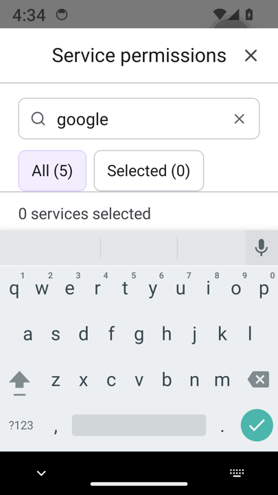
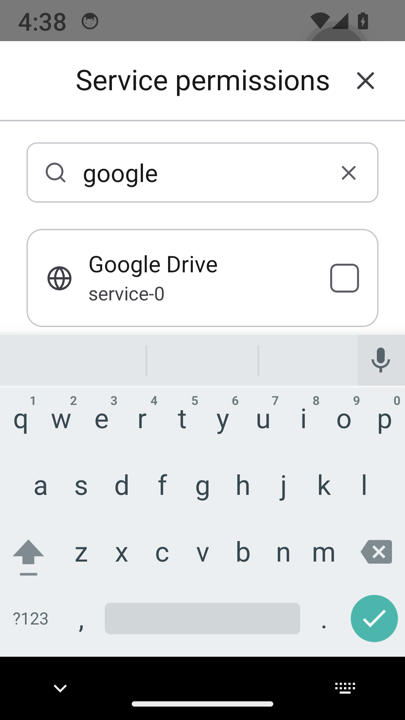
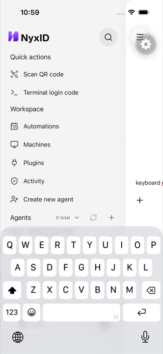
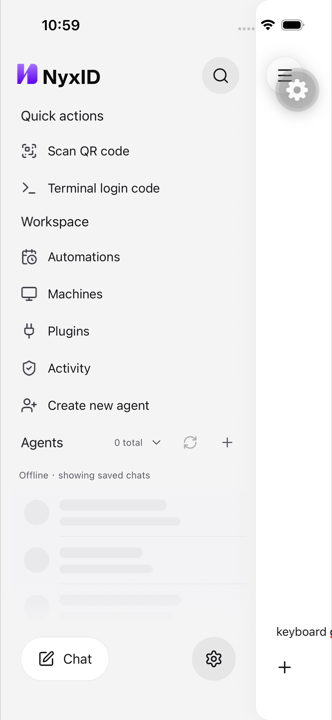
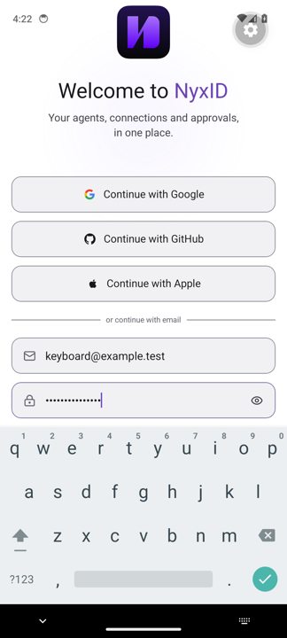
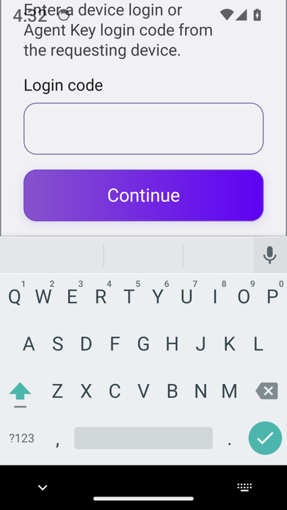

# Keyboard regression verification — 2026-11-20

Base: `upstream/main` at `b6d194f9927315b8170223ed4d02b2c5da428b3a`.

Tests use current branch source with native boundaries replaced only in the focused Node harness. Native checks use an isolated Expo/RN fixture, current production components and synthetic local data, with no real credentials or production writes. Android runtime: AOSP API 34, 1080×2400 at 420 dpi; stress: 1080×1920 at 560 dpi, font scale 1.3. This is representative native layout evidence, not a MIUI/FlyIME physical-device certification.

| Issue | Root cause and change | Evidence |
| --- | --- | --- |
| #2584 | Main already uses `KeyboardScrollView`. Android screen-coordinate frames were rejected against resized window height. IME frame height also omits navigation-bar height, leaving a strip of focused input behind the keyboard. Validate against the Android screen and lift the viewport bottom above an intersecting IME top on Android only. | Two resized-window regressions failed before repair; a navigation-strip regression failed 279 != 303. Native Password bottom changed from 1636 px (IME top 1604) to 1572 px. Email→Password focus, manual scroll and deterministic invalid-login feedback verified. |
| #2579 | Manual Modal used an iOS-only avoiding view and closed directly on Android Back. It now measures actual overlap, scrolls when short and hides the IME before dismissing on Back. | Back regression failed before repair. Native standard-window Continue 1163–1300 px above IME 1363; first Back retained modal/code. Small-window native scrolling reveals Continue 638–833 above IME 889 with keyboard retained. AOSP baseline resizes correctly, so the original complete MIUI coverage remains a physical-device retest. |
| #2702 | Fixed filters/footer and Android height avoidance left no visible search results. A measured viewport avoids duplicate reservation. Compact keyboard-visible windows temporarily hide explanation, tabs and footer; tall windows retain their normal controls. | Baseline native `google` search had no visible result and footer at 787 px. After repair Google Drive checkbox 614–869 above IME 889; selection, scroll and restore to Selected(1)/Use these permissions verified. Focused regression proves selection persists and only explicit save writes, including tall-window restoration. |
| #2647 | Sidebar reveal retained composer focus/keyboard. Menu, edge and collapsible wide-sidebar opening now dismiss the keyboard after navigation guards pass. | Baseline executable shell regression failed (0 dismissals vs 1); 61 navigation tests pass, including guarded opens, wide toggles and no navigation/draft replacement. Native iPhone 14 Pro QA (iOS 26.3.1): baseline leaves keyboard at y561 and hides bottom actions; repaired navigation dismisses keyboard and exposes New chat and Settings at y754. Settings opens; dismissing its sheet by dragging and closing navigation retains the synthetic draft. The reusable debug shell’s DevTools overlay interfered with the initial Close button hit, so that attempt is not counted as a successful Close-button regression. The fixture executes the actual App shell with a synthetic composer, mock session/network/storage, and the existing non-glass styling fallback because its reusable native binary lacks ExpoGlassEffect. |

## Focused validation

From `mobile/`:

```sh
node_modules/.bin/tsx --test --test-concurrency=1 src/components/workspace/keyboardOverlap.test.ts src/components/workspace/keyboardFrameEvents.test.ts src/components/workspace/KeyboardViewport.test.ts src/components/workspace/KeyboardScrollView.test.ts src/components/settings/SettingsPage.keyboard.test.ts src/features/auth/AuthHomeScreen.test.ts src/features/auth/DeviceLoginScreen.test.ts src/features/auth/rootEntryLayout.test.ts src/features/auth/loginRequests.test.ts src/features/agents/AgentPermissionsField.test.ts src/features/agents/AgentsScreen.permissions.test.ts src/app/AppDrawerNavigation.test.ts
```

Result: 389 passed, zero failed. The floating iPad keyboard case retains the original iOS intersection handling.

Scope analyzer: `python3 ~/.codex/skills/frontend-incremental-pr/scripts/frontend_change_scope.py --repo . --base upstream/main`.

Changed-file checks: `git diff --check`; TypeScript `createSourceFile` parse diagnostics over exactly the analyzer's TypeScript `staticCheckFiles`: 14 files, zero syntax diagnostics. Mobile has no configured affected typecheck/lint target. Full frontend suite, typecheck and production build are delegated to GitHub CI under the personal validation policy.

Source-only development bundles were served for native QA; no production build was run. Full screenshots and synthetic coordinate JSON are saved outside the repository under `/tmp/nyxid-bugs-1120/keyboard-qa/evidence/`. Scaled native screenshots are included below.

| Scenario | Before | After |
| --- | --- | --- |
| #2702 small-window permissions search |  |  |
| #2647 iOS navigation |  |  |




